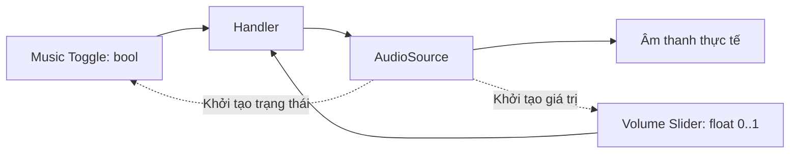

# Bài 06 — Tạo cài đặt âm thanh bằng Toggle và Slider

> **Creative Core · UI · Bài học + thực hành · Unity 6.3**  
> **Kết quả:** Bật/tắt nhạc nền và điều chỉnh âm lượng bằng các điều khiển UI đồng bộ với AudioSource.

## 1. Tổng quan và mục tiêu

`Button` phù hợp với hành động một lần; `Toggle` thể hiện trạng thái nhị phân; `Slider` điều chỉnh một giá trị liên tục hoặc theo bước. Một menu cài đặt âm thanh điển hình cần hiển thị đúng trạng thái nhạc và mức âm lượng ngay khi vừa mở, không chỉ phản ứng sau lần kéo đầu tiên.

Sau bài này, người học có thể chọn điều khiển thích hợp, kết nối `onValueChanged` với `AudioSource`, thiết lập khoảng giá trị và đồng bộ UI với trạng thái ứng dụng.

## 2. Toggle, Slider và nguồn dữ liệu

| Điều khiển | Kiểu dữ liệu | Sự kiện | Ứng dụng |
| --- | --- | --- | --- |
| `Toggle` | `bool` | `onValueChanged(bool)` | Bật/tắt nhạc, ánh sáng, hiển thị đối tượng |
| `Slider` | `float` | `onValueChanged(float)` | Âm lượng, độ sáng, tốc độ quay |
| `Button` | Không có giá trị liên tục | `onClick()` | Mở bảng, xác nhận, reset |

Đối với Slider điều khiển `AudioSource.volume`, cấu hình `Min Value = 0`, `Max Value = 1`, và bỏ chọn `Whole Numbers`. Trong API của AudioSource, `volume` nằm trong khoảng 0–1; không nên dùng mức 0–100 trực tiếp mà quên chuẩn hóa.



Mũi tên nét đứt chỉ quá trình đọc trạng thái ban đầu để gán cho điều khiển. Tránh tình trạng nhạc đang phát ở mức 0.4 nhưng tay kéo Slider hiển thị ở 0.

## 3. Lab A — Thiết lập bằng Inspector

1. Trong `Settings Menu`, tạo `UI > Toggle`, đổi tên thành `Music Toggle` và đặt nhãn “Âm nhạc” (có thể thay nhãn Text legacy bằng TextMeshPro).
2. Thêm `Audio Source` vào scene, chọn một AudioClip hợp pháp và đặt `Play On Awake`/`Loop` phù hợp.
3. Để thử an toàn, bắt đầu với `AudioSource.volume` khoảng 0.25–0.50 (mức minh họa, không phải chuẩn bắt buộc).
4. Trong `Music Toggle > On Value Changed (Boolean)`, nhấn `+`, kéo AudioSource GameObject vào đối tượng đích, chọn **AudioSource > enabled** ở phần thuộc tính động nhận `bool`.
5. Tạo `UI > Slider` trong menu, đổi tên `Volume Slider`; thêm nhãn “Âm lượng” bằng TextMeshPro.
6. Trong `Slider > On Value Changed (Single)`, gắn AudioSource và chọn thuộc tính `AudioSource.volume` nhận đối số động kiểu `float`.
7. Đặt `Slider.Value` ban đầu bằng volume hiện tại của AudioSource; đồng bộ Toggle theo trạng thái phát dự định. Kiểm tra bật/tắt và kéo thanh trong Play mode.

Nếu tùy biến luồng âm thanh phức tạp, nên dùng C# để quản lý trạng thái thay vì liên kết nhiều giá trị tới nhiều đối tượng riêng rẽ.

## 4. Lab B — Đồng bộ qua C#

Ví dụ sau dùng `AudioSource.mute` để tắt tiếng mà không phải disable component. Khi bật lại, âm thanh có thể tiếp tục theo vị trí phát nếu AudioSource vẫn đang phát; điều này khác cách bật/tắt `AudioSource.enabled` trong thực hành Inspector.

```csharp
using UnityEngine;
using UnityEngine.UI;

public class AudioSettingsUI : MonoBehaviour
{
    [SerializeField] private AudioSource musicSource;
    [SerializeField] private Toggle musicToggle;
    [SerializeField] private Slider volumeSlider;

    private void Awake()
    {
        if (musicSource == null || musicToggle == null || volumeSlider == null)
        {
            Debug.LogError("Chưa gán đủ tham chiếu Audio Settings UI.", this);
            enabled = false;
            return;
        }

        volumeSlider.minValue = 0f;
        volumeSlider.maxValue = 1f;
        volumeSlider.wholeNumbers = false;
        musicToggle.SetIsOnWithoutNotify(!musicSource.mute);
        volumeSlider.SetValueWithoutNotify(musicSource.volume);
    }

    private void OnEnable()
    {
        if (musicToggle != null)
            musicToggle.onValueChanged.AddListener(SetMusicEnabled);
        if (volumeSlider != null)
            volumeSlider.onValueChanged.AddListener(SetVolume);
    }

    private void OnDisable()
    {
        if (musicToggle != null)
            musicToggle.onValueChanged.RemoveListener(SetMusicEnabled);
        if (volumeSlider != null)
            volumeSlider.onValueChanged.RemoveListener(SetVolume);
    }

    public void SetMusicEnabled(bool isOn)
    {
        if (musicSource != null) musicSource.mute = !isOn;
    }

    public void SetVolume(float value)
    {
        if (musicSource != null)
            musicSource.volume = Mathf.Clamp01(value);
    }
}
```

Gắn component lên một GameObject luôn active và liên kết các đối tượng trong Inspector. Với bài thực hành này, **xóa các listener cài đặt sẵn trên Toggle và Slider** nếu dùng phương án đăng ký qua code, để tránh quản lý cùng một trạng thái bằng hai cơ chế trùng lặp.

`SetIsOnWithoutNotify` và `SetValueWithoutNotify` thiết lập giá trị khởi tạo mà không phát sự kiện thay đổi cho các listener. Điều này tránh callback không cần thiết khi đồng bộ giao diện lúc vào scene. Nếu trạng thái âm thanh có thể thay đổi từ nơi khác, xây dựng hàm `RefreshUI()` và gọi khi menu hiển thị để cập nhật lại.

## 5. Lưu trữ và UX (mở rộng)

Dữ liệu trong ví dụ hiện chỉ tồn tại trong phiên chạy, chưa tự lưu qua lần mở game khác. Nếu cần lưu cài đặt, có thể dùng `PlayerPrefs` cho một số thuộc tính nhỏ, nhưng phải đọc giá trị đã lưu và cập nhật `AudioSource` **trước** khi đồng bộ UI. Không dùng `PlayerPrefs` để lưu dữ liệu nhạy cảm.

Người dùng cần được nhận biết số lượng và mức độ điều chỉnh. Có thể thêm nhãn phần trăm, nút tắt âm nhanh và khả năng điều hướng bằng bàn phím/tay cầm; tuy nhiên âm lượng nghe cảm nhận không tuyến tính hoàn toàn với giá trị Slider, nên sản phẩm thực tế có thể cân nhắc `AudioMixer` và quy đổi phù hợp.

## 6. Kiểm thử và sửa lỗi

| Tình huống | Kết quả kỳ vọng | Hướng kiểm tra nếu sai |
| --- | --- | --- |
| Mở menu | Toggle và Slider khớp trạng thái nguồn âm thanh | Đồng bộ trong `Awake` hoặc `RefreshUI` |
| Tắt Toggle | Nhạc tắt tiếng hoặc AudioSource ngừng theo phương án chọn | Kiểm tra `On Value Changed` và tham chiếu |
| Kéo Slider 0 → 1 | Âm lượng đổi trong khoảng hợp lệ | `Min/Max`, `Whole Numbers`, `onValueChanged` |
| Chỉnh Slider khi Toggle off | Volume lưu giá trị mới nhưng vẫn mute | Kiểm tra việc phân biệt `mute` và `volume` |
| Quay lại menu | Điều khiển vẫn thể hiện giá trị hiện tại | Đảm bảo không tự reset vô tình |

## 7. Câu hỏi ôn tập

**Câu 1.** Điều khiển nào phù hợp nhất với bật/tắt nhạc?  
A. Image  
B. Toggle  
C. RectTransform  
D. Camera  
**Đáp án: B.** **Giải thích:** Toggle biểu diễn một trạng thái Boolean.

**Câu 2.** Kiểu đối số của `Slider.onValueChanged` là gì?  
A. String  
B. Sprite  
C. Transform  
D. Float  
**Đáp án: D.** **Giải thích:** Slider phát giá trị số thực theo khoảng cấu hình.

**Câu 3.** Khi âm lượng nguồn đang là 0.3 nhưng slider hiển thị 0, giải pháp đầu tiên là gì?  
A. Khởi tạo `Slider.Value` bằng `AudioSource.volume`  
B. Xóa Canvas  
C. Đổi shader  
D. Chuyển sang Orthographic Camera  
**Đáp án: A.** **Giải thích:** Điều khiển phải phản ánh trạng thái hệ thống ngay từ đầu.

**Câu 4.** Sự khác nhau quan trọng giữa `mute` và `volume = 0` là gì?  
A. `mute` tạo AudioSource  
B. `volume = 0` xóa clip  
C. `mute` tắt tiếng mà vẫn giữ nguyên mức volume đang cấu hình  
D. Không có khác biệt nào về trạng thái dữ liệu  
**Đáp án: C.** **Giải thích:** Tách trạng thái mute khỏi volume giúp nhớ mức âm lượng yêu thích.

**Câu 5.** Lý do dùng `SetValueWithoutNotify` khi đồng bộ UI ban đầu là gì?  
A. Cắt file âm thanh  
B. Đặt giá trị không phát sự kiện onValueChanged  
C. Tăng âm lượng vượt 1  
D. Thay thế EventSystem  
**Đáp án: B.** **Giải thích:** Có thể cập nhật UI mà không kích hoạt callback thay đổi ngoài ý muốn.

## 8. Tổng kết và tài liệu tham khảo

Toggle quản lý trạng thái có/không; Slider quản lý một mức giá trị; sự kiện `onValueChanged` chuyển thay đổi từ UI sang AudioSource. Một menu chất lượng phải đồng bộ trạng thái khi khởi tạo và qua mỗi lần chỉnh.

- [Unity Learn — Add toggles and sliders](https://learn.unity.com/pathway/creative-core/unit/creative-core-ui/tutorial/add-toggles-and-sliders-3?version=6.3)
- [Unity Technologies/uGUI — Toggle documentation](https://github.com/Unity-Technologies/uGUI/blob/main/com.unity.ugui/Documentation~/script-Toggle.md)
- [Unity Scripting API — Slider.onValueChanged](https://docs.unity.cn/2018.3/Documentation/ScriptReference/UI.Slider-onValueChanged.html)

*Bài học tiếng Việt tự biên soạn và đối chiếu tài liệu kỹ thuật; không phải bản dịch chính thức.*
