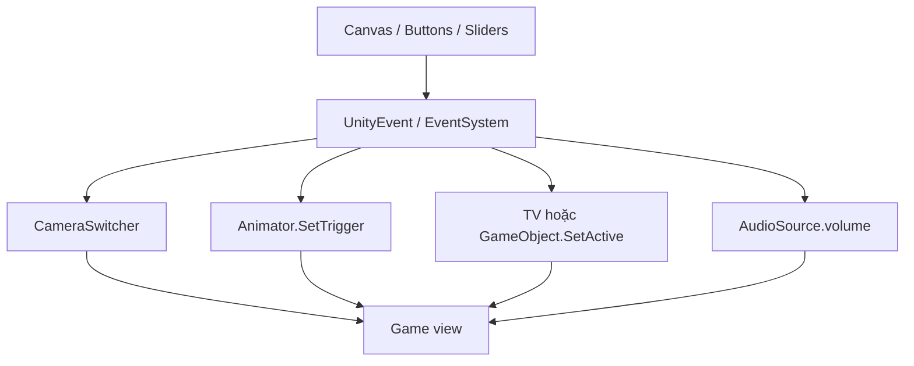

# Bài 08 — Áp dụng UI vào dự án Creative Core

> **Creative Core · UI · Guided project / Lab · Unity 6.3**  
> **Kết quả:** Bổ sung giao diện camera và các điều khiển liên quan tới đối tượng, animation hoặc audio trong một dự án 3D.

## 1. Bài toán và mục tiêu sản phẩm

Một scene 3D chỉ có hình ảnh đẹp chưa đủ trở thành trải nghiệm tương tác. Người xem cần biết có những góc nhìn nào, cách chuyển góc camera, và cách điều chỉnh hành vi của đối tượng. Trong dự án Creative Core, người học dùng `uGUI` để xây dựng các thao tác đó mà không làm xáo trộn ánh sáng, vật liệu, animation hoặc âm thanh đã thiết kế.

Sau bài này, người học có thể đọc yêu cầu UI của bản thiết kế, thiết lập luồng điều khiển nhiều camera, nối Button với đối tượng hoặc Animator, kiểm thử UI và ghi nhận sản phẩm hoàn chỉnh.

## 2. Đọc yêu cầu theo từng dự án

Creative Core đề xuất ba hướng guided project. Mỗi hướng có nhiệm vụ bắt buộc là **nút chuyển camera**; phần sáng tạo bổ sung giúp cá nhân hóa sản phẩm.

| Hướng dự án | Chức năng bắt buộc | Ý tưởng mở rộng theo dự án |
| --- | --- | --- |
| **Alien video game shop** | Nút chuyển giữa các góc camera | Nút kích hoạt animation nhảy, màn hình tiêu đề, thanh âm lượng |
| **Beachside town** | Nút chuyển giữa các góc camera | Nút kích hoạt animation cá heo, tiêu đề, thanh âm lượng |
| **Architectural rendering** | Nút chuyển giữa các góc camera | Nút bật/tắt TV, tiêu đề, thanh âm lượng |

Điểm chung của các dự án là **thao tác UI phải gây ra thay đổi quan sát được trong môi trường 3D**. Không nhất thiết thêm mọi loại control; cần chọn control đúng theo hành động.

## 3. Kiến trúc đề xuất



Sơ đồ phân tách UI (nơi người dùng bấm) và logic cảnh (nơi sự kiện được thực hiện). Hạn chế cho nhiều Button trực tiếp thực hiện những tổ hợp thao tác mâu thuẫn nhau nếu có thể gom lại thành một controller.

## 4. Lab — Thiết lập chuyển nhiều camera

### 4.1. Chuẩn bị scene

1. Trong scene chọn hai hoặc nhiều camera với góc nhìn khác nhau; đặt tên dễ hiểu, ví dụ `CameraOverview`, `CameraCloseUp`, `CameraDetail`.
2. Trong Canvas thêm `Button - TextMeshPro` tương ứng mỗi góc camera, chẳng hạn `Toàn cảnh`, `Cận cảnh`, `Chi tiết`.
3. Định nghĩa chính xác camera nào sẽ được hiển thị khi người dùng nhấn từng nút; thông thường chỉ một camera chính được bật tại một thời điểm nếu không chủ ý dùng compositing nhiều camera.
4. Kiểm tra `AudioListener`: scene thường chỉ cần một listener hoạt động; đừng để nhiều camera cùng kích hoạt nhiều listener ngoài ý muốn.

### 4.2. Script điều khiển camera

```csharp
using UnityEngine;

public class CameraSwitcher : MonoBehaviour
{
    [SerializeField] private Camera[] cameraViews;

    private void Start()
    {
        ShowCamera(0);
    }

    public void ShowCamera(int index)
    {
        if (cameraViews == null || index < 0 || index >= cameraViews.Length)
        {
            Debug.LogWarning("Chỉ số camera không hợp lệ.", this);
            return;
        }

        for (int i = 0; i < cameraViews.Length; i++)
        {
            if (cameraViews[i] != null)
                cameraViews[i].enabled = (i == index);
        }
    }
}
```

Đặt `CameraSwitcher` trên GameObject độc lập, gán danh sách `cameraViews` trong Inspector. Với mỗi Button, vào `On Click()`, chọn controller → `CameraSwitcher > ShowCamera(int)` và nhập chỉ số tương ứng (0, 1, 2...). Đây là **static argument** trong UnityEvent Inspector.

**Lưu ý về `Camera.main`:** thuộc tính này tìm camera đang enabled và có tag `MainCamera`; không nên mặc định rằng “camera duy nhất đang bật” sẽ tự trở thành `Camera.main` nếu không có tag thích hợp. Nếu script khác dựa vào `Camera.main`, cần thiết kế tagging/chuyển camera nhất quán. Với hệ thống nhiều camera phức tạp có thể dùng Cinemachine tùy nhu cầu, nhưng không bắt buộc ở bài học này.

### 4.3. Nối thêm tính năng theo dự án

- **Alien shop hoặc Beachside town:** tạo Button, trong `On Click()` gắn GameObject chứa `Animator`; gọi một phương thức wrapper kích hoạt `Animator.SetTrigger("Dance")` hoặc `Animator.SetTrigger("Dolphin")`. Tên trigger **phải đúng với tham số Animator Controller thực tế**, đây là ví dụ minh họa.
- **Architectural rendering:** gắn Button/Toggle để gọi `SetActive(true/false)` trên TV, hoặc enable/disable component theo cách dựng TV trong dự án. Nếu TV chỉ cần đổi trạng thái, Toggle thường truyền đạt trạng thái rõ hơn Button.
- **Âm thanh:** thêm Slider với miền 0–1; gắn sự kiện động vào `AudioSource.volume`, khởi tạo Slider khớp volume ban đầu.

Một ví dụ wrapper cho animation:

```csharp
using UnityEngine;

public class DemoAnimationTrigger : MonoBehaviour
{
    [SerializeField] private Animator targetAnimator;
    [SerializeField] private string triggerName = "Dance";

    public void PlayAction()
    {
        if (targetAnimator != null && !string.IsNullOrWhiteSpace(triggerName))
            targetAnimator.SetTrigger(triggerName);
    }
}
```

Tham chiếu `Animator`, tên trigger và transition trong Animator Controller phải được người học cấu hình cho phù hợp với nhân vật và clip thực tế.

## 5. Milestone, kiểm thử và tiêu chí hoàn thành

| Mốc | Công việc | Kết quả phải quan sát được |
| --- | --- | --- |
| 1 | Kiểm tra design document của dự án | Liệt kê chức năng UI cụ thể cần xây dựng |
| 2 | Thêm Canvas và điều khiển camera | Có nút cho mỗi góc nhìn dự kiến |
| 3 | Gắn sự kiện điều hướng | Mỗi nút chọn đúng camera |
| 4 | Chọn một phần mở rộng | Animation, TV hoặc audio thay đổi thực sự |
| 5 | Kiểm tra đa độ phân giải | Menu không tràn và các nút dễ bấm |
| 6 | Đóng gói | Scene/build, ảnh chụp, ghi chú kiểm thử |

**Definition of Done:** không có lỗi nghiêm trọng trong Console, các nút hoạt động ở Play mode, có ít nhất hai góc camera được chuyển đúng, phần điều khiển mở rộng phản hồi xác định được, và UI giữ bố cục trên các màn hình mục tiêu.

## 6. Các lỗi thường gặp

| Triệu chứng | Cách phân tích |
| --- | --- |
| Nhấn đổi camera nhưng vẫn hiện góc cũ | Kiểm tra chỉ số int trên UnityEvent, `Camera.enabled`, camera depth/stack nếu dùng |
| `Camera.main` trả `null` | Xem tag `MainCamera` và trạng thái enabled |
| Cảnh mất tiếng hoặc báo nhiều AudioListener | Kiểm tra listener trên mỗi camera |
| Nút kích hoạt animation không chạy | Kiểm tra tên trigger, state/transition, target Animator |
| Toggle TV không hiệu quả | Kiểm tra đối tượng đang bị tắt ở cấp cha hoặc logic phát nội dung TV |
| UI đè mất chi tiết cảnh | Sửa bố cục, anchor, kích thước và độ trong suốt |

## 7. Câu hỏi ôn tập

**Câu 1.** Dự án cần đổi giữa ba góc quay bằng Button. Lựa chọn nào hợp lý nhất?  
A. Một class điều phối việc enable camera theo chỉ số  
B. Đổi FOV của tất cả camera ngẫu nhiên  
C. Xóa tất cả camera trừ một  
D. Tắt Canvas  
**Đáp án: A.** **Giải thích:** Controller tập trung quản lý camera và tránh trạng thái xung đột.

**Câu 2.** Vì sao không nên giả định `Camera.main` tự cập nhật theo bất kỳ camera enabled duy nhất nào?  
A. Vì Camera.main là kiểu bool  
B. Vì Camera.main chỉ hoạt động trên mobile  
C. Vì còn điều kiện tag `MainCamera`  
D. Vì Canvas luôn đi trước Camera  
**Đáp án: C.** **Giải thích:** `Camera.main` được xác định thông qua camera mang tag tương ứng.

**Câu 3.** Muốn kích hoạt một animation đã thiết kế với trigger trong Animator Controller, API nào thích hợp?  
A. `Image.Type`  
B. `Animator.SetTrigger()`  
C. `AudioSource.volume`  
D. `RectTransform.anchorMin`  
**Đáp án: B.** **Giải thích:** Animator.SetTrigger đặt tham số trigger để điều kiện transition có thể chạy.

**Câu 4.** Khi nhiều camera có AudioListener hoạt động đồng thời, nên làm gì?  
A. Tăng Alpha  
B. Thêm nhiều listener hơn  
C. Xóa EventSystem  
D. Chỉ duy trì listener phù hợp cho cấu hình âm thanh mong muốn  
**Đáp án: D.** **Giải thích:** Nhiều AudioListener hoạt động cùng lúc thường gây cảnh báo và xử lý âm thanh không đúng.

**Câu 5.** Một UI “đã làm xong” nhưng nút không đổi camera khi Play. Điều gì còn thiếu?  
A. Tài liệu font  
B. Kiểm tra animation VFX  
C. Kiểm thử chức năng và xác minh UnityEvent/controller  
D. Phông chữ đậm hơn  
**Đáp án: C.** **Giải thích:** Thành phẩm phải thỏa mãn hành vi, không chỉ mặt hình thức.

## 8. Tổng kết và tài liệu tham khảo

Sản phẩm cuối cho phép người dùng chủ động khám phá môi trường 3D bằng các góc nhìn và điều khiển được thiết kế riêng. Dùng UI như một lớp điều khiển rõ ràng; giữ logic camera, animation và audio ở các component phù hợp.

- [Unity Learn — Apply UI to your guided project](https://learn.unity.com/pathway/creative-core/unit/creative-core-ui/tutorial/apply-ui-to-your-guided-project-3?version=6.3)
- [Unity Learn — Creative Core UI Mission](https://learn.unity.com/pathway/creative-core/unit/creative-core-ui?version=6.3)

*Bài học tiếng Việt tự biên soạn và bổ sung ví dụ kỹ thuật; không phải bản dịch chính thức.*
