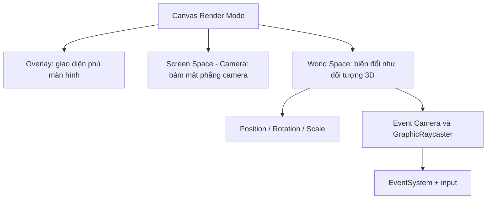

# Bài 07 — Thử thách: Thiết kế giao diện trong không gian 3D (World Space UI)

> **Creative Core · UI · Exercise · Unity 6.3**  
> **Sản phẩm:** Một bảng tương tác tồn tại như vật thể 3D trong scene, giữ chức năng mở menu, tắt/bật âm thanh và chỉnh âm lượng.

## 1. Mục tiêu và bối cảnh

Trong nhiều game, giao diện không nhất thiết “dán” trên màn hình. Bảng điều khiển của phi thuyền, màn hình trên máy tính hoặc thiết bị cầm tay của nhân vật có thể là các đối tượng 3D. Loại giao diện này giúp người chơi tương tác tự nhiên hơn với thế giới trò chơi.

Đây là **bài tập tự thực hiện**, vì vậy tài liệu đưa yêu cầu, nguyên lý và gợi ý kiểm tra, không cung cấp sẵn toàn bộ lời giải.

Sau khi hoàn thành, người học có thể phân biệt ba Canvas Render Mode, chuyển UI từ screen-space sang world-space, lựa chọn vị trí trong cảnh, và kiểm chứng sự kiện click hoạt động bằng raycast.

## 2. Các chế độ Render Mode của Canvas

| Render Mode | Vị trí và hình thức | Trường hợp dùng |
| --- | --- | --- |
| `Screen Space - Overlay` | UI phủ lên hình ảnh render, không cần camera để định vị | Menu chính, HUD 2D |
| `Screen Space - Camera` | UI nằm trên mặt phẳng gắn với camera, có thể chịu tác động của thứ tự chiều sâu | Menu phối hợp với hiệu ứng camera |
| `World Space` | Canvas là mặt phẳng có transform 3D; kích thước trên màn hình phụ thuộc khoảng cách/góc nhìn | Tablet, bảng nút trên tường, bảng điều khiển trong game |

**World Space** không đồng nghĩa với “UI luôn hướng về camera”. Khi không có logic xoay bổ sung, Canvas giữ hướng trong thế giới như các đối tượng bình thường. Đây có thể là ưu điểm khi tạo bảng gắn trên tường, nhưng là một thách thức khi người chơi di chuyển.



**Diegetic UI và Non-diegetic UI.**

**Diegetic UI** là UI được tích hợp vào thế giới hư cấu, ví dụ đồng hồ trên cổ tay nhân vật. **Non-diegetic UI** là lớp thông tin dành riêng cho người chơi, ví dụ HUD điểm số. Cách phân loại này nói về quan hệ giữa UI và thế giới trò chơi, không chỉ phụ thuộc vào một tùy chọn kỹ thuật trong Unity.

## 3. Đề bài thực hành

### 3.1. Tình huống

Tạo một **trạm điều khiển năng lượng** trong bối cảnh 3D. Trên trạm có một bảng cài đặt dùng để bật/tắt nhạc và chỉnh âm lượng. Bảng cần xuất hiện ở vị trí hợp lý, đọc được khi camera nhìn tới và phản hồi chuột trong Game view.

Có thể thay đổi chủ đề thành tablet, bảng chỉ dẫn hay buồng lái, miễn đáp ứng các tiêu chí chức năng.

### 3.2. Yêu cầu bắt buộc

1. Scene được **nhân bản** từ bản hoạt động bình thường ở Screen Space; không ghi đè bản gốc.
2. Có một Canvas ở `Render Mode = World Space`, đặt ở vị trí 3D có chủ đích.
3. Menu giữ đầy đủ chức năng: mở cài đặt, đóng cài đặt, Toggle bật/tắt âm thanh, Slider chỉnh âm lượng.
4. UI có kích thước và hướng nhìn dễ quan sát; các nút không bị vật thể 3D che ngoài ý muốn.
5. Có ảnh hoặc video minh chứng cùng mô tả một trường hợp lỗi đã kiểm tra và cách sửa.

### 3.3. Điều kiện ràng buộc

Không được xử lý bài tập bằng cách chỉ giữ nguyên `Screen Space - Overlay` và đặt hình 3D đằng sau. Người học cần thực sự chuyển Canvas sang World Space và kiểm tra việc tương tác thông qua camera.

## 4. Gợi ý kỹ thuật (không phải lời giải hoàn chỉnh)

- Trong Project window chọn scene → `Ctrl + D` (Windows) hoặc `Cmd + D` (macOS) để nhân bản, đổi tên `UI_WorldSpace`.
- Trên `Canvas`, chọn `Render Mode = World Space` và gán camera phù hợp ở trường `Event Camera`.
- Sau khi chuyển mode, Canvas có thể trông rất lớn hoặc nằm ngoài khung nhìn. Điều chỉnh `RectTransform > Position`, `Rotation`, `Scale`. Bài hướng dẫn Unity dùng khoảng `Scale = (0.03, 0.03, 0.03)` như **điểm khởi đầu minh họa cho scene mẫu**, không phải giá trị đúng cho mọi dự án.
- Xác minh `GraphicRaycaster` trên Canvas, `EventSystem` và input module đang hoạt động. Với tia tương tác do camera tạo, vật thể 3D đứng giữa có thể che UI tùy cài đặt raycaster/blocking.
- Nếu không thể nhấn, đừng kết luận code của Button sai ngay: hãy xem Event Camera, hướng Canvas, khoảng cách, sorting, `Raycast Target` và đối tượng chặn ở phía trước.

## 5. Mốc thực hiện và sản phẩm cần nộp

| Mốc | Sản phẩm | Tiêu chí |
| --- | --- | --- |
| A. Sao lưu | Scene WorldSpace mới | Scene gốc vẫn chạy được |
| B. Không gian | Canvas nằm trong 3D | Xoay/di chuyển camera làm phối cảnh Canvas thay đổi |
| C. Giao diện | Bảng có tiêu đề, Button, Toggle, Slider | Chữ và biểu tượng đủ rõ |
| D. Tương tác | Các điều khiển hoạt động | Mở, đóng, tắt nhạc, chỉnh volume chính xác |
| E. Kiểm thử | Ảnh/video và ghi chú lỗi | Có thể tái hiện thử nghiệm |

Định dạng nộp khuyến nghị:

```text
UI_WorldSpace/
├── UI_WorldSpace.unity (trong Unity project)
├── screenshots/
│   ├── 01-camera-view.png
│   ├── 02-settings-open.png
│   └── 03-audio-controls.png
└── report.md
```

Không bắt buộc tên file đúng tuyệt đối; quan trọng là giáo viên hoặc người xem có thể hiểu, mở và xác minh kết quả.

## 6. Tiêu chí đánh giá (10 điểm)

| Tiêu chí | Điểm |
| --- | ---: |
| Canvas đúng World Space, đặt có chủ đích trong cảnh | 2 |
| Bố cục rõ và có phối cảnh 3D phù hợp | 2 |
| Button mở/đóng và Toggle/Slider hoạt động | 3 |
| Không bị che, nhận click ổn định từ camera | 2 |
| Minh chứng thử nghiệm và nhận xét lỗi | 1 |

**Mức nâng cao:** thêm chuyển động camera mượt khi tiếp cận bảng; tạo hiệu ứng nút nhấn có âm thanh; hoặc thêm panel có thể đọc từ nhiều góc nhìn. Các mở rộng này chỉ nên thực hiện sau khi nghiệm thu yêu cầu cốt lõi.

## 7. Câu hỏi tự kiểm tra

**Câu 1.** Một bảng 3D gắn trên bàn phải thay đổi kích thước trên màn hình khi camera tiến lại gần. Render Mode nào phù hợp nhất?  
A. Screen Space - Overlay  
B. World Space  
C. IMGUI  
D. Không cần Canvas  
**Đáp án: B.** **Giải thích:** World Space làm Canvas tham gia không gian 3D và phối cảnh camera.

**Câu 2.** Chuyển sang World Space khiến Canvas biến mất khỏi Game view. Nguyên nhân nên kiểm tra trước là gì?  
A. Texture bị xóa khỏi ổ đĩa  
B. Shader của tất cả đối tượng hỏng  
C. EventSystem tự động tắt light  
D. Vị trí, tỷ lệ và hướng Canvas so với camera  
**Đáp án: D.** **Giải thích:** Transform lúc chuyển mode có thể không phù hợp với kích thước cảnh.

**Câu 3.** Yếu tố nào thường cần thiết để Canvas World Space nhận tương tác con trỏ?  
A. Event Camera và GraphicRaycaster thích hợp  
B. Rigidbody trên mỗi nút  
C. Particle System  
D. Baked Lightmap  
**Đáp án: A.** **Giải thích:** Raycasting và hệ thống sự kiện giúp chuyển input tới graphic đúng vị trí.

**Câu 4.** Khái niệm diegetic UI chủ yếu thể hiện điều gì?  
A. UI chỉ dùng tiếng Anh  
B. UI luôn nằm trong World Space ở mọi ứng dụng  
C. UI tồn tại trong thế giới hư cấu, như một bảng mà nhân vật có thể thấy  
D. UI không có văn bản  
**Đáp án: C.** **Giải thích:** Diegetic mô tả vai trò của UI trong thế giới trò chơi, không chỉ là kỹ thuật render.

**Câu 5.** Đâu là kết quả đánh giá đạt yêu cầu?  
A. Có một screenshot đẹp nhưng Button không thể click  
B. Canvas World Space rõ ràng và mọi chức năng thực hiện được  
C. Đặt Canvas thật xa, không nhìn thấy  
D. Tắt EventSystem để đỡ tốn tài nguyên  
**Đáp án: B.** **Giải thích:** Thử thách kiểm tra cả bố cục 3D lẫn chức năng tương tác.

## 8. Tài liệu tham khảo

- [Unity Learn — Challenge: Make a worldspace UI](https://learn.unity.com/pathway/creative-core/unit/creative-core-ui/tutorial/challenge-make-a-worldspace-ui-3?version=6.3)
- [Unity Manual — Canvas Render Modes](https://docs.unity.cn/520/Documentation/Manual/class-Canvas.html)
- [Unity Manual — Canvas Scaler](https://docs.unity.cn/2023.1/Documentation/Manual/script-CanvasScaler.html)

*Đề thực hành tiếng Việt tự biên soạn có đối chiếu hướng dẫn Unity; không phải bài nộp mẫu hoặc đáp án chính thức.*
