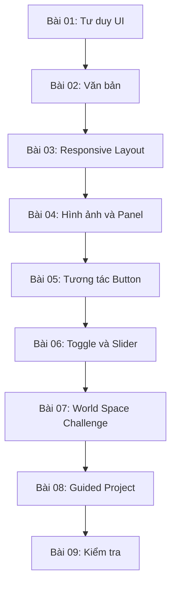

# Giáo trình Unity Creative Core — User Interfaces (tiếng Việt)

> **Học phần:** Creative Core / UI  
> **Tham chiếu:** Unity Learn, nhánh nội dung Unity 6.3  
> **Đối tượng:** Người mới học UI trong Unity, đã biết thao tác cơ bản với Scene, GameObject, Component và Inspector.

## 1. Giới thiệu

Bộ tài liệu gồm **9 bài Markdown độc lập** để học thiết kế giao diện tương tác bằng Unity UI (`uGUI`). Mỗi bài tập trung một nhiệm vụ và có kiến thức nền, thao tác trong Editor, ví dụ, lỗi thường gặp, kiểm thử và tài liệu tham khảo. Bài 07 là đề thử thách; bài 09 là bài đánh giá tự luyện chưa kèm đáp án.

**Lưu ý về nguồn:** Các file `.md` ban đầu là tài liệu tiếng Việt biên soạn ở mức dàn ý, không phải transcript chính thức. Nội dung được giảng lại theo 9 chủ đề đã cung cấp và mở rộng bằng Unity Learn/Unity Manual và ví dụ C# minh họa do người biên soạn viết. Không được hiểu là bản dịch chính thức, hoặc cho rằng đoạn code đã được Unity xác nhận chạy trên dự án cụ thể của người học.

## 2. Mục lục

| Bài | Nội dung | Đầu ra |
| --- | --- | --- |
| [01 — Nhập môn UI](01-Tutorials/001-get-started-with-user-interfaces.md) | UI, UX, vai trò Designer; uGUI, UI Toolkit, IMGUI | Scene nền cho menu |
| [02 — Tiêu đề TextMeshPro](01-Tutorials/002-add-a-title-to-your-scene.md) | Text, Font Asset, typography và khả năng đọc | Tiêu đề rõ ràng |
| [03 — Anchors và màn hình](01-Tutorials/003-manage-screen-size-and-anchors.md) | RectTransform, Pivot, Canvas Scaler | Giao diện thích ứng |
| [04 — Nền menu và Image](01-Tutorials/004-create-a-menu-background-with-images.md) | Sprite, Alpha, 9-slicing, draw order | Bảng cài đặt có hình nền |
| [05 — Button và điều hướng](01-Tutorials/005-add-basic-button-functionality.md) | EventSystem, UnityEvent, SetActive, MenuController | Mở/đóng Settings |
| [06 — Toggle và Slider](01-Tutorials/006-add-toggles-and-sliders.md) | AudioSource, Boolean, float, đồng bộ trạng thái | Cài đặt âm thanh |
| [07 — World Space UI](02-Exercises/007-challenge-make-a-worldspace-ui.md) | Ba Render Mode; diegetic UI; thử thách 3D | Scene world-space tương tác |
| [08 — Guided Project](01-Tutorials/008-apply-ui-to-your-guided-project.md) | Chuyển camera, Animator/TV/audio; kiểm thử | UI tích hợp vào dự án |
| [09 — Kiểm tra tổng hợp](03-Quizzes/009-creative-core-ui-quiz.md) | Câu hỏi, tình huống và bài thực hành | Tự đánh giá kiến thức |

## 3. Lộ trình thực hành

Sơ đồ cho thấy thứ tự phù hợp để tăng dần độ khó: xây dựng thành phần trực quan trước, thêm hành vi sau, rồi chuyển sang môi trường 3D và tích hợp với dự án.

## 4. Yêu cầu môi trường

- Unity Editor thuộc nhánh Unity 6 được sử dụng trong khóa Creative Core, ưu tiên phiên bản đã chọn trong project của bạn.
- Có `Unity UI (uGUI)` và TextMeshPro (thường có sẵn trong dự án có UI; import TMP Essentials khi Editor yêu cầu).
- Scene có `Camera`, `Canvas`, `EventSystem`; để làm bài âm thanh nên chuẩn bị AudioClip hợp pháp.
- Mở `Game view` cạnh `Scene view` để so sánh layout và hành vi.

**Lưu ý về phiên bản:** Vị trí menu và tên tùy chọn có thể được Unity cập nhật qua các phiên bản. Các bước được mô tả theo workflow của Unity Learn, có thể điều chỉnh theo giao diện Editor thực tế.

## 5. Quy tắc học tập

Sau mỗi bài, tự thực hiện ví dụ trước khi đọc mã mẫu, sau đó ghi ba mục: **kết quả mong đợi**, **kết quả chạy thật**, **nguyên nhân nếu khác nhau**. Với bài tập có EventSystem, luôn kiểm tra Console, state của GameObject, các tham chiếu trong Inspector và raycast trước khi sửa code.

## 6. Tài liệu nguồn chính

- [Unity Learn — Creative Core, Mission UI (6.3)](https://learn.unity.com/pathway/creative-core/unit/creative-core-ui?version=6.3)
- [Unity Learn — Creative Core: UI course](https://learn.unity.com/course/creative-core-ui?version=6.0)
- [Unity Manual — Canvas Scaler](https://docs.unity.cn/2023.1/Documentation/Manual/script-CanvasScaler.html)
- [Unity Manual — Basic Layout / RectTransform](https://docs.unity.cn/2023.2/Documentation/Manual/UIBasicLayout.html)
- [Unity Manual — Canvas Render Modes](https://docs.unity.cn/520/Documentation/Manual/class-Canvas.html)
- [Unity Technologies/uGUI — Multiple Resolution Design](https://github.com/Unity-Technologies/uGUI/blob/main/com.unity.ugui/Documentation~/HOWTO-UIMultiResolution.md)

*Cập nhật nội dung: 29/10/2026. Các đoạn mã C# và câu hỏi trong bộ tài liệu là ví dụ tự biên soạn; cần kiểm thử trong Unity project thực tế trước khi đưa vào sản phẩm.*
