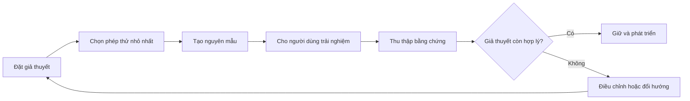

# Bài 01 — Khởi đầu với phương pháp xây dựng prototype

> **Creative Core · Prototyping · Bài học**

Prototype (nguyên mẫu) là phiên bản được tạo nhanh để kiểm chứng một câu hỏi thiết kế. Điều cần chứng minh là trải nghiệm có hoạt động và có giá trị hay không, không phải trông đã hoàn thiện hay chưa.

## 1. Mục tiêu học tập

Sau bài học, người học có thể phân biệt prototype với sản phẩm hoàn chỉnh; chọn câu hỏi cần kiểm chứng; tổ chức một vòng lặp tạo–thử–đánh giá; xác định tiêu chí dừng một lần thử nghiệm.

## 2. Vấn đề: tại sao không xây cả trò chơi ngay?

Một ý tưởng “khám phá pháo đài bí ẩn” có thể kéo theo mô hình 3D, âm thanh, nhiệm vụ, NPC và giao diện. Nếu người chơi không nhận ra nút mở cầu, công sức hoàn thiện các asset vẫn không giải quyết được vấn đề. Prototype giúp đưa giả thuyết rủi ro nhất lên trước.

**Ví dụ xuyên suốt:** người chơi đi trong sân pháo đài, bước lên bàn đạp để cấp nguồn cho nút, sau đó nhấn nút hạ cầu và ra ngoài. Câu hỏi kiểm chứng: *người chơi có suy luận được chuỗi hành động mà không cần được hướng dẫn từng bước không?*

## 3. Các mức độ trung thực của nguyên mẫu

| Hình thức | Nội dung kiểm chứng | Khi phù hợp |
|---|---|---|
| Phác thảo / paper prototype | Luồng hành động, quy tắc, ý tưởng bố trí | Chưa cần mở Unity |
| Greybox / whitebox | Tỉ lệ, khoảng cách, chuyển động, tương tác cơ bản | Cần thử trong không gian 3D |
| Functional prototype | Core mechanic đã hoạt động với phản hồi tối thiểu | Cần xác nhận khả thi kỹ thuật |
| Vertical slice | Một lát trải nghiệm gần mức chất lượng mục tiêu | Cần kiểm chứng chất lượng sản xuất; tốn kém hơn |

**MVP** (Minimum Viable Product) là khái niệm sản phẩm tối thiểu mang giá trị tới người dùng; không đồng nghĩa với mọi prototype. Prototype có thể chỉ là công cụ học hỏi nội bộ, chưa dành để phát hành.

## 4. Vòng lặp tư duy dựa trên giả thuyết

Điều quan trọng là ghi **giả thuyết, phép thử và quan sát** trước khi chỉnh sửa. Ví dụ: kỳ vọng 4/5 người thử nhận ra bàn đạp; thực tế chỉ 2/5; trước khi thêm hiệu ứng, cần xem góc nhìn hoặc vị trí vật thể có che khuất tín hiệu hay không. Các con số 4/5 và 2/5 ở đây chỉ là **ví dụ giả định**, không phải kết quả nghiên cứu.

## 5. Thực hành 15 phút

1. Viết một câu: “Tôi muốn kiểm chứng rằng…”.
2. Ghi ba hành động bắt buộc của người dùng và một điều kiện thành công.
3. Vẽ mặt bằng bằng ba khối: điểm xuất phát, chỗ tương tác, lối thoát.
4. Chọn một điểm có rủi ro cao (ví dụ: không nhìn thấy công tắc) và dự kiến cách quan sát trong thử nghiệm.
5. Lưu phiếu thử với bốn trường: giả thuyết, tác vụ, quan sát, thay đổi tiếp theo.

## 6. Những ngộ nhận cần tránh

Không đánh giá prototype bằng số lượng asset hoặc độ đẹp. Đừng cố kiểm chứng đồng thời hành vi AI, kiến trúc cấp độ, âm thanh và đồ họa. Khi một thử nghiệm thất bại, cần tìm hiểu nguyên nhân trước khi thêm nhiều tính năng. Việc đổi hướng (*pivot*) có thể là kết quả hữu ích của prototyping.

## 7. Tổng kết và tài liệu tham khảo

Bản prototype tốt trả lời được **một câu hỏi quan trọng với chi phí kiểm chứng thấp**. Hãy ưu tiên tương tác quan sát được, đo lường được và thay đổi nhanh.

- [Unity Learn – Creative Core: Prototyping](https://learn.unity.com/project/creative-core-prototyping)
- [Unity Learn – Mission Prototyping](https://learn.unity.com/pathway/creative-core/unit/prototyping?version=6.0)

## 8. Câu hỏi ôn tập trắc nghiệm

**Câu 1.** Khi nào greybox có lợi thế hơn bản phác thảo?

A. Khi chỉ định tên trò chơi  
B. Khi cần kiểm tra tỉ lệ và đường di chuyển trong không gian 3D  
C. Khi cần logo thương mại  
D. Khi cần giấy phép kinh doanh  

**Đáp án:** B
**Giải thích:** Greybox cho phép trải nghiệm trực tiếp vị trí và khoảng cách trong scene.

**Câu 2.** Mục đích quan trọng nhất của prototype ban đầu là gì?

A. Hoàn thiện mọi nhân vật  
B. Tối đa dung lượng game  
C. Kiểm chứng giả thuyết có rủi ro  
D. Thêm toàn bộ hiệu ứng  

**Đáp án:** C
**Giải thích:** Prototype nhằm giảm bất định trước khi đầu tư lớn.

**Câu 3.** Nếu người thử không phát hiện bàn đạp, hành động hợp lý trước tiên là gì?

A. Quan sát quá trình chơi và xác định vì sao họ bỏ qua  
B. Thêm 20 NPC  
C. Thay engine  
D. Xóa hết vật thể  

**Đáp án:** A
**Giải thích:** Cần tìm nguyên nhân từ quan sát, không đoán mò.

**Câu 4.** Khác biệt đúng giữa prototype và MVP là gì?

A. Hai khái niệm luôn giống nhau  
B. MVP luôn có đồ họa 3D  
C. Prototype bắt buộc phát hành trên store  
D. Prototype dùng để học và thử, MVP nhằm đem giá trị tối thiểu tới người dùng  

**Đáp án:** D
**Giải thích:** Prototype có thể là tài liệu hoặc thử nghiệm nội bộ.

**Câu 5.** Bước nào phải có trước khi mở rộng phạm vi?

A. Thêm nhiều texture  
B. Xác định giả thuyết và dấu hiệu thành công  
C. Tăng độ phân giải  
D. Đặt giá bán  

**Đáp án:** B
**Giải thích:** Không có tiêu chí thì khó kết luận thử nghiệm thành công hay thất bại.
