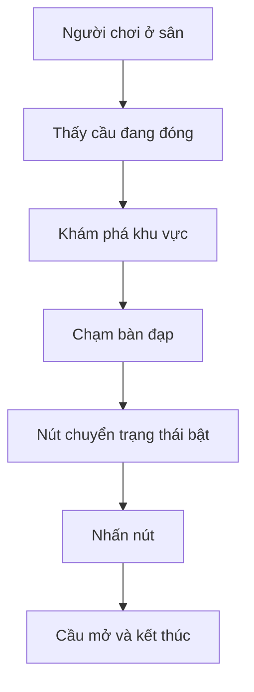

# Bài 03 — Lập kế hoạch và giới hạn phạm vi prototype

> **Creative Core · Prototyping · Thực hành**

Biến ý tưởng thành tập tương tác tối thiểu, kiểm tra bằng prototype trên giấy và lập kế hoạch triển khai có thứ tự ưu tiên.

## 1. Mục tiêu và chuẩn bị

**Đầu ra:** một bản mô tả một trang gồm mục tiêu, tương tác tối thiểu, giấy phác, phạm vi loại trừ, tiêu chí hoàn thành. Chuẩn bị giấy bút hoặc công cụ vẽ luồng, chưa bắt buộc mở Unity.

## 2. Phân rã tương tác và sự phụ thuộc

Chỉ giữ những hành động giúp người thử trải nghiệm giả thuyết chính. Ví dụ escape puzzle:

| Hành động | Phụ thuộc bắt buộc | Có trong bản đầu? |
|---|---|---|
| Di chuyển, nhìn quanh | Camera + bộ điều khiển nhân vật | Có |
| Bước lên bàn đạp | Collider trigger + thông báo trạng thái | Có |
| Nhấn nút | Kiểm tra tương tác + điều kiện bật | Có |
| Cầu hạ, người chơi đi qua | Trạng thái cầu + đường đi | Có |
| Hệ thống nhiệm vụ, lưu game, nhạc nền | Cải thiện mức hoàn thiện | Chưa |

**Minimum functional prototype** chỉ đủ chức năng để người dùng thực hiện chuỗi quan trọng, không nhất thiết là MVP thương mại.

## 3. Paper prototyping: thử trước khi code

Vẽ mặt bằng, đánh dấu vị trí người chơi và các đối tượng. Có thể dùng thẻ giấy làm nhân vật, biểu tượng làm nút, rồi mô phỏng phản ứng hệ thống khi thẻ di chuyển.

Đây là **luồng thiết kế**, không tự động tạo script Unity. Khi thử trên giấy, có thể phân vai người chơi, người hướng dẫn, “máy tính” mô phỏng luật chơi và người quan sát. Nếu thiếu người, có thể gộp vai, nhưng cần tránh việc người hướng dẫn vô tình mách lời giải.

## 4. Ưu tiên phạm vi bằng MoSCoW

| Nhóm | Ví dụ | Quyết định |
|---|---|---|
| Must have | Di chuyển, trigger, nút, mở lối | Không có thì chưa kiểm chứng được |
| Should have | Vật thể đổi màu, nhắc phím tương tác | Tăng khả năng đọc, làm khi còn thời gian |
| Could have | Tiếng mở cầu, bụi, ánh sáng | Có thể bỏ khỏi bản đầu |
| Won’t have now | Multiplayer, nhiệm vụ nhiều màn | Chủ động loại khỏi vòng thử này |

Ghi rõ “không làm trong lần này” là một quyết định thiết kế tích cực, không phải dự án còn thiếu.

## 5. Checklist thực hiện và checkpoint

1. Viết một câu hỏi kiểm chứng duy nhất.
2. Vẽ sơ đồ không gian với điểm xuất phát, tác vụ và kết thúc.
3. Liệt kê tương tác cùng phụ thuộc kỹ thuật.
4. Phân loại MoSCoW và cắt bỏ mục không bắt buộc.
5. Đặt hai checkpoint: **C1:** đi được trong greybox; **C2:** giải được chuỗi bàn đạp → nút → cầu.
6. Chạy paper test ngắn; ghi hành động người thử thực sự đã làm.
7. Chỉnh lại design brief theo quan sát, không chỉ theo sở thích cá nhân.

## 6. Bàn giao và tài liệu tham khảo

Sản phẩm cần có `prototype-brief.md`, `layout.png` hoặc `layout.md`, bảng tính năng và phiếu quan sát. Khi chuyển sang Unity, những mục **Must have** sẽ là Definition of Done của bản đầu.

- [Unity Learn – Plan and scope your prototype](https://learn.unity.com/tutorial/plan-and-scope-your-prototype-3?version=6.0)

## 7. Câu hỏi ôn tập trắc nghiệm

**Câu 1.** Tính năng nào thuộc nhóm Must have của ví dụ?

A. Multiplayer  
B. Skin nhân vật  
C. Tùy chỉnh độ phân giải  
D. Tương tác bật nút và mở cầu  

**Đáp án:** D
**Giải thích:** Đây là chức năng cần để kiểm chứng chuỗi giải đố.

**Câu 2.** Paper prototype giúp thử điều gì trước khi dựng scene?

A. Độ ổn định build Android  
B. Quy tắc và luồng tương tác  
C. Tốc độ nén texture  
D. Chi phí GPU chính xác  

**Đáp án:** B
**Giải thích:** Có thể kiểm tra logic và trải nghiệm mà không cần code.

**Câu 3.** Trong thử nghiệm trên giấy, người hướng dẫn nên làm gì?

A. Hạn chế câu hỏi gợi ý và quan sát cách người dùng quyết định  
B. Chỉ cho người chơi lời giải  
C. Thay đổi luật liên tục  
D. Đánh giá qua số khối 3D  

**Đáp án:** A
**Giải thích:** Dẫn dắt quá mức làm sai lệch bằng chứng.

**Câu 4.** Nhóm Won’t have now có ý nghĩa gì?

A. Không bao giờ làm  
B. Đã lỗi kỹ thuật  
C. Chủ động hoãn khỏi phạm vi thử hiện tại  
D. Phải hoàn thiện trước các nhóm khác  

**Đáp án:** C
**Giải thích:** Đây là quyết định quản lý phạm vi có thể thay đổi ở vòng sau.

**Câu 5.** Cách tổ chức checkpoint hữu ích nhất là?

A. Theo số asset mua  
B. Theo số lượng ảnh  
C. Theo màu nền  
D. Theo chức năng quan sát được khi chơi  

**Đáp án:** D
**Giải thích:** Checkpoint phải có dấu hiệu đạt/không đạt.
