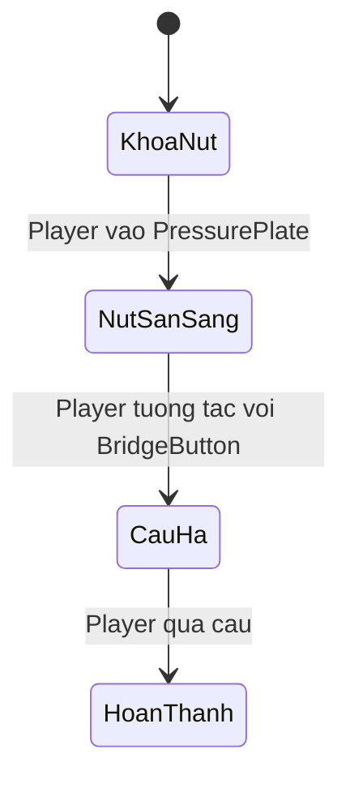

# Bài 04 — Dựng greybox prototype trong Unity

> **Creative Core · Prototyping · Thực hành**

Xây dựng bố cục không gian 3D bằng các khối đơn giản, bổ sung chuyển động và một chuỗi tương tác có thể kiểm thử.

## 1. Mục tiêu và thiết lập

**Mục tiêu:** có scene chạy được với sân, tường, bàn đạp, nút và cầu; người chơi di chuyển được, quan sát được trạng thái kích hoạt. Dùng dự án Unity 6 với template **Universal Render Pipeline (URP)** hoặc template tương thích, một scene lưu trong `Assets/Scenes/Prototype.unity`.

**Lưu ý:** nếu dùng project mẫu Unity Learn, scene `1-Greybox` và các component `OnInteract`, `OnTriggerEvent`, `Interact Handler` là **script tùy chỉnh trong project mẫu**, không phải component có sẵn trong mọi dự án Unity. Nếu tự tạo project trống, phải import đúng package/script hoặc tự xây hành vi tương đương.

## 2. Thiết kế kích thước và scene

Tạo `Plane` hoặc `Cube` làm sàn, các `Cube` cho tường/cửa và `Cylinder` làm bàn đạp. Duy trì tỷ lệ nhất quán; trong Unity thông thường **1 unit được quy ước gần 1 m** khi dùng physics và controller mặc định, nhưng đó là quy ước thiết kế chứ không phải giới hạn cứng của engine.

Ví dụ cấu trúc `Hierarchy`:

```text
PrototypeScene
├── Environment
│   ├── Floor
│   ├── Walls
│   └── Bridge
├── Interactables
│   ├── PressurePlate
│   └── BridgeButton
├── Player (controller + camera)
└── Lighting
```

Đặt tên có ý nghĩa; giữ các đối tượng tương tác ở vị trí người chơi có thể quan sát được. Giai đoạn này chưa cần texture tinh xảo.

## 3. Cấu hình controller và tài nguyên

Một controller góc nhìn thứ nhất có thể lấy từ Unity Starter Assets hoặc project ví dụ, nhưng phải đọc tài liệu đi kèm và kiểm tra phiên bản tương thích. Kiểm tra **Input System** nếu package yêu cầu; một số package cần **Cinemachine**, **ProBuilder** tùy tài nguyên được import.

Với scene mẫu Unity Learn, lệnh điều khiển minh họa là WASD hoặc phím mũi tên để di chuyển, chuột để nhìn, `E` hoặc nhấp để tương tác. Khi dùng controller khác, mapping có thể thay đổi — hãy kiểm tra Input Actions thực tế.

## 4. Tạo điều kiện kích hoạt rõ ràng

Logic tối thiểu:



Trong scene tự tạo, `PressurePlate` có `Collider` đánh dấu **Is Trigger**. Sự kiện trigger trong physics Unity yêu cầu thiết lập collider và Rigidbody/physics phù hợp; khi dùng character controller nhập sẵn cần thử trực tiếp sự kiện trong Play mode. `BridgeButton` cần phản hồi cho trạng thái khóa và đã bật (màu hoặc ký hiệu), tránh phụ thuộc hoàn toàn vào màu sắc.

Có thể dùng một đoạn C# nhỏ để phát UnityEvent khi người chơi đi vào vùng kích hoạt (cần một trong các đối tượng va chạm có Rigidbody phù hợp):

```csharp
using UnityEngine;
using UnityEngine.Events;

public class PressurePlateTrigger : MonoBehaviour
{
    [SerializeField] private UnityEvent onActivated;
    private bool activated;

    private void OnTriggerEnter(Collider other)
    {
        if (activated || !other.CompareTag("Player")) return;
        activated = true;
        onActivated?.Invoke();
    }
}
```

Đặt tag `Player` đúng lên Collider được sự kiện nhận diện, gán UnityEvent trong Inspector tới phương thức công khai phù hợp. Nếu game có nhiều Collider con, cần kiểm tra cách tag và sự kiện thực tế.

## 5. Thực hiện theo checkpoint

1. Tạo project, lưu scene và bật hệ thống quản lý phiên bản nếu có thể.
2. Thêm sàn, biên giới và hình khối cho đường đi; kiểm tra người chơi không rơi khỏi sân.
3. Import hoặc gắn player controller, thử đi/nhìn.
4. Thêm pressure plate, kiểm tra sự kiện trigger có phát sinh một lần.
5. Thêm nút chỉ hoạt động sau khi kích hoạt bàn đạp; gắn sự kiện hạ cầu bằng đổi trạng thái hoặc animation đơn giản.
6. Kiểm tra từ vị trí xuất phát mà không dùng Scene view để “gian lận” thông tin.
7. Lưu scene và ảnh chụp các trạng thái khóa → sẵn sàng → hoàn thành.

## 6. Gỡ lỗi và tiêu chí nghiệm thu

| Dấu hiệu | Kiểm tra ưu tiên |
|---|---|
| Đi xuyên tường | `Collider`, Layer Collision Matrix, vật thể có bị vô hiệu hóa? |
| Bàn đạp không kích hoạt | `Is Trigger`, physics setup, Tag của collider, Console |
| Nhấn nút không tác động | Tham chiếu UnityEvent / listener, trạng thái khóa, input mapping |
| Camera nhìn sai | Camera được gắn đúng player, transform, input |

**Hoàn thành khi:** người chơi di chuyển được, có ít nhất một hành động kích hoạt trạng thái, nhận thấy phản hồi và vượt qua cầu. Không yêu cầu hình ảnh đẹp.

## 7. Nguồn kỹ thuật

- [Unity Learn – Create your greybox prototype](https://learn.unity.com/course/creative-core-prototyping/tutorial/create-your-greybox-prototype-3?version=6.0)
- [Unity Docs – Create asset packages](https://docs.unity.com/en-us/engine/6000.3/manual/assets-and-media/asset-packages/create)

## 8. Câu hỏi ôn tập trắc nghiệm

**Câu 1.** Điểm đúng của greyboxing là gì?

A. Chỉ dùng model cuối cùng  
B. Ưu tiên khối đơn giản để thử bố cục và tương tác  
C. Không cần Play mode  
D. Không cần lưu scene  

**Đáp án:** B
**Giải thích:** Mục tiêu là kiểm chứng khả năng sử dụng và bố cục trước khi polish.

**Câu 2.** `OnTriggerEvent` trong ví dụ Unity Learn là gì?

A. Shader mặc định  
B. Một loại Terrain Layer  
C. Lệnh console  
D. Component tùy chỉnh của project mẫu  

**Đáp án:** D
**Giải thích:** Không phải component built-in có sẵn trong mọi project Unity.

**Câu 3.** Nguyên nhân có thể khiến bàn đạp không phát sự kiện?

A. Collider/trigger hoặc cấu hình physics chưa đúng  
B. Màu skybox tối  
C. Màn hình có nhiều pixel  
D. Hình khối màu xám  

**Đáp án:** A
**Giải thích:** Cần xác nhận đường đi sự kiện và collider.

**Câu 4.** Trong bản greybox, chức năng nào phải chạy được?

A. Shader phức tạp  
B. Multiplayer  
C. Chuỗi tương tác chính  
D. Kết xuất điện ảnh  

**Đáp án:** C
**Giải thích:** Chỉ cần cơ chế cốt lõi hoạt động.

**Câu 5.** Tại sao cần thử bằng Game view từ điểm xuất phát?

A. Để tiết kiệm pin  
B. Để quan sát như người chơi thay vì nhìn toàn scene  
C. Để thay project  
D. Để thêm package  

**Đáp án:** B
**Giải thích:** Scene view có thể khiến người thiết kế biết trước lời giải mà người chơi không thấy.
