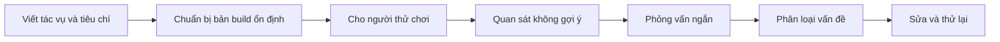

# Bài 08 — Kiểm thử prototype và cải tiến dựa trên bằng chứng

> **Creative Core · Prototyping · Thực hành**

Một bản prototype chỉ thực sự có giá trị khi được đưa vào tình huống kiểm thử nhằm quan sát người dùng và đo mức độ đạt mục tiêu thiết kế.

## 1. Mục tiêu và câu hỏi kiểm thử

Người học có thể xây kế hoạch playtest, phân biệt **lỗi kỹ thuật**, **khó dùng** và **không hấp dẫn**, ghi kết quả có cấu trúc, chuyển nhận xét thành công việc ưu tiên. Trước buổi thử, định nghĩa một số tác vụ quan sát được, không chỉ hỏi “bạn có thích không?”.

## 2. Chuẩn bị nhiệm vụ và chỉ số

Ví dụ kiểm thử câu đố hạ cầu:

| Nhiệm vụ | Quan sát | Dấu hiệu đánh giá |
|---|---|---|
| Tìm bàn đạp | Lộ trình, có bỏ qua không | Người chơi tự tìm mà không được nhắc |
| Xác định nút đã mở | Người chơi đọc trạng thái thế nào | Có nhận ra thay đổi không |
| Hạ cầu và thoát | Hành động cuối, lỗi va chạm | Hoàn tất chuỗi không mắc kẹt |

Các chỉ số thực dụng gồm tỷ lệ hoàn thành nhiệm vụ, số lần cần trợ giúp, thời gian và điểm vướng. Với ít người thử, số liệu chủ yếu mang tính **định tính/khám phá**, không đủ để khẳng định phổ quát về toàn bộ người chơi. Không áp đặt một ngưỡng thành công cố định từ ví dụ lớp học.

## 3. Tổ chức phiên playtest

1. Kiểm tra build trên máy gần với môi trường mục tiêu, bảo đảm scene và input hoạt động.
2. Nói rõ đây là kiểm thử **sản phẩm**, không phải kiểm tra khả năng của người thử.
3. Đưa nhiệm vụ trung lập: “Hãy tìm cách ra khỏi khu vực này.” Không nói “hãy tìm bàn đạp sau tường”.
4. Quan sát lối đi, thao tác sai, dừng lại và phản ứng của người chơi; có thể đề nghị người thử nói thành lời điều họ đang nghĩ, không ép nếu làm gián đoạn trải nghiệm.
5. Hỏi sau khi chơi: “Lúc nào bạn thấy khó hiểu?”, “Bạn mong điều gì xảy ra khi bấm nút?”
6. Ghi mọi phát hiện và xác định điểm cần sửa.

## 4. Phân loại bằng chứng và ưu tiên

| Loại phát hiện | Ví dụ | Cách xử lý |
|---|---|---|
| Bug | Bàn đạp không kích hoạt do collider | Sửa lỗi, tái kiểm thử |
| Usability | Không thấy nút đổi màu | Đổi vị trí, thêm tín hiệu không chỉ dựa màu |
| Experience | Câu đố quá dễ, không tạo khám phá | Sắp xếp lại chướng ngại/tầm nhìn |
| Performance | FPS giảm ở vùng nhiều cây | Profile, giảm mức chi tiết phù hợp |

Một báo cáo lỗi phải nêu **bước tái hiện → kết quả mong đợi → kết quả thực tế → phiên bản build → mức độ ảnh hưởng**. Mức ưu tiên cao dành cho lỗi chặn luồng chính hoặc vấn đề được nhiều người thử gặp, không phải chỉ cho ý kiến được nói to nhất.

## 5. Bài thực hành và checklist

- Chuẩn bị ít nhất một người thử không tham gia thiết kế; nếu có thể, thêm người đúng nhóm người dùng mục tiêu.
- Ghi hành trình thực tế, số lần cần trợ giúp và ít nhất ba nhận xét quan sát được.
- Chọn **một** cải tiến chính; lưu bản trước/sau và lặp lại tác vụ.
- Ghi rõ điều gì **chưa thể kết luận** khi mẫu thử còn ít.

**Hoàn thành:** có kế hoạch test, phiếu quan sát, ba phát hiện đã phân loại và một thay đổi được kiểm chứng.

## 6. Nguồn tham khảo

- [Unity Learn – Creative Core: Prototyping](https://learn.unity.com/project/creative-core-prototyping)
- [Unity Learn – Test your prototype](https://learn.unity.com/course/creative-core-prototyping/tutorial/test-your-prototype-3?version=6.0)

## 7. Câu hỏi ôn tập trắc nghiệm

**Câu 1.** Lời giao nhiệm vụ nào ít dẫn dắt nhất?

A. Bước lên bàn đạp ở góc trái rồi nhấn nút  
B. Nhấn phím E trên nút xanh  
C. Hãy tìm cách thoát khỏi khu vực  
D. Đi thẳng tới lối thoát  

**Đáp án:** C
**Giải thích:** Mô tả mục tiêu mà không tiết lộ cách giải.

**Câu 2.** Vì sao cần bản build ổn định trước buổi thử?

A. Để giảm nhiễu do lỗi cài đặt và thử đúng điều cần kiểm chứng  
B. Để ngăn người dùng nói  
C. Để tăng số NPC  
D. Để giảm số lượt quan sát  

**Đáp án:** A
**Giải thích:** Bản build lỗi dễ làm kết quả playtest không còn ý nghĩa.

**Câu 3.** Người thử không thấy nút đang mở là vấn đề nào?

A. Lỗi lưu file  
B. Usability/khả năng nhận tín hiệu  
C. Giấy phép asset  
D. Không có Terrain  

**Đáp án:** B
**Giải thích:** Hành vi có thể chạy đúng nhưng tín hiệu chưa đủ rõ.

**Câu 4.** Khi chỉ có hai người thử, kết luận phù hợp nhất là?

A. Hệ thống hoàn hảo  
B. Toàn bộ người dùng sẽ giống họ  
C. Dữ liệu không có ích  
D. Đây là phát hiện ban đầu cần xác nhận thêm  

**Đáp án:** D
**Giải thích:** Cỡ mẫu nhỏ phù hợp phát hiện vấn đề, không đủ khái quát.

**Câu 5.** Báo cáo bug hữu ích cần có gì?

A. Bước tái hiện cùng mong đợi và thực tế  
B. Cảm nhận chung không ví dụ  
C. Ảnh trang trí  
D. Tên vật phẩm đẹp  

**Đáp án:** A
**Giải thích:** Thông tin có cấu trúc giúp tái hiện và sửa lỗi.
