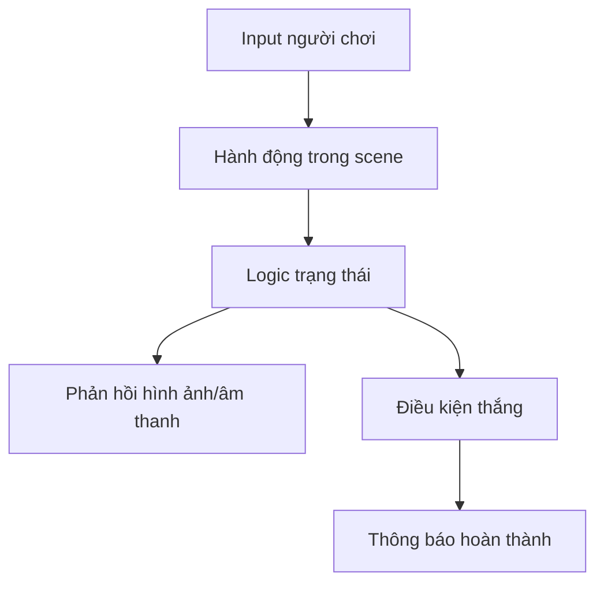

# Bài 09 — Thử thách: hoàn thiện dự án prototype độc lập

> **Creative Core · Prototyping · Dự án**

Thiết kế và triển khai một trải nghiệm tương tác nhỏ, có đầu vào, phản hồi, điều kiện kết thúc và bằng chứng kiểm thử. Đây là bài tập dự án, không phải phần giảng lý thuyết thuần túy.

## 1. Bài toán và mục tiêu sản phẩm

Chọn một trong các ý tưởng: câu đố thoát khỏi sân pháo đài, hành trình khám phá một triển lãm nhỏ hoặc cơ chế gom vật phẩm. Sản phẩm phải có **core loop** rõ ràng và có thể chơi từ đầu đến cuối mà người chấm không cần trực tiếp vận hành Unity Editor.

**Tình huống mẫu:** trong sân có cây cầu chưa mở, một bàn đạp bí mật và nút điều khiển. Người chơi tìm hiểu không gian, bật nút, hạ cầu, tới vùng đích. Chọn một mục tiêu chính và giữ toàn bộ thiết kế nhất quán với mục tiêu ấy.

## 2. Yêu cầu chức năng và phi chức năng

**Bắt buộc:**
1. Có điểm bắt đầu và trạng thái hoàn thành.
2. Người chơi thực hiện được hành động tương tác cốt lõi.
3. Có phản hồi nhìn/nghe phù hợp để biết hành động thành công hay thất bại.
4. Có thể khởi động lại lần thử một cách nhất quán.
5. Không có lỗi ngăn hoàn thành chuỗi chính trong lần kiểm tra cuối.

**Nên có:** ít nhất một cải tiến sau kiểm thử; ánh sáng và camera đủ rõ; asset có giấy phép phù hợp. **Không bắt buộc:** hệ thống tài khoản, mua bán, multiplayer, diễn hoạt phức tạp.

## 3. Kiến trúc tối thiểu và mốc bàn giao

- **Mốc A – Brief:** pitch, người dùng mục tiêu, câu hỏi kiểm chứng, phác thảo bản đồ.
- **Mốc B – Greybox:** player di chuyển và không xuyên địa hình/tường.
- **Mốc C – Functional:** các trạng thái khóa/mở/hoàn thành chạy đúng.
- **Mốc D – Playtest:** có phiếu quan sát và ít nhất một cải tiến.
- **Mốc E – Build:** chạy thử độc lập, README và bằng chứng.

## 4. Nhiệm vụ thực hiện

1. Tạo project Unity và lưu bản baseline.
2. Dựng môi trường bằng primitive, có thể thay một phần bằng ProBuilder/Terrain nếu phù hợp.
3. Thực hiện core loop và tín hiệu tương tác.
4. Thử lần đầu, ghi lỗi và những điểm người chơi bỏ qua.
5. Điều chỉnh ít nhất một yếu tố do thử nghiệm đề xuất.
6. Build tới nền tảng đích có sẵn; lưu sản phẩm và tài liệu hướng dẫn.
7. So sánh bản trước/sau theo **một tiêu chí đã định trước**.

## 5. Deliverable và Definition of Done

| Hạng mục | Minh chứng |
|---|---|
| Project nguồn | Thư mục Unity có thể mở, scene rõ tên, danh sách phụ thuộc |
| Bản build | Có thể khởi chạy đúng nền tảng đã chọn |
| README | Mục tiêu, cách chạy, điều khiển, bản Unity, hạn chế đã biết |
| Ảnh/video | Toàn bộ core loop với trạng thái đầu–giữa–cuối |
| Nhật ký kiểm thử | Test case, lỗi, biện pháp xử lý, kết quả lại |
| Asset inventory | Ghi nguồn và điều kiện sử dụng |

**Definition of Done:** người chấm có thể làm theo README, hoàn thành một lượt chơi, thấy ít nhất một phản hồi, và đối chiếu được cải tiến từ kiểm thử. Không có yêu cầu một mức đồ họa cụ thể.

## 6. Tự đánh giá và nguồn

Tự trả lời: nếu bỏ một cơ chế thì vẫn còn kiểm chứng được giả thuyết không? Phản hồi nào giúp người chơi nhận biết trạng thái? Có điều gì chỉ hoạt động trong Editor mà build không hoạt động?

- [Unity Learn – Creative Core](https://learn.unity.com/pathway/creative-core)
- [Unity Docs – Build Profiles](https://docs.unity.com/en-us/engine/6000.0/manual/building-and-publishing/build-settings/create-build-profile)
