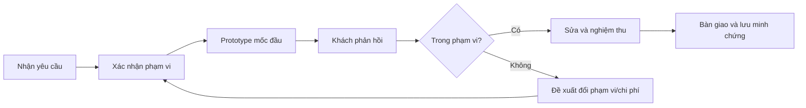

# Bài 11 — Khởi đầu làm freelance với kỹ năng sáng tạo thời gian thực

> **Creative Core · Prototyping · Bài học**

Làm freelance không chỉ là tạo scene đẹp mà còn là xác định đầu ra, quản lý kỳ vọng, phạm vi, giấy phép và quá trình bàn giao.

## 1. Mục tiêu học tập

Người học có thể định nghĩa một dịch vụ có phạm vi rõ ràng, lập đề xuất công việc và kế hoạch nghiệm thu, phân biệt deliverable với file nguồn, nhận diện rủi ro về bản quyền và sửa đổi ngoài phạm vi.

## 2. Chọn dịch vụ phù hợp năng lực ban đầu

Có thể bắt đầu từ các đầu việc nhỏ như dựng blockout level, tạo walkthrough nội thất, sửa bố cục scene, thiết kế UI prototype, setup ánh sáng cơ bản hoặc ghi video tương tác cho khách hàng. Cần phân biệt công việc **làm được** với công việc **đã kiểm thử đủ để cam kết**.

Một mô tả dịch vụ tốt: “Dựng greybox một khu vực 3D trong Unity, có di chuyển nhân vật và một tương tác cơ bản; bàn giao project và bản build Windows sau vòng kiểm thử thỏa thuận.” Không mô tả chung chung “làm mọi game bằng Unity”.

## 3. Làm rõ phạm vi trước khi nhận việc

Một brief nên có: mục tiêu trải nghiệm; platform; Unity version và render pipeline; asset khách cung cấp; số scene; tương tác; số vòng chỉnh sửa; deliverable; điều kiện nghiệm thu; quyền sử dụng tài nguyên; thời điểm phản hồi. Ví dụ:

| Thành phần | Ví dụ điều khoản kỹ thuật |
|---|---|
| Phạm vi | Một scene greybox, một nút tương tác |
| Ngoài phạm vi | Multiplayer, backend, nhân vật dựng riêng |
| Bàn giao | Project nguồn + bản build + README |
| Nghiệm thu | Người thử hoàn thành core loop theo checklist |
| Sửa đổi | Chỉ sửa theo số vòng/thời hạn được thỏa thuận |

**Báo giá** cần tính thời gian thực hiện, thời gian kiểm thử, giao tiếp, chỉnh sửa và rủi ro. Không có một mức giá chung đúng cho mọi thị trường hay hợp đồng.

## 4. Quy trình giao tiếp và kiểm soát thay đổi

Phản hồi “muốn thêm hệ thống tài khoản” sau khi đặt hàng greybox không phải chỉ là sửa màu; đó là yêu cầu thay đổi có thể ảnh hưởng giá, thời gian và trách nhiệm. Hãy xác nhận thay đổi bằng văn bản trước khi thực hiện.

## 5. Portfolio và bản quyền

Mỗi case study nên có vấn đề khách cần giải quyết, vai trò cá nhân, cách tiếp cận, video build chạy, điều đã kiểm chứng và phần giới hạn. Không đăng mã nguồn hoặc ảnh công việc có thỏa thuận bảo mật nếu chưa có quyền. Với asset từ Unity Asset Store hoặc bên thứ ba, đọc điều khoản cấp phép, phân biệt quyền tích hợp vào sản phẩm và quyền chuyển giao/tái phân phối asset gốc.

Hợp đồng và thuế có thể khác theo nơi cư trú và khách hàng; khi dự án có giá trị hoặc rủi ro lớn, cần hỏi người có chuyên môn pháp lý/tài chính thay vì suy đoán.

## 6. Bài thực hành và tổng kết

Viết một bản chào dịch vụ một trang: tiêu đề dịch vụ, đầu vào cần nhận, đầu ra bàn giao, điều kiện nghiệm thu, 3 mục không bao gồm và ví dụ thay đổi phạm vi. Đối chiếu lời hứa với demo prototype đã chạy thực tế.

- [Unity Learn – Creative Core](https://learn.unity.com/pathway/creative-core)
- [Unity Docs – Build and publish](https://docs.unity.com/en-us/engine/6000.0/manual/building-and-publishing)

## 7. Câu hỏi ôn tập trắc nghiệm

**Câu 1.** Mô tả freelance nào có phạm vi rõ?

A. Làm mọi thể loại game  
B. Một scene greybox, một tương tác, project + build + README  
C. Làm đẹp nhất thế giới  
D. Chỉ ghi “Unity developer”  

**Đáp án:** B
**Giải thích:** Có sản phẩm và điều kiện nghiệm thu cụ thể.

**Câu 2.** Yêu cầu thêm multiplayer khi hợp đồng chỉ có greybox nên xử lý thế nào?

A. Tự làm miễn phí lập tức  
B. Bỏ mọi việc  
C. Không thông báo  
D. Xác nhận thay đổi phạm vi trước khi thực hiện  

**Đáp án:** D
**Giải thích:** Thay đổi lớn cần đánh giá tác động và thống nhất.

**Câu 3.** Portfolio có NDA nên xử lý thế nào?

A. Chỉ công bố nội dung được phép  
B. Đăng toàn bộ scene khách  
C. Tải mã nguồn lên công khai  
D. Xóa tên khách là đủ  

**Đáp án:** A
**Giải thích:** Cần tuân thủ thỏa thuận và quyền công bố.

**Câu 4.** Deliverable nào hỗ trợ khách nghiệm thu?

A. File ảnh quảng cáo duy nhất  
B. Lời hứa miệng  
C. Build có thể chạy và README rõ ràng  
D. Tên tài khoản game  

**Đáp án:** C
**Giải thích:** Khách cần sản phẩm kiểm tra được.

**Câu 5.** Chi phí công việc freelance cần tính yếu tố nào?

A. Chỉ thời gian dựng model  
B. Thực hiện, kiểm thử, giao tiếp, chỉnh sửa và rủi ro  
C. Chỉ số lượng polygon  
D. Chỉ màu background  

**Đáp án:** B
**Giải thích:** Giá phải phản ánh toàn bộ khối lượng và rủi ro công việc.
