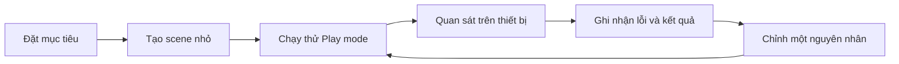

# Bài 01 — Chào mừng đến với lộ trình phát triển VR

## 1. Tổng quan

Phát triển thực tế ảo (Virtual Reality — VR) không chỉ là dựng một thế giới 3D. Ứng dụng phải theo dõi chuyển động đầu và tay, phản hồi đúng khi người dùng tương tác, cho phép di chuyển thoải mái và duy trì hình ảnh đủ ổn định trên thiết bị đích. Bài nhập môn này thiết lập cách học và tiêu chí kiểm chứng mỗi chức năng.

## 2. Mục tiêu học tập

- Mô tả được các thành phần tối thiểu của một trải nghiệm VR có tương tác.
- Phân biệt mục tiêu chức năng, mức độ thoải mái và hiệu năng.
- Thiết lập quy trình thử nghiệm–ghi nhận–sửa lỗi cho một scene nhỏ.

## 3. Một trải nghiệm VR được tạo thành như thế nào?

Trong Unity, **Scene** chứa các **GameObject**; mỗi GameObject nhận dữ liệu và hành vi thông qua **Component**. **XR Origin** đại diện gốc tọa độ cho người dùng XR, còn thiết bị theo dõi đầu và tay quyết định vị trí/góc quay tương ứng. **XR Interaction Toolkit (XRI)** cung cấp mô hình tương tác: **Interactor** (tay hoặc tia tương tác), **Interactable** (vật có thể tương tác) và thành phần điều phối tương tác.

Ví dụ: người dùng nhìn vào chiếc hộp, dùng tay ảo nhặt hộp rồi đặt lên bàn. Cần có scene, collider để xác định vùng chạm, cấu hình input chọn/nhả và một tương tác thực thi. Không nên đồng nhất việc nhìn thấy GameObject với việc đã có thể tương tác với nó.

## 4. Ba tiêu chí kiểm chứng

| Tiêu chí | Câu hỏi kiểm chứng | Ví dụ kết quả đạt |
|---|---|---|
| Tương tác | Người dùng chọn, cầm, thả vật được không? | Vật được chọn và di chuyển đúng theo tay |
| Thoải mái | Di chuyển có gây mất phương hướng? | Người dùng chọn Teleportation khi cần |
| Hiệu năng | Khung hình có ổn định trên thiết bị đích? | Không có hiện tượng giật rõ rệt khi thao tác |

**Teleportation** đưa người chơi đến vị trí mục tiêu trong một lần chuyển; **continuous movement** làm người chơi di chuyển liên tục. Hai cách tạo cảm giác khác nhau, vì thế cần thử nghiệm với đối tượng sử dụng. Với kính VR (HMD), giảm **overdraw** (vẽ chồng pixel), **draw call** và hiệu ứng đồ họa tốn tài nguyên thường là hướng tối ưu hữu ích.

## 5. Quy trình học theo vòng lặp



Sơ đồ cho thấy việc hoàn thành một chức năng không dừng ở thao tác cấu hình. Cần định nghĩa hành vi kỳ vọng, đo hoặc quan sát hành vi thực tế, rồi sửa có kiểm soát. Khi có sai khác, mở **Console**, kiểm tra **Inspector**, trạng thái GameObject, package và thiết lập input trước khi sửa mã.

## 6. Bài thực hành nhập môn

Tạo scene thử có mặt phẳng sàn, một vật thể có collider, XR Origin và hệ input tương thích dự án. Tiếp theo kiểm tra tương tác bằng tay trực tiếp hoặc tia, thử một cách di chuyển rồi quan sát độ mượt trên thiết bị hỗ trợ. Với mỗi lần thử, ghi lại theo mẫu:

```text
Mục tiêu: Nhặt và đặt được khối hộp
Kết quả mong đợi: Khối hộp theo tay và rơi khi nhả
Kết quả thực tế: ...
Minh chứng: ảnh Game view / video / Console
Giả thuyết lỗi và thay đổi đã thử: ...
```

Nếu không có kính VR, vẫn có thể chuẩn bị và kiểm tra cấu hình scene trong Editor; kết luận về độ thoải mái và hiệu năng thực tế cần được xác nhận trên thiết bị đích.

## 7. Câu hỏi ôn tập trắc nghiệm

### Câu 1

Một GameObject chỉ có mesh nhưng không có cấu hình tương tác. Nhận định nào đúng nhất?


A. Cần kiểm tra collider, Interactable và Interactor/input  

B. Vẫn cầm được vì đã hiển thị  

C. Chỉ cần tăng độ sáng  

D. Chỉ cần thêm âm thanh  


**Đáp án:** A. **Giải thích:** Hiển thị vật thể không tự tạo khả năng chọn và cầm.

### Câu 2

Tại sao không chỉ dựa vào FPS trong Unity Editor?


A. Editor luôn nhanh hơn kính VR  

B. Thiết bị đích có runtime và giới hạn hiệu năng khác  

C. FPS không liên quan VR  

D. Chỉ cần biết số GameObject  


**Đáp án:** B. **Giải thích:** Hiệu năng trên máy phát triển không đại diện hoàn toàn cho HMD.

### Câu 3

Teleportation phù hợp khi ưu tiên điều gì?


A. Di chuyển liên tục không ngắt  

B. Tăng số draw call  

C. Giảm chuyển động hình ảnh liên tục khi đổi vị trí  

D. Tắt XR Origin  


**Đáp án:** C. **Giải thích:** Dịch chuyển điểm đến giúp giảm chuyển động thị giác liên tục.

### Câu 4

Trong vòng lặp debug, thao tác nào nên thực hiện trước khi đổi nhiều cấu hình?


A. Xóa hết Component  

B. Thay phiên bản Unity ngay  

C. Xóa scene  

D. Tái hiện lỗi và đọc Console  


**Đáp án:** D. **Giải thích:** Cần thu thập dấu hiệu và khoanh vùng nguyên nhân.

### Câu 5

Vai trò của Component là gì?


A. Chứa hành vi hoặc dữ liệu gắn với GameObject  

B. Là tên khác của scene  

C. Là trình biên dịch  

D. Là file cài đặt Unity Hub  


**Đáp án:** A. **Giải thích:** Các chức năng GameObject được tổ chức bằng Component.

## 8. Tổng kết

Có thể đánh giá một tính năng VR qua **hành vi tương tác**, **mức thoải mái** và **hiệu năng trên thiết bị đích**. Mỗi bài thực hành nên có minh chứng quan sát được và một lượt tự kiểm tra lỗi.

---

**Học liệu đối chiếu:** [Unity Learn — VR Basics](https://learn.unity.com/pathway/vr-development/unit/vr-basics?version=6.3). Các ví dụ và bài tập là nội dung học tập tự biên soạn, không phải bài kiểm tra hoặc transcript chính thức.
