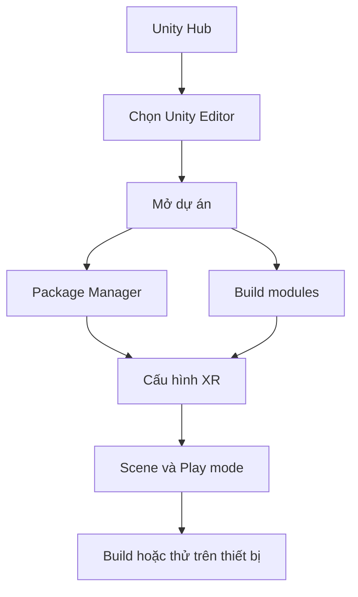

# Bài 02 — Thiết lập phần mềm phát triển VR

## 1. Tổng quan

Môi trường phát triển phải có phiên bản Unity nhất quán, các module build phù hợp và package hoạt động bình thường. Nếu thiếu một trong các thành phần này, các lỗi khi cấu hình XR có thể xuất phát từ công cụ chứ không phải logic trong scene.

## 2. Mục tiêu học tập

- Phân biệt chức năng của Unity Hub, Unity Editor và Package Manager.
- Kiểm tra được phiên bản Editor, build module và tình trạng package của dự án.
- Tạo, lưu, đóng và mở lại một dự án thử để xác nhận môi trường có thể tái lập.

## 3. Các lớp công cụ cần chuẩn bị

| Thành phần | Vai trò | Kiểm tra nhanh |
|---|---|---|
| **Unity Hub** | Quản lý phiên bản Editor và danh sách dự án | Tab **Installs** hiển thị phiên bản cần dùng |
| **Unity Editor** | Biên tập scene, GameObject, Component và chạy thử | Scene mở được, Console không có lỗi nghiêm trọng |
| **Build modules** | Hỗ trợ xây dựng ứng dụng cho nền tảng đích | Module phù hợp với PC hoặc Android được cài |
| **Package Manager** | Quản lý các gói phụ thuộc trong dự án | Gói cần thiết ở trạng thái hợp lệ |
| **XR runtime / OpenXR** | Kết nối khả năng XR với nền tảng chạy | Cấu hình tương thích thiết bị và dự án |

Không cài mọi build module chỉ để dự phòng. Trước hết cần xác định nền tảng đích và hướng dẫn của dự án. **Unity 6.3** là mốc phiên bản của lộ trình học này, không phải cam kết rằng các menu và package giữ nguyên trên mọi bản vá.

## 4. Các bước thiết lập và xác minh

1. Mở **Unity Hub → Installs**. Đối chiếu phiên bản Editor đang có với yêu cầu của dự án.
2. Cài hoặc bổ sung build module cho nền tảng muốn thử nghiệm. Dự án chạy trên kính độc lập thường cần quy trình build khác ứng dụng PC VR.
3. Tạo dự án thử từ template phù hợp; ghi nhận phiên bản Unity và render pipeline của dự án.
4. Mở **Unity Editor**. Chờ quá trình nhập asset và giải quyết package hoàn tất trước khi thao tác sâu.
5. Kiểm tra **Console** và **Package Manager**. Nếu package báo lỗi, xử lý phụ thuộc trước khi cấu hình tương tác.
6. Lưu scene, đóng Unity, sau đó mở lại từ Hub. Scene và các Component cần được giữ nguyên.

**Checkpoint:** Không có lỗi biên dịch cản trở Play mode, dự án mở lại bình thường và đã ghi rõ môi trường phát triển.

## 5. Sơ đồ quan hệ môi trường

Luồng này giúp xác định nơi cần tìm lỗi: dự án không mở được thường liên quan Editor/phiên bản; lỗi thiếu package cần xử lý trong quản lý phụ thuộc; ứng dụng chạy trong Editor nhưng không build được đòi hỏi kiểm tra module và cấu hình nền tảng.

## 6. Lỗi thường gặp và thực hành ngắn

**Tình huống 1:** Mở dự án bằng Editor không tương thích dẫn đến cảnh báo nâng cấp hoặc package lỗi. Hãy ghi nhận phiên bản dự án và kiểm tra khả năng tương thích trước khi chấp nhận thay đổi.

**Tình huống 2:** Không thấy tùy chọn build cho thiết bị mong muốn. Kiểm tra build modules đã cài qua Unity Hub và cài bổ sung nếu cần.

**Tình huống 3:** Dự án mở nhưng Play mode không chạy. Kiểm tra lỗi màu đỏ trong Console và trạng thái import packages.

Bài tập: Tạo scene tên `VR_Setup_Test`, lưu lại, chụp màn hình Console và ghi chú Editor version, render pipeline, các module đã cài. Đóng và mở lại dự án để kiểm chứng khả năng tái lập.

## 7. Câu hỏi ôn tập trắc nghiệm

### Câu 1

Thành phần nào chủ yếu quản lý các phiên bản Editor?

A. Unity Hub  

B. Scene  

C. Rigidbody  

D. XR Origin  

**Đáp án:** A. **Giải thích:** Unity Hub quản lý việc cài Editor và danh sách project.

### Câu 2

Vì sao cần chờ hoàn tất import khi mở dự án lần đầu?

A. Để tăng kích thước scene  

B. Để package và asset được xử lý xong  

C. Để Unity tự tạo game hoàn chỉnh  

D. Để tắt Console  

**Đáp án:** B. **Giải thích:** Dự án cần giải quyết asset và dependency trước khi chạy ổn định.

### Câu 3

Ứng dụng không có tùy chọn build Android: nơi kiểm tra đầu tiên?

A. Inspector của Camera  

B. Vị trí XR Origin  

C. Unity Hub và module Android  

D. Màu vật liệu  

**Đáp án:** C. **Giải thích:** Build module phải tồn tại trước khi cấu hình build.

### Câu 4

Cách kiểm chứng tốt nhất sau khi tạo dự án?

A. Chỉ xem tên project  

B. Xóa thư mục Library ngay  

C. Tắt mọi package  

D. Lưu scene, đóng rồi mở lại và kiểm tra Console  

**Đáp án:** D. **Giải thích:** Kiểm tra tái lập phát hiện lỗi cấu hình môi trường.

### Câu 5

Package Manager dùng để làm gì?

A. Quản lý phụ thuộc của dự án  

B. Chỉ để chụp ảnh  

C. Điều khiển tay VR trực tiếp  

D. Thiết lập ánh sáng trong scene  

**Đáp án:** A. **Giải thích:** Các gói tính năng và dependency được quản lý qua Package Manager.

## 8. Tổng kết

Một môi trường VR đáng tin cậy phải xác minh được **Editor**, **module build**, **package** và **khả năng mở lại dự án**. Hãy lưu bảng cấu hình môi trường cùng dự án để dễ xử lý lỗi về sau.

---

**Học liệu đối chiếu:** [Unity Learn — VR Basics](https://learn.unity.com/pathway/vr-development/unit/vr-basics?version=6.3). Các ví dụ và bài tập là nội dung học tập tự biên soạn, không phải bài kiểm tra hoặc transcript chính thức.
