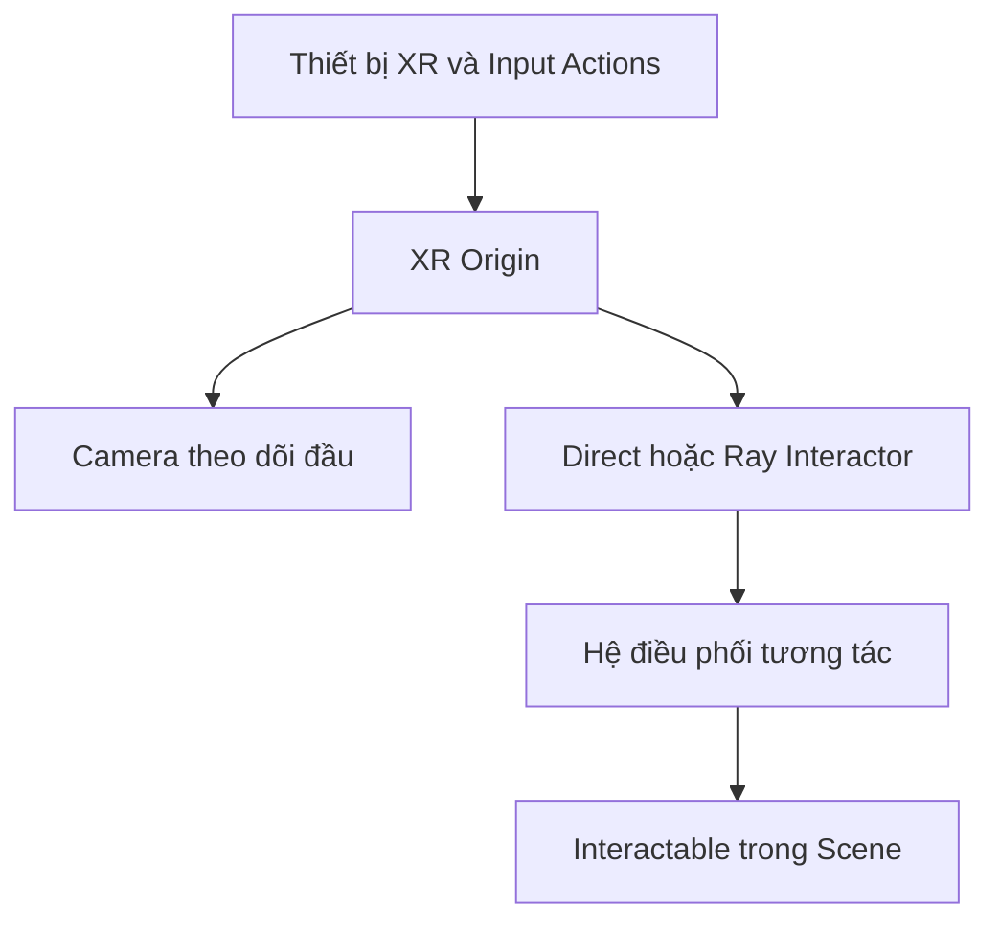

# Bài 03 — 1.1 — Thiết lập dự án VR

## 1. Tổng quan

Khi phần mềm đã cài đặt, bước tiếp theo là xây dựng một scene VR tối thiểu: thiết lập XR Origin, input, đối tượng tương tác và đường đi đến Play mode hoặc thiết bị đích. Mục tiêu là tạo bộ khung chạy được trước khi bổ sung nội dung phức tạp.

## 2. Mục tiêu học tập

- Giải thích được vai trò của XR Origin, Interactor, Interactable và thành phần điều phối tương tác.
- Tạo scene có sàn, XR Origin và một đối tượng tương tác thử.
- Khoanh vùng lỗi cấu hình XR bằng Console, input và Inspector.

## 3. Kiến trúc tối thiểu

Trong scene thông thường, một **Main Camera** cố định có thể đủ để quan sát thế giới. Trong VR, vị trí và hướng nhìn gắn với thiết bị theo dõi, vì vậy **XR Origin** tạo một hệ tọa độ gốc cho người dùng. Trên đó có thể gắn camera và các thành phần điều khiển tay theo cấu hình hỗ trợ.

**Interactor** đại diện nguồn tương tác (tay trực tiếp hoặc tia); **Interactable** là vật phản hồi; thành phần điều phối của XR Interaction Toolkit quản lý sự tương thích giữa chúng. **Input Actions** cần được kích hoạt và ánh xạ đúng để hành động chọn/nhả có hiệu lực.

Sơ đồ biểu diễn đường đi từ tín hiệu của người dùng đến GameObject. Mất input, thiếu Interactor hoặc thiếu Interactable đều có thể làm thao tác thất bại dù vật thể vẫn hiển thị.

## 4. Chuẩn bị scene thử

1. Tạo hoặc mở project VR với cấu hình package XR phù hợp phiên bản Editor.
2. Tạo scene mới và lưu bằng tên dễ nhận biết, ví dụ `VR_Interaction_Test`.
3. Thêm mặt sàn có collider và một vật thể đơn giản (khối lập phương) để làm đích thử nghiệm.
4. Thiết lập XR Origin và hệ input theo mẫu hỗ trợ của phiên bản XR Interaction Toolkit đang dùng.
5. Cấu hình tay trực tiếp hoặc tia (Direct/Ray Interactor); gắn thành phần Interactable thích hợp lên khối thử.
6. Vào Play mode hoặc chạy trên thiết bị tương thích. Quan sát camera theo chuyển động và thao tác tương tác trên vật.

**Điều kiện đạt:** Scene không có lỗi biên dịch nghiêm trọng; vật thể có thể được nhắm/chọn theo phương thức đã cấu hình; hình ảnh không bị lệch bất thường so với vị trí người chơi.

## 5. Bảng chẩn đoán lỗi

| Dấu hiệu | Phần cần kiểm tra | Cách xác nhận |
|---|---|---|
| Camera không theo thiết bị | XR Origin, runtime, tracking | Xem camera hierarchy và trạng thái XR |
| Không chọn được vật | Input Actions, Interactor, Interactable | Kiểm tra ánh xạ select và component đang bật |
| Tay xuyên vật | Collider, phạm vi direct interactor | Kiểm tra kích thước collider và vị trí tay |
| Editor chạy nhưng kính không hoạt động | Build target, runtime, thiết bị | Kiểm tra cấu hình cho nền tảng đích |

Quy trình sửa: tái hiện → đọc Console → kiểm tra Inspector và package → thay một cấu hình → chạy lại. Không đổi đồng thời nhiều biến vì sẽ khó xác định nguyên nhân thật.

## 6. Thực hành biến thể

Đặt hai vật ở các khoảng cách khác nhau: một vật trong tầm với, một vật ngoài tầm tay. Chạy thử **Direct Interactor** và **Ray Interactor** để thấy khác nhau giữa tương tác gần và xa. Ghi lại: vật nào được chọn, tình trạng input khi nhả và những thay đổi cần thiết khi đổi kiểu interactor.

Nếu chưa có headset, hãy hoàn thành phần scene và kiểm tra Console/Inspector; việc xác nhận tracking và cảm giác tương tác cần thực hiện trên thiết bị thực tế.

## 7. Câu hỏi ôn tập trắc nghiệm

### Câu 1

Điểm khác biệt chính của XR Origin so với camera tĩnh là gì?

A. Tạo hệ gốc cho tracking người dùng XR  

B. Chỉ thay đổi ánh sáng  

C. Luôn thêm vật liệu mới  

D. Tự động sửa mọi lỗi runtime  

**Đáp án:** A. **Giải thích:** XR Origin tổ chức camera và các đối tượng theo dõi trong hệ tọa độ người dùng.

### Câu 2

Vật có collider nhưng không chọn được. Cần kiểm tra tiếp điều gì?

A. Chỉ đổi màu vật  

B. Input và Interactable/Interactor  

C. Tăng số polygon  

D. Thêm âm thanh nền  

**Đáp án:** B. **Giải thích:** Collider một mình không đủ tạo luồng chọn đối tượng.

### Câu 3

Ray Interactor thường có ích trong trường hợp nào?

A. Chỉ đổi môi trường trời  

B. Chỉ để nấu ánh sáng  

C. Tương tác với vật ở xa  

D. Biên dịch source C#  

**Đáp án:** C. **Giải thích:** Tia giúp nhắm đối tượng ngoài tầm tay trực tiếp.

### Câu 4

Vì sao cần scene tối thiểu trước khi dựng nội dung phức tạp?

A. Để bỏ qua kiểm thử  

B. Để giảm số file Markdown  

C. Để không cần XR runtime  

D. Để cô lập lỗi cấu hình và xác minh cơ chế chính  

**Đáp án:** D. **Giải thích:** Scene nhỏ giảm số yếu tố gây lỗi và dễ kiểm tra.

### Câu 5

Nếu không có headset, kết luận nào thận trọng nhất?

A. Có thể xác minh cấu hình nhưng cần thiết bị thật để kiểm chứng VR hoàn chỉnh  

B. Đã kiểm chứng đầy đủ tracking thực tế  

C. Không thể mở Unity  

D. Không cần thử Console  

**Đáp án:** A. **Giải thích:** Kiểm thử trên Editor không thay thế xác nhận trên thiết bị VR.

## 8. Tổng kết

Một scene VR đầu tiên đạt yêu cầu khi **camera/tracking**, **input**, và **tương tác** đi qua một chuỗi hoạt động kiểm chứng được. Hãy giữ scene này như bản kiểm thử môi trường.

---

**Học liệu đối chiếu:** [Unity Learn — VR Basics](https://learn.unity.com/pathway/vr-development/unit/vr-basics?version=6.3). Các ví dụ và bài tập là nội dung học tập tự biên soạn, không phải bài kiểm tra hoặc transcript chính thức.
