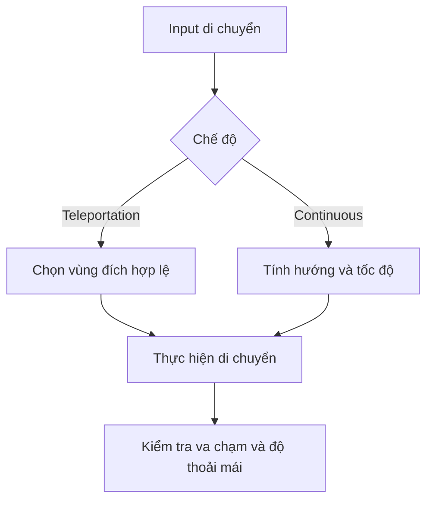

# Bài 04 — 1.2 — Di chuyển trong VR (Locomotion)

## 1. Tổng quan

Locomotion quyết định cách người dùng đổi vị trí trong thế giới ảo. Hai lựa chọn phổ biến là dịch chuyển tức thời (Teleportation) và di chuyển liên tục (Continuous Movement); mỗi lựa chọn ảnh hưởng đến cảm giác thoải mái, mức kiểm soát và khả năng định hướng.

## 2. Mục tiêu học tập

- So sánh được Teleportation và Continuous Movement bằng tình huống sử dụng.
- Giải thích vai trò của Time.deltaTime, Input Actions và hệ tọa độ trong logic di chuyển.
- Thiết kế phép thử di chuyển có kiểm tra hướng, biên, va chạm và FPS.

## 3. Phân biệt các cách di chuyển

| Phương án | Cơ chế | Lưu ý |
|---|---|---|
| **Teleportation** | Chọn vị trí đích rồi chuyển nhanh đến đó | Thường phù hợp khi ưu tiên giảm chuyển động liên tục trong tầm nhìn |
| **Continuous Movement** | Đổi vị trí liên tục theo input | Cần kiểm soát tốc độ, hướng và cảm giác thoải mái |
| **Room-scale** | Người dùng bước đi trong vùng tracking vật lý | Bị giới hạn bởi không gian thực và hệ thống tracking |

Không có phương án nào phù hợp tuyệt đối cho mọi trò chơi. Cần xem yêu cầu nhiệm vụ, mức trải nghiệm VR của người dùng và khả năng thử nghiệm trên thiết bị.

## 4. Hướng và tốc độ: tránh phụ thuộc FPS

Một điều khiển di chuyển thông thường có tốc độ đo bằng đơn vị/giây. Nếu cập nhật Transform theo từng frame, quãng đường mỗi frame nên tỉ lệ với `Time.deltaTime`:

$$
\Delta x = v \cdot \Delta t
$$

Ví dụ C# dưới đây dùng **Input Manager cũ** và thao tác trên Transform của một GameObject thông thường. Đây là bài minh họa nguyên lý cập nhật theo thời gian, **không phải mã điều khiển XR Origin bằng controller VR**:

```csharp
using UnityEngine;

public class SimpleMover : MonoBehaviour
{
    [SerializeField] private float speed = 4f;

    void Update()
    {
        // Input Manager cũ; cần Active Input Handling tương thích.
        float horizontal = Input.GetAxisRaw("Horizontal");
        Vector3 direction = new Vector3(horizontal, 0f, 0f);
        transform.Translate(direction * speed * Time.deltaTime, Space.World);
    }
}
```

`SerializeField` cho phép chỉnh `speed` trong Inspector mà vẫn giữ field `private`. Đối với ứng dụng VR dùng **Input System mới**, cần đọc tín hiệu từ **Input Actions** và kết nối với cơ chế locomotion phù hợp; không nên bê nguyên ví dụ bàn phím lên controller.

## 5. Transform, Rigidbody và hệ tọa độ

Di chuyển trực tiếp bằng `Transform` và di chuyển dựa trên `Rigidbody` tuân theo cơ chế khác nhau. Nếu dùng physics để xử lý vật cản và va chạm, tránh vừa điều khiển Rigidbody vừa ghi đè Transform một cách thiếu kiểm soát. `Space.World` dùng trục toàn cục; hướng cục bộ thay đổi cùng với đối tượng. Với VR, nhầm lẫn hướng nhìn của người dùng và hướng hệ tọa độ gốc có thể làm joystick di chuyển sai phương.



Cả hai nhánh đều cần kiểm soát vị trí hợp lệ. Teleportation không nên đưa người dùng vào tường; continuous movement không nên đi xuyên vật cản.

## 6. Bài thử và chẩn đoán

Thiết lập một vùng sàn có vật cản và hai khu vực đến. Thử Teleportation tới điểm hợp lệ và bất hợp lệ; quan sát cơ chế giới hạn mục tiêu. Với Continuous Movement, thử đổi hướng, nhấn–thả input và kiểm tra khi gặp vật cản. Nếu có bộ điều khiển bàn phím thử nghiệm, thay đổi FPS và kiểm tra tốc độ gần như không đổi.

**Lỗi thường gặp:** (1) di chuyển nhanh hơn khi FPS tăng do bỏ `Time.deltaTime`; (2) nhầm hướng local/world; (3) Input Action chưa kích hoạt; (4) trộn Transform với Rigidbody; (5) chỉ thử trong Editor nên bỏ qua vấn đề comfort trên kính.

## 7. Câu hỏi ôn tập trắc nghiệm

### Câu 1

Vì sao nhân tốc độ với Time.deltaTime trong Update?


A. Để quãng đường theo thời gian thay vì theo số frame  

B. Để làm vật thể sáng hơn  

C. Để tăng gravity  

D. Để đổi đơn vị tốc độ thành FPS  


**Đáp án:** A. **Giải thích:** Quãng đường cần tỉ lệ thời gian giữa hai lần cập nhật.

### Câu 2

Input.GetAxisRaw trong ví dụ là thuộc hệ nào?


A. XR Interaction Toolkit bắt buộc  

B. Input Manager cũ  

C. OpenXR runtime  

D. Trình quản lý Package  


**Đáp án:** B. **Giải thích:** Ví dụ minh họa được viết với Input Manager cũ.

### Câu 3

Điều nào đúng về Space.World?


A. Lấy trục cục bộ của đối tượng  

B. Khóa mọi va chạm  

C. Tính hướng theo trục tọa độ toàn cục  

D. Tắt liên kết controller  


**Đáp án:** C. **Giải thích:** Space.World dùng hệ trục của thế giới.

### Câu 4

Tại sao cần kiểm tra Teleportation ở vị trí không hợp lệ?


A. Để tăng tốc mô phỏng  

B. Để tắt tracking  

C. Để xóa Input Actions  

D. Để tránh đưa người chơi vào vật cản  


**Đáp án:** D. **Giải thích:** Đích di chuyển phải đáp ứng điều kiện không gian.

### Câu 5

Vì sao không nên trộn Transform và Rigidbody tùy tiện?


A. Có thể làm hành vi vật lý/va chạm khó dự đoán  

B. Vì cả hai chỉ làm việc với âm thanh  

C. Vì Transform không có vị trí  

D. Vì Rigidbody dùng để quản lý package  


**Đáp án:** A. **Giải thích:** Hai cơ chế cập nhật vị trí và physics cần được tổ chức nhất quán.

## 8. Tổng kết

Locomotion tốt phải đáp ứng **hướng đúng, tốc độ đúng, vị trí hợp lệ và cảm giác thoải mái**. `Time.deltaTime` giải quyết bài toán theo frame khi điều khiển thủ công; còn hệ thống VR thực tế cần input và locomotion provider phù hợp cấu hình dự án.

---

**Học liệu đối chiếu:** [Unity Learn — VR Basics](https://learn.unity.com/pathway/vr-development/unit/vr-basics?version=6.3). Các ví dụ và bài tập là nội dung học tập tự biên soạn, không phải bài kiểm tra hoặc transcript chính thức.
