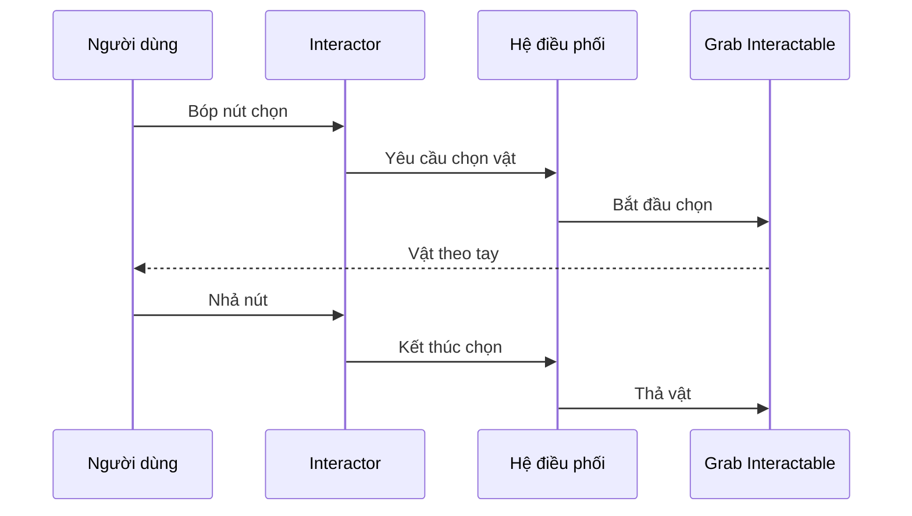

# Bài 05 — 1.3 — Vật thể có thể cầm nắm trong VR

## 1. Tổng quan

Một đồ vật chỉ trở thành đối tượng cầm nắm khi có cơ chế phát hiện tiếp xúc, nhận lệnh chọn, gắn theo tay và nhả đúng lúc. Bài này tập trung vào quan hệ giữa Interactor và Interactable trong XR Interaction Toolkit.

## 2. Mục tiêu học tập

- Phân biệt được Interactor, Interactable và Collider.
- Cấu hình một GameObject thử nghiệm để chọn, cầm, di chuyển và thả.
- Xác định được nguyên nhân thường gặp khi vật thể nhìn thấy nhưng không thể cầm.

## 3. Mô hình tương tác cầm nắm

**Interactor** là phía khởi tạo thao tác, chẳng hạn tay ảo hoặc tia. **Interactable** là đối tượng tiếp nhận thao tác. **Collider** quy định hình dạng tương tác/va chạm; tùy cách cấu hình vật thể cầm nắm, **Rigidbody** xử lý các thuộc tính vật lý như trọng lực và chuyển động. XR Interaction Toolkit kết nối chúng qua lớp điều phối tương tác.

Sơ đồ phân biệt *nguồn kích hoạt* và *đối tượng nhận tương tác*. Điều này hữu ích khi nhiều vật thể và nhiều tay cùng tồn tại trong scene.

## 4. Tạo một khối có thể cầm

1. Tạo sàn và khối lập phương tại vị trí trong tầm với.
2. Đảm bảo khối có **Collider** với kích thước phù hợp. Nếu cần mô phỏng thả/rơi, kiểm tra **Rigidbody** và cấu hình vật lý.
3. Gắn thành phần **Grab Interactable** tương ứng phiên bản XR Interaction Toolkit đang dùng.
4. Cấu hình XR Origin, tay trực tiếp hoặc ray interactor và ánh xạ hành động **Select**.
5. Play mode: hướng tay vào khối, chọn, di chuyển tay rồi nhả. Ghi lại quỹ đạo vật và phản hồi sau khi nhả.

**Checkpoint:** Khối không bị biến mất, không lệch quá xa khỏi tay, nhận được lệnh chọn và không còn bị giữ sau khi nhả. Nếu muốn vật có điểm cầm xác định, có thể bố trí vị trí gắn (attach point) phù hợp trong Inspector.

## 5. Đọc trạng thái và xử lý lỗi

| Hiện tượng | Khả năng cần kiểm tra |
|---|---|
| Tay đi qua vật nhưng không nhặt | Collider, Interactable, tương thích Interactor |
| Không có phản hồi khi bóp nút | Input Actions chưa ánh xạ/kích hoạt |
| Vật giật, văng bất thường | Rigidbody, cấu hình chuyển động, xung đột với script khác |
| Vật không nhả | Trạng thái select, logic input, tham chiếu Interactor |
| Chỉ nhặt được bằng tia | Kiểm tra Direct Interactor và vùng va chạm |

Hãy xem **Inspector**, **Console** và cấu trúc GameObject trước khi chỉnh toàn bộ cài đặt XR. Thử đổi một thành phần mỗi lần để biết chính xác thay đổi nào giải quyết lỗi.

## 6. Bài thực hành mở rộng

Tạo hai vật: một vật nhẹ và một vật cần đặt đúng vào kệ. Thử cùng một cấu hình Grab Interactable nhưng thay kích thước collider hoặc vị trí attach, sau đó dự đoán ảnh hưởng tới cảm giác cầm. Nếu thử cả Interactor trực tiếp lẫn tia, ghi lại kiểu tương tác phù hợp nhất với vật ở gần và xa.

Trong bản ghi thử nghiệm, nêu: (a) điều kiện để chọn được vật, (b) hành vi trong lúc giữ, (c) hành vi sau khi thả, (d) lỗi đã gặp và cách xác nhận đã sửa.

## 7. Câu hỏi ôn tập trắc nghiệm

### Câu 1

Đối tượng nào thường phát sinh yêu cầu chọn vật?

A. Interactor  

B. Scene  

C. Package Manager  

D. Main Camera đơn thuần  

**Đáp án:** A. **Giải thích:** Interactor là phía phát lệnh tương tác.

### Câu 2

Vai trò chính của Interactable là gì?

A. Quản lý phiên bản Editor  

B. Phản hồi khi được tương tác  

C. Vẽ mọi UI trong game  

D. Thay thế toàn bộ input  

**Đáp án:** B. **Giải thích:** Interactable là phía nhận và xử lý tương tác.

### Câu 3

Không cầm được khối dù nhìn thấy: kiểm tra nào phù hợp?

A. Chỉ đổi skybox  

B. Xóa nền cảnh  

C. Collider, Interactable và Select input  

D. Tăng chất lượng shadow  

**Đáp án:** C. **Giải thích:** Tương tác yêu cầu vùng nhận diện, thành phần tương tác và input hợp lệ.

### Câu 4

Lý do xem Rigidbody khi vật bị văng sau khi thả?

A. Rigidbody quản lý font chữ  

B. Rigidbody chỉ xử lý ánh sáng  

C. Rigidbody làm thay nhiệm vụ của Hub  

D. Rigidbody liên quan chuyển động vật lý  

**Đáp án:** D. **Giải thích:** Thiết lập vật lý có thể ảnh hưởng vận tốc và tương tác khi nhả.

### Câu 5

Vì sao thử hai kiểu Interactor gần và xa?

A. Để so sánh cách chọn và giới hạn phạm vi  

B. Để tăng kích thước file  

C. Để bỏ kiểm tra input  

D. Để tắt collider  

**Đáp án:** A. **Giải thích:** Cách tương tác phụ thuộc vị trí và kiểu nguồn chọn.

## 8. Tổng kết

Một vật cầm nắm hoạt động khi **input chọn → Interactor → Interactable → phản hồi cầm/nhả** được nối đúng. Đừng đánh giá tính năng chỉ qua việc nhìn thấy vật trong scene.

---

**Học liệu đối chiếu:** [Unity Learn — VR Basics](https://learn.unity.com/pathway/vr-development/unit/vr-basics?version=6.3). Các ví dụ và bài tập là nội dung học tập tự biên soạn, không phải bài kiểm tra hoặc transcript chính thức.
