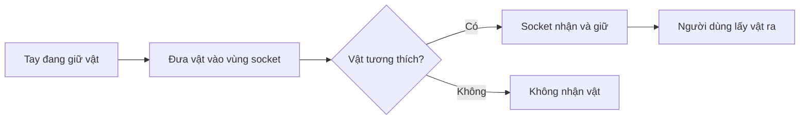

# Bài 06 — 1.4 — Đặt vật thể vào vị trí gắn (Sockets)

## 1. Tổng quan

Khi người chơi đặt một đồ vật vào ổ cắm, giá đỡ hoặc khe chứa, ứng dụng cần nhận biết đúng vật, đúng vùng đích và thời điểm chuyển từ tay sang vị trí lưu trữ. Trong XR Interaction Toolkit, Socket Interactor cung cấp một cơ chế tương tác cho tình huống này.

## 2. Mục tiêu học tập

- Giải thích được sự khác nhau giữa cầm bằng tay và giữ vật bằng socket.
- Tạo một điểm đặt thử nghiệm và kiểm chứng trình tự đặt–giữ–lấy ra.
- Chẩn đoán tình huống vật không gắn đúng hoặc gắn nhầm chỗ.

## 3. Socket đóng vai trò gì?

Một **Socket Interactor** là vùng tương tác có thể chọn và giữ vật thể phù hợp, trong khi vật vẫn là **Interactable**. Với một chiếc cúp, tay người chơi là Interactor thứ nhất; chiếc đế trưng bày có socket là Interactor thứ hai. Cấu hình socket quyết định đối tượng được chấp nhận, vị trí gắn và điều kiện chuyển giao.

Quy trình trên là mô hình kiểm thử: vật cần được nhận đúng theo tiêu chí của socket, chứ không chỉ vì nó nằm gần vị trí đích.

## 4. Thiết lập tình huống đặt vật

1. Tạo một đế/giá cố định, thêm một GameObject biểu diễn vị trí socket.
2. Thiết lập **Socket Interactor** và vùng nhận diện hoặc cấu hình va chạm phù hợp phiên bản XRI đang dùng.
3. Chuẩn bị một vật có **Grab Interactable**; xác minh rằng tay có thể nhặt vật trước.
4. Đặt socket và vật ở khoảng cách dễ tiếp cận; xác định hướng gắn (attach) để vật không bị xoay lệch.
5. Chạy thử trình tự: nhặt → đưa gần socket → nhả → quan sát trạng thái giữ → lấy ra.
6. Thử với một vật khác không được dự định dùng ở socket; ghi nhận kết quả và siết điều kiện tương thích nếu cần.

**Checkpoint:** Chỉ vật mục tiêu được nhận, vật nằm đúng vị trí, không giật mạnh và có thể lấy ra theo chủ đích.

## 5. Các tình huống cần kiểm tra

| Lỗi | Gợi ý kiểm tra |
|---|---|
| Vật gần socket nhưng không gắn | Vùng phát hiện, layer, Interactor/Interactable, trạng thái select |
| Socket nhận nhầm vật | Quy tắc tương thích, phân loại đối tượng/layer |
| Vật xoay sai hướng | Attach Transform, hướng của socket và vật |
| Vật rung hoặc xung đột | Rigidbody, trạng thái vật lý và script can thiệp vị trí |
| Vật không lấy ra được | Cấu hình select, tương tác ưu tiên và đầu vào của tay |

Khi sửa lỗi, hãy tách **khả năng phát hiện** (vật có nằm trong vùng tương tác?) khỏi **khả năng chọn/giữ** (socket có quyền nhận vật?). Đây là hai bước khác nhau.

## 6. Bài tập củng cố

Thiết kế một kệ có hai vị trí: **socket cho khối vuông** và **socket cho hình trụ**. Ghi sơ đồ điều kiện nhận vật dưới dạng bảng; kiểm thử bốn trường hợp: vật đúng đến vị trí đúng, vật sai đến vị trí đúng, vật đúng nhưng tay vẫn giữ, và vật đã đặt được lấy trở lại. Mỗi trường hợp ghi kết quả mong đợi, kết quả thực tế và lý do nếu chưa đạt.

## 7. Câu hỏi ôn tập trắc nghiệm

### Câu 1

Socket Interactor chủ yếu dùng cho tình huống nào?

A. Nhận và giữ vật vào một vị trí gắn  

B. Quản lý gói Unity  

C. Thay thế toàn bộ camera  

D. Biên dịch shader  

**Đáp án:** A. **Giải thích:** Socket là nguồn tương tác nhằm nhận vật phù hợp vào vị trí chỉ định.

### Câu 2

Vật đặt gần socket nhưng không được giữ. Kiểm tra gì trước?

A. Đổi tên scene tùy ý  

B. Vùng phát hiện và điều kiện select  

C. Xóa Input System  

D. Tăng cường độ ánh sáng  

**Đáp án:** B. **Giải thích:** Gần vị trí chưa chắc đã đáp ứng điều kiện tương tác.

### Câu 3

Vật bị xoay ngược khi gắn, phần nào liên quan trực tiếp?

A. Build module Android  

B. Console font  

C. Attach Transform  

D. Tên project  

**Đáp án:** C. **Giải thích:** Vị trí/hướng attach quyết định tư thế khi được gắn.

### Câu 4

Tại sao cần thử vật không hợp lệ với socket?

A. Để tiết kiệm bộ nhớ  

B. Để tăng FPS  

C. Để kiểm tra độ phân giải ảnh  

D. Để xác minh cơ chế lọc tương thích  

**Đáp án:** D. **Giải thích:** Một socket tốt cần từ chối vật không phù hợp.

### Câu 5

Bước nào xác minh vòng đời đầy đủ của một vật đặt lên kệ?

A. Nhặt, đưa vào socket, nhả, rồi lấy ra  

B. Chỉ nhìn vật ở Editor  

C. Chỉ thay màu nền  

D. Chỉ build scene trống  

**Đáp án:** A. **Giải thích:** Cần kiểm tra cả đặt và lấy lại vật.

## 8. Tổng kết

Socket bổ sung bước **đặt đúng vị trí và chuyển quyền giữ vật** cho cơ chế Grab. Hãy thử cả trường hợp hợp lệ lẫn không hợp lệ để bảo đảm tương tác có quy tắc rõ ràng.

---

**Học liệu đối chiếu:** [Unity Learn — VR Basics](https://learn.unity.com/pathway/vr-development/unit/vr-basics?version=6.3). Các ví dụ và bài tập là nội dung học tập tự biên soạn, không phải bài kiểm tra hoặc transcript chính thức.
