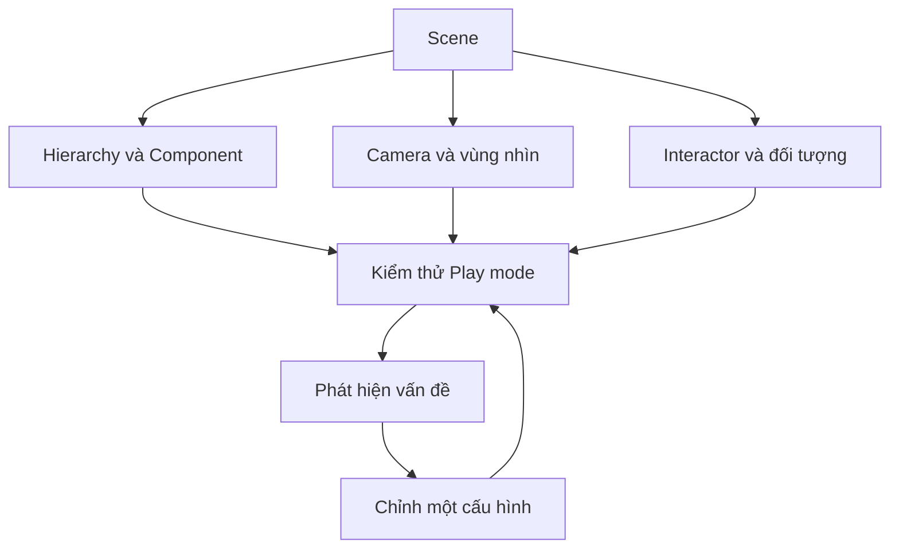

# Bài 07 — Challenge 1 — Đánh giá kiến trúc và góc nhìn VR

## 1. Tổng quan

Thử thách này yêu cầu người học kiểm tra một scene nhỏ như một hệ thống hoàn chỉnh: cấu trúc GameObject–Component, khả năng hiển thị qua camera, một thao tác tương tác và bằng chứng kiểm thử. Trọng tâm của bản thực hành là **đánh giá và cải thiện**, không chỉ dựng cảnh đẹp.

## 2. Mục tiêu học tập

- Phân tích được quan hệ scene, camera, đối tượng và tương tác.
- Kiểm tra được framing, Field of View, clipping planes và culling mask trong tình huống quan sát.
- Nộp bản scene cùng minh chứng một lượt cải tiến sau kiểm thử.

## 3. Đề bài và phạm vi

Tạo một không gian nhỏ có ba vật ở ba khoảng cách khác nhau, một camera hoặc hệ camera VR thích hợp, và ít nhất một thao tác có phản hồi quan sát được. Thử các lựa chọn **Perspective** và **Orthographic** trong scene camera thông thường để quan sát ảnh hưởng lên chiều sâu; với camera headset thực tế, phải giữ cấu hình tracking phù hợp và không áp đặt chế độ camera thông thường lên VR một cách máy móc.

**Field of View** ảnh hưởng độ rộng vùng nhìn, **Near/Far Clipping Planes** xác định khoảng cách bắt đầu/kết thúc hiển thị và **Culling Mask** quyết định layer được render. Framing là cách đặt chủ thể trong khung hình. Nếu camera bám theo một đối tượng dùng physics, cần xem độ mượt khi di chuyển.

## 4. Nhiệm vụ theo mốc

| Mốc | Công việc | Bằng chứng |
|---|---|---|
| 1 — Cấu trúc | Tạo scene, phân nhóm GameObject, xác định Component quan trọng | Ảnh Hierarchy và Inspector |
| 2 — Camera | Bố trí ba vật gần–giữa–xa, kiểm tra Field of View và clipping | Ảnh các cấu hình so sánh |
| 3 — Tương tác | Cấu hình một hành động chọn, cầm hoặc đổi trạng thái vật | Video/ảnh trước–sau thao tác |
| 4 — Kiểm thử | Ghi một trường hợp đúng và một lỗi có thể tái hiện | Mô tả bước tái hiện, Console nếu cần |
| 5 — Cải tiến | Sửa một vấn đề đã phát hiện và chạy lại | So sánh trước–sau |

**Yêu cầu nộp:** project/scene hoặc bản build chạy được; một minh chứng thành công; một minh chứng lỗi; bảng kiểm thử và tối thiểu một cải tiến.

## 5. Gợi ý kiểm tra kiến trúc

Không nên thay nhiều thông số cùng lúc. Nếu vật biến mất khi camera tiến gần, hãy kiểm tra clipping; nếu vật chỉ biến mất ở một layer, kiểm tra culling mask; nếu chuyển động camera giật, kiểm tra cách cập nhật vị trí và hệ physics.

## 6. Tiêu chí đánh giá và câu hỏi tự luận

| Tiêu chí | Đạt khi |
|---|---|
| Scene có tổ chức | Có thể giải thích GameObject/Component nào tạo hành vi chính |
| Camera hiển thị hợp lý | Ba vật nhìn thấy theo bố cục dự kiến; không bị cắt bất thường |
| Có tương tác | Hành động tạo ra phản hồi có thể chứng minh |
| Có kiểm thử | Có cách tái hiện thành công và lỗi |
| Có cải tiến | Kết quả trước–sau được ghi lại |

**Tự đánh giá (không kèm lời giải):**

1. Lỗi camera nào xuất hiện khi chỉnh Near Clip quá lớn? Em đã chứng minh ra sao?
2. Vì sao một GameObject vẫn có trong Hierarchy nhưng không xuất hiện trên Game view?
3. Với scene có Rigidbody, dấu hiệu nào cho thấy camera bám đối tượng bị giật?
4. Một cải tiến nào đã làm trải nghiệm tương tác hoặc quan sát tốt hơn?

## 7. Tổng kết

Hoàn thành thử thách khi có **scene chạy được, bằng chứng kiểm thử và cải tiến cụ thể**. Không chỉ đánh giá kết quả thị giác; cần giải thích mối liên hệ giữa cấu hình và hành vi quan sát.

---

**Học liệu đối chiếu:** [Unity Learn — VR Basics](https://learn.unity.com/pathway/vr-development/unit/vr-basics?version=6.3). Các ví dụ và bài tập là nội dung học tập tự biên soạn, không phải bài kiểm tra hoặc transcript chính thức.
