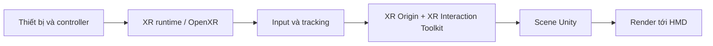

# Bài 08 — Bức tranh hệ sinh thái phần mềm VR

## 1. Tổng quan

Một ứng dụng VR đi qua nhiều tầng phần mềm: công cụ phát triển, hệ thống package, giao diện XR, runtime và thiết bị đầu cuối. Hiểu ranh giới từng tầng giúp chọn công cụ đúng và xác định nguyên nhân khi ứng dụng chạy trên máy phát triển nhưng không hoạt động trên kính.

## 2. Mục tiêu học tập

- Phân loại vai trò của Unity Hub, Unity Editor, OpenXR, XR Interaction Toolkit và nền tảng đích.
- Giải thích được luồng từ input phần cứng đến phản hồi trong scene.
- Phân biệt lỗi công cụ, lỗi tương tác và vấn đề hiệu năng.

## 3. Những lớp phần mềm quan trọng

| Lớp | Vai trò | Dấu hiệu cần kiểm tra |
|---|---|---|
| Công cụ phát triển: Unity Hub/Editor | Quản lý phiên bản, xây scene, chạy thử | Tình trạng project, Console |
| Quản lý phụ thuộc: Package Manager | Cài và quản lý package dự án | Package có tương thích không |
| Truy cập XR: OpenXR/runtime | Giao tiếp với khả năng XR của nền tảng | Runtime và thiết bị có khớp không |
| Tương tác: XR Interaction Toolkit | Interactor, Interactable và hoạt động tương tác | Input, trạng thái chọn/nhả |
| Ứng dụng và thiết bị đích | Render khung hình, nhận tracking, phản hồi người dùng | Chất lượng hình, độ mượt, comfort |

OpenXR và XRI không thay thế nhau: một bên liên quan nền tảng truy cập XR; bên kia hỗ trợ xây dựng logic tương tác trong ứng dụng Unity.

## 4. Luồng hoạt động tổng thể

Khi người dùng đưa tay đến một vật, tín hiệu phần cứng được runtime chuyển tới hệ input/tracking; cấu hình Unity xác định Interactor nào nhận hành động và Interactable nào phản hồi. Đồng thời ứng dụng phải render khung hình đủ ổn định để hình ảnh không bị giật. Cần phân biệt **trạng thái điều khiển đúng** với **khả năng trình diễn trơn tru**.

## 5. Ba nhóm sự cố phổ biến

**1. Môi trường:** Editor sai phiên bản, thiếu build module hoặc package hỏng. Kiểm tra Unity Hub, Package Manager và Console.

**2. Kết nối tương tác:** Input Actions không kích hoạt, runtime không tương thích, Interactable không được gắn hoặc Interactor không khớp. Kiểm tra Inspector, mapping input và hierarchy.

**3. Trải nghiệm:** Di chuyển gây khó chịu, draw call/overdraw cao hoặc hiệu ứng đồ họa đắt. Chọn kiểu locomotion phù hợp và kiểm tra profiler trên thiết bị đích.

Không nên dùng một chỉ số đơn lẻ để kết luận; FPS trong Editor có thể không phản ánh khung hình trên HMD.

## 6. Bài thực hành so sánh

Chọn một scene VR thử nghiệm. Lập bảng gồm ba cột: **Tầng**, **cấu hình hiện tại**, **rủi ro nếu lỗi**. Ví dụ với Input System, rủi ro là thao tác chọn không phản hồi; với OpenXR runtime, rủi ro là thiết bị không nhận tracking; với render, rủi ro là hình ảnh giật. Sau đó chủ động tạo một lỗi có thể khôi phục (ví dụ tạm vô hiệu một Input Action trong bản sao scene) và ghi dấu hiệu nhận biết.

Không tạo thử nghiệm lỗi trên bản dự án quan trọng nếu chưa sao lưu.

## 7. Câu hỏi ôn tập trắc nghiệm

### Câu 1

Vai trò chính của XR Interaction Toolkit là gì?

A. Xây dựng mô hình tương tác trong Unity  

B. Quản lý hệ điều hành của kính  

C. Thay toàn bộ GPU  

D. Thay Unity Hub  

**Đáp án:** A. **Giải thích:** XRI tập trung vào Interactor, Interactable và hành vi tương tác.

### Câu 2

OpenXR nằm gần tầng nào hơn?

A. Biên tập texture  

B. Giao tiếp XR với runtime/nền tảng  

C. Tạo sơ đồ Markdown  

D. Đặt tên file dự án  

**Đáp án:** B. **Giải thích:** OpenXR liên quan lớp giao tiếp XR giữa ứng dụng và runtime.

### Câu 3

Lỗi thiếu build module nên kiểm tra ở đâu trước?

A. Collider trên vật  

B. Field of View  

C. Unity Hub  

D. Materials  

**Đáp án:** C. **Giải thích:** Việc cài module build gắn với Editor trong Hub.

### Câu 4

Một vật thấy được nhưng không chọn được: nhóm lỗi ưu tiên là gì?

A. Hiệu ứng màu  

B. Tối ưu shader trước tiên  

C. Nội dung văn bản  

D. Input/Interactor/Interactable  

**Đáp án:** D. **Giải thích:** Luồng tương tác phải được cấu hình đúng.

### Câu 5

Vì sao phải profile trên thiết bị đích?

A. Vì đặc điểm runtime và phần cứng đích khác môi trường phát triển  

B. Vì Editor không có Game view  

C. Vì không cần kiểm thử input  

D. Vì không thể mở scene  

**Đáp án:** A. **Giải thích:** Chỉ thiết bị thực tế phản ánh sát trải nghiệm người dùng.

## 8. Tổng kết

Hệ sinh thái VR gồm các tầng có nhiệm vụ khác nhau. Khi có lỗi, hãy xác định **lỗi xuất hiện ở tầng nào** rồi mới tìm hướng khắc phục, thay vì thay đổi toàn bộ project.

---

**Học liệu đối chiếu:** [Unity Learn — VR Basics](https://learn.unity.com/pathway/vr-development/unit/vr-basics?version=6.3). Các ví dụ và bài tập là nội dung học tập tự biên soạn, không phải bài kiểm tra hoặc transcript chính thức.
