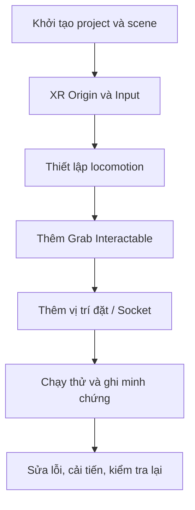

# Bài 09 — Lab 1 — Xây dựng dự án VR cá nhân cơ bản

## 1. Tổng quan

Bài lab yêu cầu hoàn thiện một bản thử nghiệm VR nhỏ, độc lập: người dùng quan sát scene, di chuyển trong giới hạn cho phép, cầm một vật và đưa vật đến vị trí chỉ định. Quy mô nhỏ giúp tập trung vào chất lượng triển khai và kiểm thử.

## 2. Mục tiêu học tập

- Xác định được yêu cầu chức năng và các mốc triển khai của dự án VR nhỏ.
- Tổ chức scene có XR Origin, locomotion và ít nhất một tương tác quan sát được.
- Ghi minh chứng, chẩn đoán lỗi, kiểm tra trên thiết bị và đề xuất cải tiến.

## 3. Đầu ra và chuẩn bị

**Đầu ra cần nộp:** file project/scene hoặc build chạy được; ít nhất một ảnh/video thể hiện tương tác thành công; bảng ghi kết quả mong đợi và thực tế; một lỗi có thể tái hiện; một cải tiến sau lần thử đầu.

**Chuẩn bị:** Unity Editor tương thích dự án, package XR/interaction phù hợp, Input Actions, scene thử, và thiết bị XR nếu có. Không giả định một scene chạy tốt trong Editor là đạt hiệu năng trên HMD.

**Phạm vi đề xuất:** một khu vực sàn có vật cản, một vật có thể nhặt và một vị trí đặt. Có thể dùng Teleportation hoặc Continuous Movement; ưu tiên phương án thoải mái cho người mới.

## 4. Các mốc xây dựng

**Mốc 1 — Project:** Ghi phiên bản Editor, render pipeline và package; scene lưu được, Console không có lỗi nghiêm trọng.

**Mốc 2 — Quan sát và di chuyển:** Kiểm tra XR Origin, hướng nhìn và điều khiển đến điểm khác. Không cho người dùng dịch chuyển vào vật cản.

**Mốc 3 — Tương tác:** Một vật có collider và cơ chế Grab Interactable; thử chọn–giữ–nhả.

**Mốc 4 — Hoàn thành nhiệm vụ:** Đưa vật đến socket hoặc khu vực đích, phản hồi rõ khi đặt đúng.

**Mốc 5 — Kiểm thử:** Kiểm tra thành công, thất bại, thao tác lặp và hiệu năng/comfort trên thiết bị nếu có.

## 5. Checkpoint và kiểm thử

| Tình huống | Kỳ vọng | Minh chứng cần lưu |
|---|---|---|
| Mở scene | Không có lỗi chặn Play mode | Ảnh Console |
| Nhận input | Tay/tia phản hồi khi điều khiển | Ảnh hoặc clip |
| Di chuyển | Tới vùng hợp lệ, không xuyên vật | Clip đoạn di chuyển |
| Cầm và thả | Vật theo tay, nhả đúng lúc | Clip trước/sau |
| Đặt vật | Được nhận ở vị trí đích | Ảnh vật tại socket |
| Thử sai | Hệ thống không nhận vật sai hoặc hành động sai | Bảng kiểm thử |

Mỗi lỗi được ghi theo dạng **đầu vào → cách tái hiện → kết quả quan sát → giả thuyết → thay đổi → kết quả chạy lại**. Khi sửa, chỉ thay một cấu hình hoặc một khối mã trong mỗi vòng thử để biết yếu tố nào tác động.

## 6. Checklist nghiệm thu

- [ ] Project/scene hoặc build mở và chạy được.
- [ ] Đã ghi phiên bản Unity, package quan trọng và nền tảng thử.
- [ ] Có XR Origin và input hoạt động theo cấu hình dự án.
- [ ] Có một phương pháp locomotion đã được thử với vật cản.
- [ ] Có vật nhặt được và thả được.
- [ ] Có mục tiêu đặt vật và phản hồi có thể quan sát.
- [ ] Có ảnh/video minh chứng thành công và ghi nhận một tình huống lỗi.
- [ ] Có ít nhất một cải tiến và kết quả so sánh trước–sau.
- [ ] Nếu có HMD, đã thử khả năng theo dõi và hiệu năng trên chính thiết bị đó.

## 7. Câu hỏi ôn tập trắc nghiệm

### Câu 1

Đầu ra nào phản ánh một bài lab có khả năng kiểm chứng?

A. Scene chạy được kèm bước thử và minh chứng  

B. Chỉ một ảnh scene đẹp  

C. Chỉ tệp tên project  

D. Chỉ màn hình package list  

**Đáp án:** A. **Giải thích:** Lab phải chứng minh được hành vi và cách tái hiện kết quả.

### Câu 2

Lý do nên bắt đầu bằng một scene nhỏ?

A. Để không phải kiểm tra input  

B. Để cô lập lỗi và giảm yếu tố gây nhiễu  

C. Để tắt Collider  

D. Để tăng số đối tượng  

**Đáp án:** B. **Giải thích:** Quy mô nhỏ giúp quan sát từng cơ chế rõ hơn.

### Câu 3

Để phát hiện lỗi locomotion, phép thử nào cần thiết?

A. Chỉ chọn màu nền  

B. Đổi tên script  

C. Đi vào vùng có vật cản và thử điểm đích bất hợp lệ  

D. Xóa XR Origin  

**Đáp án:** C. **Giải thích:** Cần kiểm tra khả năng xử lý vị trí không hợp lệ.

### Câu 4

Vì sao cần thử lại sau cải tiến?

A. Để tăng số file  

B. Để bỏ qua Console  

C. Để không cần minh chứng  

D. Để xác minh lỗi đã biến mất và không gây tác dụng phụ  

**Đáp án:** D. **Giải thích:** Chạy lại là bước xác nhận giải pháp.

### Câu 5

Lỗi không chọn được vật: bộ phận nào nên kiểm tra?

A. Input Actions, Interactor, Interactable, Collider  

B. Camera clipping trước tiên  

C. Chỉ ánh sáng  

D. Chỉ số lượng texture  

**Đáp án:** A. **Giải thích:** Những thành phần này tạo nên luồng chọn vật.

## 8. Tổng kết

Một dự án cá nhân cơ bản không cần nhiều nội dung nhưng phải hoàn chỉnh từ **cấu hình → tương tác → kiểm thử → cải tiến**. Tiêu chí quan trọng là người khác có thể chạy lại và xác nhận kết quả dựa trên minh chứng.

---

**Học liệu đối chiếu:** [Unity Learn — VR Basics](https://learn.unity.com/pathway/vr-development/unit/vr-basics?version=6.3). Các ví dụ và bài tập là nội dung học tập tự biên soạn, không phải bài kiểm tra hoặc transcript chính thức.
