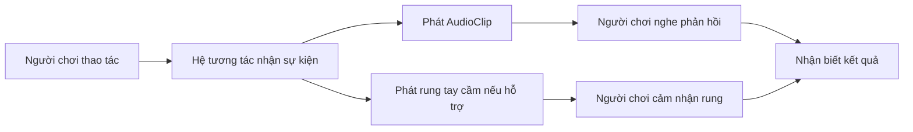

# 2.1 — Âm thanh và phản hồi xúc giác trong VR (Audio and Haptics)

## 1. Tổng quan

Một môi trường thực tế ảo không chỉ được cảm nhận bằng hình ảnh. Khi người chơi cầm một vật, bật công tắc hoặc chạm vào bề mặt, **âm thanh** giúp xác nhận sự kiện; **haptics** (phản hồi rung/xúc giác) khiến thao tác có cảm giác vật lý hơn. Hai kênh phản hồi này cũng giúp người chơi biết tương tác đã thành công mà không cần liên tục nhìn vào giao diện.

Ví dụ, một vật được nhặt lên có thể phát tiếng “click” ngắn, đồng thời tay cầm rung nhẹ. Khi vật bị thả xuống sàn, vị trí âm thanh nên phù hợp với vị trí va chạm thay vì luôn phát ngay bên tai người chơi.

**Mục tiêu học tập:**

- Phân biệt âm nền, âm sự kiện, âm 2D và âm 3D.
- Cấu hình `Audio Source` và nhận biết vai trò của `Audio Listener`.
- Kết nối một sự kiện tương tác với âm thanh; mô tả khi nào nên bổ sung rung tay cầm.
- Kiểm thử và xử lý các lỗi âm thanh thường gặp trong Unity.

## 2. Những thành phần âm thanh cốt lõi

| Thành phần / thuộc tính | Chức năng | Lưu ý khi thử nghiệm |
| --- | --- | --- |
| `AudioClip` | Tài nguyên chứa dữ liệu âm thanh | Clip phải được gán đúng và có quyền sử dụng |
| `Audio Source` | Component phát một `AudioClip` trên GameObject | Kiểm tra `Volume`, `Mute`, `Play On Awake`, `Loop` |
| `Audio Listener` | Điểm tiếp nhận âm thanh trong scene | Trong VR thường đi cùng camera của người chơi; tránh nhiều listener hoạt động đồng thời |
| `Spatial Blend` | Pha trộn giữa âm 2D và âm 3D | Với âm 3D, vị trí và khoảng cách có thể làm thay đổi âm lượng |
| `Min Distance`, `Max Distance` | Tham gia điều khiển mức suy giảm âm 3D | Kết quả còn phụ thuộc mô hình `Volume Rolloff` |

### 2.1. Âm 2D và âm 3D

**Âm 2D** phù hợp với nhạc nền hoặc âm UI cần nghe rõ bất kể với vị trí nguồn phát. **Âm 3D** phù hợp với một đối tượng xác định trong thế giới ảo: máy móc, cửa, vật rơi hoặc dòng nước. Khi nguồn âm dịch chuyển xa người chơi, âm 3D thường nhỏ dần theo cấu hình suy giảm.

`Spatial Blend` gần phía 2D sẽ làm giảm ảnh hưởng của vị trí không gian; gần phía 3D sẽ tăng ảnh hưởng của vị trí nguồn phát. Không nên biến mọi âm thanh thành âm 3D: thông báo hệ thống hoặc âm menu có thể khó nghe nếu bị đặt quá xa.

### 2.2. Âm nền và âm sự kiện

- **Âm nền:** phát liên tục hoặc lặp lại để tạo bầu không khí; thường dùng `Loop`.
- **Âm sự kiện:** chỉ phát khi có hành động như `Select`, `Activate`, va chạm hoặc hoàn thành nhiệm vụ.

Nên phân biệt rõ sự kiện *vừa trỏ đến đối tượng*, *đang cầm đối tượng* và *đã kích hoạt đối tượng*. Gắn một tiếng “hoàn thành” vào nhầm sự kiện có thể khiến người chơi nghe âm báo dù hành động chưa thực sự thành công.

## 3. Luồng xử lý phản hồi đa giác quan



Âm thanh và rung là **hai đầu ra của cùng một sự kiện gameplay**, nhưng có thể được bật/tắt hoặc tinh chỉnh độc lập. Không phải thiết bị XR nào cũng cung cấp khả năng rung giống nhau; trước khi thiết kế trải nghiệm phụ thuộc vào haptics, cần kiểm tra phần cứng và hệ input đang sử dụng.

## 4. Thực hành trong Unity

**Chuẩn bị:** scene đơn giản có camera/XR Origin, một GameObject có thể tương tác và ít nhất hai `AudioClip` hợp lệ.

1. Tạo một GameObject làm nguồn âm môi trường. Thêm `Audio Source`, gán `AudioClip`, bật `Loop` và dùng `Play On Awake` nếu cần âm nền tự chạy.
2. Chạy Play mode, điều chỉnh `Volume` và lắng nghe thay đổi. Kiểm tra xem scene có `Audio Listener` hoạt động hay không.
3. Tạo một đối tượng khác ở cách camera một khoảng rõ rệt. Thêm `Audio Source`, đặt `Spatial Blend` theo hướng 3D, rồi thay đổi vị trí nguồn phát hoặc camera.
4. Quan sát sự khác biệt khi điều chỉnh khoảng cách và các tham số suy giảm. Ghi lại giá trị Inspector trước và sau mỗi thử nghiệm.
5. Gắn một âm ngắn vào **sự kiện tương tác** của vật, ví dụ khi người chơi nhặt hoặc kích hoạt. Hãy kiểm tra sự kiện nào thực sự phát ra âm.
6. Nếu tay cầm và hệ input hỗ trợ haptics, bổ sung rung ngắn cho cùng sự kiện. Kiểm tra trên thiết bị đích thay vì chỉ suy luận từ Play mode trong Editor.

Ví dụ tối giản để gọi phát âm bằng một phương thức public (đặt script lên GameObject có `AudioSource` và gán clip trong Inspector):

```csharp
using UnityEngine;

public class InteractionSound : MonoBehaviour
{
    [SerializeField] private AudioSource source;
    [SerializeField] private AudioClip feedbackClip;

    public void PlayFeedback()
    {
        if (source != null && feedbackClip != null)
            source.PlayOneShot(feedbackClip);
    }
}
```

Có thể gọi `PlayFeedback()` từ sự kiện tương tác được cấu hình trong Inspector. `PlayOneShot` phát clip tại nguồn âm hiện có mà không cần thay thế `AudioSource.clip` đang được sử dụng. Nếu người chơi có thể kích hoạt liên tiếp rất nhanh, cần thử nghe xem các âm có chồng lặp khó chịu hay không.

## 5. Các tình huống lỗi cần kiểm tra

| Hiện tượng | Giả thuyết cần kiểm tra | Cách xác minh |
| --- | --- | --- |
| Không nghe âm | Thiếu `Audio Listener`, không có clip, volume quá nhỏ, source bị mute | Xem camera, Inspector và Console |
| Âm nghe rõ khi gần nhưng mất khi xa | Âm 3D bị suy giảm | Kiểm tra `Spatial Blend`, khoảng cách và rolloff |
| Âm phát nhiều lần | Sự kiện bị gọi lặp hoặc nhiều source phát | Ghi log số lần gọi và kiểm tra các listener sự kiện |
| Âm phát không đúng thời điểm | Gắn nhầm sự kiện `Hover`/`Select`/`Activate` | Kiểm tra thời điểm kích hoạt trong Play mode |
| Có âm nhưng không rung | Thiết bị hoặc cấu hình input chưa hỗ trợ/không kết nối | Kiểm tra trên phần cứng thực và cấu hình haptics tương ứng |

## 6. Bài thực hành ngắn

Tạo một bàn thử nghiệm VR gồm một vật có thể cầm và một công tắc. Vật phát một tiếng khi được nhặt lên; công tắc phát tiếng khác khi được kích hoạt. Thử đặt vật ở hai khoảng cách để so sánh âm 3D. Nếu phần cứng hỗ trợ, thêm phản hồi rung cho công tắc.

**Tiêu chí hoàn thành:** sự kiện nào tạo âm đó; âm 3D thay đổi theo không gian; người chơi có thể phân biệt hai hành động; ghi lại một ảnh cấu hình và một trường hợp đã debug.

## 7. Câu hỏi ôn tập

**Câu 1.** Khi tạo âm thanh phát từ một chiếc máy đặt trong thế giới VR, lựa chọn nào phù hợp nhất?

A. Bật mọi âm thanh ở chế độ 2D.  
B. Không sử dụng `Audio Listener`.  
C. Dùng `Audio Source` với thành phần không gian 3D phù hợp.  
D. Chỉ dùng nhạc nền.

**Đáp án: C.** Nguồn âm trong không gian cần chịu tác động của vị trí và khoảng cách để định vị chiếc máy.

**Câu 2.** Vì sao tiếng xác nhận kích hoạt không nên gắn bừa vào `Hover`?

A. Vì người chơi có thể chỉ trỏ vào vật mà chưa kích hoạt.  
B. Vì `Hover` luôn làm mất âm thanh.  
C. Vì Unity không có sự kiện tương tác.  
D. Vì âm nền không thể phát.

**Đáp án: A.** Phản hồi phải khớp hành động thực tế, tránh đánh lừa người chơi.

**Câu 3.** Âm nền lặp lại thường cần tùy chọn nào?

A. Tắt `Audio Source`.  
B. Xóa `AudioClip`.  
C. Tăng khoảng cách camera.  
D. Bật `Loop`.

**Đáp án: D.** `Loop` cho phép đoạn âm lặp khi nguồn âm đang phát.

**Câu 4.** Âm 3D bất ngờ nhỏ đi sau khi di chuyển camera xa nguồn. Nên kiểm tra gì trước?

A. Cấu hình UV.  
B. `Spatial Blend`, khoảng cách và suy giảm âm.  
C. Số lượng đèn.  
D. Anchors của UI.

**Đáp án: B.** Độ to của âm 3D phụ thuộc vị trí và thiết lập suy giảm.

**Câu 5.** Vì sao phản hồi rung phải được thử trên phần cứng thực?

A. Vì rung luôn giống nhau trên tất cả thiết bị.  
B. Vì rung thay thế hoàn toàn âm thanh.  
C. Vì khả năng và cường độ rung phụ thuộc thiết bị cùng hệ input.  
D. Vì Play mode tự mô phỏng mọi bộ điều khiển.

**Đáp án: C.** Haptics không nên được giả định là sẵn có và đồng nhất giữa các thiết bị.

## 8. Tổng kết

Âm thanh và haptics giúp phản hồi tương tác rõ ràng, kịp thời. Khi xây dựng VR, hãy xác định **đúng sự kiện**, **đúng nguồn phát**, **đúng không gian** và **đúng thiết bị kiểm thử** trước khi tinh chỉnh hiệu ứng.

**Đọc thêm:** [Unity Learn — Events and Interactions](https://learn.unity.com/pathway/vr-development/unit/events-and-interactions?version=6.3). Phần thực hành là ví dụ độc lập để luyện kỹ năng, không thay thế cấu hình chính thức của dự án Unity Learn.
