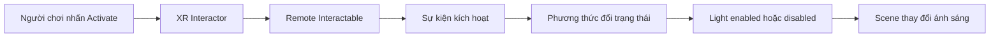

# 2.2 — Sự kiện kích hoạt: điều khiển đèn từ xa (Activation Events)

## 1. Tổng quan

Trong một ứng dụng VR, người chơi có thể **nhìn**, **chọn/cầm** và **kích hoạt** cùng một đối tượng. Đây là những hành động khác nhau. Một bộ điều khiển đèn cầm tay là ví dụ dễ quan sát: khi người chơi kích hoạt remote, trạng thái của nguồn sáng thay đổi, dù remote không nằm cạnh đèn.

Bài học này kết hợp hai nội dung: kết nối sự kiện tương tác với một chức năng gameplay và hiểu những điều cơ bản về chiếu sáng trong Unity để kiểm chứng kết quả bằng mắt.

**Mục tiêu:**

- Phân biệt `Select` và `Activate` trong hệ tương tác XR.
- Thiết kế luồng sự kiện từ remote đến một `Light` trong scene.
- Phân biệt đèn realtime với ánh sáng bake khi cần thay đổi trong lúc chạy.
- Kiểm tra lỗi khi người chơi bấm nhưng nguồn sáng không đổi trạng thái.

## 2. Tư duy hướng sự kiện

Một đối tượng tương tác thường có **người phát sự kiện** và **đối tượng nhận hành động**. Chúng không nhất thiết phải là cùng một GameObject. Remote nhận thao tác người chơi, trong khi nguồn sáng là đối tượng được điều khiển.

| Khái niệm | Ý nghĩa | Ví dụ |
| --- | --- | --- |
| `Interactor` | Thành phần của tay/người chơi thực hiện tương tác | Bộ điều khiển trực tiếp hoặc bằng tia |
| `Interactable` | Vật có thể nhận tương tác | Remote |
| `Select` | Chọn hoặc nắm giữ đối tượng tùy cấu hình | Cầm remote lên |
| `Activate` | Thực hiện chức năng chính của vật đang tương tác | Nhấn nút bật/tắt đèn |
| `Light` | Component chiếu sáng scene | Đèn treo phía xa |

Điểm quan trọng: thao tác **cầm remote** không nhất thiết đồng nghĩa với **bật đèn**. Nếu chức năng bật/tắt bị gắn vào sự kiện chọn, ánh sáng sẽ thay đổi ngay khi người chơi nhặt remote lên.

## 3. Mô hình hệ thống remote–đèn



Sơ đồ tách **đầu vào** (người chơi), **xử lý** (remote và sự kiện) với **đầu ra** (nguồn sáng). Khi lỗi xảy ra, có thể kiểm tra từng đoạn để biết sự kiện không được phát hay phương thức có chạy nhưng ánh sáng chưa thay đổi như mong muốn.

## 4. Các loại nguồn sáng trong Unity

| Loại đèn | Đặc điểm | Ứng dụng thường gặp |
| --- | --- | --- |
| `Directional Light` | Hướng chiếu là yếu tố chính; mô phỏng ánh sáng định hướng | Ánh sáng mặt trời |
| `Point Light` | Phát sáng từ một điểm theo nhiều hướng | Bóng đèn, nguồn sáng nhỏ |
| `Spot Light` | Chiếu sáng trong một hình nón | Đèn pin, đèn sân khấu |

**Realtime lighting** có thể phản hồi thay đổi khi ứng dụng chạy. **Baked lighting** lưu kết quả chiếu sáng tĩnh vào lightmap, vì vậy không thể kỳ vọng ánh sáng bake tự thay đổi giống hệt nguồn sáng realtime khi bấm nút. Trong scene phức tạp, `Light Probes` hỗ trợ nhận ánh sáng gián tiếp đối với đối tượng động, còn `Reflection Probes` cung cấp dữ liệu phản xạ môi trường. Những kỹ thuật này có vai trò khác với logic kích hoạt remote.

Đối với thí nghiệm bật/tắt đèn đơn giản, hãy ưu tiên một nguồn sáng có thiết lập phù hợp để thấy thay đổi trong Play mode, thay vì phụ thuộc vào hiệu ứng đã bake.

## 5. Triển khai thử nghiệm

**Chuẩn bị:** scene có XR Origin và cấu hình tương tác hoạt động, một đối tượng hình remote, một GameObject đèn và nền dễ quan sát thay đổi sáng/tối.

1. Tạo đèn `Point Light` hoặc `Spot Light` và thử bật/tắt component trong Inspector để xác nhận hiệu ứng ánh sáng rõ ràng.
2. Tạo đối tượng remote có cấu hình `Interactable` tương ứng với hệ XR đang dùng. Kiểm tra người chơi có thể chọn/cầm vật.
3. Tạo một thành phần điều khiển nguồn sáng; đưa tham chiếu tới đèn vào Inspector.
4. Kết nối sự kiện **activation** của remote tới phương thức bật/tắt đèn. Tên sự kiện và Inspector có thể thay đổi theo phiên bản XR Interaction Toolkit; kiểm tra package thực tế trước khi gắn.
5. Chạy Play mode: cầm remote, sau đó kích hoạt. Đèn phải thay đổi trạng thái chỉ khi được kích hoạt.
6. Ghi lại lần thử thành công và thử cố tình bỏ tham chiếu đèn để quan sát cách phát hiện lỗi.

Ví dụ C# tối giản cho phần **đổi trạng thái đèn**:

```csharp
using UnityEngine;

public class RemoteLightToggle : MonoBehaviour
{
    [SerializeField] private Light targetLight;

    public void ToggleLight()
    {
        if (targetLight == null) return;
        targetLight.enabled = !targetLight.enabled;
    }
}
```

Phương thức `ToggleLight()` được nối vào sự kiện tương tác phù hợp trong Inspector. Mã chỉ xử lý trạng thái `Light.enabled`; việc nhận input và phân phát sự kiện thuộc hệ XR đang cấu hình.

## 6. Kiểm thử và xử lý sự cố

| Dấu hiệu | Khả năng gây ra | Thao tác kiểm tra |
| --- | --- | --- |
| Remote không phản ứng | Thiếu input action, interactor hoặc interactable | Kiểm tra input và component XR |
| Cầm remote là đèn sáng ngay | Gắn sự kiện `Select` thay vì `Activate` | Rà soát danh sách UnityEvent |
| Sự kiện chạy nhưng đèn không đổi | Tham chiếu `Light` sai/chưa gán | Xem Inspector và Console |
| `enabled` đổi nhưng scene vẫn sáng | Có nguồn sáng khác, ánh sáng môi trường/bake | Tạm cô lập nguồn sáng và quan sát lại |
| Đèn bật/tắt liên tiếp ngoài ý muốn | Một thao tác gọi phương thức nhiều lần | Kiểm tra số lần sự kiện được gọi |

## 7. Bài luyện tập

Nâng cấp remote thành thiết bị điều khiển hai nguồn sáng: một đèn phòng và một đèn chiếu điểm. Tự thiết kế cách chọn đèn cần điều khiển, rồi dùng cùng phương thức bật/tắt hoặc hai phương thức riêng. Mục tiêu là mô tả được luồng sự kiện và xác định rõ vị trí trạng thái được thay đổi.

## 8. Câu hỏi ôn tập

**Câu 1.** Người chơi nhặt remote nhưng chưa bấm kích hoạt. Hành động nào nên xảy ra nếu thiết kế yêu cầu đèn chỉ bật khi bấm?

A. Đèn bật ngay khi chạm remote.  
B. Đèn chưa đổi trạng thái.  
C. Đèn luôn tắt vĩnh viễn.  
D. Scene tự bake lại.

**Đáp án: B.** `Select` và `Activate` có vai trò khác nhau trong luồng tương tác.

**Câu 2.** Nguồn sáng nào phù hợp với một chiếc đèn pin có vùng chiếu hình nón?

A. `Directional Light`.  
B. `Audio Source`.  
C. `Reflection Probe`.  
D. `Spot Light`.

**Đáp án: D.** `Spot Light` mô phỏng chùm sáng có hướng và góc mở.

**Câu 3.** Vì sao không nên dùng riêng kết quả ánh sáng bake để kiểm thử bật/tắt đèn realtime?

A. Vì bake là kết quả chiếu sáng tĩnh đã tính trước.  
B. Vì mọi nguồn sáng đều là 2D.  
C. Vì lightmap chứa sự kiện XR.  
D. Vì remote không thể có script.

**Đáp án: A.** Ánh sáng đã bake không tự đổi như nguồn sáng realtime khi trạng thái đèn đổi.

**Câu 4.** Muốn thay đổi trạng thái `Light` từ một phương thức C#, cách trực tiếp nào phù hợp?

A. Xóa XR Origin.  
B. Tăng `AudioClip`.  
C. Đổi `Light.enabled`.  
D. Xóa camera.

**Đáp án: C.** Bật/tắt `enabled` quyết định component đèn có hoạt động hay không.

**Câu 5.** Đèn không đổi khi bấm remote. Trình tự debug hợp lý nhất là gì?

A. Thay toàn bộ dự án ngay.  
B. Kiểm tra input → event → phương thức → tham chiếu đèn.  
C. Tăng độ phân giải game.  
D. Xóa mọi collider.

**Đáp án: B.** Kiểm tra theo luồng sự kiện giúp khoanh vùng nguyên nhân thay vì thay đổi nhiều thứ cùng lúc.

## 9. Tổng kết

Một tương tác VR dễ bảo trì cần phân biệt **người tạo hành động**, **sự kiện**, **hàm xử lý** và **đối tượng bị tác động**. Remote bật/tắt đèn là mô hình nhỏ nhưng có thể mở rộng sang cửa, máy móc và các thao tác điều khiển từ xa.

**Tham khảo:** [Unity Learn — Events and Interactions](https://learn.unity.com/pathway/vr-development/unit/events-and-interactions?version=6.3).
