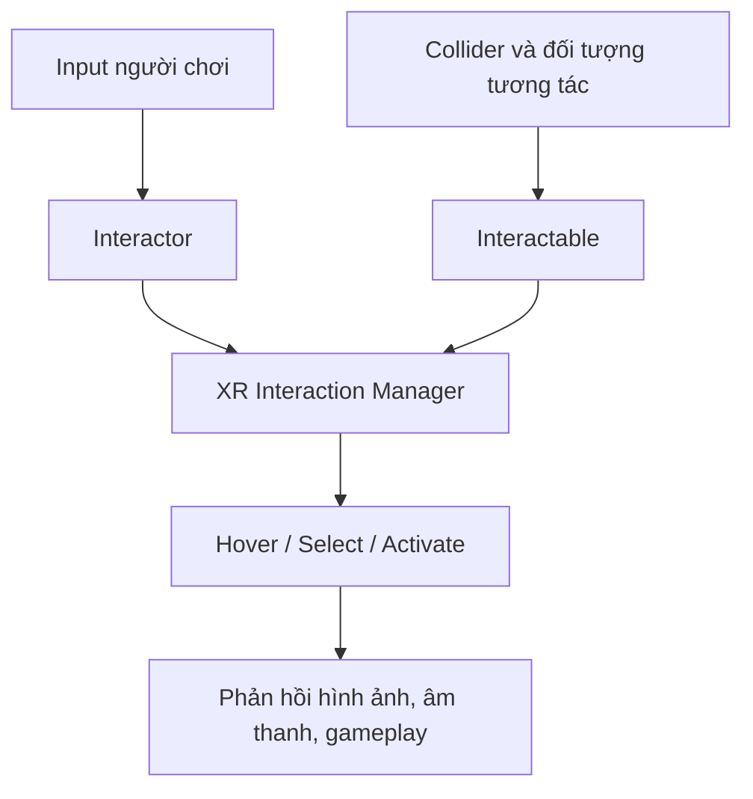

# 2.3 — Tương tác gần, xa và tia trong VR (Near–Far and Ray Interactors)

## 1. Tổng quan

Trong đời thực, ta cầm vật ở gần bằng tay và chỉ vào vật ở xa để ra lệnh. VR tái tạo các thao tác này bằng nhiều kiểu `Interactor`. Một trải nghiệm tốt cần giúp người chơi biết **mình đang nhắm vào đâu**, **vật nào có thể tương tác**, và **thao tác nào sẽ xảy ra**.

**Mục tiêu học tập:**

- Giải thích vai trò của `Interactor`, `Interactable` và bộ điều phối tương tác trong XR Interaction Toolkit.
- Phân biệt tiếp xúc gần, tương tác bằng tia và kiểu near–far kết hợp.
- Cấu hình một scene kiểm tra tương tác ở hai khoảng cách.
- Nhận biết lỗi input, collider, phạm vi tương tác và hiệu năng.

## 2. Mô hình tương tác XR

Một đối tượng VR chỉ phản hồi đúng khi các thành phần phối hợp:

| Thành phần | Vai trò | Ví dụ |
| --- | --- | --- |
| `XR Origin` | Định vị người chơi và các điểm theo dõi trong thế giới ảo | Camera/tay cầm của người dùng |
| `Interactor` | Phát hiện, lựa chọn hoặc thao tác với vật | Tay chạm trực tiếp, tia trỏ |
| `Interactable` | Định nghĩa đối tượng có thể nhận tương tác | Khối hộp có thể nhặt |
| `XR Interaction Manager` | Điều phối các quan hệ tương tác | Quản lý interactor/interactable |
| Input actions | Ánh xạ các thao tác tay cầm/nút | Select, Activate theo cấu hình |

Sơ đồ thể hiện chuỗi logic khái niệm: input và khả năng phát hiện mục tiêu phải khớp trước khi hệ thống có thể tạo tương tác hợp lệ.

## 3. So sánh ba cách tương tác

| Cách tương tác | Cảm giác người dùng | Phù hợp | Vấn đề cần lưu ý |
| --- | --- | --- | --- |
| Direct / near | Tay chạm gần vật | Nhặt, đặt, thao tác gần | Collider/phạm vi chạm phải chính xác |
| Ray / far | Trỏ tia tới mục tiêu | Chọn vật hoặc UI ở xa | Dễ chọn nhầm nếu tia quá dày hoặc mục tiêu quá nhỏ |
| Near–far kết hợp | Chuyển từ chạm gần sang nhắm xa | Môi trường có vật ở nhiều khoảng cách | Phải thiết kế chuyển đổi nhất quán để tránh khó hiểu |

Cơ chế **di chuyển** là vấn đề khác với cơ chế **tương tác**. `Teleportation` đưa người chơi sang vị trí mới theo bước nhảy, còn continuous movement di chuyển liên tục. Cả hai có ảnh hưởng khác nhau đến sự thoải mái, nên không mặc định rằng ray interactor chỉ dùng cho teleport hoặc rằng near–far tự giải quyết locomotion.

## 4. Thực hành scene hai khoảng cách

**Chuẩn bị:** dự án có XR Interaction Toolkit, input actions và XR Origin đã hoạt động; hai đối tượng có collider và khả năng tương tác phù hợp.

1. Tạo một khối hộp **ở gần người chơi** và một khối hộp **ở xa hơn tầm với**. Gán tên rõ ràng trong Hierarchy.
2. Thêm các thành phần `Interactable` tương ứng để vật có thể được chọn. Xác minh collider được gắn đúng vật và không bị vô hiệu hóa.
3. Kiểm tra interactor gần với vật gần. Dùng thay đổi màu/vị trí hoặc một sự kiện đơn giản để xác nhận `Hover` và `Select`.
4. Cấu hình interactor dạng tia phù hợp phiên bản package. Trỏ tới vật xa và xác minh ray thực sự chạm collider cần chọn.
5. Nếu project có near–far interactor, so sánh hành vi khi dịch chuyển tay từ vật gần sang vật xa. Ghi lại thứ tự ưu tiên hoặc điều kiện chuyển đổi quan sát được.
6. Thử locomotion nếu scene hỗ trợ, lưu ý cảm giác thoải mái. Không thay đổi đồng thời cả tương tác và di chuyển khi debug.
7. Chạy trên phần cứng đích nếu có. Quan sát tính ổn định khi đưa tay nhanh hoặc trỏ vào nhiều vật gần nhau.

**Bảng theo dõi kiểm thử:**

| Tình huống | Kết quả mong đợi | Kết quả thực tế |
| --- | --- | --- |
| Tay đưa tới vật gần | Nhận hover/select đúng vật | Ghi sau khi test |
| Ray hướng tới vật xa | Tia tìm đúng mục tiêu | Ghi sau khi test |
| Ray hướng ra khoảng trống | Không chọn vật ngoài ý muốn | Ghi sau khi test |
| Vật bị vô hiệu collider | Không thể chọn bằng cách dựa vào collider đó | Ghi sau khi test |

## 5. Thiết kế sự thoải mái và hiệu năng

HMD cần tốc độ hiển thị cao và **ổn định**. Một scene vẫn có thể gây khó chịu dù tương tác đúng chức năng nếu người dùng bị giật hình khi xoay đầu hoặc di chuyển tay. Các nguyên nhân có thể nằm ở overdraw, số draw call, shader/hiệu ứng đắt hoặc logic chạy quá nhiều mỗi frame.

Hãy dùng Profiler và chạy trên thiết bị đích khi có thể. FPS trong Editor chỉ là tín hiệu ban đầu; không đủ để kết luận trải nghiệm trên HMD. Với ray, giữ phản hồi trực quan rõ ràng và tránh làm màn hình ngập đường tia hoặc hiệu ứng nhấp nháy.

## 6. Xử lý lỗi thường gặp

- **Không thể chọn vật:** kiểm tra input actions, interactor có hoạt động, vật có interactable/collider và các lớp tương tác có tương thích không.
- **Ray nhìn thấy nhưng không có sự kiện:** xác nhận ray thực sự hit mục tiêu và thành phần target có đăng ký tương tác hợp lệ.
- **Thử trong Editor được nhưng HMD lỗi:** kiểm tra runtime OpenXR và ánh xạ controller trên thiết bị.
- **Tương tác gần và xa xung đột:** quan sát trạng thái hover/select, tính ưu tiên và điểm phát hiện vật trong từng chế độ.
- **Khựng hình:** profile trên thiết bị, cô lập hiệu ứng và đo lại sau khi thay đổi từng thành phần.

## 7. Bài thực hành

Xây dựng một quầy VR có ba vật: một vật bắt buộc nhặt bằng tay gần, một bảng chọn ở xa, một vật có thể được tương tác qua cả hai khoảng cách. Viết ngắn cách nhận biết người dùng đang dùng kiểu tương tác nào và ít nhất hai tình huống chọn nhầm cần phòng tránh.

## 8. Câu hỏi ôn tập

**Câu 1.** Thành phần nào đóng vai trò điều phối interactor và interactable?

A. `XR Interaction Manager`.  
B. `AudioClip`.  
C. `Directional Light`.  
D. `Canvas Scaler`.

**Đáp án: A.** Bộ quản lý chịu trách nhiệm điều phối quan hệ tương tác.

**Câu 2.** Chọn vật nằm xa hơn tầm tay thường phù hợp cơ chế nào?

A. Chỉ direct contact.  
B. Chỉ locomotion.  
C. Ray interactor.  
D. Không cần target.

**Đáp án: C.** Tia cho phép nhắm và chọn vật ở xa.

**Câu 3.** Tia hiển thị nhưng không chọn được khối hộp. Bước kiểm tra tốt nhất là gì?

A. Tăng nhạc nền.  
B. Xóa XR Origin.  
C. Thay màu skybox.  
D. Kiểm tra hit, collider, interactable và cấu hình input.

**Đáp án: D.** Một ray trực quan chưa chứng minh toàn bộ chuỗi chọn mục tiêu đã hợp lệ.

**Câu 4.** Phát biểu nào mô tả đúng quan hệ giữa teleportation và ray?

A. Hai khái niệm hoàn toàn giống nhau.  
B. Ray có thể dùng để chọn; teleportation là cơ chế di chuyển.  
C. Teleportation luôn là âm thanh.  
D. Near–far luôn vô hiệu hóa teleportation.

**Đáp án: B.** Kỹ thuật nhắm mục tiêu và phương thức di chuyển giải quyết hai vấn đề khác nhau.

**Câu 5.** Vì sao cần thử trên HMD thực?

A. Vì FPS trong Editor luôn bằng FPS trên HMD.  
B. Vì không cần đo hiệu năng.  
C. Vì sự thoải mái, tracking và hiệu năng thực tế có thể khác Editor.  
D. Vì HMD tự sửa lỗi input.

**Đáp án: C.** Thử trên thiết bị đích giúp phát hiện vấn đề không thể nhìn hết trong Editor.

## 9. Tổng kết

Khả năng tương tác gần và xa mở rộng phạm vi hành động trong VR, nhưng phải được thiết kế nhất quán. Hãy kiểm tra toàn bộ chuỗi **input → interactor → mục tiêu → sự kiện → phản hồi** và luôn xem hiệu năng là một phần của trải nghiệm.

**Tham khảo:** [Unity Learn — Events and Interactions](https://learn.unity.com/pathway/vr-development/unit/events-and-interactions?version=6.3).
