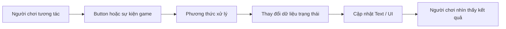

# 2.4 — Thiết kế giao diện người dùng cho VR (User Interface)

## 1. Tổng quan

Giao diện người dùng (UI) cung cấp nơi để đọc thông tin và thực hiện lệnh: chọn chế độ, bật âm thanh, bắt đầu nhiệm vụ hoặc xem điểm số. Trong VR, một bảng UI không chỉ cần **đẹp và dễ đọc** mà còn cần **dễ nhắm, dễ thao tác, không che mất khung cảnh**.

Bài học trình bày các thành phần UI của Unity, cách kết nối sự kiện và cách kiểm thử giao diện trong scene VR. `Canvas`, `RectTransform`, `Button`, `Toggle`, `Slider` và `TextMeshPro` là những khái niệm chính.

**Mục tiêu học tập:**

- Mô tả cấu trúc Canvas và các thành phần hiển thị/giao tiếp.
- Điều chỉnh bố cục và kiểm tra UI ở các kích thước hiển thị khác nhau.
- Kết nối sự kiện `Button` với phương thức cập nhật trạng thái.
- Nhận biết khác biệt giữa thử UI bằng chuột và tương tác UI qua XR.

## 2. Các thành phần UI thiết yếu

| Thành phần | Vai trò | Thử nghiệm nên làm |
| --- | --- | --- |
| `Canvas` | Không gian chứa các phần tử UI | Quan sát chế độ hiển thị và vị trí trong scene |
| `RectTransform` | Điều khiển kích thước, vị trí, anchors | Thay kích thước bố cục |
| `Canvas Scaler` | Hỗ trợ điều chỉnh tỷ lệ UI | Kiểm tra ở nhiều độ phân giải |
| `Button` | Phát sự kiện khi người dùng chọn/nhấn | Gắn `On Click` vào một hành động |
| `Toggle` | Bật/tắt một lựa chọn | Thử đổi trạng thái |
| `Slider` | Điều chỉnh giá trị liên tục | Thử thanh âm lượng |
| `TextMeshPro` | Hiển thị chữ | Kiểm tra cỡ chữ và khả năng đọc |
| `EventSystem` | Điều phối sự kiện UI | Kiểm tra khi nút không nhận đầu vào |

### 2.1. Canvas trong bối cảnh VR

UI 2D thường gắn vào màn hình. Trong VR, nhiều menu được đặt thành một bảng có vị trí trong **không gian 3D** để người chơi nhìn hoặc trỏ tới. Tùy cấu hình UI và hệ XR, cần có cơ chế raycast và input phù hợp để tia của controller tác động đến UI.

Thiết kế nên đặt bảng ở vị trí dễ nhìn, kích thước đủ lớn và tránh buộc người dùng cúi/ngửa cổ quá mức. Các thử nghiệm độ phân giải, anchor và bố cục vẫn hữu ích, nhưng chưa thay thế việc kiểm tra **khoảng cách đọc** và **tương tác bằng controller** trên HMD.

### 2.2. Dữ liệu và phần hiển thị

UI không nên là nơi duy nhất nắm giữ trạng thái của trò chơi. Ví dụ, điểm số được giữ trong một biến và nhãn điểm số hiển thị giá trị đó. Khi điểm thay đổi, cập nhật nhãn ngay tại sự kiện thay vì cập nhật vô điều kiện mỗi frame.



Sơ đồ minh họa luồng một chiều từ hành động đến trạng thái, rồi đến hiển thị. Cách tổ chức này giúp tránh lỗi giao diện hiển thị một số nhưng logic gameplay giữ số khác.

## 3. Thực hành tạo bảng điều khiển

**Chuẩn bị:** scene Unity có camera/XR Origin, Canvas với tiêu đề, `Button`, TextMeshPro, `EventSystem`; hệ UI tương tác XR phù hợp nếu kiểm thử bằng tay cầm.

1. Tạo Canvas và đặt một tiêu đề cùng một Button, ví dụ **“Thêm điểm”**.
2. Sắp xếp tên trong Hierarchy dễ đọc: `MenuCanvas`, `Title`, `ScoreLabel`, `AddPointButton`.
3. Kiểm tra `RectTransform`, anchors và bố cục ở những độ phân giải Game view khác nhau.
4. Viết phương thức quản lý điểm và nối sự kiện `Button` tới phương thức đó trong Inspector.
5. Chạy Play mode bằng chuột hoặc công cụ input đang có để xác nhận điểm số được cập nhật.
6. Nếu UI nằm trong không gian VR, kiểm tra lại raycast/module xử lý UI và khả năng chọn nút bằng interactor trên thiết bị.
7. Thử các trạng thái UI **khởi đầu**, **đang chơi**, **kết thúc**. Xác minh người chơi luôn biết hành động tiếp theo.

Mã minh họa dùng TextMeshPro:

```csharp
using TMPro;
using UnityEngine;

public class ScoreDisplay : MonoBehaviour
{
    [SerializeField] private TMP_Text scoreLabel;
    private int score;

    private void Start()
    {
        RefreshLabel();
    }

    public void AddPoint()
    {
        score++;
        RefreshLabel();
    }

    private void RefreshLabel()
    {
        if (scoreLabel != null)
            scoreLabel.text = $"Điểm: {score}";
    }
}
```

Gán `scoreLabel` trong Inspector và liên kết `AddPoint()` với `Button` (sự kiện `On Click`). Giao diện ban đầu hiển thị `Điểm: 0`, sau mỗi lần bấm tăng thêm một điểm. Hãy kiểm thử cả trường hợp tham chiếu nhãn chưa được gán.

## 4. Kiểm thử UI theo trạng thái

| Trạng thái | Nội dung hiển thị | Hành động cần thử |
| --- | --- | --- |
| Khởi đầu | Tiêu đề, nút bắt đầu | Bấm bắt đầu và kiểm tra chuyển trạng thái |
| Đang chơi | Điểm số, tác vụ, điều khiển | Thay đổi điểm và quan sát nhãn |
| Kết thúc | Thông báo hoàn thành, nút tiếp tục/quay lại | Bấm nút và kiểm tra điều hướng |

Nút có kích thước dễ đọc chưa chắc dễ chọn trong VR. Đặc biệt lưu ý khoảng cách giữa các nút, khả năng định vị tia, độ tương phản văn bản và trạng thái hover/selected.

## 5. Lỗi thường gặp

- **Button không nhận thao tác:** kiểm tra `EventSystem`, raycast target, trạng thái interactable, và input module tương ứng.
- **Text tràn khung:** kiểm tra kích thước `RectTransform`, anchors, font size và thiết lập tự ngắt dòng.
- **Hiển thị đúng trên màn hình nhưng khó đọc trên HMD:** điều chỉnh vị trí/kích thước bảng UI và thử trên thiết bị.
- **Điểm hiển thị sai:** kiểm tra nơi lưu điểm và thời điểm `RefreshLabel()` được gọi.
- **Bấm một lần tăng nhiều điểm:** xem có nối nhiều listener hoặc nhiều đường sự kiện cùng gọi phương thức không.

## 6. Bài luyện tập

Tạo menu VR có ba chức năng: **Bắt đầu**, **Bật/tắt âm thanh**, **Tăng điểm thử nghiệm**. Mỗi chức năng cần phản hồi trực quan. Hãy kiểm tra ít nhất hai bố cục và ghi lại lý do chọn bố cục cuối cùng.

## 7. Câu hỏi ôn tập

**Câu 1.** Một nút không nhận sự kiện dù hiển thị bình thường. Thành phần nào nên kiểm tra trước?

A. `Light Probe`.  
B. `AudioClip`.  
C. `EventSystem` và cấu hình raycast/input.  
D. `Mesh Renderer` của sàn.

**Đáp án: C.** Hiển thị UI và nhận sự kiện input là hai bước khác nhau.

**Câu 2.** Vì sao cần cập nhật nhãn khi điểm thay đổi?

A. Để UI phản ánh dữ liệu mới mà không chạy cập nhật thừa mỗi frame.  
B. Để xóa dữ liệu điểm.  
C. Để vô hiệu hóa mọi nút.  
D. Để bật đèn tự động.

**Đáp án: A.** UI cần đồng bộ với trạng thái ứng dụng tại thời điểm có thay đổi.

**Câu 3.** Thành phần nào chứa các phần tử UI?

A. `Audio Listener`.  
B. `Collider`.  
C. `Light`.  
D. `Canvas`.

**Đáp án: D.** Canvas là không gian tổ chức các phần tử giao diện.

**Câu 4.** Bảng UI đặt trong không gian VR cần kiểm thử bổ sung điều gì?

A. Chỉ kích thước màn hình desktop.  
B. Khả năng đọc và chọn bằng bộ điều khiển ở khoảng cách sử dụng.  
C. Chỉ màu của terrain.  
D. Chỉ độ dài của AudioClip.

**Đáp án: B.** UI VR phụ thuộc khoảng cách, tư thế nhìn và đầu vào từ controller.

**Câu 5.** Cấu trúc nào dễ bảo trì nhất cho hệ thống điểm?

A. Viết điểm số trực tiếp cố định trong Text.  
B. Thay đổi text ngẫu nhiên mỗi frame.  
C. Lưu điểm trong trạng thái và hiển thị từ trạng thái đó.  
D. Dùng ánh sáng thay thế dữ liệu.

**Đáp án: C.** Tách dữ liệu và phần hiển thị làm logic nhất quán, dễ kiểm thử.

## 8. Tổng kết

Giao diện VR hiệu quả phải đồng thời **dễ đọc**, **dễ nhắm chọn** và **phản ánh đúng trạng thái**. Bắt đầu từ một Canvas đơn giản, kết nối sự kiện rõ ràng rồi kiểm tra từ Editor đến thiết bị XR thực.

**Tham khảo:** [Unity Learn — Events and Interactions](https://learn.unity.com/pathway/vr-development/unit/events-and-interactions?version=6.3).
