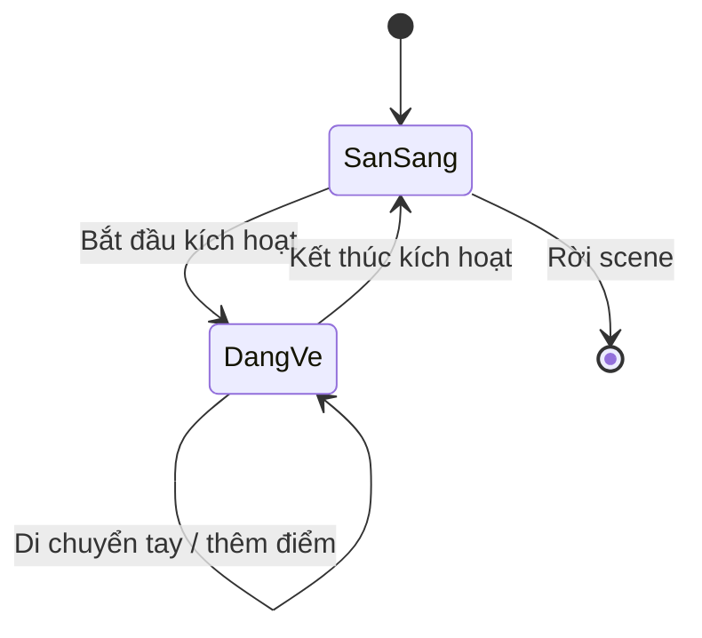
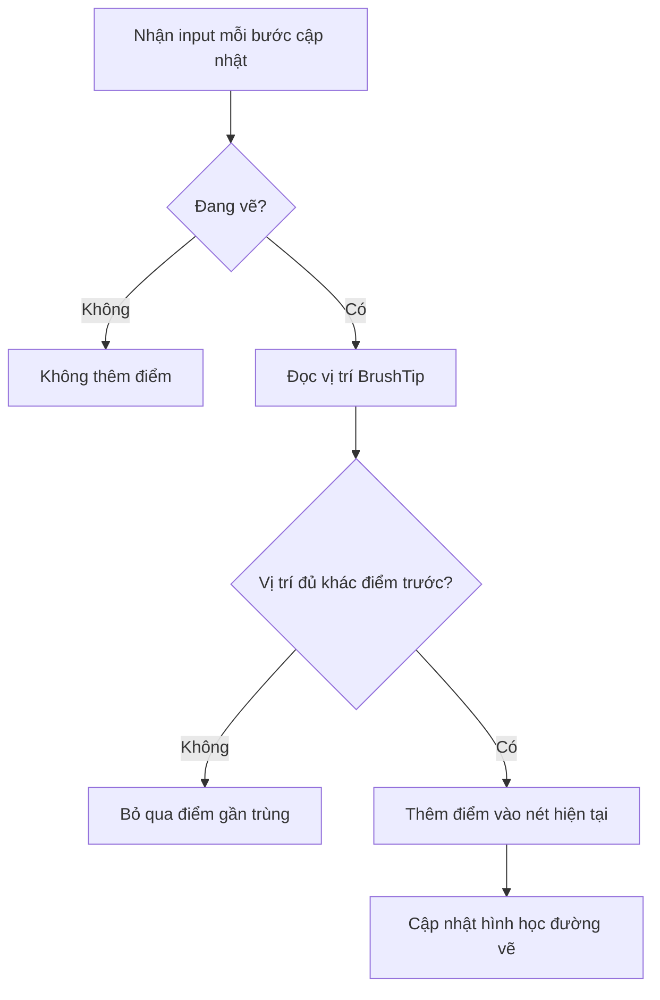

# Challenge 2 — Thử thách vẽ trong không gian 3D (3D Painting)

## 1. Bài toán

Hãy xây dựng một nguyên mẫu **vẽ bằng chuyển động tay trong không gian VR**. Người chơi có thể đưa đầu công cụ vẽ tới một vị trí 3D, thực hiện thao tác bắt đầu vẽ, di chuyển tay để tạo nét và dừng thao tác để kết thúc nét. Nguyên mẫu cần phản hồi trực quan rõ ràng và có thể kiểm chứng trong Play mode.

Đây là bài thực hành tổng hợp về **input**, **sự kiện tương tác**, **đối tượng trong scene** và **hiệu năng**. Không bắt buộc tạo một ứng dụng vẽ hoàn chỉnh; ưu tiên một vòng tương tác nhỏ chạy đúng, giải thích được.

## 2. Mục tiêu sản phẩm

Khi hoàn thành, người chơi có thể:

- Bắt đầu một nét vẽ tại vị trí của đầu bút ảo.
- Di chuyển bút trong không gian để tạo đường đi nhìn thấy được.
- Kết thúc nét khi nhả thao tác kích hoạt.
- Phân biệt một nét vẽ đã kết thúc với nét mới.
- Quan sát phản hồi khi vẽ và kiểm tra lỗi cơ bản.

**Lưu ý phạm vi:** Các yêu cầu trên là đề xuất thực hành được biên soạn cho thử thách, không phải bản liệt kê tiêu chí chấm chính thức của Unity Learn.

## 3. Kiến thức cần vận dụng

| Nội dung | Vai trò trong thử thách |
| --- | --- |
| XR Origin và hệ input | Theo dõi vị trí/định hướng tay và nhận thao tác điều khiển |
| `Interactor`/`Interactable` | Xác định công cụ vẽ được chọn hoặc kích hoạt như thế nào |
| Sự kiện bắt đầu/kết thúc thao tác | Quyết định lúc nào thêm điểm vào nét |
| `Transform` của đầu bút | Cung cấp vị trí 3D để vẽ |
| `LineRenderer` hoặc kỹ thuật tạo hình tương đương | Hiển thị chuỗi điểm thành nét vẽ |
| Phản hồi âm/haptics (tùy thiết bị) | Báo hiệu bắt đầu hoặc kết thúc thao tác |

**Gợi ý kỹ thuật:** Có thể dùng `LineRenderer` để hiển thị một polyline theo các vị trí được ghi lại; không nhất thiết phải dựng mesh hoặc shader phức tạp ở bản đầu tiên.

## 4. Sơ đồ trạng thái công cụ vẽ

Ở trạng thái **Sẵn sàng**, chuyển động tay không được tự sinh nét mới. Chỉ khi nhận thao tác kích hoạt, công cụ mới chuyển sang **Đang vẽ** và ghi lại đường đi. Khi kết thúc, nét cũ phải được giữ lại nếu mục tiêu là tạo nhiều nét riêng biệt.

## 5. Nhiệm vụ theo mốc thực hiện

### 5.1. Mốc 1 — Scene và đầu bút

1. Chuẩn bị scene có XR Origin, sàn và không gian trống để thao tác.
2. Tạo một đối tượng `BrushTip` đại diện cho đầu bút ảo và gắn nó với vị trí tay điều khiển phù hợp.
3. Chạy thử, xác minh `BrushTip` chuyển động theo tay và không nằm lệch quá xa vị trí mong muốn.

**Checkpoint:** Ghi được ảnh hoặc video đầu bút đang được theo dõi trong scene.

### 5.2. Mốc 2 — Một nét vẽ

1. Chọn một đầu vào để bắt đầu/kết thúc vẽ (ví dụ hành động activation đã được cấu hình trong hệ XR).
2. Khi bắt đầu, tạo cấu trúc lưu điểm hoặc đối tượng hiển thị nét mới.
3. Trong lúc vẽ, ghi các vị trí của `BrushTip` theo chuyển động. Tránh ghi quá nhiều điểm gần như trùng nhau.
4. Khi kết thúc, dừng thêm điểm; quan sát nét vẫn còn trong scene.

**Checkpoint:** Tạo được một nét dài, có đầu và cuối rõ ràng.

### 5.3. Mốc 3 — Nhiều nét và phản hồi

1. Vẽ hai nét ở hai vùng không gian khác nhau.
2. Kiểm tra việc bắt đầu nét thứ hai không xóa nhầm hoặc nối liền với nét thứ nhất.
3. Tạo phản hồi trực quan khi bắt đầu vẽ; có thể thêm âm ngắn hoặc rung nếu thiết bị hỗ trợ.

**Checkpoint:** Ít nhất hai nét tồn tại độc lập trong scene.

### 5.4. Mốc 4 — Kiểm thử và tinh chỉnh

1. Thử di chuyển tay chậm, nhanh, rồi dừng tay ở cùng một vị trí.
2. Quan sát đoạn thẳng bị đứt, rung hoặc xuất hiện quá nhiều điểm.
3. Chỉ thay đổi một tham số mỗi lần, chẳng hạn khoảng cách tối thiểu giữa hai điểm ghi nhận.
4. Nếu có HMD, kiểm thử trên thiết bị đích, chú ý độ trễ và độ mượt.

**Checkpoint:** Có ít nhất một cải tiến được ghi lại trước và sau khi sửa.

## 6. Lưu đồ xử lý nét vẽ

Sơ đồ là nguyên tắc xử lý, **không phải toàn bộ mã giải bài**. Giải pháp cụ thể còn tùy hệ XR, vật liệu nét, cách lưu điểm và thiết bị mục tiêu. Lọc vị trí quá gần nhau có thể giảm số điểm không cần thiết, nhưng ngưỡng quá lớn sẽ làm nét gấp khúc.

## 7. Các lỗi nên chủ động thử

| Tình huống | Hậu quả có thể xảy ra | Hướng kiểm tra |
| --- | --- | --- |
| Đầu bút không được theo dõi | Nét xuất hiện sai vị trí | Kiểm tra `Transform` và tracking |
| Input không map đúng | Không vào trạng thái đang vẽ | Kiểm tra action, interactor, tương tác |
| Không reset nét hiện tại | Nét mới nối vào nét cũ | Kiểm tra thời điểm bắt đầu một nét mới |
| Lưu quá nhiều điểm | Hao bộ nhớ/giảm hiệu năng | Quan sát số điểm và profiler |
| Material/renderer chưa đúng | Dữ liệu điểm có nhưng không thấy nét | Kiểm tra `LineRenderer`, màu, chiều rộng và camera |

## 8. Tiêu chí nghiệm thu và sản phẩm cần nộp

- [ ] Scene hoặc project chạy được.
- [ ] Có thao tác bắt đầu và kết thúc nét vẽ.
- [ ] Có thể tạo hai nét riêng biệt trong không gian 3D.
- [ ] Có phản hồi quan sát được khi vẽ.
- [ ] Có minh chứng thành công bằng ảnh/video.
- [ ] Có mô tả ít nhất một lỗi, cách tái hiện và cách sửa.
- [ ] Có một điều chỉnh cải thiện trải nghiệm hoặc hiệu năng.

**Sản phẩm nộp:** project/scene hoặc build có thể chạy; ảnh/video minh chứng; bảng kiểm thử ngắn; giải thích kiến trúc xử lý input → nét vẽ.

## 9. Câu hỏi tự đánh giá

**Câu 1.** Vì sao phải phân biệt trạng thái sẵn sàng và đang vẽ?

A. Để bút luôn tự vẽ khi di chuyển.  
B. Để mọi nét bị nối với nhau.  
C. Để bỏ qua input.  
D. Để chỉ thêm điểm trong thời gian người chơi chủ động vẽ.

**Đáp án: D.** Quản lý trạng thái giúp tránh các nét không mong muốn.

**Câu 2.** Vì sao nên thử bỏ qua các điểm rất gần nhau?

A. Vì `Transform` không có vị trí.  
B. Vì giảm số điểm dư thừa có thể giảm chi phí cập nhật.  
C. Vì làm camera tự di chuyển.  
D. Vì giúp thay thế input actions.

**Đáp án: B.** Lưu và hiển thị quá nhiều điểm gần trùng không mang lại khác biệt tương xứng.

**Câu 3.** Hai nét vẽ vô tình bị nối vào nhau. Nên kiểm tra gì?

A. Logic tạo nét mới khi bắt đầu lần vẽ thứ hai.  
B. Màu của skybox.  
C. `Audio Listener`.  
D. Độ sáng môi trường.

**Đáp án: A.** Nét mới cần cấu trúc/đối tượng hiển thị riêng.

**Câu 4.** Có dữ liệu điểm nhưng không thấy đường vẽ. Cần kiểm tra gì?

A. Chỉ thay controller.  
B. Chỉ tăng FPS.  
C. Thành phần hiển thị nét, vật liệu, chiều rộng và góc nhìn.  
D. Chỉ xóa điểm.

**Đáp án: C.** Dữ liệu đúng chưa đủ nếu đối tượng render không hiển thị được.

**Câu 5.** Cách kiểm chứng cải tiến hợp lý nhất là gì?

A. Thay nhiều biến rồi ước lượng.  
B. Chỉ quay video thành công cuối.  
C. Không lưu kết quả ban đầu.  
D. Thay một yếu tố, kiểm thử cùng tình huống, so sánh trước–sau.

**Đáp án: D.** Phép so sánh có kiểm soát giúp xác định thay đổi nào thực sự tạo hiệu quả.

## 10. Tổng kết

Thử thách vẽ 3D rèn kỹ năng chuyển input VR thành hành động liên tục, có trạng thái và phản hồi. Kết quả tốt không chỉ là nét vẽ xuất hiện, mà còn là khả năng **tách các nét**, **dự đoán hành vi**, **kiểm thử lỗi** và **tối ưu trên thiết bị đích**.

**Tham khảo:** [Unity Learn — Events and Interactions](https://learn.unity.com/pathway/vr-development/unit/events-and-interactions?version=6.3).
