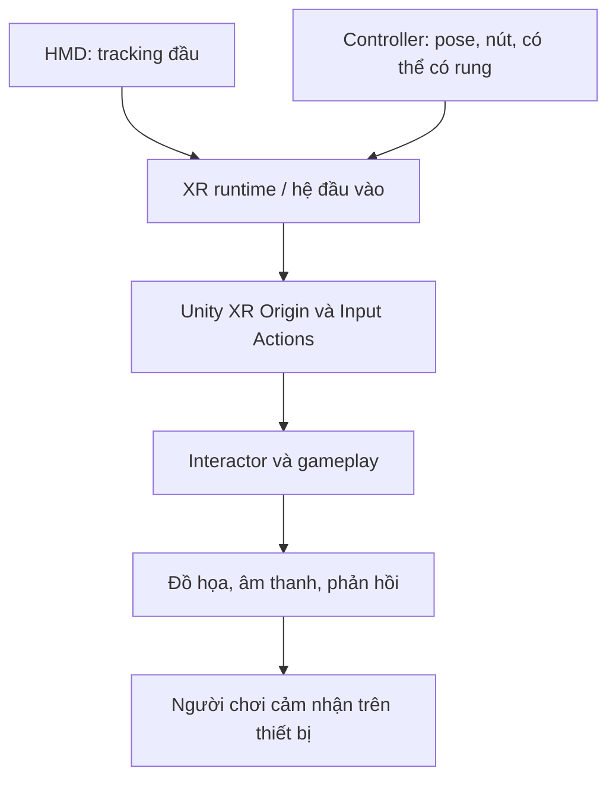

# Tổng quan hệ sinh thái phần cứng XR (The XR Hardware Landscape)

## 1. Tổng quan

Phần cứng quyết định người chơi **nhìn thấy gì**, **điều khiển thế nào** và **ứng dụng cần tối ưu ra sao**. Một thao tác hoạt động bằng chuột trong Unity Editor chưa chắc hoạt động bằng controller trên HMD. Vì vậy, khi phát triển VR cần hiểu các nhóm thiết bị và kiểm thử theo đúng mục tiêu triển khai.

**Mục tiêu học tập:**

- Nhận biết các nhóm phần cứng thường gặp trong hệ sinh thái XR.
- Phân biệt HMD, thiết bị nhập liệu, tracking và bộ xử lý/rendering.
- Giải thích ảnh hưởng của phần cứng đến thiết kế tương tác và sự thoải mái.
- Lập checklist kiểm thử một project VR trên thiết bị đích.

## 2. XR, VR và các thành phần hệ thống

**XR (Extended Reality)** là thuật ngữ bao quát các trải nghiệm thực tế mở rộng. **VR (Virtual Reality)** thường đưa người chơi vào một môi trường ảo, quan sát bằng HMD. Các biến thể XR khác có thể kết hợp hoặc bổ sung nội dung ảo lên môi trường thật; phạm vi tính năng phụ thuộc từng thiết bị.

| Nhóm | Vai trò trong ứng dụng |
| --- | --- |
| HMD (Head-Mounted Display) | Cung cấp hình ảnh cho người dùng và thường theo dõi chuyển động đầu |
| Controller / tay cầm | Nhận thao tác điều khiển, vị trí/định hướng và có thể cung cấp haptics |
| Hệ tracking | Xác định vị trí và hướng của đầu/tay hoặc đối tượng được theo dõi |
| Hệ âm thanh | Tái tạo âm nền, âm không gian, thông báo tương tác |
| Thiết bị tính toán | Chạy logic game, xử lý đồ họa và cung cấp tài nguyên phần cứng |
| Runtime / nền tảng XR | Kết nối ứng dụng với khả năng thiết bị qua các lớp phần mềm hỗ trợ |

## 3. Cấu trúc dữ liệu từ thiết bị đến trải nghiệm

Sơ đồ phân biệt **tín hiệu đi vào** (tracking và nút điều khiển) với **tín hiệu đi ra** (render, âm thanh, rung). Một lỗi chọn vật có thể bắt nguồn từ ánh xạ input, ngay cả khi hình ảnh scene hiển thị chính xác.

## 4. Những khác biệt phần cứng ảnh hưởng đến thiết kế

### 4.1. Cách xử lý ứng dụng

Một thiết bị VR **standalone** có thể thực thi ứng dụng bằng phần cứng tích hợp. Một hệ **PC VR** phụ thuộc máy tính để chạy và xuất hình lên HMD. Nguồn lực render, khả năng tính toán và quy trình build/deploy cần được lựa chọn theo thiết bị mục tiêu; không nên tự giả định cùng một cấu hình hiệu năng cho mọi máy.

### 4.2. Tracking và input

Một số trải nghiệm phụ thuộc tay cầm, số khác có thể dùng theo dõi tay hoặc phương thức nhập bổ sung. **Không được mặc định** rằng mọi hệ XR đều hỗ trợ đồng thời mọi loại input hoặc tính năng haptics. Tài liệu dự án nên nêu rõ cách thao tác chính và cách dự phòng khi một khả năng phần cứng không sẵn có.

### 4.3. Đồ họa và sự thoải mái

Đối với HMD, tốc độ khung hình cao và ổn định có vai trò đặc biệt quan trọng. Giảm hiệu ứng đắt, overdraw và draw call có thể cải thiện hiệu năng; tuy nhiên cần **đo** để xác định nút thắt thực tế. Sự thoải mái còn phụ thuộc cách di chuyển: teleportation và continuous movement tạo cảm giác khác nhau, nên cần cho người dùng lựa chọn phù hợp khi thiết kế ứng dụng.

## 5. Hướng dẫn kiểm thử theo thiết bị mục tiêu

1. **Xác định môi trường triển khai:** ghi rõ thiết bị HMD, loại controller, runtime và phương thức chạy ứng dụng. Không cần tự đoán version của package.
2. **Xác nhận tracking:** quan sát camera/XR Origin có đi theo chuyển động đầu và tay đúng không.
3. **Thử input:** chọn một vật có `Interactable` và kiểm tra `Hover`, `Select`, `Activate` theo thiết kế.
4. **Thử âm/haptics:** phát một âm sự kiện và kiểm tra phản hồi rung chỉ khi thiết bị hỗ trợ.
5. **Thử di chuyển:** so sánh teleportation và continuous movement (nếu có), ghi nhận sự thoải mái của người trải nghiệm.
6. **Thử hiệu năng:** chạy scene đại diện trên thiết bị đích, dùng công cụ profiler phù hợp, kiểm tra hiện tượng giật/độ trễ.
7. **Ghi kết quả:** lưu ảnh, log lỗi và điều kiện thử nghiệm để có thể tái hiện.

## 6. Bảng kiểm tra tương thích

| Tính năng | Cần xác nhận | Nếu không hoạt động |
| --- | --- | --- |
| Camera VR | HMD cập nhật góc nhìn theo tracking | Kiểm tra runtime và XR Origin |
| Controller | Input action nhận đúng nút/pose | Kiểm tra profile và bindings |
| Tương tác direct/ray | Chọn được vật hợp lệ | Kiểm tra collider, interactor, interactable |
| Âm thanh | Âm được phát ở vị trí/âm lượng mong đợi | Kiểm tra listener và source |
| Haptics | Thiết bị thực có rung khi yêu cầu | Xác nhận hỗ trợ và cấu hình haptics |
| Frame rate/độ mượt | Hành động không bị khựng khó chịu | Profile scene trên thiết bị |

## 7. Bài thực hành

Thiết kế một **bảng yêu cầu phần cứng** cho scene VR nhỏ gồm nhặt vật, trỏ tia, mở bảng UI và phản hồi âm thanh. Với mỗi tính năng, chỉ rõ: đầu vào cần thiết, thành phần Unity liên quan, cách xác nhận khi chạy, phương án giảm chức năng nếu thiết bị không hỗ trợ.

## 8. Câu hỏi ôn tập

**Câu 1.** Vì sao không thể kết luận ứng dụng chạy tốt trên HMD chỉ dựa vào FPS trong Editor?

A. Vì Unity Editor không có hình ảnh.  
B. Vì phần cứng, runtime và tải thực tế trên HMD khác môi trường Editor.  
C. Vì FPS không thể đo được.  
D. Vì controller không có nút.

**Đáp án: B.** Hiệu năng cần được đo ở môi trường đích.

**Câu 2.** Thành phần nào thường chịu trách nhiệm theo dõi chuyển động đầu để thay đổi góc nhìn?

A. HMD và hệ tracking.  
B. `Button` UI.  
C. `AudioClip`.  
D. `LineRenderer`.

**Đáp án: A.** Hệ theo dõi chuyển động đầu cung cấp dữ liệu pose cho trải nghiệm nhìn.

**Câu 3.** Phát biểu nào đúng về haptics?

A. Mọi HMD và controller đều rung giống nhau.  
B. Haptics thay thế toàn bộ hình ảnh.  
C. Không cần cấu hình input.  
D. Cần xác nhận khả năng hỗ trợ trên phần cứng mục tiêu.

**Đáp án: D.** Khả năng rung tùy thiết bị và phần mềm hỗ trợ.

**Câu 4.** Một chức năng tương tác không nhận nút trên HMD. Nên kiểm tra lớp nào?

A. Bố cục lightmap trước tiên.  
B. Chỉ màu background.  
C. Runtime, ánh xạ input và interactor.  
D. Chỉ độ phân giải video.

**Đáp án: C.** Input đi qua hệ phần cứng/runtime trước khi tới logic tương tác.

**Câu 5.** Vì sao nên xem xét cả teleportation và continuous movement?

A. Vì hai kiểu di chuyển ảnh hưởng khác nhau tới sự thoải mái của người dùng.  
B. Vì teleportation luôn có FPS cao hơn.  
C. Vì continuous movement không cần input.  
D. Vì cả hai là cùng một kiểu chọn vật.

**Đáp án: A.** Phương thức locomotion tác động trực tiếp đến trải nghiệm và comfort.

## 9. Tổng kết

Phát triển VR hiệu quả không chỉ là dựng scene và gắn script. Cần kết nối thiết kế tương tác với các giới hạn của HMD, tracking, input và năng lực render; đồng thời **kiểm thử trên phần cứng mục tiêu** khi có điều kiện.

**Tham khảo:** [Unity Learn — Events and Interactions](https://learn.unity.com/pathway/vr-development/unit/events-and-interactions?version=6.3).
