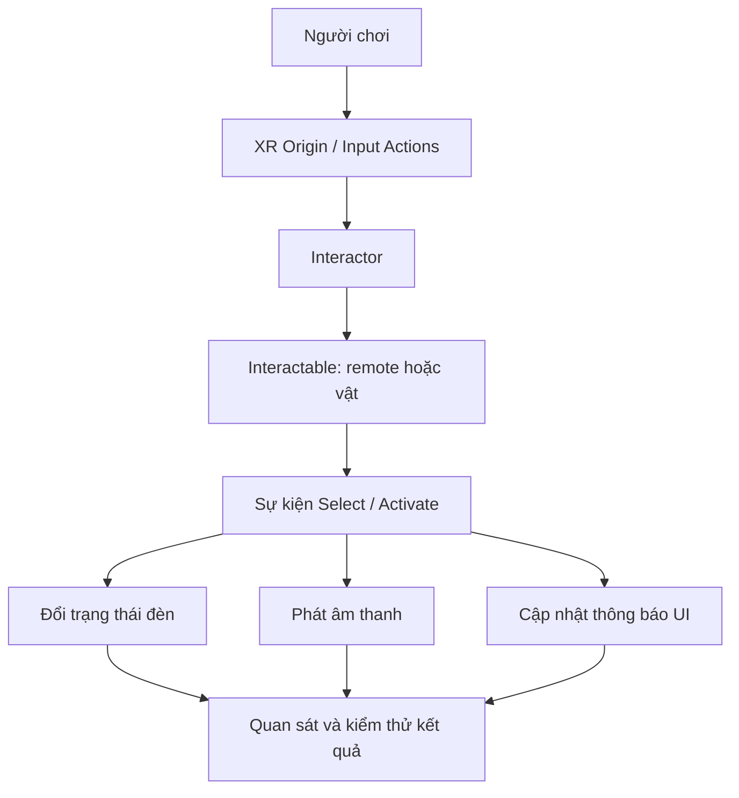

# Lab 2 — Dự án cá nhân: Sự kiện và tương tác trong VR

## 1. Tổng quan

Bài lab yêu cầu tạo một **scene VR nhỏ nhưng hoàn chỉnh về tương tác**. Người chơi phải thực hiện được ít nhất một hành động, nhận phản hồi rõ ràng và quan sát sự thay đổi trạng thái. Kỹ năng trọng tâm là kết nối những phần đã học: interactor, sự kiện `Select`/`Activate`, âm thanh, UI và kiểm thử.

Đề xuất thực hiện một **góc phòng trải nghiệm** có remote điều khiển đèn, một vật nhặt được và một bảng hướng dẫn. Người học có thể thay đổi chủ đề miễn sao vẫn chứng minh được luồng sự kiện hợp lệ.

**Lưu ý:** Đây là đề thực hành tự biên soạn theo chủ đề Lab 2, không phải yêu cầu chấm điểm chính thức của Unity Learn.

## 2. Mục tiêu và kết quả cần đạt

- Thiết lập được scene có XR Origin và hệ input tương thích.
- Có một vật dùng `Interactable` được điều khiển bởi interactor gần hoặc tia.
- Có một hành động thay đổi rõ ràng trạng thái scene.
- Có phản hồi bằng hình ảnh, âm thanh hoặc UI tại thời điểm thích hợp.
- Tự ghi lỗi, tái hiện lỗi và kiểm thử lại sau khi sửa.

## 3. Chuẩn bị

| Hạng mục | Yêu cầu |
| --- | --- |
| Dự án Unity | Có cấu hình XR phù hợp với môi trường hiện dùng |
| Scene | Không gian đủ rộng, vật và camera dễ quan sát |
| Input | Select/Activate được ánh xạ theo hệ điều khiển |
| Thành phần tương tác | XR Origin, interactor và interactable hoạt động |
| Tài nguyên | Một đối tượng có thể cầm, một đèn, một AudioClip được phép dùng, Canvas nếu cần |
| Kiểm thử | Play mode; HMD thực nếu có |

## 4. Kiến trúc mẫu

Đây là kiến trúc tham khảo, không áp đặt phải có mọi nhánh. Nhánh nào được chọn cần có **sự kiện đầu vào** và **kết quả đầu ra** rõ ràng để kiểm chứng.

## 5. Quy trình thực hiện

### 5.1. Giai đoạn 1 — Xác định kịch bản tương tác

Viết một câu mô tả ngắn: “Khi người chơi ..., hệ thống sẽ ..., và người chơi nhận biết bằng ...”. Ví dụ: “Khi người chơi kích hoạt remote, đèn phòng đổi trạng thái và phát một tiếng xác nhận”.

Liệt kê tối thiểu hai tình huống: **thành công** và **không có tác dụng** (ví dụ kích hoạt khi chưa chọn đúng vật, nếu thiết kế yêu cầu phải cầm vật).

### 5.2. Giai đoạn 2 — Dựng scene và cấu hình tương tác

1. Tạo scene có XR Origin, camera và điều kiện ánh sáng đủ để quan sát.
2. Đặt một vật tương tác, gắn collider và interactable phù hợp.
3. Cấu hình direct hoặc ray interactor theo input hiện có.
4. Kiểm tra `Hover`/`Select` trước khi thêm các hiệu ứng khác.

**Checkpoint:** người chơi chọn/cầm được vật theo thiết kế.

### 5.3. Giai đoạn 3 — Kết nối sự kiện với chức năng

1. Chọn một chức năng đơn giản như bật/tắt đèn hoặc thay đổi trạng thái hiển thị.
2. Tạo phương thức xử lý chức năng; tách phần logic khỏi phần nhận input nếu có thể.
3. Liên kết phương thức với đúng sự kiện `Activate` hoặc sự kiện được lựa chọn.
4. Kiểm tra không có sự thay đổi ngoài ý muốn khi chỉ hover hoặc cầm vật.

**Checkpoint:** hành động hợp lệ tạo thay đổi trạng thái lặp lại được.

### 5.4. Giai đoạn 4 — Thêm phản hồi

1. Gắn Audio Source và âm sự kiện phù hợp.
2. Nếu có UI, hiển thị trạng thái đèn hoặc hướng dẫn thao tác.
3. Nếu thiết bị hỗ trợ, thử bổ sung rung tay cầm; không để tính năng rung trở thành điều kiện bắt buộc của lab.

**Checkpoint:** người chơi hiểu mình vừa thực hiện thành công hành động nào.

### 5.5. Giai đoạn 5 — Debug và hoàn thiện

1. Tự tạo một lỗi (ví dụ bỏ tham chiếu nguồn sáng) và ghi nhận triệu chứng.
2. Kiểm tra Console, Inspector, input mapping, collider và kết nối sự kiện theo thứ tự phù hợp.
3. Sửa một nguyên nhân giả định và chạy lại đúng tình huống trước đó.
4. Nếu có HMD, thử trên thiết bị đích và quan sát độ mượt/comfort.

**Checkpoint:** có bằng chứng trước–sau khi sửa ít nhất một lỗi.

## 6. Bảng kiểm thử mẫu

| ID | Thao tác | Kết quả mong đợi | Minh chứng |
| --- | --- | --- | --- |
| T01 | Chọn vật tương tác | Vật phản hồi trạng thái chọn | Ảnh/video |
| T02 | Kích hoạt chức năng | Đèn hoặc trạng thái scene đổi | Ảnh/video |
| T03 | Kích hoạt lại | Trạng thái đổi theo quy tắc đã thiết kế | Ảnh/video |
| T04 | Ngắt một tham chiếu có chủ đích | Lỗi được phát hiện và giải thích | Console/ghi chú |
| T05 | Thử sau khi sửa | Hành vi hoạt động trở lại | Ảnh/video |

Người thực hành điền **kết quả thực tế**, trạng thái Pass/Fail và nhận xét vào bản bảng kiểm thử của riêng mình, không chỉ đánh dấu tất cả là đạt.

## 7. Xử lý sự cố

| Vấn đề | Kiểm tra trước |
| --- | --- |
| Không có tương tác | Runtime, input actions, interactor và interactable |
| Không cầm được vật | Collider, trạng thái GameObject, lớp tương tác |
| Bấm remote không bật đèn | Event binding, tham chiếu `Light`, phương thức xử lý |
| Không nghe âm | AudioClip, Audio Source, Audio Listener, khoảng cách |
| UI không phản hồi | EventSystem, raycast/input module của UI |
| HMD chạy giật | Profiler trên thiết bị, hiệu ứng render, logic frame |

## 8. Sản phẩm cần nộp

- [ ] Project/scene hoặc build chạy được.
- [ ] Sơ đồ mô tả tương tác hoặc ghi chú luồng input → sự kiện → phản hồi.
- [ ] Ít nhất một ảnh/video của kết quả thành công.
- [ ] Bảng kiểm thử có tình huống thành công và tình huống lỗi.
- [ ] Mô tả ngắn một cải tiến sau lần thử đầu tiên.
- [ ] Không có lỗi nghiêm trọng chưa được giải thích trong Console khi thực hiện tương tác cốt lõi.

## 9. Câu hỏi ôn tập

**Câu 1.** Dấu hiệu nào chứng minh tương tác chính của lab đã hoạt động?

A. Có nhiều đối tượng trong scene.  
B. Scene có nhạc nền.  
C. Đầu vào hợp lệ tạo ra trạng thái/ phản hồi có thể kiểm chứng.  
D. Có nhiều vật liệu đẹp.

**Đáp án: C.** Bài lab đánh giá một luồng tương tác thực sự hoàn chỉnh.

**Câu 2.** Vì sao nên kiểm tra `Hover`/`Select` trước khi thêm âm thanh và UI?

A. Để cô lập việc nhận tương tác trước khi thêm phần phản hồi.  
B. Vì âm thanh không dùng trong VR.  
C. Vì UI tự sửa collider.  
D. Vì không cần input.

**Đáp án: A.** Tách các giai đoạn giúp debug dễ dàng hơn.

**Câu 3.** Remote bật đèn ngay khi cầm, khác với thiết kế chỉ bật khi kích hoạt. Nên kiểm tra gì?

A. Chỉ texture sàn.  
B. Chỉ màu Canvas.  
C. Chỉ số lượng âm thanh.  
D. Sự kiện nào đang gọi hàm đổi trạng thái.

**Đáp án: D.** Kết nối `Select`/`Activate` không đúng có thể làm hành vi xảy ra sai thời điểm.

**Câu 4.** Phương pháp debug nào đáng tin cậy hơn?

A. Sửa đồng thời mọi component.  
B. Tái hiện lỗi, xác định giả thuyết, sửa một yếu tố, thử lại.  
C. Xóa scene và làm lại mọi lúc.  
D. Chỉ xem Game view.

**Đáp án: B.** Một thay đổi có kiểm soát giúp xác nhận nguyên nhân.

**Câu 5.** Minh chứng nào hữu ích nhất khi bàn giao lab?

A. Chỉ tên dự án.  
B. Chỉ ảnh Hierarchy.  
C. Project chạy được, bằng chứng hoạt động và bảng kiểm thử.  
D. Chỉ một tệp văn bản rỗng.

**Đáp án: C.** Cần có cả sản phẩm lẫn bằng chứng kiểm chứng.

## 10. Tổng kết

Lab 2 hoàn thành khi có thể trình diễn và giải thích một tương tác VR theo toàn chuỗi **input → interactor → sự kiện → xử lý → phản hồi**, kèm ít nhất một lượt kiểm thử và sửa lỗi có ghi chép.

**Tham khảo:** [Unity Learn — Events and Interactions](https://learn.unity.com/pathway/vr-development/unit/events-and-interactions?version=6.3).
