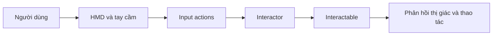

# Bài 01 — Thiết kế VR thoải mái và dễ tiếp cận (Comfort and Accessibility)

> **Lộ trình:** VR Development · **Học phần:** Ergonomics and Optimization · **Ngữ cảnh:** Unity 6.3, XR Interaction Toolkit
>
> **Mục tiêu chính:** Xây dựng tương tác VR có thể sử dụng thoải mái, dễ kiểm soát và kiểm chứng được trên thiết bị đeo.

## 1. Tại sao sự thoải mái quan trọng trong VR?

Trong ứng dụng 2D, người dùng nhìn vào màn hình cố định. Trong VR, chuyển động của camera và hình ảnh chiếm phần lớn trường nhìn, trong khi cơ thể có thể không chuyển động tương ứng. Sự không khớp giữa tín hiệu thị giác và cảm giác vận động có thể làm người dùng khó chịu. Vì vậy, **comfort** không chỉ là một thiết lập đồ họa: nó tác động trực tiếp đến thiết kế di chuyển, thao tác và hiệu năng.

**Accessibility** là khả năng phục vụ người dùng có khác biệt về thể chất, cảm giác hoặc cách thao tác. Chẳng hạn, một vật thể chỉ có thể với tới khi đứng sẽ gây khó khăn cho người dùng đang ngồi; một thông báo chỉ truyền bằng màu sắc có thể bị bỏ lỡ.

## 2. Mục tiêu học tập

Sau bài này, người học có thể:

- Phân biệt teleportation và continuous movement về cách di chuyển và tác động đến trải nghiệm.
- Tổ chức `XR Origin`, hệ thống input, `Interactor` và `Interactable` cho một cảnh tương tác nhỏ.
- Đề xuất tối thiểu hai phương án cải thiện comfort và accessibility trong cùng một tình huống.
- Kiểm tra hành vi trực tiếp trên thiết bị đích và lưu bằng chứng kiểm thử.

## 3. Những thành phần nền tảng

| Thành phần | Chức năng | Điểm cần kiểm tra |
|---|---|---|
| `XR Origin` | Điểm gốc điều phối vị trí người chơi và thiết bị theo dõi | Vị trí, chiều cao, hướng và vùng di chuyển |
| Input actions | Liên kết thao tác tay cầm với hành vi trong ứng dụng | Hành động đã bật và được ánh xạ đúng |
| `Interactor` | Thành phần khởi tạo tương tác từ tay hoặc tia | Có thể chọn được đối tượng trong tầm |
| `Interactable` | Đối tượng cho phép nhận tương tác | Có thành phần/collider phù hợp |
| HMD | Thiết bị hiển thị đeo trên đầu | Theo dõi tốt; khung hình ổn định |

**Cách đọc sơ đồ:** Input mô tả ý định người dùng; interactor truyền thao tác đến đối tượng có thể tương tác. Nếu hành động không xảy ra, hãy kiểm tra lần lượt từng mắt xích thay vì sửa ngẫu nhiên.

## 4. Thiết kế di chuyển hướng tới comfort

| Cơ chế | Cách hoạt động | Ưu điểm | Lưu ý |
|---|---|---|---|
| **Teleportation** | Chọn điểm đến hợp lệ rồi dịch chuyển | Giảm chuyển động thị giác liên tục | Cần thể hiện điểm đến rõ ràng và ngăn dịch chuyển xuyên vật cản |
| **Continuous movement** | Di chuyển liên tục khi giữ input | Thích hợp tình huống cần điều hướng chính xác | Có thể gây khó chịu với một số người |

Không có chế độ di chuyển phù hợp cho tất cả. Một ứng dụng nên ưu tiên **cho phép lựa chọn** nếu mục tiêu và phần cứng hỗ trợ. Khi đánh giá, hãy quan sát độ dễ điều hướng, khả năng dự đoán vị trí tới và phản hồi từ người thử, thay vì chỉ kiểm tra việc chạy được.

Các nguyên tắc thiết kế bổ trợ:

- Giảm những chuyển động camera do chương trình tự áp đặt ngoài ý muốn của người dùng.
- Bố trí vật thể tương tác trong tầm với và kiểm tra ở tư thế đứng lẫn ngồi.
- Dùng nhiều tín hiệu phản hồi: hình dạng, văn bản, âm thanh hoặc trạng thái sáng, thay vì chỉ dựa vào màu.
- Đặt bảng điều khiển ở vị trí dễ nhìn; tránh yêu cầu giữ cổ quay lệch quá lâu.
- Ưu tiên frame rate ổn định trên HMD: chuyển động bị giật cũng ảnh hưởng đến comfort.

## 5. Thực hành: Cảnh tương tác có hai cách tiếp cận

**Chuẩn bị:** Một project Unity VR có XR Interaction Toolkit, runtime XR phù hợp và thiết bị kiểm thử nếu có.

1. Tạo scene thử nghiệm gồm nền, `XR Origin` và các input actions cần dùng.
2. Thêm một vật có thể tương tác; kiểm tra xem người chơi có thể chọn bằng direct interactor hoặc ray interactor.
3. Bố trí vật trong khoảng cách thuận tiện. Thử thay đổi chiều cao, khoảng cách và góc tiếp cận.
4. Thiết lập một cơ chế di chuyển: ưu tiên thử teleportation trước; nếu project có continuous movement, chạy so sánh cả hai chế độ.
5. Chạy trong Editor để kiểm tra logic; tiếp tục thử bản build trên thiết bị đích để đánh giá cảm giác và độ ổn định thực tế.
6. Ghi kết quả theo mẫu:

| Tình huống | Mong đợi | Thực tế | Cần chỉnh sửa |
|---|---|---|---|
| Chọn vật bằng tia | Vật được chọn đúng | *Điền sau kiểm thử* | *Điền sau kiểm thử* |
| Tiếp cận khi ngồi | Vật vẫn trong tầm | *Điền sau kiểm thử* | *Điền sau kiểm thử* |
| Di chuyển đến đích | Đến đúng điểm hợp lệ | *Điền sau kiểm thử* | *Điền sau kiểm thử* |

## 6. Gỡ lỗi có hệ thống

**Không thể chọn đối tượng:** kiểm tra input action, trạng thái `Interactor`, `Interactable`, collider và tham chiếu trong Inspector. **Teleport không hoạt động:** xem lại đầu vào, bề mặt đích và cấu hình locomotion của project. **Editor chạy mượt nhưng HMD bị giật:** ghi phép đo trên thiết bị đích, kiểm tra nội dung render thay vì suy luận từ Play mode.

Quy trình sửa lỗi hiệu quả là **tái hiện → quan sát Console/Inspector → thay đổi một nguyên nhân → kiểm thử lại**. Luôn lưu ảnh hoặc video và mô tả thao tác dẫn đến lỗi.

## 7. Checklist vận dụng

- [ ] Ít nhất một đối tượng có thể chọn/điều khiển.
- [ ] Đã thử một cơ chế di chuyển và xác nhận vị trí đích hợp lệ.
- [ ] Đã kiểm tra vùng chạm ở nhiều tư thế hoặc chiều cao.
- [ ] Phản hồi không chỉ phụ thuộc vào một tín hiệu khó nhận biết.
- [ ] Có ghi nhận lỗi, bước tái hiện và kết quả sau khi sửa.
- [ ] Có kiểm thử trên thiết bị đích nếu có thiết bị.

## 8. Tổng kết

Comfort là một thuộc tính của **toàn bộ trải nghiệm**: cơ chế di chuyển, bố cục tương tác, phản hồi và hiệu năng phải phối hợp. Một thiết kế tốt được xác nhận bằng kiểm thử có bằng chứng, không chỉ bởi việc scene chạy trong Editor.

## 9. Câu hỏi ôn tập trắc nghiệm

### Câu 1

Một người khó tiếp cận vật ở vị trí quá cao khi ngồi. Thay đổi nào phù hợp nhất?

A. Tăng độ bóng  
B. Đặt vật trong phạm vi thao tác thuận tiện  
C. Tăng số lượng vật thể  
D. Bỏ input action  

**Đáp án:** B  
**Giải thích:** Vị trí tương tác cần phù hợp với nhiều tư thế sử dụng, không chỉ tư thế đứng.

### Câu 2

Trong luồng tương tác VR, thành phần nào truyền hành động chọn tới vật?

A. Interactor  
B. Light Probe  
C. Reflection Probe  
D. Lightmap  

**Đáp án:** A  
**Giải thích:** Interactor tiếp nhận thao tác và tác động lên interactable được cấu hình phù hợp.

### Câu 3

Khi nào teleportation có thể đáng ưu tiên hơn continuous movement?

A. Khi muốn tăng overdraw  
B. Khi cần tăng số draw call  
C. Khi muốn giảm chuyển động thị giác liên tục  
D. Khi muốn bỏ phản hồi  

**Đáp án:** C  
**Giải thích:** Teleportation thay thế dịch chuyển liên tục bằng bước chuyển đến điểm hợp lệ.

### Câu 4

Nếu một vật không thể chọn, nên làm gì trước?

A. Tăng tốc độ render  
B. Đổi màu trời  
C. Xóa tất cả mesh  
D. Kiểm tra input action, interactor và interactable  

**Đáp án:** D  
**Giải thích:** Cần rà chuỗi đầu vào và thành phần tương tác trước khi thay đổi đồ họa.

### Câu 5

Bằng chứng nào phù hợp để đánh giá comfort và chức năng?

A. Chỉ ảnh trong Inspector  
B. Video thử thao tác và ghi nhận của người thử  
C. Chỉ tên scene  
D. Chỉ số lượng GameObject  

**Đáp án:** B  
**Giải thích:** Comfort cần quan sát tương tác thực và phản hồi của người dùng, không chỉ thiết lập.

---

*Tài liệu học tập tự biên soạn dựa trên đề mục của Unity Learn; không phải bản dịch hoặc transcript chính thức. Đối chiếu nội dung và tài nguyên thực hành tại [Unity Learn — Ergonomics and Optimization](https://learn.unity.com/pathway/vr-development/unit/ergonomics-and-optimization?version=6.3). Tên menu và package có thể thay đổi theo phiên bản project.*
