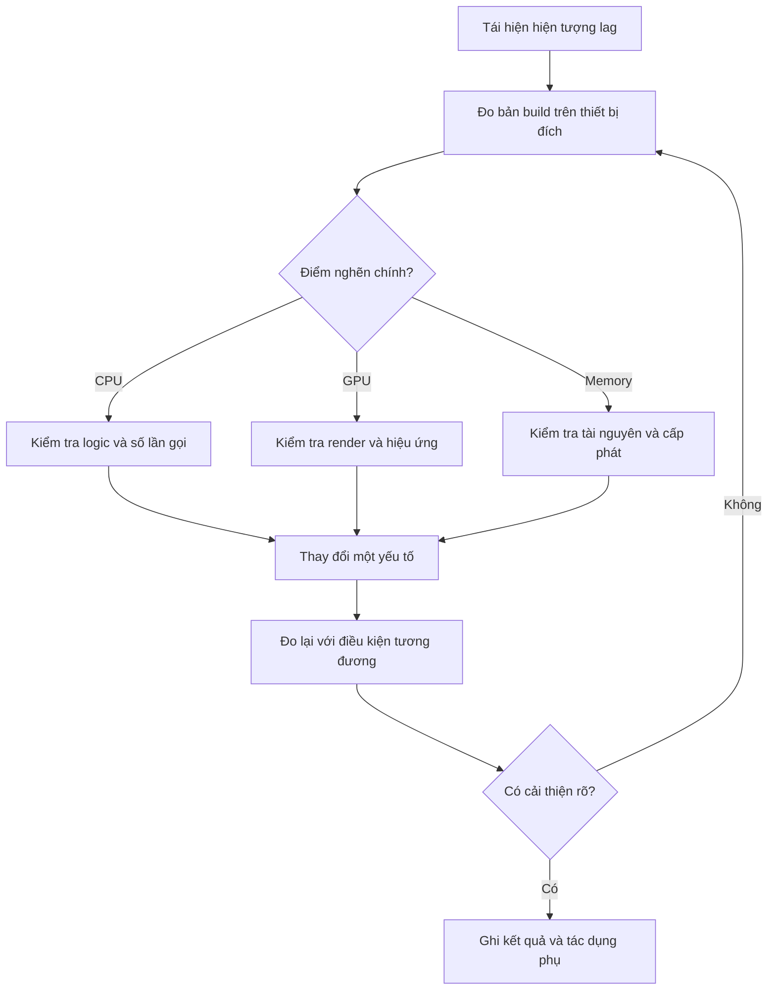

# Bài 02 — Đo lường và tối ưu hiệu năng VR (Optimization)

> **Lộ trình:** VR Development · **Học phần:** Ergonomics and Optimization · **Ngữ cảnh:** Unity 6.3
>
> **Nguyên tắc:** Đo trước, xác định điểm nghẽn, thay một biến, rồi đo lại trên cùng điều kiện.

## 1. Vấn đề của tối ưu VR

VR cần phản hồi hình ảnh ổn định khi người dùng quay đầu hoặc thao tác. Nếu thời gian dựng một frame không đáp ứng tốc độ làm mới của thiết bị, trải nghiệm có thể bị giật. Tối ưu hóa không đồng nghĩa với giảm mọi hiệu ứng; mục tiêu là dành tài nguyên cho những thành phần **thực sự quan trọng với người dùng**.

FPS cho biết số khung hình mỗi giây, nhưng chỉ số tổng hợp này chưa đủ để biết ứng dụng bị giới hạn bởi CPU, GPU, bộ nhớ hay một bước tải dữ liệu. Unity Console và Profiler được dùng kết hợp để chẩn đoán.

## 2. Mục tiêu học tập

- Sử dụng Console và Stack Trace để phân biệt lỗi biên dịch với lỗi phát sinh khi chạy.
- Đọc kết quả cơ bản về CPU, GPU, Memory và frame time trong Profiler.
- Xây dựng phép so sánh trước/sau tối ưu có điều kiện kiểm thử nhất quán.
- Giải thích vì sao cần đo bản build trên thiết bị đích, không chỉ trong Editor.

## 3. Tư duy đo lường

Thời gian khung hình ngân sách lý thuyết phụ thuộc tần số làm mới của thiết bị:

$$
T_{\text{budget}}\;(\mathrm{ms}) = \frac{1000}{f\;(\mathrm{Hz})}
$$

Chẳng hạn, **với ví dụ giả định** thiết bị chạy ở 90 Hz, thời gian tương ứng xấp xỉ 11,1 ms mỗi frame. Đây là phép quy đổi toán học, **không phải số đo hay khuyến nghị cấu hình** của một mẫu HMD cụ thể. Đo thực tế cần xem thời gian frame và sự dao động theo cảnh.

| Công cụ hoặc số đo | Dùng để trả lời |
|---|---|
| Console | Có exception, lỗi biên dịch hoặc cảnh báo nào? |
| Stack Trace | Lỗi xuất phát từ lời gọi/mã nào? |
| CPU Profiler | Khâu xử lý nào đang chiếm thời gian CPU? |
| GPU/frame timing | Khâu dựng hình có phải điểm nghẽn? |
| Memory Profiler / memory module | Bộ nhớ đang tăng hoặc bị giữ quá nhiều ở đâu? |
| FPS / frame time | Trải nghiệm có duy trì tốc độ khung hình đều không? |

**Giải thích:** Nhánh chẩn đoán chỉ là giả thuyết có căn cứ. Nếu thay đổi không giúp cải thiện số đo, cần quay lại quan sát thay vì khẳng định đã tối ưu.

## 4. Những nhóm chi phí đáng xem xét

**CPU:** logic lặp không cần thiết, xử lý vật lý, cập nhật liên tục hoặc tính toán phát sinh trong mỗi frame. **GPU:** lượng hình phải vẽ, ánh sáng/bóng đổ, vật liệu, hiệu ứng trong suốt và overdraw. **Memory:** texture và mesh lớn, nạp tài nguyên không phù hợp, cấp phát và thu gom bộ nhớ gây gián đoạn.

Các hướng điều chỉnh như giảm số vật thể phải render, giới hạn hiệu ứng đắt hoặc thay phương án chiếu sáng chỉ nên thực hiện **sau khi phép đo chỉ ra nhóm chi phí liên quan**. Việc giảm chất lượng toàn cảnh khi nguyên nhân thực tế nằm ở CPU sẽ khó giúp ích.

## 5. Thực hành: Tìm và xử lý một điểm nghẽn

1. Tạo cảnh có thể tái hiện một hiện tượng lag hoặc lỗi rõ ràng.
2. Ghi điều kiện kiểm thử: scene, hoạt động của người chơi, thiết bị và cấu hình build.
3. Kiểm tra Console. Nếu có exception, xem Stack Trace và xác nhận lỗi có liên quan đến hiện tượng.
4. Mở Profiler, ghi kết quả trong đoạn tương tác đại diện; ưu tiên số đo từ thiết bị đích.
5. Đề xuất một nguyên nhân, ví dụ cảnh render quá nhiều vật thể trong cùng khung nhìn.
6. Điều chỉnh **một** yếu tố, chạy cùng đường kiểm thử, ghi lại số đo và quan sát khác biệt.
7. Nếu chất lượng hoặc tương tác bị ảnh hưởng, ghi rõ tác dụng phụ và cân nhắc hoàn tác.

| Thử nghiệm | Điều kiện | Frame time / kết quả | Chất lượng thị giác | Kết luận |
|---|---|---|---|---|
| Trước tối ưu | *Điền* | *Điền* | *Điền* | Mốc so sánh |
| Sau tối ưu | *Giữ tương đương* | *Điền* | *Điền* | Chấp nhận / hoàn tác |

## 6. Những sai lầm thường gặp

- **Chỉ nhìn FPS:** không biết phần nào gây chậm; cần xem thêm CPU/GPU timing.
- **Đo trong Editor rồi kết luận cho HMD:** Editor có thêm overhead và có thể khác nền tảng chạy thật.
- **Sửa nhiều yếu tố cùng lúc:** không thể quy kết nguyên nhân của sự cải thiện.
- **Bỏ qua tác dụng phụ:** giảm vật thể/ánh sáng có thể làm mất tín hiệu tương tác quan trọng.
- **Tối ưu trước khi sửa lỗi:** exception liên tục hoặc tài nguyên thiếu có thể làm mọi số đo sai lệch.

## 7. Checklist hoàn thành

- [ ] Có tình huống kiểm thử tái hiện được.
- [ ] Có dữ liệu đo trước khi tối ưu.
- [ ] Phân biệt được lỗi Console và điểm nghẽn hiệu năng.
- [ ] Chỉ thay một yếu tố trong một lượt so sánh.
- [ ] Có số đo sau tối ưu và nhận xét về tác dụng phụ.
- [ ] Có bằng chứng từ bản build/thiết bị đích nếu có.

## 8. Tổng kết

Một quy trình tối ưu có giá trị khi người khác có thể **lặp lại phép đo** và xác nhận cải thiện. Profiler giúp tìm nguyên nhân; việc chỉnh Inspector hoặc code chỉ là bước kiểm chứng giả thuyết.

## 9. Câu hỏi ôn tập trắc nghiệm

### Câu 1

Một scene bị chậm và chưa biết nguyên nhân. Hành động đầu tiên hợp lý là gì?

A. Giảm mọi texture  
B. Xóa toàn bộ light  
C. Đo và tìm điểm nghẽn bằng Profiler  
D. Thêm hiệu ứng  

**Đáp án:** C  
**Giải thích:** Chỉ sau khi biết điểm nghẽn mới chọn được hướng tối ưu phù hợp.

### Câu 2

Stack Trace chủ yếu giúp gì?

A. Định vị vị trí phát sinh lỗi  
B. Tạo lightmap  
C. Đặt vị trí teleport  
D. Vẽ ray tương tác  

**Đáp án:** A  
**Giải thích:** Stack Trace cho biết chuỗi lời gọi giúp truy nguyên lỗi phát sinh.

### Câu 3

Vì sao phải giữ điều kiện kiểm thử tương đương trước và sau tối ưu?

A. Để tránh dùng build  
B. Để ép FPS bằng nhau  
C. Để giảm lượng ghi chú  
D. Để so sánh tác động của thay đổi một cách có cơ sở  

**Đáp án:** D  
**Giải thích:** Đổi nhiều yếu tố khiến nguyên nhân khác biệt không thể xác định.

### Câu 4

Chỉ số nào giúp biết thời gian xử lý trên mỗi khung hình?

A. Tên GameObject  
B. Frame time  
C. Tên prefab  
D. Tên scene  

**Đáp án:** B  
**Giải thích:** Frame time trực tiếp cho thấy thời gian xử lý một frame.

### Câu 5

Nếu FPS cải thiện nhưng vật tương tác biến mất, nên kết luận thế nào?

A. Tối ưu thành công hoàn toàn  
B. Bỏ qua vì FPS tốt  
C. Cần xem lại tác dụng phụ rồi mới chấp nhận  
D. Không cần thử bản build  

**Đáp án:** C  
**Giải thích:** Tối ưu phải giữ trải nghiệm chức năng, không chỉ một số đo.

---

*Tài liệu học tập tự biên soạn dựa trên đề mục của Unity Learn; không phải bản dịch hoặc transcript chính thức. Đối chiếu nội dung và tài nguyên thực hành tại [Unity Learn — Ergonomics and Optimization](https://learn.unity.com/pathway/vr-development/unit/ergonomics-and-optimization?version=6.3). Tên menu và package có thể thay đổi theo phiên bản project.*
