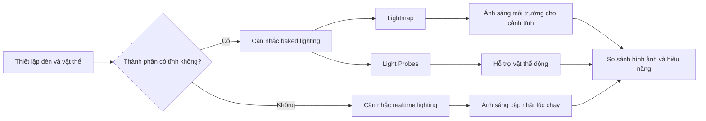

# Bài 03 — Chiếu sáng hiệu quả trong VR (Lighting)

> **Lộ trình:** VR Development · **Học phần:** Ergonomics and Optimization · **Ngữ cảnh:** Unity 6.3
>
> **Trọng tâm:** Phân biệt nguồn sáng, lựa chọn baked/realtime lighting và đo ảnh hưởng tới hiệu năng.

## 1. Vai trò của ánh sáng

Ánh sáng giúp người chơi nhận biết hình khối, khoảng cách và khu vực cần tương tác. Một cảnh quá tối khiến thao tác khó khăn; một cảnh dùng quá nhiều hiệu ứng đổ bóng có thể làm tăng chi phí dựng hình. Trong VR, giải pháp phù hợp là cân bằng **độ rõ của cảnh** với **frame time ổn định**.

## 2. Mục tiêu học tập

- Phân biệt `Directional Light`, `Point Light` và `Spot Light` theo phạm vi chiếu sáng.
- Giải thích sự khác nhau giữa baked lighting và realtime lighting.
- Mô tả vai trò của `Light Probes` và `Reflection Probes`.
- Tạo một cảnh có vật tĩnh/vật động, so sánh kết quả thị giác và hiệu năng trước/sau thay đổi.

## 3. Các nguồn sáng cơ bản

| Loại | Đặc tính | Ví dụ |
|---|---|---|
| `Directional Light` | Tia sáng có hướng chung trong cảnh | Ánh nắng hoặc nguồn sáng định hướng lớn |
| `Point Light` | Phát sáng từ một vị trí ra nhiều hướng | Bóng đèn tròn trong phòng |
| `Spot Light` | Chiếu theo vùng hình nón | Đèn rọi một khu vực thao tác |

Tùy ngữ cảnh, hướng, cường độ và màu nguồn sáng thay đổi cảm nhận độ sâu và độ rõ của vật thể. Khi đánh giá, quan sát cả **vùng sáng**, **vùng tối** và khả năng đọc được hình dạng đối tượng.

## 4. Baked, realtime và probes

**Baked lighting** tính trước đóng góp chiếu sáng của những thành phần phù hợp rồi lưu kết quả trong lightmap. Cách này có ích với bối cảnh tĩnh. **Realtime lighting** cập nhật khi scene chạy, phù hợp các nguồn sáng hoặc tình huống cần thay đổi theo thời gian, nhưng có thể phát sinh chi phí xử lý lớn hơn.

| Công nghệ | Dành cho | Giới hạn cần nhớ |
|---|---|---|
| Baked lighting / lightmap | Bề mặt tĩnh cần ánh sáng ổn định | Thay đổi động không tự phản ánh đầy đủ trong kết quả đã bake |
| Realtime lighting | Nguồn sáng hay điều kiện thay đổi lúc chạy | Cần đo chi phí thực tế |
| `Light Probes` | Hỗ trợ đối tượng động nhận thông tin chiếu sáng môi trường đã tính trước | Cần bố trí và kiểm tra trong vùng vật di chuyển |
| `Reflection Probes` | Cung cấp thông tin phản xạ từ môi trường | Có thể cần cập nhật/thiết lập phù hợp với cảnh |

**Giải thích:** Các lựa chọn không hoàn toàn loại trừ nhau; một scene có thể phối hợp chiếu sáng tĩnh và động. Điều quan trọng là kiểm tra kết quả thực tế trong pipeline và nền tảng đang dùng.

## 5. Thực hành: So sánh cấu hình chiếu sáng

1. Tạo scene gồm sàn, tường, ít nhất một vật tĩnh và một vật di chuyển được.
2. Thêm nguồn sáng phù hợp, điều chỉnh hướng, cường độ và màu để thấy thay đổi bóng đổ.
3. Ghi hình cấu hình ban đầu và kiểm tra độ rõ của khu vực người chơi cần thao tác.
4. Nếu project và render pipeline hỗ trợ, đánh dấu các bề mặt tĩnh phù hợp rồi thử bake ánh sáng.
5. Thử `Light Probes` để quan sát đối tượng động trong vùng chiếu sáng bake; dùng `Reflection Probes` khi cần kiểm tra bề mặt phản xạ.
6. Đo thời gian frame trước/sau trên cùng scene và cùng thiết bị. Ghi rõ nếu có thay đổi chất lượng hình ảnh.

| Kịch bản | Độ rõ vật thể | Bóng/độ phản xạ | Hiệu năng | Nhận xét |
|---|---|---|---|---|
| Ban đầu | *Điền* | *Điền* | *Điền* | *Điền* |
| Sau chỉnh sáng | *Điền* | *Điền* | *Điền* | *Điền* |
| Sau bake (nếu hỗ trợ) | *Điền* | *Điền* | *Điền* | *Điền* |

## 6. Gỡ lỗi ánh sáng

**Lightmap không cập nhật:** xác nhận đối tượng tĩnh đúng cách, cài đặt bake và thao tác tạo lại lighting. **Bề mặt tối hoặc sai bóng:** kiểm tra UV/lightmap phù hợp, hướng normal, thiết lập đèn và chất liệu. **Vật động không nhận ánh sáng như dự kiến:** kiểm tra bố trí `Light Probes` và chế độ chiếu sáng của renderer. **Cảnh đẹp nhưng chậm:** xem xét lượng ánh sáng động, bóng và hiệu ứng; dùng Profiler để xác định chi phí chứ không kết luận từ cảm nhận.

## 7. Checklist hoàn thành

- [ ] Thử ít nhất hai loại nguồn sáng hoặc hai cấu hình ánh sáng.
- [ ] Chỉ ra được điểm khác biệt baked và realtime.
- [ ] Có ví dụ vật tĩnh và vật động.
- [ ] Nếu dùng lightmap, đã xác nhận kết quả bake và UV phù hợp.
- [ ] Có ảnh so sánh và phép đo hiệu năng ở cùng điều kiện.

## 8. Tổng kết

Chiếu sáng trong VR đồng thời là vấn đề **thị giác** và **tối ưu hóa**. Chỉ chọn giải pháp sau khi đã biết vật nào tĩnh, vật nào cần thay đổi và tác động thực tế lên bản build.

## 9. Câu hỏi ôn tập trắc nghiệm

### Câu 1

Nguồn sáng nào phù hợp mô phỏng ánh nắng có hướng chung?

A. Point Light  
B. Spot Light  
C. Reflection Probe  
D. Directional Light  

**Đáp án:** D  
**Giải thích:** Directional Light biểu diễn nguồn sáng định hướng.

### Câu 2

Baked lighting phù hợp nhất với nhóm đối tượng nào?

A. Các bề mặt tĩnh  
B. Mọi đối tượng luôn chuyển động  
C. Input actions  
D. Ray interactor  

**Đáp án:** A  
**Giải thích:** Ánh sáng bake được tính trước cho các thành phần phù hợp, đặc biệt là cảnh tĩnh.

### Câu 3

Light Probes giúp ích cho trường hợp nào?

A. Sửa input  
B. Hỗ trợ vật động nhận ánh sáng môi trường bake  
C. Tạo bản build  
D. Thêm collider  

**Đáp án:** B  
**Giải thích:** Light Probes cung cấp thông tin chiếu sáng môi trường cho vật thể động.

### Câu 4

Khi lightmap không cập nhật, bước kiểm tra nào hợp lý?

A. Đổi tên prefab  
B. Tăng tốc độ di chuyển  
C. Kiểm tra cấu hình bake và trạng thái đối tượng tĩnh  
D. Xóa README  

**Đáp án:** C  
**Giải thích:** Cấu hình bake và đối tượng thuộc diện tính ánh sáng quyết định kết quả lightmap.

### Câu 5

Để chọn phương án sáng tối ưu, bằng chứng nào tốt nhất?

A. Chỉ một ảnh đẹp  
B. Số lượng tên object  
C. Tên tài liệu  
D. Ảnh so sánh cùng phép đo hiệu năng  

**Đáp án:** D  
**Giải thích:** Cần cân bằng chất lượng cảnh với số đo hiệu năng.

---

*Tài liệu học tập tự biên soạn dựa trên đề mục của Unity Learn; không phải bản dịch hoặc transcript chính thức. Đối chiếu nội dung và tài nguyên thực hành tại [Unity Learn — Ergonomics and Optimization](https://learn.unity.com/pathway/vr-development/unit/ergonomics-and-optimization?version=6.3). Tên menu và package có thể thay đổi theo phiên bản project.*
