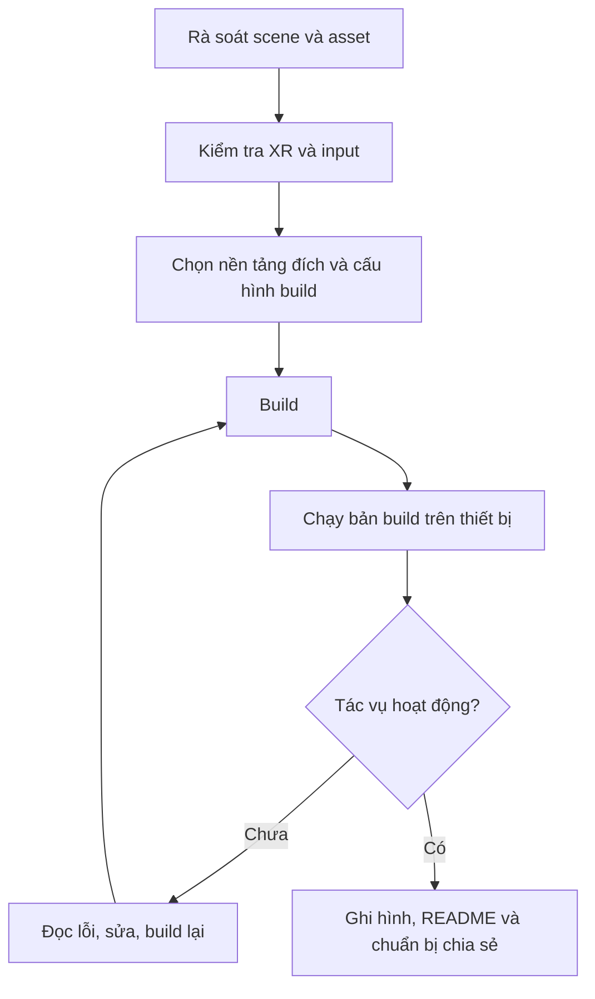

# Bài 04 — Đóng gói, kiểm thử và chia sẻ dự án VR (Building and Sharing)

> **Lộ trình:** VR Development · **Học phần:** Ergonomics and Optimization · **Ngữ cảnh:** Unity 6.3
>
> **Sản phẩm cần đạt:** Một bản build chạy được kèm hướng dẫn sử dụng và minh chứng kiểm thử.

## 1. Từ scene trong Editor đến sản phẩm thật

Bản chạy trong Unity Editor có thể khác bản build vì môi trường thực thi, input, tài nguyên hoặc giới hạn phần cứng không giống nhau. Do đó, **chạy được trong Play mode chưa đồng nghĩa với hoàn thành dự án VR**. Quá trình đóng gói cần kiểm tra cả tính đầy đủ của scene, nền tảng đích và quyền sử dụng tài sản số.

## 2. Mục tiêu học tập

- Mô tả được các bước chuẩn bị project trước khi build.
- Lựa chọn nền tảng đích phù hợp với thiết bị kiểm thử hiện có.
- Kiểm chứng thao tác VR từ khi khởi chạy đến khi hoàn thành tác vụ trong bản build.
- Viết README ngắn có hướng dẫn chơi, yêu cầu hệ thống, giới hạn và tài nguyên được sử dụng.

## 3. Quy trình build có kiểm soát



**Giải thích:** Việc kiểm thử không kết thúc khi công cụ thông báo build thành công; cần xác nhận người dùng thực sự có thể điều khiển và hoàn tất tác vụ trong bản đã đóng gói.

## 4. Những yếu tố phải rà soát

| Nhóm | Câu hỏi kiểm tra |
|---|---|
| Scene | Scene khởi động đã được đưa vào cấu hình build chưa? |
| Asset | Có thiếu prefab, material, texture hoặc tham chiếu nào không? |
| XR runtime | Runtime và tính năng XR có tương thích thiết bị chạy không? |
| Input | Các hành động cầm, chọn, di chuyển có dùng được trong bản build không? |
| Chất lượng | Cấu hình đồ họa có phù hợp giới hạn thiết bị không? |
| Quyền sử dụng | Asset, hình ảnh, âm nhạc có giấy phép cho phép chia sẻ không? |
| Quyền riêng tư | Video/ảnh minh chứng có vô tình hiển thị dữ liệu cá nhân không? |

## 5. Thực hành: Phát hành một bản thử nghiệm

1. Rà lại Hierarchy, Inspector và Console; sửa những lỗi cản trở khởi động/tương tác.
2. Kiểm tra danh sách scene đưa vào build và các tài nguyên được tham chiếu.
3. Chọn nền tảng đích dựa trên thiết bị sử dụng thực tế; kiểm tra thiết lập XR và chất lượng tương ứng.
4. Tạo bản build; lưu phiên bản hoặc thời điểm build để phục vụ so sánh.
5. Chạy bản build trên thiết bị đích: khởi động → di chuyển → tương tác → hoàn thành tác vụ → thoát ứng dụng.
6. Ghi lại video/ảnh thành công và tối thiểu một trường hợp lỗi đã thử kiểm tra.
7. Viết README với những thông tin trong mục 6 rồi chia sẻ file đúng đối tượng.

## 6. Mẫu README kèm bản build

```markdown
# Tên dự án VR

## Mục tiêu
Mô tả một câu về trải nghiệm và tác vụ chính.

## Yêu cầu chạy
- Nền tảng và thiết bị: ...
- Điều khiển chính: ...

## Hướng dẫn sử dụng
1. Khởi động ứng dụng.
2. Di chuyển đến khu vực tương tác.
3. Chọn hoặc thao tác với đối tượng.

## Kiểm thử
- Tác vụ đã kiểm tra: ...
- Kết quả: ...
- Lỗi còn biết: ...

## Tài nguyên và giấy phép
- Tên asset / tác giả / giấy phép / đường dẫn tham chiếu: ...
```

Mẫu là khung điền thông tin; không được coi các chỗ trống là thông số đã xác minh.

## 7. Vấn đề thường gặp khi chia sẻ

**Thiếu scene:** bản build mở sai màn hình hoặc không có cảnh cần chơi. **Phụ thuộc Editor:** mã hay tài nguyên chỉ hoạt động khi Play mode. **Mất input:** cần kiểm tra cấu hình action và môi trường XR thực tế. **Sai giấy phép:** cần thay tài nguyên hoặc xin quyền phù hợp trước khi công khai. **Thiếu thông tin chạy:** người nhận không biết thiết bị cần thiết; README phải nêu rõ yêu cầu và cách thử.

## 8. Checklist phát hành

- [ ] Bản build thực sự khởi động được trên thiết bị đích.
- [ ] Kiểm thử hoàn chỉnh luồng tương tác chính.
- [ ] Đã kiểm tra lỗi Console và những giới hạn còn tồn tại.
- [ ] Có video hoặc ảnh từ bản chạy thật.
- [ ] Có README với thao tác, yêu cầu và known issues.
- [ ] Có rà soát giấy phép asset và quyền riêng tư.

## 9. Tổng kết

Một dự án VR đáng chia sẻ phải **có thể chạy, có thể kiểm chứng và có thể hiểu cách sử dụng**. Quy trình build đi cùng kiểm thử, tài liệu hướng dẫn và trách nhiệm về tài nguyên được công khai.

## 10. Câu hỏi ôn tập trắc nghiệm

### Câu 1

Vì sao phải kiểm tra bản build ngoài Play mode?

A. Vì runtime, input và tài nguyên có thể khác  
B. Vì Editor không hỗ trợ GameObject  
C. Vì README thay thế kiểm thử  
D. Vì mọi build đều thất bại  

**Đáp án:** A  
**Giải thích:** Môi trường build và thiết bị đích có khác biệt thực tế so với Editor.

### Câu 2

Bản build mở sai cảnh. Nơi cần kiểm tra đầu tiên là gì?

A. Reflection Probe  
B. Danh sách scene khi build  
C. Màu ánh sáng  
D. Frame time  

**Đáp án:** B  
**Giải thích:** Scene cần chạy phải được cấu hình trong build đúng cách.

### Câu 3

Thông tin nào nên có trong README?

A. Chỉ lời cảm ơn  
B. Chỉ số lượng package  
C. Yêu cầu thiết bị, cách thao tác và lỗi đã biết  
D. Chỉ ảnh Editor  

**Đáp án:** C  
**Giải thích:** README giúp người khác có thể chạy lại và biết các giới hạn.

### Câu 4

Trước khi chia sẻ nhạc hoặc asset, cần làm gì?

A. Giảm FPS  
B. Xóa ánh sáng  
C. Tăng overdraw  
D. Xác nhận quyền sử dụng và giấy phép  

**Đáp án:** D  
**Giải thích:** Tài nguyên cần có quyền phù hợp với mục đích chia sẻ.

### Câu 5

Bằng chứng nào xác nhận dự án có thể dùng?

A. Video thao tác trong bản build thực tế  
B. Tên file đẹp  
C. Một ảnh settings  
D. Danh sách phụ kiện chưa kiểm thử  

**Đáp án:** A  
**Giải thích:** Phải cho thấy tác vụ chính chạy được ngoài Editor.

---

*Tài liệu học tập tự biên soạn dựa trên đề mục của Unity Learn; không phải bản dịch hoặc transcript chính thức. Đối chiếu nội dung và tài nguyên thực hành tại [Unity Learn — Ergonomics and Optimization](https://learn.unity.com/pathway/vr-development/unit/ergonomics-and-optimization?version=6.3). Tên menu và package có thể thay đổi theo phiên bản project.*
