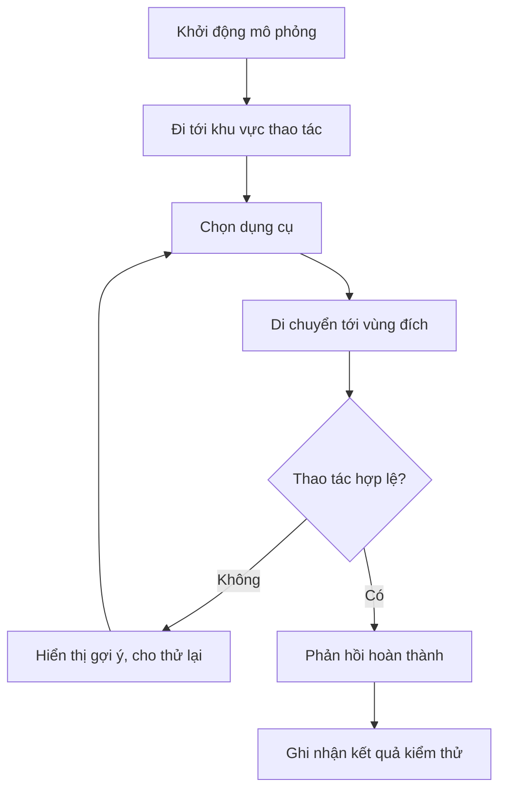

# Bài 05 — Thử thách: Mô phỏng huấn luyện trong VR (Training Simulation)

> **Dạng bài:** Challenge · **Học phần:** Ergonomics and Optimization · **Ngữ cảnh:** Unity 6.3
>
> **Nhiệm vụ:** Hoàn thành một mô phỏng nhỏ có hành động người dùng, phản hồi nhìn thấy được và bằng chứng kiểm thử.

## 1. Bài toán

Một ứng dụng huấn luyện VR cần giúp người học thực hiện hành động có mục đích trong môi trường giả lập. Ví dụ thực hành tự xây dựng: **người dùng tiếp cận một dụng cụ, chọn dụng cụ và đặt nó vào vùng đánh dấu**. Tác vụ phải đủ đơn giản để có thể tập trung vào tính chính xác của tương tác, sự thoải mái và hiệu năng.

Không bắt buộc mô phỏng một hệ thống công nghiệp hoàn chỉnh. Mức hoàn thành của thử thách là một scene/bản build nhỏ có thể chạy độc lập và được kiểm chứng bằng tiêu chí rõ ràng.

## 2. Mục tiêu và yêu cầu

- Dựng scene với `XR Origin`, input actions và tối thiểu một `Interactable`.
- Người chơi thao tác qua direct hoặc ray interactor.
- Có cơ chế tiếp cận thuận tiện, ví dụ teleportation.
- Có phản hồi dễ quan sát để phân biệt thao tác thành công và chưa thành công.
- Ghi video/ảnh, mô tả tối thiểu một lỗi và ít nhất một cải tiến sau lần thử đầu tiên.
- Kiểm tra hiệu năng trên thiết bị đích khi có phần cứng.

## 3. Thiết kế tình huống huấn luyện

**Tình huống đề xuất:** Khu vực thực hành gồm bàn dụng cụ, một đối tượng cần chọn và vùng đích. Người chơi đến bàn, chọn vật, dịch chuyển hoặc đưa vật đến vùng đích. Khi thao tác hợp lệ, hệ thống cho phản hồi trực quan.

**Giải thích:** Sơ đồ tập trung vào vòng phản hồi của bài huấn luyện. Cách xác định “hợp lệ” do người xây dựng scene lựa chọn và kiểm chứng; sơ đồ không yêu cầu một API Unity cụ thể.

## 4. Triển khai theo mốc

### 4.1. Mốc 1 — Tương tác cơ bản

Tạo scene, bố trí vật thể dễ nhìn và kiểm tra chuỗi input → interactor → interactable. Chỉ chuyển sang mốc tiếp theo khi thao tác chọn lặp lại được ổn định.

### 4.2. Mốc 2 — Comfort và phản hồi

Bố trí điểm đến phù hợp. Tránh bắt người chơi với tới vật ngoài tầm tay; thử tư thế ngồi nếu có thể. Khi tương tác thành công, thêm phản hồi như đổi trạng thái vật, biểu tượng hoặc dòng chữ. Đảm bảo tín hiệu không chỉ phụ thuộc vào màu sắc.

### 4.3. Mốc 3 — Kiểm chứng và tối ưu

Kiểm tra Console và Profiler. Nếu có lag, ghi lại điều kiện tái hiện và chỉ điều chỉnh một yếu tố mỗi lần. So sánh kết quả trước/sau trên cùng tuyến di chuyển hoặc cùng thao tác.

## 5. Bảng tiêu chí nghiệm thu

| Tiêu chí | Cách kiểm chứng | Bằng chứng cần nộp |
|---|---|---|
| Scene/bản build chạy được | Khởi động độc lập | File project hoặc bản build |
| Có tương tác | Chọn hoặc điều khiển vật thể | Ảnh/video từ Play mode hoặc thiết bị |
| Có phản hồi | Thấy thay đổi sau thao tác | Ảnh/video minh chứng |
| Có lỗi được phân tích | Tái hiện và giải thích được | Log/ảnh + mô tả |
| Có cải tiến | So sánh lần thử đầu và lần sau | Ghi chép trước/sau |
| Chú ý comfort | Thử được vùng chạm và cách tiếp cận | Checklist kiểm thử |

## 6. Gợi ý kiểm thử

**Ca thử A:** chọn vật từ khoảng cách hợp lệ. **Ca thử B:** cố chọn vật ngoài phạm vi tương tác. **Ca thử C:** đến vùng đích và thực hiện thao tác đúng. **Ca thử D:** mô phỏng thiếu input action hoặc thiếu thành phần tương tác, sau đó khôi phục cấu hình. Chỉ thay đổi những thành phần trong bản sao thực hành để tránh làm hỏng project chính.

| Ca thử | Kết quả mong đợi | Kết quả thực tế | Hướng xử lý |
|---|---|---|---|
| A | Chọn được vật | *Điền* | *Điền* |
| B | Không chọn sai hoặc có gợi ý | *Điền* | *Điền* |
| C | Nhận phản hồi hoàn thành | *Điền* | *Điền* |
| D | Phát hiện và sửa lỗi | *Điền* | *Điền* |

## 7. Hồ sơ nộp bài

Nộp scene/project hoặc build, một bản mô tả mục tiêu và các bước chạy, ảnh/video minh chứng, bảng kiểm thử và ghi chép tối thiểu một cải tiến. **Không cần trình diễn những tính năng chưa hoạt động;** ưu tiên quy trình nhỏ nhưng đáng tin cậy.

## 8. Tự đánh giá

- [ ] Người khác có thể bắt đầu và hoàn thành tác vụ khi đọc hướng dẫn.
- [ ] Có thể thao tác bằng interactor trong scene.
- [ ] Người chơi biết khi nào thành công và thất bại.
- [ ] Vị trí tương tác phù hợp với phạm vi chạm.
- [ ] Ghi được một lỗi và quá trình sửa.
- [ ] Có bằng chứng cải tiến sau lần thử đầu.

## 9. Câu hỏi ôn tập trắc nghiệm

### Câu 1

Một mô phỏng huấn luyện tối thiểu cần gì?

A. Chỉ tài liệu giới thiệu  
B. Một thao tác và phản hồi có thể quan sát  
C. Hệ thống đồ họa phức tạp  
D. Nhiều hiệu ứng mà không cần hành động  

**Đáp án:** B  
**Giải thích:** Mục tiêu thử thách là một thao tác có ý nghĩa và kết quả kiểm chứng được.

### Câu 2

Lỗi không chọn được vật nên kiểm tra nhóm nào?

A. Màu lightmap  
B. README  
C. Input actions và thành phần tương tác  
D. Tốc độ mạng  

**Đáp án:** C  
**Giải thích:** Chức năng chọn phụ thuộc chuỗi input–interactor–interactable.

### Câu 3

Kết quả lần thử đầu thất bại. Cách làm tốt nhất là gì?

A. Ghi bước tái hiện, sửa một nguyên nhân và thử lại  
B. Xóa project luôn  
C. Bỏ qua báo lỗi  
D. Sửa tất cả thông số cùng lúc  

**Đáp án:** A  
**Giải thích:** Cần ghi lại một cải tiến có bằng chứng sau thử nghiệm đầu.

### Câu 4

Điều gì phản ánh comfort trong thử thách?

A. Số câu hỏi trong tài liệu  
B. Số lượng ảnh trang trí  
C. Tên prefabs  
D. Điểm đến và tầm chạm thuận tiện  

**Đáp án:** D  
**Giải thích:** Comfort gắn với cách người chơi tiếp cận và thao tác.

### Câu 5

Bộ nộp bài nào đạt yêu cầu hơn?

A. Chỉ một ảnh Scene view  
B. Scene/build, video, bảng test và mô tả cải tiến  
C. Chỉ code chưa chạy  
D. Chỉ lời giới thiệu  

**Đáp án:** B  
**Giải thích:** Cần sản phẩm chạy được và bằng chứng kiểm thử/cải tiến.

---

*Tài liệu học tập tự biên soạn dựa trên đề mục của Unity Learn; không phải bản dịch hoặc transcript chính thức. Đối chiếu nội dung và tài nguyên thực hành tại [Unity Learn — Ergonomics and Optimization](https://learn.unity.com/pathway/vr-development/unit/ergonomics-and-optimization?version=6.3). Tên menu và package có thể thay đổi theo phiên bản project.*
