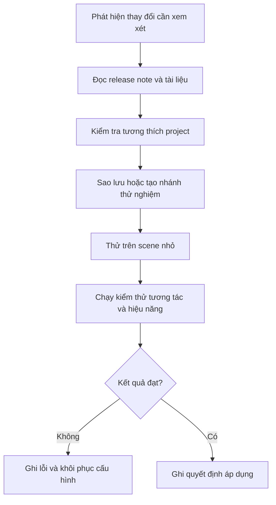

# Bài 06 — Cập nhật công nghệ XR một cách có hệ thống (Keeping up with XR Technology)

> **Lộ trình:** VR Development · **Học phần:** Ergonomics and Optimization · **Ngữ cảnh:** Unity 6.3
>
> **Năng lực trọng tâm:** Theo dõi sự thay đổi của hệ sinh thái XR mà không phá vỡ một project đang hoạt động.

## 1. Vì sao phải theo dõi thay đổi?

Dự án XR phụ thuộc vào nhiều lớp: Unity Editor, gói tương tác, XR runtime, thiết bị đeo và hệ thống input. Khi một lớp thay đổi, trải nghiệm trên HMD có thể khác trước ngay cả khi scene và logic trò chơi không sửa. Người phát triển cần có quy trình **kiểm chứng tính tương thích**, không chỉ đọc tên tính năng mới.

Trong bài thực hành, đặc biệt chú ý mối quan hệ `XR Origin` → input actions → `Interactor` → `Interactable`, hai kiểu di chuyển teleportation/continuous movement và yêu cầu đo frame time trên thiết bị thật.

## 2. Mục tiêu học tập

- Xác định những thành phần của project XR có thể bị ảnh hưởng khi nâng phiên bản.
- Thiết lập một checklist kiểm thử hồi quy cho tương tác và locomotion.
- Phân biệt thông tin từ tài liệu kỹ thuật, trạng thái project và kết quả kiểm thử thực tế.
- Lưu nhật ký thay đổi để có thể khôi phục khi phát sinh lỗi.

## 3. Các lớp cần quan sát

| Lớp | Điều cần đối chiếu | Rủi ro nếu bỏ qua |
|---|---|---|
| Unity Editor | Phiên bản project và thay đổi công cụ | Cách cấu hình hoặc hành vi khác trước |
| XR Interaction Toolkit | Thành phần interactor/interactable và mẫu input | Tương tác không còn hoạt động như mong đợi |
| XR runtime / OpenXR | Runtime tương thích thiết bị, tính năng bật | Thiết bị hoặc đầu vào không được nhận |
| Thiết bị HMD/tay cầm | Kiểu thao tác và khả năng theo dõi | Thao tác không khớp người dùng |
| Render pipeline / lighting | Hỗ trợ bake, lightmap, shader, chất lượng | Thay đổi hình ảnh và frame time |

**Giải thích:** Cập nhật là một thay đổi kỹ thuật có thể kiểm chứng. Thử nghiệm tách biệt giúp tránh biến một project đang chạy ổn định thành môi trường lỗi khó truy nguyên.

## 4. Quy trình theo dõi cập nhật

1. **Xác định nhu cầu:** sửa lỗi, bổ sung tính năng hay hỗ trợ thiết bị mới; không cập nhật chỉ vì có số phiên bản mới.
2. **Đối chiếu nguồn kỹ thuật:** trang hướng dẫn chính thức của Unity, ghi chú phát hành package và tài liệu của runtime/thiết bị liên quan.
3. **Lập mốc an toàn:** lưu commit hoặc bản sao project có thể chạy được.
4. **Thử nghiệm nhỏ:** dựng scene có `XR Origin`, input, một interactor và một interactable.
5. **Kiểm thử chức năng:** thao tác chọn, locomotion, phản hồi và toàn bộ flow của scene.
6. **Kiểm thử hiệu năng:** dùng bản build trên thiết bị đích, ghi dữ liệu trước/sau khi cập nhật.
7. **Ra quyết định:** giữ phiên bản mới nếu đạt tiêu chí; nếu không, ghi lỗi và quay về mốc ổn định.

## 5. Mẫu nhật ký tương thích

| Mục | Phiên bản hiện tại | Phiên bản thử nghiệm | Kết quả |
|---|---|---|---|
| Editor | *Điền từ project* | *Điền* | *Điền* |
| Package tương tác | *Điền* | *Điền* | *Điền* |
| Runtime XR | *Điền* | *Điền* | *Điền* |
| Input và interactor | *Đạt/Không* | *Đạt/Không* | *Điền* |
| Locomotion | *Đạt/Không* | *Đạt/Không* | *Điền* |
| Frame time trên HMD | *Số đo* | *Số đo* | *Điền* |

Bảng trên là mẫu ghi chép, **không chứa dữ liệu benchmark thực tế**. Chỉ điền sau khi kiểm thử và giữ lại điều kiện đo để có thể tái hiện.

## 6. Bài tập áp dụng

Lấy một project XR nhỏ đang chạy được. Ghi lại trạng thái hiện tại rồi đề xuất một thay đổi cấu hình hoặc phiên bản để thử trong bản sao. Trước khi đổi, dự đoán bộ phận nào có thể bị ảnh hưởng. Sau đó kiểm tra lại input, interactor, locomotion và hiệu năng. Nếu không có nhu cầu cập nhật, chỉ cần thực hiện **bài kiểm thử hồi quy hiện trạng** để lập mốc baseline.

## 7. Lỗi tư duy thường gặp

- **Nâng đồng thời nhiều thành phần:** khó biết thay đổi nào gây lỗi.
- **Tin rằng chạy trong Editor là đủ:** vẫn cần xem bản build và runtime thực tế.
- **Chỉ chú ý tính năng mới:** bỏ quên UX, comfort và hiệu năng.
- **Không lưu phiên bản đã kiểm thử:** không thể quay lại cấu hình ổn định.

## 8. Checklist hoàn thành

- [ ] Xác định được các lớp có thể tác động đến tương tác XR.
- [ ] Lưu mốc project trước khi thay đổi.
- [ ] Có checklist kiểm thử lại chức năng và hiệu năng.
- [ ] Ghi được giả thuyết, kết quả và quyết định giữ/hoàn tác.
- [ ] Biết nơi đối chiếu tài liệu cập nhật chính thức.

## 9. Tổng kết

Theo kịp XR không chỉ là đọc tin tức về phần cứng. Năng lực thực hành cốt lõi là **đánh giá thay đổi, cô lập tác động và bảo vệ chất lượng trải nghiệm**.

## 10. Câu hỏi ôn tập trắc nghiệm

### Câu 1

Trước khi cập nhật package XR, nên làm gì?

A. Xóa toàn bộ project  
B. Thay cùng lúc mọi gói  
C. Sao lưu hoặc tạo nhánh thử nghiệm  
D. Chỉ đổi màu scene  

**Đáp án:** C  
**Giải thích:** Mốc ổn định giúp khôi phục và đối chiếu khi phát sinh lỗi.

### Câu 2

Điều gì cần kiểm thử lại sau khi thay đổi runtime XR?

A. Input và tương tác trên thiết bị đích  
B. Chỉ tên folder  
C. Chỉ chiều dài README  
D. Chỉ số lượng bảng  

**Đáp án:** A  
**Giải thích:** Runtime ảnh hưởng đến đầu vào, thiết bị và hành vi XR.

### Câu 3

Vì sao thử trên scene nhỏ trước?

A. Để bỏ kiểm thử  
B. Để tăng độ phức tạp  
C. Để xóa lỗi trong mọi ứng dụng  
D. Để cô lập thay đổi và nhận diện lỗi  

**Đáp án:** D  
**Giải thích:** Scene nhỏ giúp xác định thay đổi nào tạo ra lỗi.

### Câu 4

Chỉ số nào nên so sánh khi cập nhật để tránh giảm chất lượng trải nghiệm?

A. Tên vật thể  
B. Frame time trên HMD  
C. Tên người viết  
D. Ngày lưu tài liệu  

**Đáp án:** B  
**Giải thích:** Tính năng tương thích chưa đủ nếu hiệu năng giảm.

### Câu 5

Khi thử bản cập nhật không đạt tiêu chí, nên làm gì?

A. Ép áp dụng cho mọi dự án  
B. Bỏ qua lỗi  
C. Ghi lỗi và quay lại mốc ổn định  
D. Chỉ xóa video  

**Đáp án:** C  
**Giải thích:** Bảo vệ chất lượng project quan trọng hơn chạy theo phiên bản.

---

*Tài liệu học tập tự biên soạn dựa trên đề mục của Unity Learn; không phải bản dịch hoặc transcript chính thức. Đối chiếu nội dung và tài nguyên thực hành tại [Unity Learn — Ergonomics and Optimization](https://learn.unity.com/pathway/vr-development/unit/ergonomics-and-optimization?version=6.3). Tên menu và package có thể thay đổi theo phiên bản project.*
