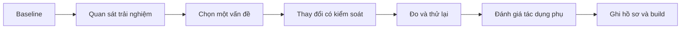

# Bài 07 — Lab: Cải thiện ergonomics và optimization cho dự án VR cá nhân

> **Dạng bài:** Lab thực hành · **Học phần:** Ergonomics and Optimization · **Ngữ cảnh:** Unity 6.3
>
> **Đầu ra:** Một phiên bản scene/bản build có thử nghiệm về comfort và hiệu năng, bảng đo và minh chứng cải tiến.

## 1. Tổng quan bài lab

Một scene VR có thể tương tác đúng nhưng vẫn khiến người dùng khó tiếp cận vật thể hoặc cảm thấy hình ảnh giật. Bài lab này yêu cầu **chọn một luồng sử dụng thực tế** trong dự án cá nhân, thiết lập baseline rồi thực hiện thay đổi có thể kiểm chứng. Không cần bổ sung nhiều tính năng mới: chỉ cần làm tốt một tương tác và thể hiện quá trình cải tiến.

## 2. Mục tiêu

- Kiểm tra hoạt động của XR Origin, input action, interactor và interactable.
- Tìm ít nhất một vấn đề về vùng chạm, cách di chuyển hoặc phản hồi.
- Ghi phép đo hiệu năng và phân biệt giữa lỗi logic với hiện tượng giật.
- Đề xuất, áp dụng và kiểm chứng ít nhất một thay đổi.
- Nộp scene/bản build, báo cáo trước/sau và minh chứng.

## 3. Chuẩn bị

Cần một project Unity VR đang chạy hoặc một scene tối giản tự tạo; các thành phần XR tương thích project; Console/Profiler và thiết bị đích nếu có. Tạo bản sao/commit trước khi thay đổi. Chuẩn bị chỗ lưu ảnh màn hình, video, bản build và bảng kiểm thử.

**Ví dụ luồng dùng để đánh giá:** người dùng đi đến bàn, nhắm ray interactor vào vật, chọn vật rồi nhận phản hồi. Nếu dự án khác, thay bằng thao tác chính của project nhưng giữ nguyên phương pháp đo và đối chiếu.

## 4. Quy trình thực hành

### 4.1. Checkpoint A — Kiểm tra chức năng

1. Mở scene và xác nhận `XR Origin` cùng input actions hoạt động.
2. Kiểm tra mục tiêu tương tác có thể được chọn bằng direct/ray interactor phù hợp.
3. Thử bước di chuyển, đặc biệt nếu dùng teleportation; xác nhận điểm đến hợp lệ.
4. Ghi một ảnh/video và mô tả thao tác có thể tái hiện.

**Điều kiện qua checkpoint:** hoàn thành được một tác vụ tương tác không phụ thuộc vào những bước chưa rõ.

### 4.2. Checkpoint B — Đánh giá comfort

1. Xác định vật hoặc bảng giao diện khó với tới/khó quan sát.
2. Chọn một điều chỉnh, ví dụ chuyển vị trí vật, thay khoảng cách tiếp cận hoặc cải thiện tín hiệu phản hồi.
3. Thử cùng tình huống ở hai cấu hình; mô tả khác biệt quan sát được.
4. Ghi nhận nếu thay đổi gây ra vấn đề mới cho tương tác.

**Điều kiện qua checkpoint:** chứng minh được thay đổi có mục đích và không làm mất thao tác cơ bản.

### 4.3. Checkpoint C — Đánh giá hiệu năng

1. Ghi điều kiện kiểm thử và tạo baseline trước khi tối ưu.
2. Mở Console và Profiler, đo CPU/GPU/frame time hoặc dữ liệu phù hợp với thiết bị.
3. Tìm giả thuyết nguyên nhân nếu có hiện tượng lag; xem xét chi phí render, ánh sáng hoặc logic dựa trên số đo.
4. Chỉ chỉnh một yếu tố, chạy lại cùng thao tác và so sánh kết quả.

**Điều kiện qua checkpoint:** có phép đo trước/sau và kết luận dựa trên dữ liệu, kể cả khi kết quả chưa cải thiện.

### 4.4. Checkpoint D — Bản build và hồ sơ

1. Đưa scene vào cấu hình build; chọn nền tảng đích phù hợp.
2. Chạy bản build và đi qua toàn bộ luồng tương tác.
3. Ghi video/ảnh thao tác, kết quả phép đo và lỗi còn tồn tại.
4. Chuẩn bị README cho người khác chạy lại thử nghiệm.

**Điều kiện qua checkpoint:** người nhận có thể kiểm tra lại ít nhất một tác vụ theo mô tả.

## 5. Sơ đồ quy trình cải tiến

**Giải thích:** Mỗi thay đổi phải có đường dẫn từ vấn đề ban đầu tới bằng chứng kiểm chứng. Không có baseline sẽ rất khó nói rằng kết quả tốt hơn.

## 6. Mẫu báo cáo và bàn giao

| Hạng mục | Baseline | Sau thay đổi | Bằng chứng |
|---|---|---|---|
| Khả năng chọn vật | *Điền* | *Điền* | Video/ảnh |
| Comfort/tiếp cận | *Điền* | *Điền* | Ghi chú kiểm thử |
| Frame time | *Điền số đo* | *Điền số đo* | Profiler |
| Lỗi Console | *Điền* | *Điền* | Log |
| Vấn đề còn lại | *Điền* | *Điền* | Mô tả tái hiện |

**Deliverables:** project hoặc scene/bản build; README; bảng so sánh trước/sau; ít nhất một ảnh/video; mô tả ít nhất một lỗi và cách khắc phục; ghi chép quyết định cuối cùng.

## 7. Gỡ lỗi và kiểm tra kết quả

Nếu không thể tương tác, xem input actions, interactor, interactable và collider. Nếu bản build khác Editor, rà lại tài nguyên, nền tảng và XR runtime. Nếu thấy lag, xác định CPU/GPU/memory trước khi thay đổi đồ họa. Với từng lỗi: tái hiện → kiểm tra Console/Inspector/Profiler → sửa một nguyên nhân → chạy lại → ghi bằng chứng.

## 8. Checklist hoàn thành

- [ ] Tạo baseline có thể lặp lại.
- [ ] Đã kiểm tra tương tác chính trong scene.
- [ ] Đã thử cải thiện comfort hoặc khả năng tiếp cận.
- [ ] Có số đo hoặc bằng chứng hiệu năng.
- [ ] Có ít nhất một thay đổi và so sánh trước/sau.
- [ ] Có scene/bản build và README có thể bàn giao.

## 9. Câu hỏi ôn tập trắc nghiệm

### Câu 1

Mục đích của baseline trong lab là gì?

A. Làm mốc để so sánh thay đổi  
B. Thay thế build  
C. Xóa yêu cầu kiểm thử  
D. Bỏ input actions  

**Đáp án:** A  
**Giải thích:** Baseline giữ trạng thái ban đầu để chứng minh tác dụng của cải tiến.

### Câu 2

Checkpoint nào tập trung vào xác nhận chọn vật được?

A. Checkpoint D  
B. Checkpoint A  
C. Checkpoint C  
D. Phần README  

**Đáp án:** B  
**Giải thích:** Checkpoint A kiểm tra hoạt động chức năng cơ bản.

### Câu 3

Nếu thay đổi để giảm lag, nên đo lại thế nào?

A. Thay nhiều yếu tố cùng lúc  
B. Chỉ chạy trong Scene view  
C. Dùng đường thử khác hoàn toàn  
D. Cùng điều kiện và chỉ một thay đổi  

**Đáp án:** D  
**Giải thích:** Phép so sánh có ý nghĩa khi giữ điều kiện tương đương.

### Câu 4

Một vật khó chạm trong tư thế ngồi thuộc nhóm vấn đề nào?

A. Tên asset  
B. Build metadata  
C. Comfort/accessibility  
D. Ánh sáng phản xạ  

**Đáp án:** C  
**Giải thích:** Vị trí và tầm chạm là điều kiện sử dụng thực tế.

### Câu 5

Deliverable phù hợp nhất của lab gồm gì?

A. Scene/build, README, bằng chứng và so sánh trước/sau  
B. Chỉ ảnh Inspector  
C. Chỉ bảng thuật ngữ  
D. Chỉ ý tưởng chưa chạy  

**Đáp án:** A  
**Giải thích:** Lab cần sản phẩm có thể kiểm chứng cùng hồ sơ cải tiến.

---

*Tài liệu học tập tự biên soạn dựa trên đề mục của Unity Learn; không phải bản dịch hoặc transcript chính thức. Đối chiếu nội dung và tài nguyên thực hành tại [Unity Learn — Ergonomics and Optimization](https://learn.unity.com/pathway/vr-development/unit/ergonomics-and-optimization?version=6.3). Tên menu và package có thể thay đổi theo phiên bản project.*
