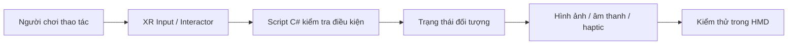

# Bài 01 — Khởi động Mission: Custom VR Development

> **Lộ trình:** VR Development · **Học phần:** Custom VR Development · **Nền tảng:** Unity 6.3 · **Dạng:** tutorial.
>
> **Lưu ý:** Các quy trình và mã bên dưới là ví dụ thực hành độc lập, không phải bản chép nguyên văn hướng dẫn hay đề kiểm tra chính thức của Unity. Cần đối chiếu tài nguyên scene, prefab và phiên bản package trong dự án thực tế.

## 1. Tổng quan

Ở giai đoạn phát triển VR tùy biến, người lập trình không chỉ kéo thả các component tương tác có sẵn. Mục tiêu là chuyển một hành vi cụ thể của người chơi thành **logic C# có thể kiểm thử**: cầm thiết bị quét, hướng vào vật thể, kích hoạt bằng input, nhận phản hồi; hoặc giải câu đố để mở cửa.

Một nguyên tắc quan trọng là thiết kế từ **hành vi quan sát được**. Ví dụ, thay vì đặt yêu cầu chung chung “máy quét hoạt động”, hãy phát biểu: “Khi người chơi giữ máy quét, nhấn nút kích hoạt và tia chạm vật thể có thể quét trong phạm vi xác định, vật thể hiển thị trạng thái đã quét.”

## 2. Mục tiêu học tập

- Phân biệt vai trò của Interactor, Interactable và script tùy biến trong XR Interaction Toolkit.
- Chia một cơ chế VR thành input, xử lý, trạng thái, phản hồi và kiểm thử.
- Lập kế hoạch hoàn thành một scene tương tác nhỏ và kiểm tra trên thiết bị mục tiêu.

## 3. Tư duy thiết kế tương tác tùy biến

Một tương tác điển hình gồm năm khâu: **người chơi ra lệnh → hệ thống phát hiện → kiểm tra điều kiện → cập nhật trạng thái → phản hồi**.

Trong đó, **Interactor** là thành phần thực hiện hành động chọn/chạm (chẳng hạn tay hoặc tia), **Interactable** mô tả đối tượng được tương tác, còn **script tùy biến** phụ trách quy tắc riêng của trò chơi. Tránh đặt toàn bộ logic trong một script duy nhất, vì điều này khiến việc thay đổi hành vi và debug khó hơn.

## 4. Chuẩn bị môi trường

1. Mở dự án Unity đã có XR Origin/XR Rig, hệ input tương thích và XR Interaction Toolkit.
2. Kiểm tra cấu hình OpenXR và profile điều khiển thích hợp với thiết bị.
3. Tạo scene thử nghiệm nhỏ, có mặt sàn, một đối tượng có collider và một thiết bị cầm tay.
4. Bật cửa sổ **Console** và **Inspector**; thử Play Mode trước khi viết thêm logic.
5. Kiểm tra trên headset mục tiêu. FPS trong Editor chỉ là dấu hiệu sơ bộ, không thay thế profiling trên thiết bị.

**Phụ thuộc tối thiểu:** Người học cần hiểu `GameObject`, `Component`, `Transform`, `Collider` và sự khác nhau giữa `Update()` và sự kiện. Chức năng của XR Interaction Toolkit có thể khác nhau theo phiên bản package, nên kiểm tra tên component trong Inspector của dự án.

## 5. Lộ trình triển khai một tương tác

| Giai đoạn | Đầu ra cần quan sát | Minh chứng |
|---|---|---|
| Dựng scene | Đối tượng xuất hiện đúng vị trí | Ảnh Hierarchy và Game view |
| Kết nối input | Nhấn đúng nút tạo sự kiện | Console hoặc giao diện báo trạng thái |
| Xử lý | Điều kiện hợp lệ được chấp nhận | Tình huống đúng/sai |
| Phản hồi | Trạng thái nhìn hoặc nghe rõ | Video thao tác |
| Kiểm thử | Không lỗi Console, hoạt động trên HMD | Nhật ký kiểm thử |

## 6. Bài thực hành khởi động

Tạo một **công tắc VR đơn giản**: một đối tượng có thể chọn, và mỗi lần kích hoạt thì đổi giữa hai vật liệu hoặc bật/tắt nguồn sáng. Có thể nối sự kiện `Activated` trong Inspector đến một phương thức `public` của script riêng. Nếu không có headset, có thể dùng công cụ mô phỏng XR tương thích package để kiểm tra sơ bộ.

**Tiêu chí đạt:** công tắc phản hồi rõ ràng; vô hiệu hóa đối tượng sẽ ngăn tương tác; không có tham chiếu null; thao tác lặp lại không làm trạng thái sai lệch.

## 7. Lỗi thường gặp

- **Bấm mà không phản hồi:** kiểm tra Input Actions, thiết bị điều khiển, Interactable và event binding.
- **Tia không trúng vật thể:** kiểm tra Collider, Interaction Layer Mask/Physics Layer Mask và khoảng cách.
- **Editor chạy được, HMD lỗi:** rà cấu hình runtime OpenXR, quyền thiết bị và build target.
- **Rung hoặc giật:** đo frame time; kiểm tra shadow, draw call, overdraw và hiệu ứng quá đắt.

## 8. Tổng kết

Một Mission VR tùy biến nên được triển khai theo các tiêu chí đo được: **có hành động cụ thể, có điều kiện hợp lệ, có phản hồi, có kiểm thử và có minh chứng**. Đây là nền tảng cho hệ thống máy quét, bộ nhập mã, đầu đọc thẻ và cửa trượt ở các ví dụ thực hành tiếp theo.

## 9. Câu hỏi ôn tập trắc nghiệm

### Câu 1

Phần nào chịu trách nhiệm quy tắc riêng như “chỉ mở cửa khi nhập đúng mã”?

A. Camera của XR Origin  
B. Script logic C# của trò chơi  
C. Texture của vật thể  
D. Post-processing  

**Đáp án:** B. **Giải thích:** Logic ứng dụng nằm trong script hoặc thành phần nghiệp vụ tùy biến; XR chỉ cung cấp lớp tương tác cơ bản.

### Câu 2

Vì sao phải có Collider khi kiểm tra tia bằng `Physics.Raycast`?

A. Để vật thể có thể được truy vấn va chạm  
B. Để tự động tối ưu GPU  
C. Để bật âm thanh stereo  
D. Để khởi tạo XR Origin  

**Đáp án:** A. **Giải thích:** Raycast dò tìm hit trên các Collider phù hợp với Physics Layer Mask.

### Câu 3

Kết quả nào là tiêu chí kiểm thử rõ ràng nhất?

A. Máy quét trông bắt mắt  
B. Có nhiều component  
C. Script dài hơn 100 dòng  
D. Kích hoạt vào mục tiêu hợp lệ làm hiển thị trạng thái đã quét  

**Đáp án:** D. **Giải thích:** Tiêu chí cần quan sát và kiểm chứng được.

### Câu 4

Khi ứng dụng giật trên HMD nhưng mượt trong Editor, nên ưu tiên gì?

A. Đổi tên scene  
B. Xóa toàn bộ collider  
C. Profiling trên thiết bị đích  
D. Tắt mọi input  

**Đáp án:** C. **Giải thích:** Hiệu năng cần đo trên phần cứng và chế độ render thực tế.

### Câu 5

Cách tách hệ thống tương tác giúp dễ bảo trì là gì?

A. Gom mọi chức năng vào Update  
B. Tách input, điều kiện và phản hồi  
C. Chỉ dùng một GameObject cho cả scene  
D. Bỏ kiểm thử lỗi  

**Đáp án:** B. **Giải thích:** Mỗi phần có trách nhiệm rõ ràng, dễ kiểm thử riêng.

---

**Đọc thêm:** [Unity Learn — Custom VR Development](https://learn.unity.com/pathway/vr-development/unit/mission-4-custom-vr-development?version=6.3). Tên mục học và phiên bản đối chiếu theo danh mục Unity 6.3; thao tác và kết quả có thể thay đổi khi package được cập nhật.
