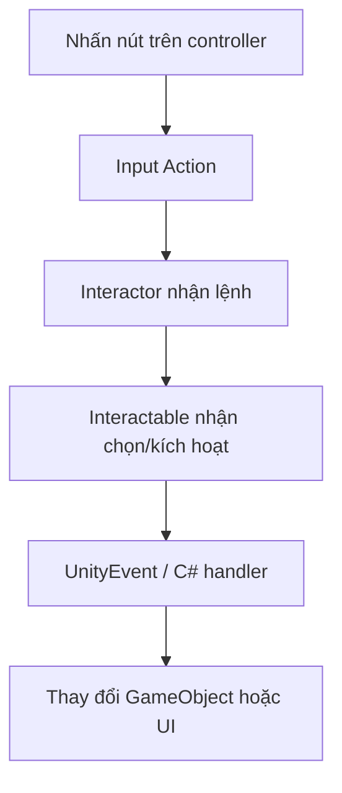

# Bài 02 — Khám phá và phân tích Sample Scene

> **Lộ trình:** VR Development · **Học phần:** Custom VR Development · **Nền tảng:** Unity 6.3 · **Dạng:** tutorial.
>
> **Lưu ý:** Các quy trình và mã bên dưới là ví dụ thực hành độc lập, không phải bản chép nguyên văn hướng dẫn hay đề kiểm tra chính thức của Unity. Cần đối chiếu tài nguyên scene, prefab và phiên bản package trong dự án thực tế.

## 1. Tổng quan

Sample Scene là môi trường để nhận diện cấu trúc tương tác VR trước khi sửa mã. Thay vì thử các nút ngẫu nhiên, hãy tìm được **luồng sự kiện**: vật thể nào phát input, script nào xử lý, điều kiện nào làm đổi trạng thái và nơi phản hồi được hiển thị.

Các dự án Unity có thể tổ chức Hierarchy hoặc prefab khác nhau. Phương pháp khảo sát dưới đây vẫn áp dụng được ngay cả khi scene minh họa không giống hoàn toàn scene trong khóa học.

## 2. Mục tiêu học tập

- Lần theo mối liên kết giữa GameObject, Component, Inspector và sự kiện.
- Xác định đối tượng có thể cầm, collider, layer và phản hồi trong một scene VR.
- Ghi lại sơ đồ Hierarchy và kiểm thử thành công/thất bại của một tương tác.

## 3. Đọc cấu trúc scene

Chọn một vật thể nghi là thiết bị tương tác, mở **Inspector** và kiểm tra lần lượt:

| Thành phần | Câu hỏi khi khảo sát |
|---|---|
| `Transform` | Đối tượng được đặt ở đâu? Có phải con của tay hay không? |
| `Collider` | Hình bao có khớp vật thể và cho phép ray/trigger dò được không? |
| `Rigidbody` | Đối tượng có sử dụng chuyển động vật lý khi cầm/thả không? |
| `XR Grab Interactable` | Người chơi có thể nhặt vật này không? |
| `XR Simple Interactable` | Đối tượng nhận sự kiện chọn/kích hoạt nào? |
| Script C# tùy biến | Thuộc tính nào đang được tham chiếu? |
| Event trong Inspector | Khi `Activated`/`Select Entered`, phương thức nào chạy? |

Các tên `XR ... Interactable` có thể thay đổi hoặc được thay thế tùy package và thiết kế scene. Đừng tự thêm component trùng chức năng trước khi hiểu component đang có.

## 4. Truy vết sự kiện tương tác

Để kiểm tra, hãy bắt đầu từ **đối tượng nhận kết quả** rồi truy ngược: script nào đổi thuộc tính? Ai gọi script đó? Event nào gắn với script? Input nào tạo event?

## 5. Quy trình thực hành

1. Mở sample scene hoặc scene tương đương; lưu bản sao trước khi chỉnh sửa.
2. Chạy Play Mode, thử từng thao tác: trỏ, nhặt, thả, kích hoạt, tiến lại gần và đi xa.
3. Dừng Play Mode. Tìm GameObject vừa tương tác trong Hierarchy.
4. Kiểm tra Collider và các lớp tương tác. Phân biệt **Physics Layer Mask** (dò va chạm) với **Interaction Layer Mask** (lọc XR interaction).
5. Dùng Inspector để tìm tham chiếu từ đối tượng này tới script/đối tượng khác.
6. Vẽ sơ đồ luồng sự kiện, sau đó thử **vô hiệu hóa một component** để xác nhận giả thuyết, rồi hoàn tác.

**Lưu ý:** Thay đổi giá trị trong Play Mode thường không được lưu về scene sau khi dừng; muốn giữ lại cấu hình, thực hiện ở Edit Mode.

## 6. Phiếu khảo sát mẫu

| Thử nghiệm | Dự đoán | Quan sát | Kết luận |
|---|---|---|---|
| Tia trỏ vào đối tượng | Có highlight | Điền sau khi thử | Kiểm tra Interactor/Mask |
| Nhặt đối tượng | Theo tay | Điền sau khi thử | Kiểm tra Grab và Rigidbody |
| Kích hoạt khi không cầm | Không chạy hoặc theo thiết kế | Điền sau khi thử | Kiểm tra điều kiện |
| Xóa tạm collider | Ray không hit | Điền sau khi thử | Kiểm chứng ray/physics |

## 7. Debug và tổng kết

Nếu sự kiện không xảy ra, kiểm tra từ ngoài vào trong: **thiết bị → Input Action → Interactor → Interactable → UnityEvent → script → đối tượng đích**. Khi xuất hiện `MissingReferenceException` hoặc `NullReferenceException`, hãy đối chiếu các trường script trong Inspector, không sửa mã đoán mò. Đầu ra tốt nhất là một sơ đồ rõ các quan hệ và nhật ký thử nghiệm có ít nhất một trường hợp lỗi có chủ đích.

## 8. Câu hỏi ôn tập trắc nghiệm

### Câu 1

Để tìm nguyên nhân một vật không nhận thao tác nhặt, nên kiểm tra thành phần nào trước?

A. Chất lượng texture  
B. XR Grab Interactable và cấu hình Interactor  
C. Skybox  
D. Thiết lập anti-aliasing  

**Đáp án:** B. **Giải thích:** Vật thể phải hỗ trợ grab và interactor phải được cấu hình đúng.

### Câu 2

Điều gì có thể xảy ra khi thay Inspector trong Play Mode rồi dừng?

A. Tất cả thay đổi luôn tự lưu  
B. Scene luôn bị xóa  
C. Giá trị thường trở lại trạng thái trước Play Mode  
D. Unity tự tạo build  

**Đáp án:** C. **Giải thích:** Các chỉnh sửa trong Play Mode thường chỉ mang tính tạm thời.

### Câu 3

Trong luồng kiểm tra tương tác, khâu nào nằm sau Interactable?

A. UnityEvent hoặc handler  
B. GPU driver  
C. Build target  
D. Material import  

**Đáp án:** A. **Giải thích:** Interactable phát sự kiện; handler mới thực hiện logic trò chơi.

### Câu 4

Tại sao phân biệt Physics Layer Mask và Interaction Layer Mask?

A. Hai loại là một  
B. Cả hai chỉ dùng cho âm thanh  
C. Để tăng texture quality  
D. Chúng lọc các loại truy vấn/tương tác khác nhau  

**Đáp án:** D. **Giải thích:** Physics và XR interaction có các cơ chế lọc riêng.

### Câu 5

Sơ đồ nào phù hợp nhất để khảo sát sample scene?

A. Bản đồ địa hình  
B. Luồng input đến phản hồi  
C. Biểu đồ chi phí asset  
D. Sơ đồ ánh sáng vật lý  

**Đáp án:** B. **Giải thích:** Mối quan hệ giữa event và kết quả giúp truy vết lỗi.

---

**Đọc thêm:** [Unity Learn — Custom VR Development](https://learn.unity.com/pathway/vr-development/unit/mission-4-custom-vr-development?version=6.3). Tên mục học và phiên bản đối chiếu theo danh mục Unity 6.3; thao tác và kết quả có thể thay đổi khi package được cập nhật.
