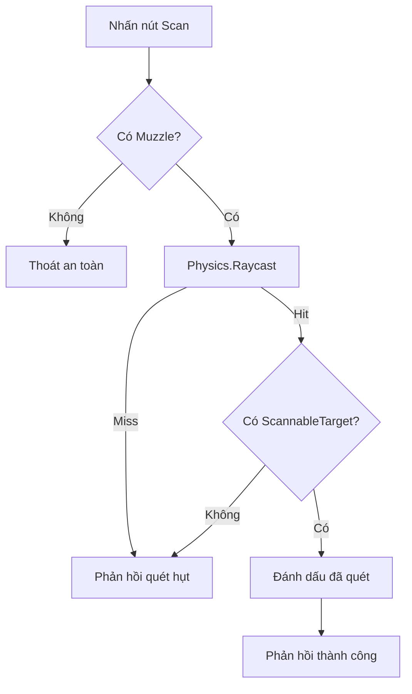

# Bài 04 — Lập trình chức năng quét bằng C#

> **Lộ trình:** VR Development · **Học phần:** Custom VR Development · **Nền tảng:** Unity 6.3 · **Dạng:** tutorial.
>
> **Lưu ý:** Các quy trình và mã bên dưới là ví dụ thực hành độc lập, không phải bản chép nguyên văn hướng dẫn hay đề kiểm tra chính thức của Unity. Cần đối chiếu tài nguyên scene, prefab và phiên bản package trong dự án thực tế.

## 1. Tổng quan

Sau khi bố trí thiết bị, ta triển khai việc **nhận tín hiệu kích hoạt**, phát tia `Physics.Raycast`, xác định vật thể có thể quét và tạo phản hồi. Ví dụ dùng Unity Input System để tách nút kích hoạt khỏi logic va chạm; người học cần gán `InputActionReference` tương ứng với controller trong Inspector.

## 2. Mục tiêu học tập

- Viết hàm quét theo hướng và khoảng cách có giới hạn.
- Chỉ xử lý mục tiêu chứa component `ScannableTarget`.
- Xử lý null, bỏ qua hit sai và kiểm thử bằng Console trước khi thêm UI/VFX.

## 3. Luồng xử lý quét



## 4. Component cho vật thể đích

```csharp
using UnityEngine;

public class ScannableTarget : MonoBehaviour
{
    [SerializeField] private Renderer targetRenderer;
    [SerializeField] private Color scannedColor = Color.green;
    private bool isScanned;

    public void Scan()
    {
        if (isScanned) return;
        isScanned = true;
        if (targetRenderer != null)
            targetRenderer.material.color = scannedColor;
        Debug.Log($"Đã quét: {name}");
    }
}
```

`isScanned` giúp thao tác có tính **idempotent**: quét lặp lại không làm trạng thái thay đổi ngoài ý muốn. `renderer.material` tạo/điều chỉnh material instance tại runtime; nếu cần tối ưu nhiều đối tượng, cân nhắc `MaterialPropertyBlock` hoặc cơ chế shader phù hợp.

## 5. Script phát tia khi nhận input

```csharp
using UnityEngine;
using UnityEngine.InputSystem;

public class HandheldScanner : MonoBehaviour
{
    [SerializeField] private Transform muzzle;
    [SerializeField] private InputActionReference scanAction;
    [SerializeField, Min(0.1f)] private float maxDistance = 5f;
    [SerializeField] private LayerMask targetLayers = ~0;

    private void Update()
    {
        if (scanAction == null || scanAction.action == null) return;
        if (scanAction.action.WasPressedThisFrame()) ScanOnce();
    }

    public void ScanOnce()
    {
        if (muzzle == null) return;

        if (Physics.Raycast(muzzle.position, muzzle.forward,
            out RaycastHit hit, maxDistance, targetLayers))
        {
            var target = hit.collider.GetComponentInParent<ScannableTarget>();
            if (target != null)
            {
                target.Scan();
                return;
            }
        }
        Debug.Log("Không tìm thấy mục tiêu quét hợp lệ");
    }
}
```

**Tích hợp:** kéo `Muzzle` vào trường tương ứng, chọn `InputActionReference` đã được kích hoạt trong Input Action Manager/action map, cấu hình layer và gắn `ScannableTarget` lên vật thể mục tiêu. Nếu action không hoạt động, kiểm tra action map đã bật chưa. Có thể thay nhánh `WasPressedThisFrame()` bằng **sự kiện Activate** của XR Interactable gọi trực tiếp `ScanOnce()` trong Inspector để tránh tự quản lý nút input.

**Giới hạn của ví dụ:** khi input action chung cho cả hai tay, script trên có thể được gọi không đúng thiết bị cầm. Với sản phẩm thực tế, chỉ cho phép quét khi scanner đang được người chơi cầm/đang active bằng điều kiện trạng thái Grab tương ứng.

## 6. Kiểm thử có điều kiện

| Tình huống | Kết quả cần đạt |
|---|---|
| Bấm Scan, ray trúng vật thể có `ScannableTarget` | Đổi màu, log thành công |
| Ray trúng tường không có component | Log miss, không đổi màu |
| Đối tượng ngoài `maxDistance` | Không quét được |
| Bấm liên tục vào mục tiêu đã quét | Không chạy xử lý lại |
| `Muzzle` chưa được gán | Không phát sinh `NullReferenceException` |

## 7. Các cải tiến thực tế

- Đặt hiệu ứng laser với `Line Renderer`, dừng tại `hit.point` thay vì luôn kéo dài tối đa.
- Thêm âm thanh/haptic khi quét thành công, nhưng tránh phát rung liên tục gây khó chịu.
- Tách phản hồi UI khỏi logic `ScannableTarget` để dễ tái sử dụng.
- Khi quản lý nhiều mục tiêu, dùng sự kiện hoàn thành để cập nhật số lượng đã quét mà không phải tìm mọi object mỗi frame.

## 8. Tổng kết

Scanner hoàn chỉnh cần **input đúng, hướng tia đúng, lớp lọc hợp lý, điều kiện mục tiêu rõ và phản hồi kiểm chứng được**. Mã mẫu là nền tảng để mở rộng thành hệ thống nhiều loại mục tiêu, nhiệm vụ quét hoặc công cụ tương tác trong Escape Room.

## 9. Câu hỏi ôn tập trắc nghiệm

### Câu 1

Khi `Physics.Raycast` trúng tường nhưng không có `ScannableTarget`, điều gì nên xảy ra?

A. Mọi vật trong scene đổi màu  
B. Ứng dụng đóng  
C. Không đánh dấu mục tiêu, có thể báo miss  
D. Tăng `maxDistance` tự động  

**Đáp án:** C. **Giải thích:** Hit vật lý chưa đồng nghĩa mục tiêu hợp lệ.

### Câu 2

`WasPressedThisFrame()` phù hợp với hành vi nào?

A. Kích hoạt một lần khi nhấn  
B. Quét liên tục mọi frame dù không bấm  
C. Khởi tạo prefab  
D. Phát hiện va chạm vật lý  

**Đáp án:** A. **Giải thích:** Đây là kiểm tra cạnh nhấn của input trong frame hiện tại.

### Câu 3

Vì sao `Scan()` kiểm tra `isScanned`?

A. Để tạo material mới liên tục  
B. Để tự nhận input XR  
C. Để bật OpenXR  
D. Để tránh xử lý lặp trạng thái đã hoàn thành  

**Đáp án:** D. **Giải thích:** Đối tượng đã quét không cần thay đổi lại nếu nghiệp vụ là một lần.

### Câu 4

Khi không thấy ray trúng mục tiêu, yếu tố nào cần kiểm tra?

A. Tên file scene  
B. Collider, LayerMask, khoảng cách và hướng  
C. Màu ambient  
D. Số lượng script trong project  

**Đáp án:** B. **Giải thích:** Những tham số này trực tiếp quyết định kết quả Physics.Raycast.

### Câu 5

Khi input action dùng chung cho hai tay, cần bổ sung gì?

A. Ánh sáng baking  
B. Thêm skybox  
C. Điều kiện scanner đang được cầm/active  
D. Một máy quét thứ ba  

**Đáp án:** C. **Giải thích:** Giúp ngăn nhấn tay không cầm máy mà vẫn kích hoạt quét.

---

**Đọc thêm:** [Unity Learn — Custom VR Development](https://learn.unity.com/pathway/vr-development/unit/mission-4-custom-vr-development?version=6.3). Tên mục học và phiên bản đối chiếu theo danh mục Unity 6.3; thao tác và kết quả có thể thay đổi khi package được cập nhật.
