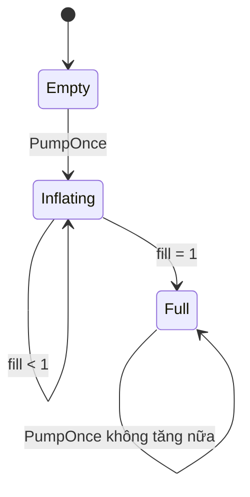

# Bài 05 — Tạo Balloon Inflator trong VR

> **Lộ trình:** VR Development · **Học phần:** Custom VR Development · **Nền tảng:** Unity 6.3 · **Dạng:** tutorial.
>
> **Lưu ý:** Các quy trình và mã bên dưới là ví dụ thực hành độc lập, không phải bản chép nguyên văn hướng dẫn hay đề kiểm tra chính thức của Unity. Cần đối chiếu tài nguyên scene, prefab và phiên bản package trong dự án thực tế.

## 1. Tổng quan

Một trò tương tác đơn giản để luyện cơ chế tùy biến là **bơm bóng**: mỗi lần kích hoạt nút, quả bóng lớn lên đến kích thước giới hạn. Điều quan trọng không nằm ở hình cầu, mà ở khả năng xây dựng quy tắc **input → trạng thái → hiển thị**, cùng phản hồi và giới hạn để tránh lỗi.

## 2. Mục tiêu học tập

- Tạo thiết bị bơm và quả bóng có thể quan sát trong VR.
- Viết phương thức tăng mức bơm và giới hạn kích thước.
- Nối sự kiện kích hoạt từ thiết bị tới script xử lý, kiểm thử các biên.

## 3. Quy tắc trạng thái

Giả sử `fill` nằm trong đoạn từ 0 đến 1. Mỗi lần nhấn tăng thêm một lượng `step`; kích thước được tính từ mức ban đầu đến mức cực đại:

$$
fill_{next} = \min(1, fill_{current} + step)
$$

$$
scale = scale_{start} \times \operatorname{Lerp}(1, maxMultiplier, fill)
$$

Nhờ giới hạn này, bấm rất nhiều lần vẫn không khiến quả bóng tăng vô hạn. Trong sản phẩm VR, kích thước tối đa cần được chọn phù hợp phạm vi quan sát, tránh quả bóng đột ngột che hết tầm nhìn.

## 4. Tạo scene và nối sự kiện

1. Tạo GameObject `Balloon` có Mesh Renderer (ví dụ sphere) và một đối tượng `Pump` có thể tương tác.
2. Đặt `BalloonInflator` lên một GameObject quản lý; gán Transform của bóng.
3. Nếu `Pump` hỗ trợ sự kiện `Activated`, liên kết event với `BalloonInflator.PumpOnce()` bằng Inspector.
4. Nếu dùng nút UI world-space, nối sự kiện `OnClick()` tới cùng phương thức `PumpOnce()`.
5. Chạy Play Mode, thử kích hoạt một, nhiều và quá số lần dự kiến; quan sát kích thước.

## 5. Mã C# tham khảo

```csharp
using UnityEngine;
using UnityEngine.Events;

public class BalloonInflator : MonoBehaviour
{
    [SerializeField] private Transform balloon;
    [SerializeField, Range(0.01f, 1f)] private float step = 0.1f;
    [SerializeField, Min(1f)] private float maxMultiplier = 2f;
    [SerializeField] private UnityEvent onFull;

    private Vector3 baseScale;
    private float fill;
    private bool wasFull;

    private void Awake()
    {
        if (balloon != null) baseScale = balloon.localScale;
    }

    public void PumpOnce()
    {
        if (balloon == null) return;
        fill = Mathf.Clamp01(fill + step);
        float multiplier = Mathf.Lerp(1f, maxMultiplier, fill);
        balloon.localScale = baseScale * multiplier;

        if (fill >= 1f && !wasFull)
        {
            wasFull = true;
            onFull?.Invoke();
        }
    }
}
```

Trong ví dụ, `baseScale` được ghi lại ở `Awake()` để giữ tỷ lệ ban đầu của bóng, kể cả khi mesh không phải hình cầu chuẩn. `onFull` chỉ được phát một lần, phù hợp khi muốn hiện thông báo thành công hoặc mở khóa vật thể mới.

## 6. Sơ đồ logic



Đây là sơ đồ khái niệm: `Empty` là mức ban đầu; `Inflating` ứng với `0 < fill < 1`; `Full` ứng với `fill = 1`. Script chỉ lưu biến số và cờ trạng thái tương đương, không bắt buộc dùng state machine framework.

## 7. Kiểm thử và cải tiến

| Trường hợp | Mong đợi |
|---|---|
| Kích hoạt lần đầu | Bóng lớn lên một lượng nhỏ |
| Kích hoạt đến giới hạn | Bóng dừng ở kích thước tối đa |
| Kích hoạt thêm khi đã đầy | Không tràn tỷ lệ và không phát lại `onFull` |
| Bóng chưa được gán trong Inspector | Thoát an toàn, không văng exception |

Có thể thêm âm thanh bơm, hiệu ứng đổi màu theo mức `fill` hoặc rung nhẹ cho controller. Nếu muốn một trò chơi có áp suất, thời gian hoặc nổ bóng, hãy bổ sung quy tắc này thành module riêng, tránh ghép mọi hành vi vào phương thức `PumpOnce()`.

## 8. Tổng kết

Bài này luyện cách biểu diễn **mức tiến độ liên tục**, cập nhật Transform bằng `Mathf.Lerp`, phát sự kiện đạt ngưỡng và kiểm tra giá trị biên — những kỹ thuật tái sử dụng được cho van nước, thanh năng lượng hoặc đồ vật tăng/giảm kích thước.

## 9. Câu hỏi ôn tập trắc nghiệm

### Câu 1

Vai trò của `Mathf.Clamp01` là gì?

A. Đổi layer  
B. Giữ giá trị trong khoảng từ 0 đến 1  
C. Tự động phát haptic  
D. Kích hoạt collider  

**Đáp án:** B. **Giải thích:** Giới hạn tiến độ bơm ở miền hợp lệ.

### Câu 2

Lưu `baseScale` giúp ích gì?

A. Giữ được tỷ lệ scale gốc của bóng  
B. Tăng FPS  
C. Tạo Rigidbody  
D. Tự kết nối Input Actions  

**Đáp án:** A. **Giải thích:** Kích thước mới được nhân với scale ban đầu, tránh phá tỷ lệ mesh.

### Câu 3

Tại sao dùng `wasFull` trước khi phát `onFull`?

A. Để xóa bóng  
B. Để tạo prefab  
C. Để bỏ Renderer  
D. Để tránh phát sự kiện hoàn thành nhiều lần  

**Đáp án:** D. **Giải thích:** Cờ ngăn xử lý sự kiện đạt ngưỡng lặp lại.

### Câu 4

Sau khi `fill` đạt 1, bấm thêm sẽ làm gì?

A. Tăng vô hạn  
B. Tự động đóng ứng dụng  
C. Không tăng kích thước thêm  
D. Đặt lại về 0  

**Đáp án:** C. **Giải thích:** fill được giới hạn bằng Clamp01.

### Câu 5

Trong scene VR, việc tăng kích thước bóng cần tránh điều gì?

A. Tên biến ngắn  
B. Che khuất tầm nhìn đột ngột và gây khó chịu  
C. Dùng UnityEvents  
D. Đặt vật thể trong scene  

**Đáp án:** B. **Giải thích:** Thiết kế phản hồi VR cần xét trải nghiệm và an toàn cảm nhận của người dùng.

---

**Đọc thêm:** [Unity Learn — Custom VR Development](https://learn.unity.com/pathway/vr-development/unit/mission-4-custom-vr-development?version=6.3). Tên mục học và phiên bản đối chiếu theo danh mục Unity 6.3; thao tác và kết quả có thể thay đổi khi package được cập nhật.
