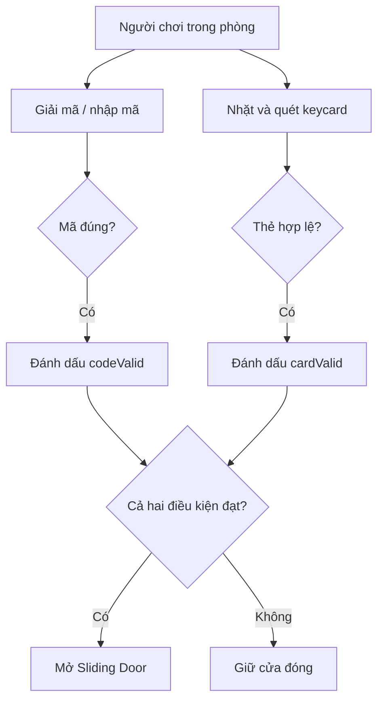

# Bài 06 — Tổng quan dự án Escape Room VR

> **Lộ trình:** VR Development · **Học phần:** Custom VR Development · **Nền tảng:** Unity 6.3 · **Dạng:** tutorial.
>
> **Lưu ý:** Các quy trình và mã bên dưới là ví dụ thực hành độc lập, không phải bản chép nguyên văn hướng dẫn hay đề kiểm tra chính thức của Unity. Cần đối chiếu tài nguyên scene, prefab và phiên bản package trong dự án thực tế.

## 1. Tổng quan

**Escape Room VR** là bài toán tổ hợp nhiều tương tác đơn lẻ thành một hệ thống câu đố có tiến độ: tìm mã, nhập mã bằng bảng số, tìm thẻ chìa khóa, xác thực tại đầu đọc và mở cửa trượt. Thử thách chính là **định nghĩa điều kiện mở khóa và phối hợp giữa các module** mà không làm chúng phụ thuộc quá chặt vào nhau.

## 2. Mục tiêu học tập

- Mô tả vòng chơi và điều kiện thắng rõ ràng.
- Tách Number Pad, Keycard Reader, Sliding Door và bộ điều phối trạng thái.
- Xây dựng kịch bản kiểm thử cho trường hợp đúng/sai và tương tác lặp lại.

## 3. Kịch bản phòng thoát hiểm tối thiểu

Người chơi bắt đầu trong một phòng khóa. Họ phải đọc gợi ý tìm **mã số**, nhập mã vào bảng điều khiển và tìm **keycard** đặt đúng vào đầu đọc. Cửa chỉ mở khi cả hai điều kiện đã đạt. Có thể thay đổi thứ tự hai nhiệm vụ, nhưng kết quả phải nhất quán.



Hai cơ chế gửi **sự kiện thành công**, không nên trực tiếp thay đổi Transform của cửa từ nhiều nơi. Bộ điều phối sẽ quyết định thời điểm mở.

## 4. Kiến trúc và trách nhiệm

| Module | Đầu vào | Kết quả |
|---|---|---|
| `NumberPad` | Chữ số, Xóa, Xác nhận | Event `codeAccepted` |
| `KeycardReader` | Collider thẻ đi vào vùng đầu đọc | Event `cardAccepted` |
| `EscapeRoomController` | Hai sự kiện hợp lệ | Gọi `SlidingDoor.Open()` |
| `SlidingDoor` | Yêu cầu mở | Di chuyển cánh cửa |

Đây là gợi ý kiến trúc, không phải tên bắt buộc của prefab chính thức. Một game nhỏ có thể nối UnityEvents trong Inspector; game lớn có thể tách event bus hoặc state machine.

## 5. Bố trí scene VR

1. Bố trí sàn, tường, cửa và lối đi có kích thước dễ nhận biết.
2. Đặt Number Pad tại vùng dễ tiếp cận (tay với tới hoặc tia trỏ được), có chữ số rõ và feedback đủ tương phản.
3. Đặt Keycard ở vị trí người chơi có thể quan sát, nhặt và đưa tới Reader mà không gây va chạm bất thường.
4. Đặt Reader cạnh cửa. Đảm bảo Collider/Trigger đủ rộng để thao tác dễ dàng nhưng không tự kích hoạt khi thẻ ở xa.
5. Định nghĩa cửa đóng là **trạng thái ban đầu**, cửa mở là **điều kiện hoàn thành**.
6. Thử cả phương thức di chuyển phù hợp với người chơi: teleportation hoặc continuous movement có tùy chọn thoải mái.

## 6. Quản lý trạng thái điều kiện

Có thể biểu diễn trạng thái bằng hai biến Boolean:

```csharp
using UnityEngine;

public class EscapeRoomController : MonoBehaviour
{
    [SerializeField] private SlidingDoor door;
    private bool codeValid;
    private bool cardValid;
    private bool opened;

    public void AcceptCode() { codeValid = true; TryOpen(); }
    public void AcceptCard() { cardValid = true; TryOpen(); }

    private void TryOpen()
    {
        if (opened || !codeValid || !cardValid || door == null) return;
        opened = true;
        door.Open();
    }
}
```

Script này hoạt động cùng class `SlidingDoor` được xây dựng trong bài cửa trượt. Gắn event thành công từ Number Pad và Card Reader tới các phương thức `AcceptCode()` và `AcceptCard()` trong Inspector.

## 7. Ma trận kiểm thử

| Mã số | Thẻ | Trạng thái cửa |
|---|---|---|
| Sai | Sai | Đóng |
| Đúng | Sai | Đóng |
| Sai | Đúng | Đóng |
| Đúng | Đúng | Mở |

Thử thêm trường hợp nhấn mã nhiều lần, quét thẻ nhiều lần và thử lại sau lỗi. Mỗi thay đổi phải có phản hồi rõ, ví dụ đèn báo xanh khi điều kiện đạt hoặc âm báo lỗi ngắn khi nhập sai.

## 8. Tiêu chí hoàn thành

- [ ] Có ít nhất hai cơ chế tương tác độc lập, không tự mở cửa khi mới hoàn thành một cơ chế.
- [ ] Có phản hồi thị giác khi nhập đúng/sai và quét thẻ hợp lệ/không hợp lệ.
- [ ] Cửa di chuyển mượt tới vị trí mở, không dịch chuyển vô hạn.
- [ ] Scene chạy được trong Play Mode và kiểm tra lại trên headset đích.
- [ ] Có hình/video cùng bảng kết quả bốn tổ hợp điều kiện.

## 9. Tổng kết

Escape Room là cơ hội luyện **logic trạng thái và phối hợp module**: đầu vào khác nhau cùng đóng góp vào điều kiện chung; cửa nhận một lệnh rõ ràng sau khi tất cả điều kiện hợp lệ được xác nhận.

## 10. Câu hỏi ôn tập trắc nghiệm

### Câu 1

Nếu nhập đúng mã nhưng chưa có thẻ hợp lệ, cửa nên như thế nào?

A. Mở ngay  
B. Giữ đóng  
C. Khởi động lại scene  
D. Tự tạo keycard  

**Đáp án:** B. **Giải thích:** Điều kiện mở sử dụng phép AND giữa mã và thẻ.

### Câu 2

Ưu điểm của bộ điều phối EscapeRoomController là gì?

A. Tập trung điều kiện mở khóa vào một nơi  
B. Tăng số collider  
C. Thay thế XR Origin  
D. Tự thêm đồ họa HDR  

**Đáp án:** A. **Giải thích:** Các module chỉ phát sự kiện, tránh mỗi module tự điều khiển cửa.

### Câu 3

Sự kiện nào phù hợp đầu ra của Keycard Reader?

A. Update camera FOV  
B. Change skybox  
C. Reload scene  
D. CardAccepted  

**Đáp án:** D. **Giải thích:** Đầu đọc cần báo thẻ hợp lệ cho hệ điều phối.

### Câu 4

Một cách kiểm tra tốt cho điều kiện AND là gì?

A. Thử chỉ tình huống hai điều kiện đúng  
B. Thử chỉ tình huống cả hai sai  
C. Thử đầy đủ bốn tổ hợp đúng/sai  
D. Không cần thử trường hợp sai  

**Đáp án:** C. **Giải thích:** Bốn tổ hợp thể hiện rõ lỗi logic mở khóa.

### Câu 5

Vì sao Number Pad không nên trực tiếp dịch chuyển cửa mỗi khi nhận số?

A. Vì keypad luôn có Rigidbody  
B. Vì keypad nên chỉ gửi tín hiệu khi hoàn thành xác thực  
C. Vì cửa không có Transform  
D. Vì mọi sự kiện phải đi qua Update  

**Đáp án:** B. **Giải thích:** Phân tách trách nhiệm giúp giảm phụ thuộc và tránh mở nhầm cửa.

---

**Đọc thêm:** [Unity Learn — Custom VR Development](https://learn.unity.com/pathway/vr-development/unit/mission-4-custom-vr-development?version=6.3). Tên mục học và phiên bản đối chiếu theo danh mục Unity 6.3; thao tác và kết quả có thể thay đổi khi package được cập nhật.
