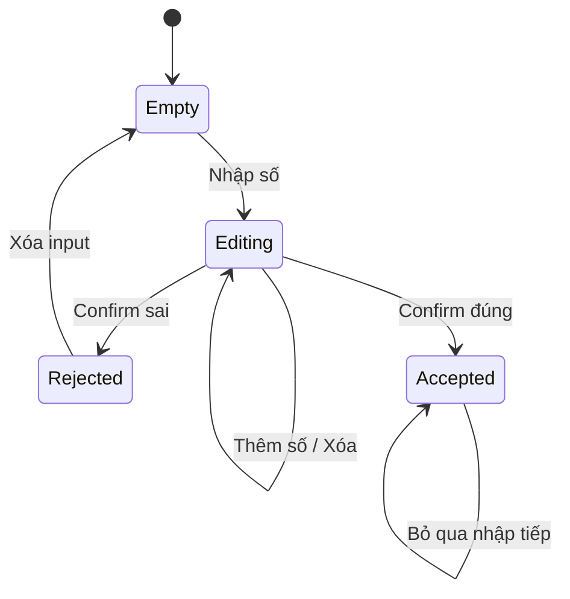

# Bài 07 — Xây dựng bảng nhập mã số (Number Pad)

> **Lộ trình:** VR Development · **Học phần:** Custom VR Development · **Nền tảng:** Unity 6.3 · **Dạng:** tutorial.
>
> **Lưu ý:** Các quy trình và mã bên dưới là ví dụ thực hành độc lập, không phải bản chép nguyên văn hướng dẫn hay đề kiểm tra chính thức của Unity. Cần đối chiếu tài nguyên scene, prefab và phiên bản package trong dự án thực tế.

## 1. Tổng quan

Number Pad là thiết bị nhập mã trong thế giới VR. Trải nghiệm tốt cần cho người chơi biết mình đã bấm phím nào, có thể xóa khi nhập sai và chỉ phát tín hiệu thành công khi xác nhận đúng mã. Không đặt mục tiêu xây hệ thống bảo mật thật: đây là **logic câu đố trong trò chơi**.

## 2. Mục tiêu học tập

- Tạo giao diện số có thể kích hoạt bằng nút world-space hoặc sự kiện XR.
- Quản lý chuỗi đã nhập, độ dài tối đa, nút xóa và nút xác nhận.
- Phát UnityEvent khi mã đúng và phản hồi rõ khi sai.

## 3. Cấu trúc và hành vi bàn phím

```text
Keypad
├── Display (TextMeshPro)
├── Digit_0 ... Digit_9
├── Clear
└── Confirm
```

Nếu dùng Canvas world-space, kiểm tra `EventSystem`, raycaster phù hợp với XR/UI và input module tương thích. Nếu dùng mỗi phím là GameObject với XR Interactable, gắn sự kiện kích hoạt để gọi phương thức nhận chữ số. Không sử dụng đồng thời hai cơ chế nhập cho cùng một phím nếu dễ sinh sự kiện trùng.

## 4. State machine cho bộ nhập mã



Việc sử dụng trạng thái `Accepted` giúp khóa keypad sau khi hoàn thành, tránh event thành công bị phát lại. Sau lỗi, có thể xóa toàn bộ hoặc chỉ hiển thị thông báo, tùy thiết kế trải nghiệm.

## 5. Ví dụ C# có thể gắn vào giao diện

```csharp
using TMPro;
using UnityEngine;
using UnityEngine.Events;

public class NumberPad : MonoBehaviour
{
    [SerializeField] private TMP_Text display;
    [SerializeField] private string correctCode = "0427";
    [SerializeField, Min(1)] private int maxLength = 4;
    [SerializeField] private UnityEvent codeAccepted;

    private string current = "";
    private bool unlocked;

    public void AddDigit(string digit)
    {
        if (unlocked || current.Length >= maxLength) return;
        if (digit.Length != 1 || !char.IsDigit(digit[0])) return;
        current += digit;
        Refresh();
    }

    public void Clear()
    {
        if (unlocked) return;
        current = "";
        Refresh();
    }

    public void Confirm()
    {
        if (unlocked) return;
        if (current == correctCode)
        {
            unlocked = true;
            if (display != null) display.text = "Đã mở khóa";
            codeAccepted?.Invoke();
        }
        else
        {
            current = "";
            if (display != null) display.text = "Sai mã — thử lại";
        }
    }

    private void Refresh()
    {
        if (display != null) display.text = current;
    }
}
```

`"0427"` là **mã ví dụ**, không phải mã cố định của dự án. Dùng `string` thay vì `int` để giữ được các số 0 ở đầu. Gán các nút digit gọi `AddDigit(string)` với tham số tương ứng, nút Clear gọi `Clear()` và nút Confirm gọi `Confirm()`.

## 6. Kiểm thử và lỗi thường gặp

| Thử nghiệm | Kết quả mong đợi |
|---|---|
| Nhập `0`, `4`, `2`, `7` rồi Confirm | Event `codeAccepted` phát một lần |
| Nhập sai rồi Confirm | Thông báo lỗi và có thể nhập lại |
| Nhập quá `maxLength` | Ký tự thừa bị bỏ qua |
| Nhấn Confirm khi trống | Không mở khóa |
| Nhấn lại sau khi mở | Không phát lại event |

- **Nút nhìn thấy nhưng không bấm được:** kiểm tra UI Raycaster, EventSystem, Input Module và vị trí Canvas.
- **Một lần bấm nhận hai ký tự:** kiểm tra listener trùng hoặc cả hệ XR lẫn UI cùng xử lý.
- **Mã bắt đầu bằng 0 bị mất:** dùng chuỗi ký tự, không chuyển sang số nguyên.
- **Màn hình hiển thị mã nhạy cảm:** trong trò chơi có thể hiện dấu `•` thay chữ số nếu muốn tránh người chơi nhìn trộm, nhưng vẫn nên có xác nhận thao tác.

## 7. Tổng kết

Number Pad minh họa cách **thu thập chuỗi nhập theo sự kiện**, giới hạn độ dài, xác minh dữ liệu và phát tín hiệu thành công để một module khác sử dụng. Tách UI và quy tắc xét mã là bước chuẩn bị tốt để mở rộng các câu đố VR.

## 8. Câu hỏi ôn tập trắc nghiệm

### Câu 1

Vì sao lưu mã như `"0427"` thay vì số nguyên `427`?

A. Vì string nhanh hơn mọi trường hợp  
B. Vì mã có thể chứa số 0 ở đầu  
C. Vì Unity không hỗ trợ số nguyên  
D. Vì UI không hỗ trợ chữ số  

**Đáp án:** B. **Giải thích:** Chuỗi giữ nguyên độ dài và ký tự 0 đầu.

### Câu 2

Khi nhập đúng mã, thiết kế nên làm gì?

A. Phát event thành công một lần  
B. Xóa scene  
C. Tự mở tất cả cửa dù thiếu keycard  
D. Lặp thông báo trong Update  

**Đáp án:** A. **Giải thích:** Event được gửi một lần để controller xử lý điều kiện chung.

### Câu 3

Để tránh nhập quá số chữ số, cần kiểm tra gì?

A. Chất lượng material  
B. Tốc độ Render Pipeline  
C. Camera clipping planes  
D. current.Length so với maxLength  

**Đáp án:** D. **Giải thích:** Kiểm tra độ dài trước khi thêm ký tự.

### Câu 4

Một phím số nhận hai lần nhấn dù người chơi chỉ bấm một lần, nguyên nhân hợp lý là gì?

A. Đèn quá sáng  
B. Collider quá nặng  
C. Listener hoặc cơ chế XR/UI bị nối trùng  
D. Chưa tạo material  

**Đáp án:** C. **Giải thích:** Nhiều đường phát sự kiện có thể kích hoạt cùng handler.

### Câu 5

UI World Space không nhận tia trỏ, nên kiểm tra gì?

A. Loại font chữ  
B. Raycaster, EventSystem, Input Module  
C. Cường độ directional light  
D. GPU texture cache  

**Đáp án:** B. **Giải thích:** Các thành phần UI input quyết định ray trỏ tương tác được hay không.

---

**Đọc thêm:** [Unity Learn — Custom VR Development](https://learn.unity.com/pathway/vr-development/unit/mission-4-custom-vr-development?version=6.3). Tên mục học và phiên bản đối chiếu theo danh mục Unity 6.3; thao tác và kết quả có thể thay đổi khi package được cập nhật.
