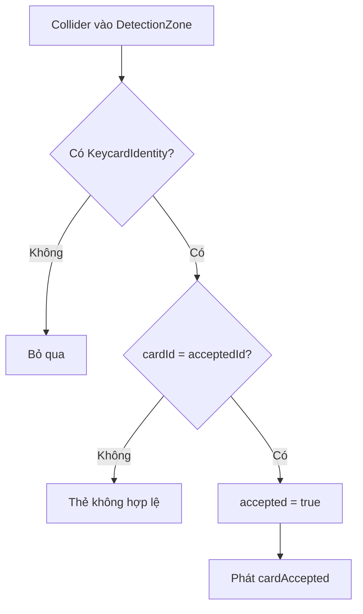

# Bài 08 — Thiết kế đầu đọc Keycard trong VR

> **Lộ trình:** VR Development · **Học phần:** Custom VR Development · **Nền tảng:** Unity 6.3 · **Dạng:** tutorial.
>
> **Lưu ý:** Các quy trình và mã bên dưới là ví dụ thực hành độc lập, không phải bản chép nguyên văn hướng dẫn hay đề kiểm tra chính thức của Unity. Cần đối chiếu tài nguyên scene, prefab và phiên bản package trong dự án thực tế.

## 1. Tổng quan

Đầu đọc thẻ nhận một vật thể người chơi đang cầm, đối chiếu danh tính thẻ và phát tín hiệu khi hợp lệ. Trong bài tập, có thể dùng **Trigger Collider** để phát hiện thẻ đi vào vùng đọc. Đây là cơ chế tương tác vật lý trong game, không phải đầu đọc RFID thực tế.

## 2. Mục tiêu học tập

- Thiết lập vùng trigger để nhận biết vật thể đi vào đầu đọc.
- Xác thực thẻ dựa trên một mã nhận dạng đơn giản.
- Phát sự kiện khi thẻ đúng và chặn kích hoạt lặp lại.

## 3. Cấu trúc đối tượng

```text
Keycard (XR Grab Interactable)
├── Mesh/Collider
├── Rigidbody
└── KeycardIdentity (cardId)

Reader
├── ReaderBody (mesh)
└── DetectionZone (Collider isTrigger + KeycardReader)
```

Để `OnTriggerEnter` hoạt động trong Unity Physics 3D, các Collider phải được cấu hình hợp lệ và **ít nhất một trong hai đối tượng tương tác thường cần Rigidbody**. Kiểm tra collision matrix khi vật thể đi xuyên qua trigger mà không có sự kiện.

## 4. Mã C# cho danh tính thẻ

```csharp
using UnityEngine;

public class KeycardIdentity : MonoBehaviour
{
    [SerializeField] private string cardId = "blue-key";
    public string CardId => cardId;
}
```

Danh tính thẻ nên đặt trên gốc hoặc đối tượng cha để script ở trigger có thể dùng `GetComponentInParent` khi Collider nằm ở GameObject con.

## 5. Script đầu đọc

```csharp
using UnityEngine;
using UnityEngine.Events;

public class KeycardReader : MonoBehaviour
{
    [SerializeField] private string acceptedId = "blue-key";
    [SerializeField] private UnityEvent cardAccepted;
    private bool accepted;

    private void OnTriggerEnter(Collider other)
    {
        if (accepted) return;
        var card = other.GetComponentInParent<KeycardIdentity>();
        if (card == null || card.CardId != acceptedId) return;

        accepted = true;
        cardAccepted?.Invoke();
        Debug.Log("Keycard hợp lệ");
    }
}
```

Đặt `KeycardReader` trên **chính GameObject sở hữu Trigger Collider** (hoặc đảm bảo callback được chuyển về đúng script). Trong Inspector, nối `cardAccepted` với `EscapeRoomController.AcceptCard()` để đầu đọc không tự điều khiển cửa.

## 6. Luồng xác thực



Có thể thêm đèn LED đỏ/xanh hoặc âm báo: **đã đọc thẻ** phải khác với **đã xác thực đúng thẻ** để người chơi hiểu lý do không mở được cửa.

## 7. Kiểm thử và debug

1. Đưa thẻ đúng vào vùng đọc: event được phát một lần.
2. Đưa thẻ sai: cửa vẫn đóng; không phát event thành công.
3. Đưa vật thể không có `KeycardIdentity`: hệ thống bỏ qua.
4. Đưa thẻ đúng nhiều lần: event không phát lại.
5. Kiểm tra lại khi thẻ đang nằm trong tay người chơi và Rigidbody được XRI điều khiển.

**Lỗi thường gặp:** quên bật `Is Trigger`, thiếu Rigidbody/collision, gắn script sai GameObject, sai `cardId`, layer không va chạm theo Physics Settings. Dùng `OnTriggerEnter` cho trường hợp thẻ **đi vào** vùng nhận; nếu đặt thẻ sẵn trong trigger từ lúc scene bắt đầu, hành vi cần được kiểm thử và có thể cần xử lý riêng.

## 8. Tổng kết

Một Keycard Reader tốt gồm ba phần: **phát hiện đúng vùng**, **xác thực đúng vật** và **phát sự kiện rõ ràng**. Khi tách biệt với cửa, cùng một đầu đọc có thể được tái sử dụng cho nhiều tình huống trò chơi.

## 9. Câu hỏi ôn tập trắc nghiệm

### Câu 1

Thiết lập nào biến Collider thành vùng phát sự kiện trigger?

A. `Is Trigger`  
B. `Use Gravity`  
C. `Static Batching`  
D. `Occlusion Culling`  

**Đáp án:** A. **Giải thích:** Is Trigger cho phép nhận thông báo giao nhau thay vì va chạm vật lý thông thường.

### Câu 2

Nếu Collider là GameObject con của thẻ, dùng phương thức nào để tìm component trên cha?

A. FindObjectOfType  
B. GameObject.Destroy  
C. GetComponentInParent  
D. Transform.Translate  

**Đáp án:** C. **Giải thích:** GetComponentInParent tìm component ở đối tượng hiện tại hoặc ancestor.

### Câu 3

Vì sao Reader chỉ nên phát `cardAccepted` thay vì mở cửa trực tiếp?

A. Để tăng draw call  
B. Vì Controller sẽ kết hợp với điều kiện mã số  
C. Để xóa keycard  
D. Vì trigger không thể gọi method  

**Đáp án:** B. **Giải thích:** Bộ điều phối chịu trách nhiệm kết hợp nhiều điều kiện.

### Câu 4

Khi đưa nhầm thẻ vào vùng đọc, phản hồi nào phù hợp?

A. Đánh dấu thẻ hợp lệ  
B. Mở cửa ngay  
C. Xóa phòng  
D. Báo không hợp lệ và giữ khóa  

**Đáp án:** D. **Giải thích:** Xác thực cần phân biệt thẻ đúng và sai.

### Câu 5

Trigger không phát khi thẻ đi vào, nên kiểm tra gì?

A. Tên prefab  
B. Cấu hình Collider, Rigidbody và collision layers  
C. Giá trị HDR  
D. Texture compression  

**Đáp án:** B. **Giải thích:** Hệ vật lý và collision matrix quyết định sự kiện trigger.

---

**Đọc thêm:** [Unity Learn — Custom VR Development](https://learn.unity.com/pathway/vr-development/unit/mission-4-custom-vr-development?version=6.3). Tên mục học và phiên bản đối chiếu theo danh mục Unity 6.3; thao tác và kết quả có thể thay đổi khi package được cập nhật.
