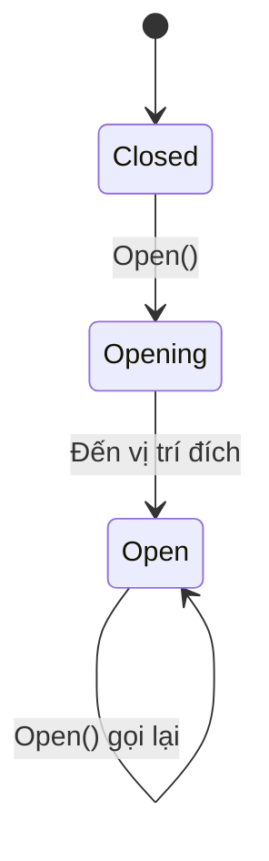

# Bài 09 — Lập trình cửa trượt (Sliding Door)

> **Lộ trình:** VR Development · **Học phần:** Custom VR Development · **Nền tảng:** Unity 6.3 · **Dạng:** tutorial.
>
> **Lưu ý:** Các quy trình và mã bên dưới là ví dụ thực hành độc lập, không phải bản chép nguyên văn hướng dẫn hay đề kiểm tra chính thức của Unity. Cần đối chiếu tài nguyên scene, prefab và phiên bản package trong dự án thực tế.

## 1. Tổng quan

Trong Escape Room VR, cửa trượt là cơ chế phản hồi cuối cùng sau khi người chơi giải được câu đố. Một cửa hoàn chỉnh cần có **trạng thái đóng/mở, vị trí đích xác định, tốc độ chuyển động hợp lý và cách chặn lệnh lặp**. Không nên dịch chuyển camera hay toàn bộ scene để giả lập cửa đang mở.

## 2. Mục tiêu học tập

- Tính vị trí đóng/mở của một cánh cửa theo local Transform.
- Điều khiển chuyển động theo frame time để giảm phụ thuộc FPS.
- Nối sự kiện từ Escape Room Controller và kiểm thử trạng thái cửa.

## 3. Thiết kế trạng thái cửa



Nếu cần đóng cửa lần nữa, có thể bổ sung `Closing` và `Close()`. Tuy nhiên với Escape Room đơn giản, chỉ cần một chiều mở để dễ kiểm thử.

## 4. Cấu trúc scene

```text
DoorFrame (khung cố định)
└── DoorPanel (cánh di chuyển, SlidingDoor)
```

Cửa cần có Mesh Renderer và Collider phù hợp. **Chỉ cánh cửa** dịch chuyển, không dịch chuyển khung. Nếu sử dụng Rigidbody động hoặc có tương tác vật lý phức tạp, cần chọn phương pháp di chuyển tương thích Physics (ví dụ `Rigidbody.MovePosition` trong `FixedUpdate`) thay vì dùng Transform thuần túy.

## 5. Code mẫu cho cửa không dùng vật lý động

```csharp
using UnityEngine;

public class SlidingDoor : MonoBehaviour
{
    [SerializeField] private Vector3 localOpenOffset = new Vector3(2f, 0f, 0f);
    [SerializeField, Min(0.01f)] private float speed = 1f;

    private Vector3 closedPosition;
    private Vector3 openPosition;
    private bool opening;

    private void Awake()
    {
        closedPosition = transform.localPosition;
        openPosition = closedPosition + localOpenOffset;
    }

    public void Open() => opening = true;

    private void Update()
    {
        if (!opening) return;
        transform.localPosition = Vector3.MoveTowards(
            transform.localPosition, openPosition, speed * Time.deltaTime);
        if ((transform.localPosition - openPosition).sqrMagnitude < 0.0001f)
            opening = false;
    }
}
```

`localOpenOffset` là **độ lệch trong hệ tọa độ của cha**. Thông số `(2,0,0)` chỉ là ví dụ; phải chỉnh theo kích thước cánh cửa và hướng của khung. `MoveTowards` giới hạn quãng đường dịch chuyển mỗi frame; `Time.deltaTime` giúp tốc độ tương đối ổn định khi FPS thay đổi.

## 6. Nối logic Escape Room

1. Gắn script `SlidingDoor` vào `DoorPanel`; đặt vị trí cánh cửa ở **trạng thái đóng** trước khi Play Mode.
2. Chỉnh `localOpenOffset` và `speed`; thử gọi `Open()` qua nút test hoặc sự kiện Inspector.
3. Tạo `EscapeRoomController`, gán tham chiếu tới `SlidingDoor`.
4. Nối Number Pad và Keycard Reader đến bộ điều phối để chỉ gọi `Open()` khi hai điều kiện đã đạt.
5. Thử làm các nhiệm vụ theo hai thứ tự khác nhau và xác nhận cửa chỉ mở một lần.

## 7. Kiểm thử & lỗi thường gặp

| Hiện tượng | Khả năng nguyên nhân | Cách khắc phục |
|---|---|---|
| Cửa chạy sai hướng | Offset local sai dấu/trục | Xem local gizmo, chỉnh offset |
| Cửa bật tới đích ngay | Dịch chuyển vị trí trực tiếp hoặc speed quá lớn | Dùng `MoveTowards`, điều chỉnh speed |
| Cửa trượt mãi | Thiếu điều kiện dừng | Kiểm tra khoảng cách tới `openPosition` |
| Cửa đi xuyên vật thể | Transform di chuyển mà không xử lý vật lý | Quyết định rõ cửa là kinematic hay dynamic |
| Nhập đúng mã vẫn không mở | Chưa có thẻ hoặc listener chưa nối | Kiểm tra trạng thái Controller và event |

**Lưu ý VR:** tránh chuyển động cửa quá nhanh sát vị trí đầu người chơi; không dùng cửa mở như cơ chế dịch chuyển bắt buộc đối với người chơi. Đường đi cần đủ thoáng và có phản hồi rằng câu đố đã hoàn thành.

## 8. Tổng kết

Sliding Door minh họa cách **chuyển điều kiện logic thành hoạt ảnh chuyển động đơn giản** và kết thúc khi đạt đích. Thiết kế độc lập với các câu đố giúp dễ thay đổi tốc độ, âm thanh và hình dạng cửa mà không phải sửa Number Pad hay Keycard Reader.

## 9. Câu hỏi ôn tập trắc nghiệm

### Câu 1

Vì sao dùng `Time.deltaTime` trong phép dịch chuyển?

A. Để chuyển động ít phụ thuộc vào FPS  
B. Để mở khóa Input Actions  
C. Để sửa Collider  
D. Để tăng kích thước cửa  

**Đáp án:** A. **Giải thích:** deltaTime là thời gian giữa các frame, giúp điều chỉnh bước dịch chuyển.

### Câu 2

`localOpenOffset` được cộng với giá trị nào?

A. Camera position  
B. Muzzle.forward  
C. Vị trí local ban đầu của cánh cửa  
D. Vị trí bất kỳ của XR Origin  

**Đáp án:** C. **Giải thích:** openPosition = closedPosition + localOpenOffset.

### Câu 3

Cửa đạt đúng vị trí đích, script nên làm gì?

A. Tạo thêm cửa mới  
B. Tiếp tục cộng offset  
C. Gọi Open hàng frame  
D. Dừng trạng thái opening  

**Đáp án:** D. **Giải thích:** Điều kiện dừng tránh xử lý không cần thiết và vượt quá đích.

### Câu 4

Nếu cần cửa chịu vật lý động, cách tiếp cận nên được cân nhắc?

A. Thêm Post-processing  
B. Rigidbody.MovePosition cùng FixedUpdate và thiết kế vật lý phù hợp  
C. Bỏ Collider  
D. Dịch chuyển camera  

**Đáp án:** B. **Giải thích:** Chuyển động có vật lý cần đồng bộ với cơ chế Rigidbody.

### Câu 5

Cửa không mở sau khi người chơi nhập đúng mã, bước kiểm tra nào hợp lý?

A. Đổi Skybox  
B. Xóa prefab cửa  
C. Kiểm tra điều kiện thẻ và event từ controller  
D. Giảm texture resolution  

**Đáp án:** C. **Giải thích:** Cửa chỉ nhận lệnh khi mọi điều kiện mở khóa đã thỏa.

---

**Đọc thêm:** [Unity Learn — Custom VR Development](https://learn.unity.com/pathway/vr-development/unit/mission-4-custom-vr-development?version=6.3). Tên mục học và phiên bản đối chiếu theo danh mục Unity 6.3; thao tác và kết quả có thể thay đổi khi package được cập nhật.
