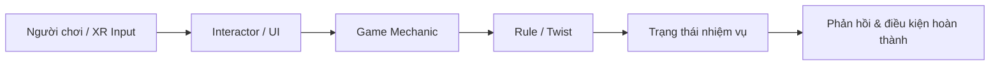

# Bài 11 — Project 3: Clone with a Twist! (Đồ án VR sáng tạo)

> **Lộ trình:** VR Development · **Học phần:** Custom VR Development · **Nền tảng:** Unity 6.3 · **Loại:** Project/Exercise.
>
> **Lưu ý:** Đây là đề bài luyện tập mở, tự biên soạn theo chủ đề. Các twist và tiêu chí đánh giá không phải quy định chính thức của Unity.

## 1. Mục tiêu

Sau khi hoàn thành, người học cần tái tạo một cơ chế VR hoạt động, thiết kế ít nhất một biến thể có quy tắc rõ ràng, phân tách trách nhiệm giữa component, chứng minh được kết quả bằng test case và video.

## 2. Kiến thức cần dùng

Sử dụng XR Interaction Toolkit và Input Actions cho tương tác, Collider/Trigger hoặc Raycast cho truy vấn va chạm, C# script cho logic trạng thái, UnityEvent để kết nối module và Inspector/Console để debug. Kiểm thử cuối nên diễn ra trên thiết bị VR mục tiêu.

## 3. Bài toán và phạm vi

**Dự án:** Xây dựng lại một cơ chế VR đã thực hành (scanner, balloon inflator, keypad, keycard reader hoặc sliding door), sau đó phát triển thêm một **twist** — quy tắc mới làm thay đổi cách người chơi giải nhiệm vụ.

Không sao chép máy móc scene mẫu. Mục tiêu là chứng minh có thể phân tích **input → logic → state → feedback** rồi áp dụng thành giải pháp của riêng mình.

## 4. Gợi ý chọn hướng thiết kế

| Cơ chế gốc | Twist đề xuất | Thử thách kỹ thuật |
|---|---|---|
| Scanner | Chỉ quét mục tiêu trong đúng thứ tự | Danh sách trạng thái và sự kiện |
| Balloon | Bơm quá nhanh làm bóng xì hơi | Timer, tốc độ và giới hạn |
| Number Pad | Mã thay đổi sau mỗi lần chơi | Tạo mã và cung cấp gợi ý |
| Keycard Reader | Thẻ chỉ hợp lệ khi đã được quét | Phối hợp hai cơ chế |
| Sliding Door | Cửa mở trong thời gian giới hạn | Bộ đếm ngược và chu trình trạng thái |

Các gợi ý là lựa chọn mở rộng, không phải yêu cầu chính thức. Chỉ chọn **một twist chính** để đủ thời gian phát triển và kiểm thử kỹ lưỡng.

## 5. Kiến trúc gợi ý

Một cách triển khai hiệu quả là tách `Game Mechanic` khỏi `Rule / Twist`: khi thay đổi luật chơi, phần bắt input hoặc chuyển động cơ bản ít bị ảnh hưởng.

## 6. Milestone triển khai

1. **M1 — Thiết kế:** viết một đoạn mô tả mục tiêu người chơi, điều kiện thành công, thất bại và biến trạng thái. Vẽ sơ đồ tối giản.
2. **M2 — Clone:** dựng cơ chế gốc đủ sử dụng trong một scene độc lập. Kiểm tra Collider, Input Actions và event.
3. **M3 — Twist:** viết logic bổ sung, xử lý các trường hợp biên và đảm bảo phản hồi rõ ràng.
4. **M4 — UX/VR:** kiểm tra tầm với, kích thước chữ, tốc độ chuyển động, mức phản hồi âm thanh/haptic và phương thức điều khiển.
5. **M5 — Kiểm thử và nộp:** tạo bản build hoặc scene chạy được, quay video minh chứng và ghi kết quả kiểm thử.

## 7. Kế hoạch kiểm thử mẫu

| ID | Trường hợp | Kết quả mong đợi |
|---|---|---|
| TC-01 | Tương tác đúng quy tắc | Hoàn thành và có phản hồi |
| TC-02 | Thao tác sai thứ tự/điều kiện | Không cho qua, có gợi ý |
| TC-03 | Kích hoạt liên tiếp rất nhanh | Không lỗi trạng thái hoặc event lặp |
| TC-04 | Thiếu tham chiếu trong Inspector | Báo lỗi rõ hoặc thoát an toàn |
| TC-05 | Chạy trên headset mục tiêu | Điều khiển ổn, không gây khó chịu đáng kể |

## 8. Deliverables và tiêu chí đánh giá

**Sản phẩm cần nộp:** project Unity hoặc scene/prefab chạy được; bản mô tả một trang; sơ đồ logic; video thao tác từ đầu đến cuối; bảng kiểm thử có kết quả thực tế và nhận xét cải tiến.

| Tiêu chí | Tỷ trọng tự đánh giá |
|---|---:|
| Cơ chế gốc hoạt động ổn định | 30% |
| Twist có ý nghĩa và đúng logic | 30% |
| Phản hồi và trải nghiệm VR | 20% |
| Kiểm thử, tài liệu, khả năng giải thích | 20% |

*Các tỷ trọng trên là rubric đề xuất để tự luyện, không phải thang điểm chính thức của Unity.*

**Definition of Done:**

- [ ] Có thể chơi từ trạng thái đầu đến trạng thái hoàn thành mà không cần sửa code khi đang chạy.
- [ ] Twist tạo ra thay đổi thực sự trong quy tắc, không chỉ đổi màu hoặc đổi tên.
- [ ] Có tối thiểu một kiểm thử thành công và hai kiểm thử thất bại.
- [ ] Mọi event quan trọng chỉ phát theo thiết kế, không nhân đôi ngoài ý muốn.
- [ ] Có một cải tiến dựa trên lần chạy thử đầu tiên.

## 9. Câu hỏi suy ngẫm và ôn tập

1. Twist của dự án tác động vào input, điều kiện hay phản hồi? Vì sao chọn vị trí đó?
2. Nếu người chơi lặp lại thao tác rất nhanh, bạn bảo vệ trạng thái thế nào?
3. Làm thế nào xác minh lỗi do Input Actions, collider hay chính thuật toán?
4. Khi thay đổi cơ chế vận động trong VR, bạn kiểm tra sự thoải mái của người chơi ra sao?
5. Thành phần nào có thể tái sử dụng để tạo một dự án khác mà không sửa code lõi?

## 10. Tổng kết

Dự án được đánh giá bằng khả năng **giải thích và chứng minh cơ chế hoạt động**, không phải số lượng hiệu ứng. Một game nhỏ, ổn định, có quy tắc mới và được kiểm thử tốt là kết quả học tập có giá trị hơn một scene phức tạp nhưng không thể tái hiện thành công.

---

**Đọc thêm:** [Unity Learn — Custom VR Development](https://learn.unity.com/pathway/vr-development/unit/mission-4-custom-vr-development?version=6.3).
