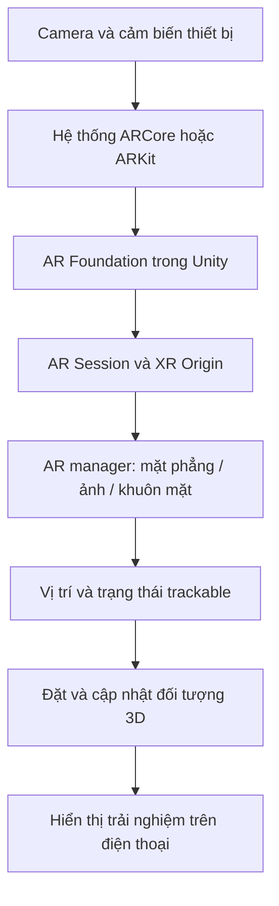

# Bài 01 — Làm quen với phát triển ứng dụng AR (Welcome to AR Development)

> **Lộ trình:** Mobile AR Development  
> **Học phần:** Get started with AR  
> **Môi trường tham chiếu:** Unity 2022.3  
> **Mục đích:** Nắm nguyên lý AR di động, các thành phần cơ bản trong Unity và cách kiểm chứng một trải nghiệm AR.

## 1. Tóm tắt bài học

**Thực tế tăng cường (Augmented Reality — AR)** đưa nội dung số vào khung nhìn của thế giới thật. Khác với một cảnh 3D chỉ xuất hiện trong trò chơi, đối tượng AR phải được đặt đúng vị trí, đúng tỷ lệ và có hành vi phù hợp khi người dùng di chuyển điện thoại. Vì vậy, phát triển AR không chỉ là dựng mô hình 3D: ứng dụng còn phải lấy hình ảnh từ camera, theo dõi chuyển động thiết bị và duy trì mối liên hệ giữa vật thể ảo với môi trường thật.

Trong Unity, các thành phần như `AR Session`, `XR Origin` và những **AR manager** giúp tổ chức trải nghiệm này. Kết quả cuối cùng cần được **kiểm chứng trên thiết bị thật**, bởi `Game view` trong Editor không tự tái tạo đầy đủ khả năng cảm biến và theo dõi của điện thoại.

## 2. Mục tiêu học tập

Sau bài học, bạn có thể:

- Giải thích sự khác nhau giữa AR và một cảnh 3D thông thường.
- Mô tả vai trò của `AR Session`, `XR Origin`, camera và các AR manager.
- Phân biệt `plane detection`, `tracked image` và `face tracking` theo mục đích sử dụng.
- Lập quy trình thử nghiệm một đối tượng ảo bám vào thế giới thật.
- Xác định dấu hiệu mất tracking và cách thu thập bằng chứng khi gỡ lỗi.

## 3. AR hoạt động như thế nào?

### 3.1. Thế giới thật và nội dung ảo

Một ứng dụng AR di động kết hợp **dữ liệu hình ảnh/cảm biến** với **nội dung được kết xuất**. Camera cung cấp hình ảnh môi trường; hệ thống theo dõi ước lượng trạng thái thiết bị và, khi được hỗ trợ, nhận diện các đặc trưng như mặt phẳng hoặc ảnh tham chiếu. Unity sử dụng các thông tin đó để hiển thị vật thể ảo sao cho người xem cảm thấy chúng ở cùng không gian với vật thể thật.

Ví dụ, khi người dùng đặt một mô hình chiếc ghế lên sàn nhà, chiếc ghế cần giữ gần như cùng vị trí khi người dùng đi vòng quanh. Nếu nó trôi theo màn hình thay vì bám sàn, trải nghiệm đặt vật thể chưa đúng.

### 3.2. Các nền tảng cần phân biệt

| Công nghệ | Ý nghĩa | Vai trò trong dự án |
| --- | --- | --- |
| **Unity** | Công cụ xây dựng scene, quản lý GameObject và kết xuất 3D | Nơi phát triển ứng dụng |
| **AR Foundation** | Lớp làm việc với các chức năng AR trong Unity | Giúp tổ chức tính năng AR đa nền tảng |
| **ARCore** | Nền tảng AR cho các thiết bị Android tương thích | Cung cấp khả năng AR trên Android |
| **ARKit** | Nền tảng AR cho các thiết bị Apple tương thích | Cung cấp khả năng AR trên iOS |

Không phải mọi thiết bị hỗ trợ cùng một tính năng. Chẳng hạn, nhận diện mặt, ảnh hoặc mặt phẳng còn phụ thuộc vào phần cứng, hệ điều hành và gói cung cấp tính năng AR. Trước khi triển khai, cần xác nhận tính năng mong muốn có trên **thiết bị đích cụ thể**.

## 4. Cấu trúc một ứng dụng AR trong Unity

### 4.1. Những thành phần cốt lõi

- **`Scene`:** không gian chứa các `GameObject` để tổ chức nội dung ứng dụng.
- **`GameObject`:** đơn vị đối tượng trong scene; có thể là camera, mô hình 3D, đối tượng quản lý AR hoặc UI.
- **`Component`:** dữ liệu và hành vi gắn vào GameObject; được cấu hình trong `Inspector`.
- **`AR Session`:** điều phối vòng đời phiên AR và trạng thái theo dõi.
- **`XR Origin`:** đóng vai trò gốc tọa độ liên hệ giữa nội dung Unity và vị trí, hướng của thiết bị trong không gian theo dõi.
- **AR camera và AR manager:** làm việc với hình ảnh camera, mặt phẳng, ảnh theo dõi hoặc các loại đối tượng AR khác tùy cấu hình.

### 4.2. Luồng dữ liệu tổng quát

Sơ đồ thể hiện một luồng **khái niệm**, không phải danh sách các lệnh hoặc API cần gọi. Trạng thái tracking tác động đến độ tin cậy của vị trí; vì thế, ứng dụng không nên mặc định mọi đối tượng đã được nhận diện ổn định ngay sau khi mở camera.

### 4.3. Trackable và tọa độ

**Trackable** là đối tượng hoặc đặc trưng được hệ thống AR nhận diện/theo dõi, chẳng hạn mặt phẳng hay ảnh tham chiếu. Để nội dung số bám đúng môi trường, hãy đặt mô hình theo tọa độ của trackable phù hợp, thay vì đặt tùy tiện theo camera.

| Tính năng | Minh họa ứng dụng | Cần kiểm tra |
| --- | --- | --- |
| **Plane detection** | Đặt một mô hình lên bàn hoặc sàn | Mặt phẳng có được phát hiện và cập nhật ổn định không? |
| **Tracked image** | Hiện nội dung khi camera nhìn thấy ảnh được quy định | Ảnh tham chiếu có đủ rõ và được nhận diện không? |
| **Face tracking** | Gắn nội dung số theo khuôn mặt | Thiết bị có hỗ trợ theo dõi mặt không? |

## 5. Thực hành: kiểm chứng một đối tượng AR đơn giản

**Đầu ra mong muốn:** Một đối tượng ảo xuất hiện gắn với đặc trưng môi trường mà ứng dụng theo dõi; có ảnh hoặc video minh chứng trên thiết bị thật.

### 5.1. Chuẩn bị

1. Chọn một điện thoại hỗ trợ AR và tính năng bạn định dùng.
2. Chuẩn bị dự án Unity có cấu hình AR phù hợp cho Android hoặc iOS.
3. Đặt trước tiêu chí thành công: đối tượng xuất hiện, đúng tỷ lệ và không trôi rõ rệt khi di chuyển máy.
4. Chọn nơi thử đủ ánh sáng và có kết cấu để camera nhận diện môi trường.

### 5.2. Các bước tiến hành

1. Tạo hoặc mở một scene dành cho thử nghiệm AR.
2. Kiểm tra các đối tượng điều phối phiên AR và camera trong scene; đảm bảo không thiếu cấu hình cần thiết.
3. Bật chức năng theo dõi phù hợp, ví dụ phát hiện mặt phẳng.
4. Thêm một mô hình 3D đơn giản làm nội dung thử nghiệm; bố trí cách đặt mô hình theo trackable đã chọn.
5. Build ứng dụng cho thiết bị. Cấp quyền camera khi hệ điều hành yêu cầu.
6. Hướng camera đến vùng thử nghiệm, quan sát đối tượng ảo và di chuyển điện thoại ở các góc khác nhau.
7. Lặp lại trong điều kiện ánh sáng/nền khác nhau, ghi lại cả lần thành công và lần gặp lỗi.

**Checkpoint:** Không chỉ kiểm tra rằng mô hình xuất hiện. Hãy xác minh mô hình có **giữ quan hệ không gian hợp lý** với mặt phẳng hoặc ảnh theo dõi hay không.

### 5.3. Mẫu ghi kết quả

| Hạng mục | Nội dung cần ghi |
| --- | --- |
| Thiết bị | Dòng máy, hệ điều hành, khả năng AR đã kiểm tra |
| Kịch bản | Vị trí thử, nguồn sáng, loại trackable |
| Kỳ vọng | Đối tượng xuất hiện và ổn định khi máy di chuyển |
| Thực tế | Thành công, không xuất hiện, rung hoặc trôi vị trí |
| Bằng chứng | Ảnh/video thiết bị; log hoặc Console liên quan |
| Giả thuyết lỗi | Thiếu quyền, tracking yếu, cấu hình không phù hợp... |

## 6. Lỗi thường gặp và quy trình khắc phục

| Hiện tượng | Nguyên nhân có thể | Hướng kiểm tra |
| --- | --- | --- |
| Chạy được trong Editor nhưng không hoạt động đúng trên điện thoại | Editor không phản ánh đầy đủ cảm biến và AR runtime | Build lên máy thật và so sánh |
| Camera không mở hoặc không hiển thị | Quyền camera/cấu hình thiết bị | Kiểm tra quyền truy cập và thiết lập nền tảng |
| Không tìm được mặt phẳng/ảnh | Thiết bị không hỗ trợ, ánh sáng kém hoặc mục tiêu khó nhận diện | Đổi điều kiện thử và kiểm tra khả năng nền tảng |
| Mô hình trôi hoặc nhảy | Tracking chưa ổn định, cách neo vị trí chưa phù hợp | Quan sát trạng thái tracking và vị trí tương đối |
| Ứng dụng giật, chậm | Nội dung quá nặng hoặc cấu hình chưa tối ưu | Thử đối tượng đơn giản hơn và quan sát FPS |

Quy trình debug nên nhất quán: **tái hiện lỗi → đọc log/Console → kiểm tra Scene, Inspector, package và trạng thái thiết bị → đổi một yếu tố → thử lại và ghi kết quả**. Đổi nhiều thông số cùng lúc khiến khó xác định nguyên nhân.

## 7. Bài tập củng cố

**Bài tập cơ bản:** Viết bằng lời quá trình tạo ra một hình ảnh AR từ camera đến đối tượng 3D và nêu vai trò của ba thành phần `AR Session`, `XR Origin`, AR manager.

**Bài tập vận dụng:** Thử cùng một mô hình ở hai môi trường sáng khác nhau, dự đoán điều gì có thể thay đổi trong khả năng tracking rồi kiểm chứng trên máy.

**Bài tập mở rộng:** Chọn một ứng dụng thực tế như trưng bày sản phẩm trên bàn, thẻ thông tin gắn theo ảnh hoặc hiệu ứng theo khuôn mặt. Xác định trackable thích hợp và tiêu chí đánh giá thành công.

## 8. Câu hỏi ôn tập

### Câu 1

Vì sao một đối tượng 3D hiển thị trên màn hình **chưa đủ** chứng minh ứng dụng đã có AR đúng nghĩa?

A. Vì AR không cho phép dùng mô hình 3D.  
B. Vì phải sử dụng thực tế ảo (VR).  
C. Vì còn cần liên hệ vị trí/nội dung với thế giới thật thông qua khả năng theo dõi.  
D. Vì AR chỉ hoạt động khi không có camera.

**Đáp án: C.** **Giải thích:** Điểm cốt lõi của AR là nội dung ảo được đặt trong bối cảnh và chuyển động phù hợp với môi trường thật.

### Câu 2

Bộ phận nào có vai trò điều phối phiên theo dõi AR?

A. `AR Session`.  
B. `Mesh Renderer`.  
C. `Audio Source`.  
D. `Canvas`.

**Đáp án: A.** **Giải thích:** `AR Session` quản lý phiên AR; các thành phần khác đảm nhận việc hiển thị hoặc xử lý loại nội dung riêng.

### Câu 3

Bạn muốn đặt một mô hình lên sàn nhà được điện thoại nhận diện. Nên ưu tiên loại trackable nào?

A. Face tracking.  
B. Audio listener.  
C. Animation clip.  
D. Plane detection.

**Đáp án: D.** **Giải thích:** Phát hiện mặt phẳng phù hợp với các bề mặt như sàn và bàn.

### Câu 4

Ứng dụng hoạt động đúng trong Game view nhưng lỗi trên Android. Hành động kiểm chứng nào phù hợp nhất?

A. Kết luận thiết bị hỏng.  
B. Kiểm tra khả năng AR, quyền camera, cấu hình build và log trên thiết bị.  
C. Tăng số lượng mô hình 3D.  
D. Chỉ thay màu nền scene.

**Đáp án: B.** **Giải thích:** Editor và môi trường Android thực tế có khác biệt về cảm biến, quyền và runtime.

### Câu 5

Tại sao nên thay một yếu tố mỗi lần debug?

A. Để làm dự án nặng hơn.  
B. Vì không thể sửa nhiều lỗi trong Unity.  
C. Để xác định thay đổi nào thực sự làm kết quả khác đi.  
D. Để tránh phải xem Console.

**Đáp án: C.** **Giải thích:** Thử nghiệm có kiểm soát giúp tìm nguyên nhân thay vì nhầm lẫn giữa nhiều thay đổi.

## 9. Tổng kết và checklist

AR di động là sự phối hợp giữa **hệ thống theo dõi của thiết bị**, **các thành phần AR trong Unity** và **nội dung 3D**. Một trải nghiệm tốt cần kiểm chứng cả khả năng nhận diện môi trường, vị trí đối tượng, trạng thái tracking và hiệu năng thực tế.

- [ ] Phân biệt được AR với cảnh 3D thông thường.
- [ ] Giải thích được `AR Session`, `XR Origin` và trackable.
- [ ] Lựa chọn được mặt phẳng, ảnh hoặc khuôn mặt cho một tình huống cụ thể.
- [ ] Có bằng chứng thử nghiệm trên điện thoại.
- [ ] Ghi được ít nhất một lỗi và quy trình kiểm chứng.

**Tham khảo học phần:** [Unity Learn — Get started with AR](https://learn.unity.com/pathway/mobile-ar-development/unit/get-started-with-ar?version=2022.3). Các thao tác giao diện và phiên bản package có thể thay đổi; đối chiếu với môi trường Unity đang sử dụng.
