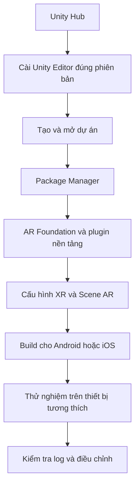

# Bài 02 — Cấu hình môi trường phát triển AR trong Unity

> **Tên bài:** Configure your AR development environment  
> **Lộ trình:** Mobile AR Development · **Học phần:** Get started with AR  
> **Môi trường tham chiếu:** Unity 2022.3

## 1. Tổng quan

Một dự án AR chỉ hoạt động ổn định khi **phiên bản Unity Editor, mô-đun build, các package AR và nền tảng thiết bị** tương thích với nhau. Nếu thiếu một mắt xích, scene có thể chạy trong Editor nhưng không thể build, không khởi tạo được AR hoặc không nhận camera trên điện thoại.

Mục tiêu của bài là chuẩn bị một dự án nhỏ có thể **mở lại, kiểm tra lỗi và sẵn sàng triển khai**. Không cần tạo một ứng dụng AR hoàn chỉnh ngay từ đầu; cần thiết lập môi trường có thể tái lập trước.

## 2. Mục tiêu học tập

Hoàn thành bài học, bạn có thể:

- Phân biệt nhiệm vụ của `Unity Hub` và `Unity Editor`.
- Chọn phiên bản Editor và build module phù hợp cho Android hoặc iOS.
- Giải thích vai trò của `Package Manager` và các gói AR.
- Chuẩn bị scene cơ bản để kiểm tra cấu hình AR.
- Xác nhận dự án mở lại được mà không có lỗi nghiêm trọng.

## 3. Những thành phần cần chuẩn bị

| Thành phần | Vai trò | Kiểm tra tối thiểu |
| --- | --- | --- |
| **Unity Hub** | Cài đặt/quản lý các bản Unity Editor và dự án | Editor cần dùng đã xuất hiện trong `Installs` |
| **Unity Editor** | Tạo scene, GameObject, Component và cấu hình build | Dự án mở được, `Console` không có lỗi nghiêm trọng |
| **Build modules** | Bổ sung công cụ để build cho hệ điều hành đích | Có `Android Build Support` hoặc `iOS Build Support` |
| **Package Manager** | Quản lý các package phụ thuộc của dự án | Các package cần thiết được cài và không báo lỗi |
| **AR Foundation** | Cung cấp các thành phần làm việc với AR trong Unity | Package tương thích với phiên bản Editor |
| **ARCore XR Plugin / ARKit XR Plugin** | Tích hợp nền tảng AR tương ứng | Chọn theo Android hoặc iOS |
| **Thiết bị thật** | Môi trường kiểm thử tính năng AR | Hỗ trợ tính năng AR và có quyền dùng camera |

**Lưu ý nền tảng:** Với Android, môi trường build thường cần bộ công cụ Android tương ứng (SDK, NDK và JDK được cài qua lựa chọn của Unity Hub). Với iOS, quá trình tạo và chạy ứng dụng trên thiết bị cần công cụ build/signing của hệ sinh thái Apple, thường thực hiện qua **Xcode trên macOS**. Không nên coi việc chọn `iOS Build Support` trong Unity là đủ để chạy ngay trên iPhone.

## 4. Mối quan hệ giữa Editor, package và thiết bị

Sơ đồ nhấn mạnh việc kiểm tra theo thứ tự. Khi build thất bại, hãy quay lại đúng lớp liên quan: Editor, module, package, cấu hình nền tảng hoặc thiết bị. Không sửa ngẫu nhiên các GameObject khi lỗi thực tế xuất phát từ thiếu module build.

## 5. Thực hành cấu hình môi trường

### 5.1. Kiểm tra Unity Hub và phiên bản Editor

1. Mở `Unity Hub`, chuyển đến mục `Installs`.
2. Kiểm tra có Unity Editor phù hợp với tài liệu học hoặc dự án cần triển khai. Phiên bản tham chiếu của học phần là **Unity 2022.3**.
3. Kiểm tra mô-đun của nền tảng dự định dùng:
   - **Android:** `Android Build Support` và các công cụ build đi kèm cần thiết.
   - **iOS:** `iOS Build Support`; chuẩn bị thêm môi trường Xcode/signing phù hợp khi triển khai trên thiết bị Apple.
4. Nếu thiếu, bổ sung mô-đun bằng công cụ quản lý cài đặt của Unity Hub.

**Checkpoint 1:** Có thể xác định rõ bản Unity Editor và các mô-đun đã cài, thay vì chỉ nói “máy đã có Unity”.

### 5.2. Tạo dự án thử và ghi lại cấu hình

1. Tạo dự án thử nghiệm từ template 3D thích hợp với mục tiêu AR.
2. Đặt tên dự án dễ phân biệt, chẳng hạn `AR_Environment_Test`.
3. Ghi lại phiên bản Unity Editor và **render pipeline** đang dùng.
4. Mở dự án; cho Editor hoàn thành việc nhập assets và xử lý package khi khởi chạy lần đầu.
5. Quan sát `Console` để biết có lỗi biên dịch hay không.

Render pipeline và một số tùy chọn build ảnh hưởng đến cách hiển thị, nên việc ghi lại chúng giúp bạn tái hiện lỗi trên máy khác. Không thay đổi pipeline tùy tiện nếu tài nguyên hoặc bài thực hành đã có yêu cầu riêng.

### 5.3. Kiểm tra các package AR

1. Mở `Package Manager`.
2. Kiểm tra `AR Foundation` và gói plugin dành cho nền tảng đích đã được cài đặt phù hợp.
3. Kiểm tra các phụ thuộc và thông báo xung đột package.
4. Kiểm tra cấu hình XR/platform tương ứng trong thiết lập dự án; chỉ bật các nhà cung cấp phù hợp với nền tảng đang xây dựng.
5. Đọc lỗi nếu package không hoạt động; tránh tự suy đoán số phiên bản hoặc ghép các bản không tương thích.

**Checkpoint 2:** Dự án không còn lỗi package/biên dịch nghiêm trọng; bạn xác định được AR provider dành cho thiết bị sẽ sử dụng.

### 5.4. Chuẩn bị scene kiểm tra

1. Tạo một scene riêng để thử môi trường.
2. Thêm/kiểm tra các đối tượng AR cơ bản theo cấu trúc hỗ trợ của phiên bản package, đặc biệt là phiên AR, gốc tọa độ XR và camera AR.
3. Xác minh các `GameObject` đang hoạt động và các `Component` cần thiết không bị thiếu tham chiếu.
4. Lưu scene vào dự án.
5. Đóng Editor rồi mở lại dự án, mở scene vừa lưu và quan sát `Console`.

Tên menu hoặc prefab có thể khác nhau giữa các phiên bản package. Hãy dùng hướng dẫn tương ứng với phiên bản Unity/AR Foundation đang cài, thay vì coi một chuỗi thao tác giao diện là bất biến.

**Checkpoint 3:** Sau khi mở lại, scene và cấu hình vẫn còn; các package được nhận diện và dự án không có lỗi nghiêm trọng.

## 6. Lỗi thường gặp và cách khắc phục

| Dấu hiệu | Khả năng cần kiểm tra | Hành động ưu tiên |
| --- | --- | --- |
| Dự án mở lên báo lỗi hàng loạt | Editor không tương thích hoặc package chưa được giải quyết | Xác nhận phiên bản, xem `Console` và `Package Manager` |
| Không có nền tảng Android/iOS khi build | Thiếu build module | Kiểm tra `Installs` trong Unity Hub |
| AR không khởi tạo trên điện thoại | Chọn sai provider, máy không hỗ trợ hoặc cấu hình nền tảng chưa đủ | Kiểm tra plugin, khả năng thiết bị và quyền camera |
| Thiếu đối tượng hoặc tham chiếu trong scene | GameObject/Component chưa được thiết lập | Xem `Hierarchy` và `Inspector` |
| Dự án không tái lập được trên máy khác | Chưa thống nhất Editor, package hoặc assets | Ghi phiên bản và kiểm tra các tệp dự án cần thiết |

### Quy trình debug có kiểm soát

1. **Tái hiện:** ghi thao tác làm phát sinh lỗi.
2. **Quan sát:** lưu thông báo `Console`, môi trường build và phần cấu hình liên quan.
3. **Khoanh vùng:** xác định lỗi thuộc Editor, package, scene hay thiết bị.
4. **Thử nghiệm:** điều chỉnh **một nguyên nhân giả định**.
5. **Đối chiếu:** chạy lại cùng kịch bản và so sánh kết quả.

## 7. Bài tập thực hành

**Nhiệm vụ:** Chuẩn bị một dự án `AR_Environment_Test` sao cho có thể chuyển giao cấu hình cho người khác kiểm chứng.

**Các sản phẩm cần nộp:**

- Một scene thử đã lưu và mở lại thành công.
- Ghi chú phiên bản Unity Editor, render pipeline, nền tảng đích và các package AR quan trọng.
- Ảnh `Console` hoặc mô tả kết quả kiểm tra lỗi sau khi mở lại.
- Danh sách vấn đề còn tồn tại (nếu có) cùng bước kiểm chứng tiếp theo.

**Tiêu chí hoàn thành:** Môi trường có thể tái lập, không có lỗi nghiêm trọng cản trở việc tiếp tục xây dựng ứng dụng và đã xác định nền tảng thiết bị đích.

## 8. Câu hỏi ôn tập

### Câu 1

Bạn cần bổ sung công cụ build Android cho bản Unity đang cài. Bắt đầu kiểm tra ở đâu là hợp lý nhất?

A. `Scene view`.  
B. `Unity Hub` → `Installs`.  
C. `Hierarchy`.  
D. `Animator`.

**Đáp án: B.** **Giải thích:** Unity Hub quản lý Editor và các mô-đun build gắn với từng bản cài đặt.

### Câu 2

Vì sao phải kiểm tra `Package Manager` sau khi mở dự án AR lần đầu?

A. Để thay thế hệ điều hành của điện thoại.  
B. Để chỉnh màu nền camera.  
C. Để bỏ toàn bộ đối tượng trong scene.  
D. Để phát hiện package thiếu hoặc xung đột phụ thuộc.

**Đáp án: D.** **Giải thích:** Dự án dùng các package; sự cố phụ thuộc có thể làm hỏng biên dịch và runtime.

### Câu 3

Bạn muốn triển khai AR trên thiết bị Android. Lựa chọn nào liên quan trực tiếp đến AR provider của nền tảng này?

A. `ARCore XR Plugin`.  
B. `ARKit XR Plugin` làm lựa chọn duy nhất.  
C. `Audio Mixer`.  
D. `Timeline`.

**Đáp án: A.** **Giải thích:** ARCore là nền tảng AR trên Android; ARKit dành cho hệ sinh thái Apple.

### Câu 4

Đóng và mở lại một dự án sau khi cấu hình giúp kiểm tra điều gì?

A. FPS chắc chắn sẽ tăng.  
B. Điện thoại chắc chắn đã hỗ trợ AR.  
C. Scene, package và thiết lập có thể được khôi phục/tái lập.  
D. Không cần thử trên thiết bị thật nữa.

**Đáp án: C.** **Giải thích:** Đây là bài kiểm tra đơn giản cho khả năng tái lập môi trường, không thay thế kiểm thử runtime trên điện thoại.

### Câu 5

Đã cài iOS Build Support nhưng chưa thể chạy ứng dụng lên iPhone. Nhận định nào phù hợp nhất?

A. Chỉ cần bấm Play trong Unity Editor trên mọi hệ điều hành.  
B. Vẫn cần kiểm tra quá trình build, Xcode/signing và điều kiện triển khai của thiết bị.  
C. Bỏ qua quyền camera.  
D. Chuyển sang ARCore để build iOS.

**Đáp án: B.** **Giải thích:** iOS Build Support không tự thay thế các bước build và ký ứng dụng trong hệ sinh thái Apple.

## 9. Tổng kết và checklist

Thiết lập môi trường AR là quá trình nối đúng **Editor → module build → package → cấu hình XR → scene → thiết bị**. Ghi chép chính xác cấu hình thường tiết kiệm nhiều thời gian hơn xử lý lỗi bằng thử-sai.

- [ ] Kiểm tra phiên bản Unity Editor trong Hub.
- [ ] Cài mô-đun build cho hệ điều hành đích.
- [ ] Xác nhận package AR thích hợp, không còn lỗi nghiêm trọng.
- [ ] Lưu được scene kiểm tra.
- [ ] Đóng/mở lại dự án và xác minh cấu hình.
- [ ] Ghi lại ít nhất một vấn đề hoặc điểm cần xác nhận khi build trên thiết bị.

**Tham khảo:** [Unity Learn — Get started with AR](https://learn.unity.com/pathway/mobile-ar-development/unit/get-started-with-ar?version=2022.3). Khi thực hành với phiên bản khác, cần đối chiếu tên menu và khả năng tương thích package.
