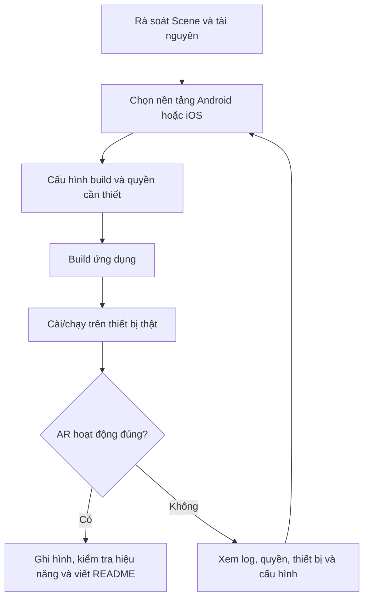

# Bài 03 — Triển khai ứng dụng AR lên iOS hoặc Android

> **Tên bài:** Deploy your project to iOS or Android  
> **Lộ trình:** Mobile AR Development · **Học phần:** Get started with AR  
> **Môi trường tham chiếu:** Unity 2022.3

## 1. Tổng quan

**Build** là bước chuyển dự án Unity thành ứng dụng cho một nền tảng cụ thể; **deploy** là đưa ứng dụng đó lên thiết bị để chạy thử hoặc phân phối. Với ứng dụng AR, hai bước này quan trọng vì dữ liệu camera, tracking, hiệu năng và khả năng hỗ trợ AR trên điện thoại **không được kiểm chứng đầy đủ chỉ bằng Play mode**.

Một bản triển khai hoàn chỉnh không chỉ là file cài đặt. Bạn cần xác minh ứng dụng khởi chạy, sử dụng được các tính năng AR cần thiết, không thiếu tài nguyên và có đủ thông tin để người khác cài/thử nghiệm lại.

## 2. Mục tiêu học tập

Sau bài học, bạn có thể:

- Phân biệt kiểm thử trong Unity Editor với kiểm thử bản build trên thiết bị thật.
- Rà soát scene, asset, quyền và cấu hình nền tảng trước khi build.
- Mô tả quy trình triển khai cơ bản lên Android và iOS.
- Kiểm tra ứng dụng từ lúc khởi chạy đến khi dùng tính năng AR.
- Chuẩn bị video/ảnh minh chứng và README cho bản thử nghiệm.

## 3. Những yếu tố khác nhau giữa Editor và thiết bị thật

| Yếu tố | Khi làm việc trong Unity Editor | Khi chạy trên điện thoại |
| --- | --- | --- |
| Camera và cảm biến | Có thể chỉ chạy mô phỏng hoặc không đầy đủ | Dùng phần cứng và quyền truy cập hệ điều hành |
| Theo dõi không gian | Chưa phản ánh đầy đủ AR runtime thật | Phụ thuộc ARCore/ARKit và thiết bị |
| Hiệu năng | Phụ thuộc tài nguyên máy phát triển | Bị giới hạn bởi CPU/GPU, bộ nhớ và nhiệt độ thiết bị |
| Input | Chuột, bàn phím hoặc thiết lập kiểm thử | Chạm màn hình và chuyển động điện thoại |
| Tài nguyên | Có thể truy cập nội dung trong môi trường Editor | Chỉ có nội dung được đóng gói/cấu hình phù hợp |

Do đó, câu hỏi chính sau khi build không phải “Build có thành công không?” mà là “**Ứng dụng có đạt mục tiêu trên thiết bị đích không?**”.

## 4. Quy trình triển khai tổng quát



Quy trình có vòng lặp vì build thành công không đảm bảo chức năng AR vận hành đúng. Mỗi lần sửa cần kèm một lần thử lại trên thiết bị với kịch bản rõ ràng.

## 5. Chuẩn bị trước khi build

### 5.1. Rà soát nội dung dự án

1. Kiểm tra các scene chính đã được lưu và đưa vào danh sách scene sẽ build.
2. Mở các scene đó để phát hiện `GameObject` bị vô hiệu hóa ngoài ý muốn hoặc `Component` thiếu tham chiếu.
3. Kiểm tra asset, mô hình 3D, hình ảnh và những tài nguyên được sử dụng trong runtime.
4. Xác nhận các package AR và provider phù hợp với hệ điều hành đích.
5. Xem `Console`, xử lý lỗi biên dịch hoặc lỗi cấu hình nghiêm trọng trước khi build.

### 5.2. Kiểm tra thiết bị và quyền

- **Thiết bị:** cần tương thích với AR và hỗ trợ các tính năng dự án sử dụng.
- **Camera:** ứng dụng cần quyền truy cập camera; kiểm tra cách yêu cầu quyền trên hệ điều hành đích.
- **Nội dung AR:** nếu dự án yêu cầu mặt phẳng, ảnh tham chiếu hoặc theo dõi mặt, phải xác minh tính năng đó có sẵn.
- **Tính hợp pháp:** kiểm tra quyền sử dụng asset, ảnh, âm thanh/nhạc và dữ liệu trước khi chia sẻ công khai.
- **Quyền riêng tư:** tránh thu thập/chia sẻ hình ảnh camera hoặc dữ liệu cá nhân không cần thiết.

## 6. Triển khai cho Android

### 6.1. Chuẩn bị

- Cài `Android Build Support` và các công cụ build cần thiết cho Unity Editor đang sử dụng.
- Cài và cấu hình các package AR phục vụ Android, bao gồm ARCore provider phù hợp nếu dự án dùng AR Foundation.
- Chuẩn bị điện thoại Android tương thích AR; bật các thiết lập cần thiết để cài và gỡ lỗi ứng dụng thử nghiệm từ máy tính.

### 6.2. Các bước thực hiện

1. Mở dự án và chọn Android làm **target platform** trong thiết lập build của Unity.
2. Kiểm tra scene đưa vào build; loại bỏ scene thử không cần thiết nếu chúng không phải nội dung của bản chạy.
3. Rà soát thiết lập ứng dụng và thông số nền tảng cần thiết theo hướng dẫn của phiên bản Unity/AR provider đang sử dụng.
4. Build bản ứng dụng thử nghiệm.
5. Cài/chạy ứng dụng lên thiết bị Android tương thích.
6. Cấp quyền camera theo yêu cầu; xác nhận AR session khởi tạo.
7. Thử tính năng chính, di chuyển thiết bị và ghi lại kết quả.

**Checkpoint Android:** Ứng dụng mở được, camera hoạt động, đối tượng AR xuất hiện đúng điều kiện và không có lỗi nghiêm trọng trong kịch bản kiểm thử.

## 7. Triển khai cho iOS

### 7.1. Chuẩn bị

- Cài `iOS Build Support` cho bản Unity đang dùng.
- Bảo đảm đã cấu hình AR Foundation/ARKit provider thích hợp.
- Chuẩn bị iPhone hoặc iPad hỗ trợ tính năng AR được sử dụng.
- Chuẩn bị công cụ build và ký ứng dụng thuộc hệ sinh thái Apple, thường là **Xcode trên macOS**, cùng tài khoản/cấu hình ký phù hợp.

### 7.2. Các bước thực hiện

1. Chọn iOS làm nền tảng đích trong thiết lập build của Unity.
2. Kiểm tra scene, asset và cấu hình AR cho iOS.
3. Build để tạo đầu ra dự án iOS theo quy trình Unity hỗ trợ.
4. Mở dự án đầu ra bằng công cụ build phù hợp, cấu hình signing và thiết bị đích.
5. Build và chạy ứng dụng trên iPhone/iPad.
6. Cho phép ứng dụng truy cập camera, kiểm tra tracking và đối tượng ảo.
7. Lưu ảnh/video thực tế và ghi chú những khác biệt so với Android hoặc Editor, nếu có.

**Checkpoint iOS:** Ứng dụng được cài/chạy trên thiết bị tương thích, xử lý quyền camera và hoàn thành kịch bản AR mong đợi.

**Lưu ý:** Quy trình ký và phân phối iOS có thể thay đổi theo tài khoản, chế độ thử nghiệm và công cụ Apple. Không đồng nhất việc xuất dự án từ Unity với việc đã cài đặt thành công lên iPhone.

## 8. Kiểm thử bản build có hệ thống

### 8.1. Kịch bản kiểm thử tối thiểu

| Mã thử nghiệm | Hành động | Kết quả mong đợi |
| --- | --- | --- |
| T01 | Mở ứng dụng lần đầu | Ứng dụng khởi chạy mà không bị thoát bất thường |
| T02 | Xử lý lời nhắc quyền camera | Có thể tiếp tục khi quyền được cấp; xử lý được khi quyền chưa được cấp |
| T03 | Hướng camera vào đối tượng/môi trường thích hợp | Hệ thống AR nhận diện đúng tính năng cần dùng |
| T04 | Đặt hoặc quan sát mô hình ảo | Mô hình xuất hiện đúng ngữ cảnh và tỷ lệ |
| T05 | Di chuyển điện thoại | Mô hình duy trì quan hệ không gian hợp lý |
| T06 | Thử ở điều kiện ánh sáng khác | Ghi nhận sự ổn định, giới hạn hoặc lỗi tracking |
| T07 | Hoàn thành luồng ứng dụng và thoát | Không có sự cố nghiêm trọng; ghi log nếu có |

### 8.2. Đánh giá hiệu năng

Đừng chỉ đánh giá theo cảm nhận “mượt” hay “lag”. Khi có công cụ phù hợp, hãy ghi FPS, mức độ giật hình hoặc thông tin lỗi. Nếu hiệu năng kém, thử giản lược đối tượng 3D, số lượng hiệu ứng hoặc độ phức tạp scene để xác định thành phần ảnh hưởng lớn.

### 8.3. Mẫu nhật ký kiểm thử

```text
Thiết bị / hệ điều hành:
Bản build / ngày thử:
Kịch bản:
Kết quả mong đợi:
Kết quả thực tế:
Bằng chứng (ảnh/video/log):
Lỗi / nghi ngờ nguyên nhân:
Thay đổi đã thử:
Kết quả sau khi thử lại:
```

## 9. Đóng gói sản phẩm và viết README

Một README ngắn giúp người khác hiểu và chạy lại bản thử nghiệm. Nên có:

- **Mục tiêu:** ứng dụng AR giải quyết tình huống nào.
- **Nền tảng và thiết bị:** Android hoặc iOS; tính năng AR và điều kiện phần cứng cần có.
- **Cách cài/chạy:** các bước thực hiện phù hợp với bản build đã giao.
- **Cách sử dụng:** thao tác của người dùng và điều kiện môi trường cần thiết.
- **Kết quả:** ảnh/video minh chứng từ thiết bị thật.
- **Hạn chế:** lỗi còn biết, trường hợp tracking chưa ổn định, giới hạn hiệu năng.
- **Tài nguyên:** nguồn và quyền sử dụng asset quan trọng nếu bản dựng được chia sẻ.

Nếu trình bày trong portfolio, hãy ghi rõ **vai trò cá nhân**, cách giải quyết vấn đề và bài học rút ra, thay vì chỉ đưa ảnh chụp Scene view.

## 10. Sự cố thường gặp

| Hiện tượng | Việc cần xác minh trước |
| --- | --- |
| Build không tìm được scene | Scene đã được thêm vào danh sách build chưa? |
| Build lỗi do nền tảng | Build module, package, target platform có tương thích không? |
| Cài được nhưng camera không hoạt động | Quyền camera và cấu hình thiết bị có đúng không? |
| Model có trong Editor nhưng thiếu trên thiết bị | Asset, tham chiếu và cấu hình đóng gói đã đầy đủ chưa? |
| Không nhận diện môi trường | Thiết bị, AR provider, ánh sáng và loại trackable có phù hợp không? |
| Hiệu năng kém | Độ phức tạp scene và tài nguyên có vượt khả năng thiết bị không? |

Trong mỗi lần khắc phục, hãy thay **một yếu tố nghi ngờ** và chạy lại kịch bản từng gây lỗi. Điều này tạo ra bằng chứng cụ thể về nguyên nhân và kết quả.

## 11. Bài tập thực hành

**Đề bài:** Triển khai một scene AR đơn giản lên ít nhất một thiết bị iOS hoặc Android tương thích; tạo bộ bằng chứng để người khác có thể đánh giá bản build.

**Sản phẩm cần nộp:** bản build hoặc quy trình chạy có thể tái lập, ít nhất một video/ảnh trên thiết bị, một bảng kết quả kiểm thử và README ngắn.

**Điều kiện đạt:** Tính năng AR chính hoạt động trong ít nhất một kịch bản xác định; những giới hạn chưa khắc phục được phải được ghi rõ thay vì coi là thành công.

## 12. Câu hỏi ôn tập

### Câu 1

Vì sao không nên dùng riêng Play mode làm bằng chứng ứng dụng AR đã sẵn sàng triển khai?

A. Vì Play mode luôn chậm hơn điện thoại.  
B. Vì Play mode xóa toàn bộ asset.  
C. Vì AR trên điện thoại phụ thuộc camera, cảm biến, quyền và runtime thật.  
D. Vì Unity không thể kết xuất vật thể 3D.

**Đáp án: C.** **Giải thích:** Editor không thay thế được các điều kiện của thiết bị đích.

### Câu 2

Một scene hoạt động trong Editor nhưng không có mặt trong bản build. Cần kiểm tra ưu tiên điều gì?

A. Danh sách scene đưa vào build.  
B. Bàn phím máy tính.  
C. Tên người dùng trong Editor.  
D. Màu của cửa sổ Hierarchy.

**Đáp án: A.** **Giải thích:** Scene chưa được đưa vào bản build có thể khiến nội dung cần thiết không được đóng gói.

### Câu 3

Đâu là mục đích của README đi kèm một bản thử nghiệm AR?

A. Thay thế hoàn toàn việc kiểm thử thiết bị.  
B. Giấu các lỗi chưa sửa.  
C. Chỉ liệt kê tên tác giả.  
D. Giúp người khác hiểu yêu cầu máy, cách chạy, chức năng và hạn chế.

**Đáp án: D.** **Giải thích:** README phục vụ khả năng sử dụng và tái lập, không phải chỉ để trang trí.

### Câu 4

Trước khi chia sẻ một ứng dụng có ảnh và nhạc, người phát triển nên làm gì?

A. Mặc định mọi nội dung tải được đều dùng tự do.  
B. Kiểm tra giấy phép tài nguyên và yếu tố quyền riêng tư.  
C. Chỉ kiểm tra kích thước file.  
D. Bỏ qua người dùng cuối.

**Đáp án: B.** **Giải thích:** Việc công khai sản phẩm cần tuân thủ quyền sử dụng tài nguyên và bảo vệ thông tin người dùng.

### Câu 5

Nếu một phiên AR không ổn định trong môi trường tối, cách kiểm tra nào có giá trị nhất?

A. Tăng ngẫu nhiên tất cả tham số.  
B. Xóa nhật ký lỗi.  
C. Thử lại cùng kịch bản ở điều kiện ánh sáng khác và ghi kết quả.  
D. Chỉ đổi tên scene.

**Đáp án: C.** **Giải thích:** Thay đổi có kiểm soát một điều kiện giúp đánh giá ảnh hưởng của ánh sáng đến tracking.

## 13. Tổng kết và checklist

Triển khai ứng dụng AR gồm nhiều bước liên tiếp: **rà soát dự án → cấu hình nền tảng → build → cài lên thiết bị → kiểm thử → ghi minh chứng và tài liệu hóa**. Bản build được coi là có giá trị khi đã được kiểm chứng đúng với mục tiêu sử dụng.

- [ ] Scene và asset đã được rà soát trước khi build.
- [ ] Chọn đúng nền tảng đích và package AR.
- [ ] Thiết bị đích hỗ trợ AR và đã xử lý quyền camera.
- [ ] Chạy đủ kịch bản khởi động, tracking và nội dung ảo.
- [ ] Có ảnh/video thiết bị, nhật ký lỗi và kết quả kiểm thử.
- [ ] Có README và ghi nhận các hạn chế còn tồn tại.

**Tham khảo:** [Unity Learn — Get started with AR](https://learn.unity.com/pathway/mobile-ar-development/unit/get-started-with-ar?version=2022.3). Các tùy chọn build và ký ứng dụng cần đối chiếu theo phiên bản công cụ và nền tảng thực tế.
