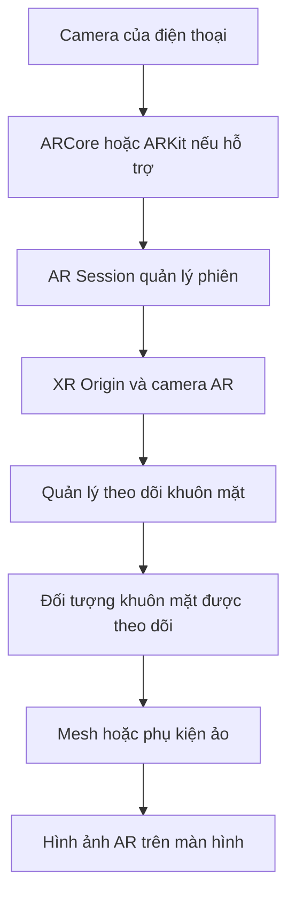

# Bài 01 — Thiết lập dự án theo dõi khuôn mặt (Set up a face tracking project)

> **Lộ trình:** Mobile AR Development · **Chủ đề:** Create a basic face filter · **Môi trường tham chiếu:** Unity 2022.3  
> **Hình thức:** Hướng dẫn thực hành. Các bước được diễn giải để học và kiểm chứng; cấu hình chi tiết có thể thay đổi theo phiên bản package và thiết bị.

## 1. Tổng quan và mục tiêu

Face filter là hiệu ứng thực tế tăng cường (AR) gắn các đối tượng ảo với khuôn mặt thật thu được từ camera. Muốn chiếc mũ, kính hoặc lớp trang điểm ảo bám theo đầu khi người dùng di chuyển, dự án phải có một **phiên AR**, một **camera**, khả năng **nhận diện/theo dõi khuôn mặt** và một **đối tượng ảo gắn đúng hệ tọa độ**.

Sau bài học, bạn có thể:

- Giải thích vai trò của `AR Session`, `XR Origin`, camera và thành phần quản lý face tracking.
- Kiểm tra điều kiện thiết bị, quyền camera và các package cần thiết trước khi triển khai.
- Xây dựng một scene thử nghiệm có đối tượng ảo bám theo khuôn mặt; kiểm thử trên thiết bị thật.
- Phân biệt lỗi do thiết lập dự án, thiết bị không hỗ trợ và lỗi do tracking không ổn định.

## 2. Cấu trúc hệ thống

Sơ đồ thể hiện đường đi khái niệm: dữ liệu camera và dịch vụ AR của thiết bị giúp hệ thống cập nhật tư thế khuôn mặt; Unity dùng thông tin ấy để đặt và hiển thị nội dung ảo. Đây không phải sơ đồ API nội bộ của các package.

| Thành phần | Vai trò | Điều cần kiểm tra |
| --- | --- | --- |
| `Scene` | Chứa các đối tượng trong trải nghiệm | Scene được đưa vào cấu hình build |
| `GameObject` | Nút trong hệ phân cấp đối tượng | Đang hoạt động; đúng vị trí trong Hierarchy |
| `Component` | Bổ sung dữ liệu và hành vi | Tham chiếu và tùy chọn trong Inspector |
| `AR Session` | Quản lý vòng đời phiên AR | Trạng thái phiên, cấu hình XR |
| `XR Origin` | Liên hệ hệ tọa độ theo dõi với scene | Camera và các đối tượng được tổ chức đúng |
| Face tracking | Cập nhật thông tin khuôn mặt | Thiết bị/hệ điều hành có hỗ trợ |

**Phân biệt quan trọng:** plane detection tìm mặt phẳng của môi trường; image tracking tìm hình ảnh mục tiêu; face tracking theo dõi khuôn mặt. Chúng là các loại trackable khác nhau và không thể thay thế tùy tiện.

## 3. Chuẩn bị

1. Mở dự án Unity phù hợp với nội dung học (tài liệu tham chiếu dùng Unity 2022.3).
2. Chọn thiết bị iOS/Android thực tế và tra cứu **khả năng hỗ trợ face tracking**, không chỉ khả năng chạy AR thông thường.
3. Kiểm tra sự hiện diện và tương thích của AR Foundation cùng provider thích hợp, ví dụ ARKit hoặc ARCore tùy nền tảng; không mặc định mọi thiết bị Android đều hỗ trợ face tracking.
4. Chuẩn bị cáp/kết nối triển khai, quyền camera và khả năng xem log trên thiết bị.
5. Tạo scene riêng để quan sát, tránh sửa nhiều tính năng cùng lúc.

## 4. Quy trình thực hành

### 4.1. Chuẩn bị scene AR

Tạo hoặc mở scene thực hành. Thiết lập phiên AR và cấu trúc origin/camera theo các package đã cài. Xem Inspector để xác nhận các component không bị vô hiệu hóa. Đặt tên các GameObject rõ nghĩa, ví dụ `AR Session`, `XR Origin`, `Face Content`.

**Checkpoint:** scene có thể mở bình thường, các tham chiếu chính không bị thiếu và Console không báo lỗi cấu hình cản trở build.

### 4.2. Bật theo dõi khuôn mặt

Thêm thành phần quản lý face tracking theo cách package của dự án cung cấp. Chuẩn bị đối tượng đại diện cho một khuôn mặt được theo dõi; nội dung trang trí phải là con của đối tượng này hoặc được cập nhật theo pose của nó. Đừng gán vật thể vào một vị trí cố định trong world space rồi kỳ vọng nó tự di chuyển theo mặt.

**Checkpoint:** khi có khuôn mặt trong khung hình, bạn xác định được đối tượng nào nhận vị trí/hướng từ hệ thống AR.

### 4.3. Gắn đối tượng kiểm thử

Dùng một vật thể 3D đơn giản, nhỏ và dễ thấy để kiểm tra trước khi thiết kế filter. Điều chỉnh tọa độ **local** của vật thể, thay vì thay đổi ngẫu nhiên origin/camera. Kiểm tra cả trường hợp mặt quay trái, quay phải và tiến gần/ra xa camera.

### 4.4. Build và quan sát

Đưa scene vào danh sách build, chọn nền tảng đúng và triển khai lên thiết bị. Cấp quyền camera nếu hệ điều hành yêu cầu. Thử dưới ánh sáng ổn định trước, sau đó thay đổi nền và khoảng cách.

Ghi lại theo mẫu:

| Tình huống | Kết quả mong đợi | Kết quả thực tế / bằng chứng |
| --- | --- | --- |
| Một khuôn mặt xuất hiện | Phụ kiện được hiển thị đúng vị trí | Điền sau kiểm thử |
| Người dùng quay đầu | Nội dung xoay theo mặt | Điền sau kiểm thử |
| Mặt rời khỏi khung hình | Ứng dụng xử lý mất tracking hợp lý | Điền sau kiểm thử |
| Ánh sáng yếu | Nhận biết độ ổn định thay đổi | Điền sau kiểm thử |

## 5. Các lỗi thường gặp

| Hiện tượng | Nguyên nhân có thể | Cách kiểm chứng |
| --- | --- | --- |
| Không thấy hiệu ứng | Camera permission, scene hoặc object chưa đúng | Kiểm tra quyền, Inspector, log |
| Camera có hình nhưng không tracking | Thiết bị/provider không hỗ trợ tính năng cụ thể | Kiểm tra danh sách thiết bị và trạng thái session |
| Phụ kiện đứng yên | Đặt trong world space thay vì theo đối tượng mặt | Kiểm tra parent và local transform |
| Phụ kiện lệch/nhảy | Local transform không phù hợp hoặc tracking chập chờn | Thử trong ánh sáng ổn định, chỉnh một biến mỗi lần |
| Game view chạy nhưng điện thoại sai | Editor không thay thế được camera/AR thật | Build và đo trên thiết bị |

Quy trình debug nên cố định: tái hiện → đọc Console/log → kiểm tra GameObject/Component/package → sửa một giả thuyết → chạy lại → ghi kết quả.

## 6. Bài tập và checklist

- [ ] Tạo được scene AR đơn giản để kiểm thử face tracking.
- [ ] Xác định được vị trí gắn một đối tượng ảo với khuôn mặt.
- [ ] Build và ghi nhận kết quả trên thiết bị tương thích.
- [ ] Lưu ít nhất một ảnh hoặc video và một lỗi đã xử lý.

**Bài tập mở rộng:** đổi kích thước hoặc offset của phụ kiện; dự đoán trước xem phụ kiện thay đổi ra sao khi quay đầu rồi kiểm tra trên thiết bị.

## 7. Câu hỏi ôn tập

**Câu 1.** Đối tượng trang trí cần bám theo khuôn mặt nên liên kết với đâu?  
A. World origin cố định.  
B. Camera theo một vị trí không thay đổi.  
C. Đối tượng/pose của khuôn mặt được theo dõi.  
D. Một plane được phát hiện bất kỳ.  
**Đáp án: C.** Vì vị trí và hướng của khuôn mặt thay đổi qua từng khung hình.

**Câu 2.** `AR Session` chịu trách nhiệm chính về điều gì?  
A. Quản lý phiên AR.  
B. Vẽ texture lên mesh.  
C. Đặt keyframe hoạt ảnh.  
D. Phát particle.  
**Đáp án: A.** Phiên AR quyết định quá trình theo dõi diễn ra và chuyển trạng thái như thế nào.

**Câu 3.** Vì sao không thể chỉ dùng Play mode để kết luận face tracking đã hoạt động đúng?  
A. Play mode không thể chạy bất kỳ shader nào.  
B. Mọi điện thoại đều dùng một hệ tọa độ khác nhau.  
C. Scene trong Editor luôn không có camera.  
D. Face tracking phụ thuộc phần cứng và hệ thống AR trên thiết bị thật.  
**Đáp án: D.** Editor không phản ánh đầy đủ khả năng camera và provider của điện thoại.

**Câu 4.** Cần kiểm tra điều gì khi camera hiển thị nhưng mặt không được nhận diện?  
A. Chỉ đổi màu material.  
B. Khả năng hỗ trợ của thiết bị, provider và trạng thái tracking.  
C. Chỉ tăng số lượng hạt.  
D. Tắt hết ánh sáng.  
**Đáp án: B.** Nhận diện khuôn mặt là tính năng riêng cần được hỗ trợ và cấu hình.

**Câu 5.** Khi debug, cách làm nào giúp tìm nguyên nhân đáng tin cậy?  
A. Chỉnh mọi tham số cùng lúc.  
B. Bỏ qua log.  
C. Chỉ đổi một giả thuyết mỗi lượt và so sánh kết quả.  
D. Chỉ nhìn Game view.  
**Đáp án: C.** Thử nghiệm có kiểm soát giúp liên hệ thay đổi với kết quả.

## 8. Tổng kết

Một face filter có nền tảng đúng khi phiên AR chạy ổn định, camera được cấp quyền, thiết bị hỗ trợ tính năng và nội dung ảo được gắn với pose khuôn mặt. **Kiểm thử trên thiết bị thật là bước bắt buộc** để đánh giá kết quả thực tế.

---

*Bài học độc lập được biên soạn lại bằng tiếng Việt từ đề cương thực hành. Để đối chiếu lộ trình và tài nguyên chính thức, xem [Unity Learn — Create a basic face filter](https://learn.unity.com/pathway/mobile-ar-development/unit/create-a-basic-face-filter-tutorials?version=2022.3). Nội dung này không phải bản chép hay bản dịch chính thức của Unity.*
