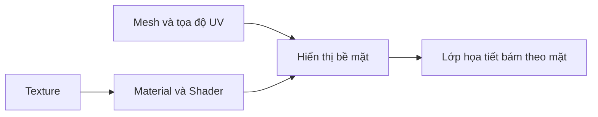

# Bài 02 — Thêm họa tiết lên khuôn mặt (Add a face texture)

> **Lộ trình:** Mobile AR Development · **Chủ đề:** Create a basic face filter · **Môi trường tham chiếu:** Unity 2022.3  
> **Hình thức:** Bài học kết hợp thực hành vật liệu và texture.

## 1. Mục tiêu và bối cảnh

Texture giúp biến một bề mặt 3D trơn thành lớp trang trí có hoa văn, màu sắc hoặc chi tiết. Với face filter, mục tiêu không đơn thuần là đặt một ảnh lên màn hình, mà là làm cho họa tiết **di chuyển và biến dạng theo bề mặt khuôn mặt được theo dõi** khi hệ thống hỗ trợ face mesh.

Sau bài học, bạn có thể phân biệt mesh, material, shader, texture, UV; tạo vật liệu kiểm thử; điều chỉnh tiling/offset; phát hiện lỗi texture bị kéo giãn và giải thích vì sao một ảnh 2D cần tọa độ UV để phủ lên mặt 3D.

## 2. Các khái niệm cốt lõi

| Thuật ngữ | Ý nghĩa | Ứng dụng trong filter |
| --- | --- | --- |
| `Mesh` | Hình học gồm đỉnh và các mặt | Bề mặt 3D để phủ họa tiết |
| `Material` | Cấu hình cách bề mặt được hiển thị | Màu sắc, độ phản chiếu, độ trong suốt |
| `Shader` | Quy tắc tính bề mặt khi render | Quyết định texture và ánh sáng ảnh hưởng thế nào |
| `Texture` | Dữ liệu ảnh hoặc bản đồ thông số | Hoa văn, màu trang điểm, hình trang trí |
| `UV` | Tọa độ 2D ánh xạ lên mesh 3D | Quyết định họa tiết nằm ở đâu và có méo không |
| `Normal Map` | Bản đồ hướng pháp tuyến phục vụ hiệu ứng ánh sáng | Giả lập độ gồ ghề mà không tăng số đa giác |

**Lưu ý:** Sơ đồ trình bày quan hệ khái niệm, không phải thứ tự chính xác của các lệnh render.

## 3. Phân biệt các loại bản đồ

- **Base map/albedo:** tạo màu hoặc hình vẽ nhìn thấy trực tiếp.
- **Normal map:** thay đổi cảm nhận hướng bề mặt với ánh sáng, không đổi hình học thật.
- **Mask:** quy định nơi hoặc mức độ một hiệu ứng xuất hiện; ý nghĩa phụ thuộc shader.
- **Metallic/smoothness:** điều khiển cảm giác kim loại hoặc độ mịn bóng của bề mặt tùy pipeline.

Một sticker hình ngôi sao dán lên má thông thường cần base texture và ánh xạ UV phù hợp. Độ bóng và normal map chỉ là bổ sung nếu phù hợp mục tiêu thị giác.

## 4. Hướng dẫn thực hành

### 4.1. Luyện material trên vật thể đơn giản

1. Tạo material mới trong cửa sổ Project.
2. Gán material lên `Cube` hoặc `Sphere` để dễ quan sát.
3. Điều chỉnh hai giá trị `Smoothness` cách biệt rõ ràng, nếu shader hỗ trợ; ghi lại thay đổi của phản xạ.
4. Nhập ảnh texture có quyền sử dụng phù hợp, gán vào ô bản đồ màu của material.
5. Thử `Tiling` và `Offset` nếu vật liệu cung cấp tùy chọn này.

**Checkpoint:** hình ảnh hiển thị trên vật thể; bạn diễn giải được sự khác nhau giữa thay đổi material và thay đổi mesh.

### 4.2. Đưa texture vào filter khuôn mặt

1. Chuẩn bị hình có vùng màu/độ trong suốt phù hợp mục tiêu (ví dụ hai họa tiết hai má).
2. Nếu dự án hỗ trợ mặt nạ mesh theo khuôn mặt, xác định cách mesh được tạo và cách material được gán cho mesh đó.
3. Kiểm tra UV của mesh thực tế. Cùng một ảnh có thể trông đẹp trên Sphere nhưng bị lệch trên mesh khuôn mặt nếu UV khác nhau.
4. Chọn material/shader phù hợp với render pipeline và nhu cầu transparency. Không giả định mọi shader có sẵn trong mọi dự án.
5. Build lên thiết bị, quan sát khi người dùng quay đầu và thay đổi khoảng cách.

### 4.3. Kiểm thử normal map (tùy chọn)

Nếu có normal map, đặt đúng loại import và gán vào thuộc tính được shader hỗ trợ. So sánh cùng một bề mặt trước/sau khi gán. Đừng nhầm hiệu ứng ánh sáng với thay đổi hình học thật.

## 5. Bảng kiểm tra trực quan

| Hiện tượng | Cần xem xét |
| --- | --- |
| Hoa văn méo hoặc đặt sai chỗ | UV mesh và thiết kế texture |
| Mặt quá bóng | Smoothness, nguồn sáng, shader |
| Không nhìn thấy vùng trong suốt | Alpha của ảnh và chế độ hiển thị material |
| Màu trên thiết bị khác Editor | Render pipeline, ánh sáng, xử lý màu và camera |
| Một chỉnh sửa tác động nhiều vật thể | Các đối tượng đang dùng chung material |
| Normal map trông bất thường | Import type và thuộc tính shader |

Cần kiểm tra từng yếu tố, bắt đầu với một texture màu đơn giản trước khi kết hợp nhiều map.

## 6. Bài tập

**Bài cơ bản:** gán một họa tiết lên Sphere, chụp ảnh ở hai mức Smoothness.  
**Bài vận dụng:** thử thay đổi UV hoặc offset và mô tả vì sao họa tiết bị dịch.  
**Bài mở rộng:** gắn họa tiết vào face mesh thực tế và lưu ảnh minh chứng lúc nhìn thẳng, quay trái, quay phải.

- [ ] Có material và texture hoạt động.
- [ ] Phân biệt được texture và geometry.
- [ ] Quan sát thay đổi theo UV/tiling/offset.
- [ ] Ghi lại tối thiểu một lỗi hiển thị và cách khắc phục.

## 7. Câu hỏi ôn tập

**Câu 1.** Texture bị kéo giãn trên bề mặt khuôn mặt thường liên quan trực tiếp nhất tới yếu tố nào?  
A. Số lượng particle.  
B. Ánh xạ UV.  
C. Quyền microphone.  
D. Animator state.  
**Đáp án: B.** UV xác định cách ảnh 2D phủ lên từng phần của mesh.

**Câu 2.** Normal map có tác dụng chính nào?  
A. Tạo thêm đa giác thật.  
B. Bật camera.  
C. Gắn vật thể vào đầu.  
D. Tạo cảm giác bề mặt gồ ghề qua ánh sáng.  
**Đáp án: D.** Normal map thay đổi cách ánh sáng phản ứng mà không nhất thiết thay đổi geometry.

**Câu 3.** Vai trò của material so với mesh là gì?  
A. Material điều khiển cách bề mặt hiển thị, mesh mô tả hình dạng.  
B. Material luôn có nhiều đỉnh hơn mesh.  
C. Mesh quyết định quyền camera.  
D. Cả hai chỉ lưu hoạt ảnh.  
**Đáp án: A.** Hai thành phần phục vụ hai lớp thông tin khác nhau.

**Câu 4.** Khi nhiều đối tượng đổi màu ngoài ý muốn sau một chỉnh sửa, cần kiểm tra trước hết điều gì?  
A. File build của iOS.  
B. Số face trackable.  
C. Các đối tượng có dùng chung material không.  
D. Rate over Time.  
**Đáp án: C.** Một material dùng chung có thể ảnh hưởng đồng thời nhiều renderer.

**Câu 5.** Vì sao phải kiểm thử texture trên chính face mesh của dự án?  
A. Sphere không hỗ trợ material.  
B. Cách ánh xạ UV và hình học có thể khác vật thể kiểm thử.  
C. Texture không được dùng trên điện thoại.  
D. Face tracking chỉ dùng normal map.  
**Đáp án: B.** Phần trang trí đúng trên primitive chưa bảo đảm đúng trên khuôn mặt.

## 8. Tổng kết

Muốn vẽ họa tiết AR lên mặt, bạn cần đúng **mesh + UV + material/shader + texture** và phải đánh giá bằng camera thật. Khi bị lệch hoặc méo, hãy kiểm tra UV trước khi cố sửa bằng độ bóng hay màu sắc.

---

*Bài học độc lập được biên soạn lại bằng tiếng Việt từ đề cương thực hành. Để đối chiếu lộ trình và tài nguyên chính thức, xem [Unity Learn — Create a basic face filter](https://learn.unity.com/pathway/mobile-ar-development/unit/create-a-basic-face-filter-tutorials?version=2022.3). Nội dung này không phải bản chép hay bản dịch chính thức của Unity.*
