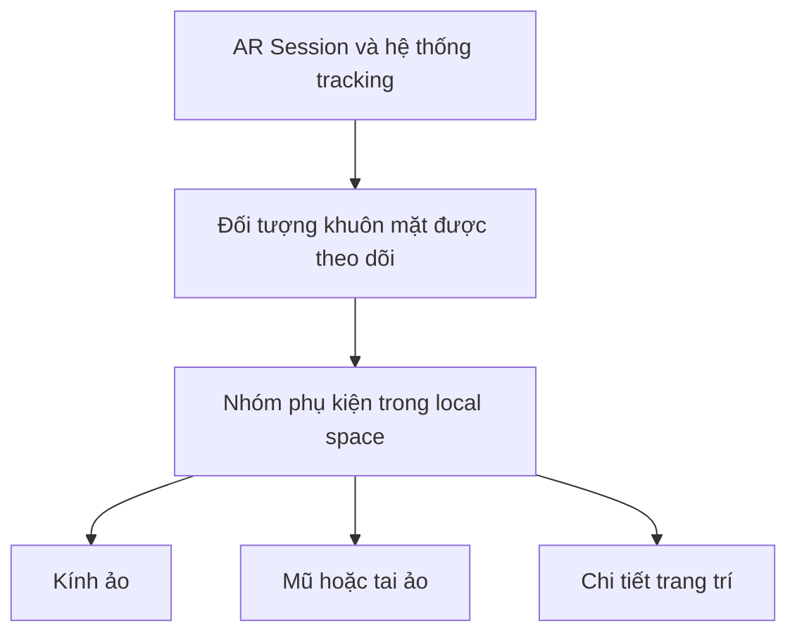

# Bài 03 — Thêm phụ kiện cho bộ lọc khuôn mặt (Add accessories to your filter)

> **Lộ trình:** Mobile AR Development · **Chủ đề:** Create a basic face filter · **Môi trường tham chiếu:** Unity 2022.3  
> **Hình thức:** Hướng dẫn thực hành AR.

## 1. Mục tiêu

Một bộ lọc trở nên sinh động khi có kính, mũ, tai động vật hoặc vật thể 3D chuyển động cùng đầu người dùng. Khó khăn chính là **đặt phụ kiện theo tọa độ của khuôn mặt đang được theo dõi**, thay vì tọa độ toàn cục trong scene.

Bạn sẽ luyện cách tổ chức hierarchy, chỉnh local transform, kiểm thử ở nhiều góc mặt và xử lý tình huống mất tracking.

## 2. Cơ chế gắn phụ kiện

`Transform` gồm vị trí, góc xoay và tỷ lệ. Nếu phụ kiện là con của đối tượng khuôn mặt, transform của phụ kiện được diễn giải tương đối so với gốc cha; khi gốc cha cập nhật theo mặt, phụ kiện có thể di chuyển theo. Tọa độ cụ thể và tỷ lệ phải được hiệu chỉnh theo mô hình, không có một bộ số dùng chung cho mọi loại phụ kiện.

| Thuộc tính | Cách dùng | Dấu hiệu sai |
| --- | --- | --- |
| Local Position | Dịch phụ kiện so với gốc mặt | Kính nổi quá xa hoặc xuyên vào mặt |
| Local Rotation | Căn hướng phụ kiện | Mũ bị nghiêng, kính ngược |
| Local Scale | Đổi kích thước tương đối | Phụ kiện quá to/nhỏ khi nhìn chính diện |
| Parent | Chọn đối tượng phụ kiện đi theo | Phụ kiện cố định khi người dùng xoay đầu |

## 3. Chuẩn bị phụ kiện

Chọn model đơn giản, ít chi tiết để thử nghiệm trên thiết bị di động. Kiểm tra đơn vị, trục hướng của model, material và bản quyền tài sản. Đừng bắt đầu bằng model phức tạp trước khi kiểm chứng được đối tượng thử nhỏ bám theo mặt.

## 4. Thực hành

1. **Xác nhận tracking:** sử dụng scene đã có phiên AR, camera và khả năng theo dõi mặt. Chạy bản build tối giản trước.
2. **Đặt phụ kiện:** tạo hoặc nhập kính/mũ 3D và đặt dưới nhóm nội dung gắn với face trackable. Nếu hệ thống tạo đối tượng khuôn mặt động, cấu hình để các phụ kiện thuộc đối tượng được sinh ra hoặc được gắn với nó.
3. **Căn chỉnh:** bắt đầu với local position/rotation/scale mặc định, sau đó chỉ sửa một thuộc tính mỗi lần. Xem camera ở tư thế chính diện.
4. **Kiểm tra hướng:** thử xoay trái/phải, cúi/ngẩng đầu và tiến/lùi. Ghi xem phụ kiện có bám ổn định không.
5. **Xử lý mất mặt:** thiết kế hành vi ẩn/ngừng hiển thị phụ kiện khi không có tracking hợp lệ, tránh để vật thể đứng lơ lửng không rõ lý do.
6. **Đánh giá hiệu năng:** đo trên điện thoại, chú ý số mesh, vật liệu và mức độ phức tạp của model.

**Ví dụ:** với chiếc kính ảo, yêu cầu thị giác là hai mắt kính nằm tương đối cân đối theo khuôn mặt ở cả góc nhìn thẳng và góc nghiêng. Không nên kết luận thành công chỉ từ một khung hình tĩnh.

## 5. Ma trận kiểm thử

| Trường hợp | Cần xác minh |
| --- | --- |
| Mặt nhìn thẳng | Phụ kiện cân đối, đúng kích cỡ |
| Quay đầu trái/phải | Phụ kiện di chuyển và xoay nhất quán |
| Cúi và ngẩng | Không lộ lỗi xoay trục hoặc offset quá lớn |
| Rời khung hình | Không còn phụ kiện trôi nổi |
| Ánh sáng thay đổi | Quan sát độ ổn định của tracking |
| Máy nóng/chậm | Chú ý giảm độ phức tạp 3D nếu cần |

## 6. Lỗi và phương pháp gỡ lỗi

**Phụ kiện không di chuyển:** xem parent và việc liên kết pose với face trackable. **Phụ kiện bị lệch:** xem gốc trục, local transform, hướng xuất model. **Không hiển thị:** kiểm tra GameObject active, renderer, camera, material. **Chỉ sai trên điện thoại:** kiểm tra provider, kích thước và render pipeline trên thiết bị thật.

Mỗi lần debug hãy ghi **kết quả mong đợi → thực tế → giả thuyết → thay đổi → kết quả mới**.

## 7. Bài tập và checklist

- [ ] Có ít nhất một phụ kiện 3D gắn theo mặt.
- [ ] Thực hiện hiệu chỉnh local transform có lý do.
- [ ] Thử tối thiểu ba tư thế đầu khác nhau.
- [ ] Kiểm tra tình trạng mất tracking.
- [ ] Lưu ảnh/video và ghi chú một lỗi.

**Thử thách:** thêm hai phụ kiện khác nhau, ví dụ kính và mũ; kiểm tra xem chúng có giữ quan hệ vị trí ổn định với cùng một khuôn mặt không.

## 8. Câu hỏi ôn tập

**Câu 1.** Vì sao nên để phụ kiện trong hệ tọa độ của đối tượng khuôn mặt?  
A. Để tự động tăng FPS.  
B. Để không cần material.  
C. Để không cần quyền camera.  
D. Để phụ kiện được cập nhật cùng tư thế khuôn mặt.  
**Đáp án: D.** Parent/pose đúng giúp nội dung đi theo mặt thay vì đứng yên trong scene.

**Câu 2.** Kính bị lệch sang một bên nhưng vẫn xoay theo đầu. Thành phần nào cần kiểm tra trước?  
A. Local Position và gốc model.  
B. Particle emission.  
C. Color grading.  
D. Tên project.  
**Đáp án: A.** Tracking hoạt động nhưng vị trí tương đối có thể chưa phù hợp.

**Câu 3.** Test nào giúp phát hiện lỗi thiết lập trục quay?  
A. Chỉ chụp màn hình đứng yên.  
B. Chỉ đổi màu kính.  
C. Xoay, cúi và ngẩng đầu.  
D. Chỉ kiểm tra tốc độ mạng.  
**Đáp án: C.** Chuyển động đa hướng làm lộ sai lệch rotation/axis.

**Câu 4.** Khi khuôn mặt rời khung hình, thiết kế nào hợp lý nhất?  
A. Giữ kính mãi ở vị trí cuối.  
B. Có hành vi hiển thị phù hợp với trạng thái mất tracking.  
C. Tăng số object liên tục.  
D. Thêm nhiều normal map.  
**Đáp án: B.** Trạng thái tracking là điều kiện hiển thị cốt lõi của trải nghiệm AR.

**Câu 5.** Vì sao nên bắt đầu với model 3D đơn giản?  
A. Để thay thế AR Session.  
B. Để không cần build.  
C. Để UV luôn chính xác.  
D. Để cô lập lỗi tracking/transform và giảm chi phí render.  
**Đáp án: D.** Vật thể đơn giản dễ quan sát và dễ kiểm soát hiệu năng.

## 9. Tổng kết

Phụ kiện thành công không chỉ xuất hiện trên màn hình: nó phải **bám đúng vị trí, xoay theo đầu, có tỷ lệ phù hợp và ứng xử tốt khi tracking thay đổi**. Hãy ưu tiên đúng hierarchy và local transform trước khi làm đẹp model.

---

*Bài học độc lập được biên soạn lại bằng tiếng Việt từ đề cương thực hành. Để đối chiếu lộ trình và tài nguyên chính thức, xem [Unity Learn — Create a basic face filter](https://learn.unity.com/pathway/mobile-ar-development/unit/create-a-basic-face-filter-tutorials?version=2022.3). Nội dung này không phải bản chép hay bản dịch chính thức của Unity.*
