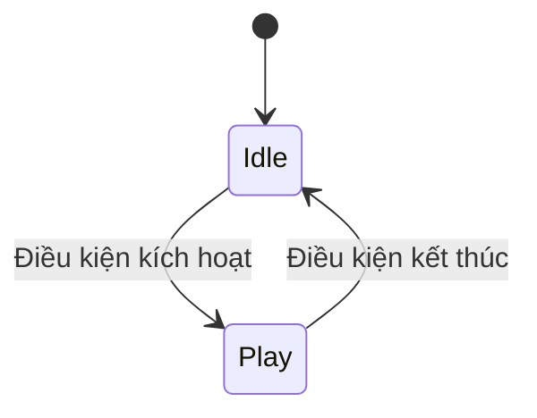

# Bài 04 — Thêm hoạt ảnh cho bộ lọc (Add animations to your filter)

> **Lộ trình:** Mobile AR Development · **Chủ đề:** Create a basic face filter · **Môi trường tham chiếu:** Unity 2022.3  
> **Hình thức:** Bài học và bài thực hành Animation.

## 1. Mục tiêu

Animation giúp kính, tai, vương miện hoặc chi tiết của bộ lọc chuyển động có chủ ý. Hoạt ảnh này **khác** với việc toàn bộ phụ kiện tự di chuyển do hệ thống theo dõi khuôn mặt: tracking cập nhật tư thế đầu, còn animation thay đổi thuộc tính của đồ vật theo thời gian.

Bạn sẽ tạo clip đơn giản, phân biệt `Animation Clip` và `Animator Controller`, thiết lập trạng thái/transition và kiểm tra hiện tượng clip ghi đè transform ngoài ý muốn.

## 2. Nguyên lý hoạt động

| Thành phần | Vai trò |
| --- | --- |
| `Animation Clip` | Chứa chuỗi keyframe của thuộc tính theo thời gian |
| `Animation` window | Nơi tạo/chỉnh keyframe của clip |
| `Animator Controller` | Sơ đồ trạng thái và điều kiện chuyển animation |
| `Parameter` | Giá trị dùng để điều khiển chuyển trạng thái |
| `Transition` | Liên kết giữa các trạng thái hoạt ảnh |
| `Rig/Avatar` | Cần quan tâm khi dùng mô hình nhân vật có hệ xương |

Sơ đồ trên là một ví dụ tổ chức hành vi, không mặc định rằng Unity tự tạo hai state hay các điều kiện đó.

## 3. Thực hành tạo hoạt ảnh

### 3.1. Tạo clip đầu tiên

1. Chọn một chi tiết phụ kiện riêng, ví dụ ngôi sao nằm trên mũ, thay vì chính đối tượng face tracking.
2. Mở `Animation` window và tạo clip mới.
3. Đặt hai keyframe cho thuộc tính dễ quan sát, chẳng hạn vị trí local hoặc tỷ lệ, tại hai thời điểm khác nhau.
4. Xem trước chuyển động. Giải thích bằng lời vì sao đối tượng thay đổi qua thời gian.

**Cảnh báo:** nếu animate trực tiếp transform do hệ thống AR quản lý, animation có thể tranh quyền ghi thuộc tính với tracking. Nên animate một GameObject con của nội dung được gắn theo mặt.

### 3.2. Dùng Animator Controller

Tạo hai trạng thái mang tính minh họa: `Idle` và `Play`. Gán clip tương ứng, thêm parameter và cấu hình transition theo nhu cầu. Xác nhận state đang hoạt động và điều kiện có thể khiến chuyển state. Các tùy chọn chuyển cụ thể phụ thuộc cách bạn tổ chức controller.

### 3.3. Kết hợp với filter

Đặt object hoạt ảnh bên trong nhóm phụ kiện bám theo khuôn mặt. Trong quá trình test, quan sát đồng thời: (1) cả nhóm bám theo mặt; (2) chi tiết bên trong chạy hoạt ảnh tương đối với nhóm. Đây là hai cơ chế khác nhau.

### 3.4. Trường hợp model ngoài

Nếu dùng nhân vật hoặc đối tượng có xương, kiểm tra `Import Settings > Rig` và `Animation`. Không bắt buộc có `Avatar` cho mọi hoạt ảnh transform đơn giản; nhu cầu rig/Avatar tùy loại model.

## 4. Thử nghiệm và debug

| Dấu hiệu | Cách kiểm tra |
| --- | --- |
| Không có chuyển động | Clip có keyframe? Animator và controller có gắn đúng? |
| Hoạt ảnh không chuyển state | Parameter và điều kiện transition có khớp? |
| Object bị giật khi tracking | Clip có đang chỉnh transform cấp cha của face tracking? |
| Chuyển động sai hướng | Thuộc tính local/world hoặc trục model không phù hợp |
| Model rigged không phát đúng | Loại rig, Avatar/mapping và clip import |

Ghi lại một đoạn video ngắn của chuyển động và một ảnh màn hình Animator khi transition xảy ra.

## 5. Thử thách

- [ ] Tạo được clip với ít nhất hai keyframe và xem trước thành công.
- [ ] Cấu hình controller có hai state và một điều kiện chuyển.
- [ ] Kết hợp hoạt ảnh với vật thể đang bám theo khuôn mặt.
- [ ] Chứng minh rằng animation của chi tiết không phá vỡ tracking của nhóm.

**Bài mở rộng:** tạo ngôi sao nhấp nhô nhẹ trên mũ. Dự đoán khác biệt giữa animate `localPosition` và thay đổi vị trí của cả đối tượng khuôn mặt.

## 6. Câu hỏi ôn tập

**Câu 1.** Cái gì lưu các keyframe theo thời gian?  
A. AR Session.  
B. Texture.  
C. Animation Clip.  
D. Camera permission.  
**Đáp án: C.** Clip mô tả sự thay đổi của thuộc tính theo trục thời gian.

**Câu 2.** Vai trò của Animator Controller là gì?  
A. Điều khiển trạng thái và chuyển tiếp hoạt ảnh.  
B. Tạo face mesh.  
C. Xóa mọi material.  
D. Quản lý quyền camera.  
**Đáp án: A.** Controller tổ chức state machine và các điều kiện chuyển.

**Câu 3.** Đâu là sự phân biệt chính xác giữa tracking và animation?  
A. Tracking luôn chạy nhanh hơn animation.  
B. Animation chỉ dùng trên máy tính.  
C. Cả hai luôn là cùng một thành phần.  
D. Tracking cập nhật pose khuôn mặt; animation thay đổi thuộc tính theo thời gian.  
**Đáp án: D.** Chúng có nguồn điều khiển khác nhau và có thể phối hợp.

**Câu 4.** Vì sao nên animate đối tượng con thay vì gốc tracking?  
A. Vì đối tượng con không có transform.  
B. Để tránh xung đột giữa clip và hệ thống AR cùng chỉnh pose.  
C. Vì mọi clip cần Rig.  
D. Vì AR không dùng hierarchy.  
**Đáp án: B.** Tách hai vai trò giúp tracking duy trì tính nhất quán.

**Câu 5.** Nếu transition không xảy ra, nên kiểm tra gì?  
A. Chỉ pixel của texture.  
B. Chỉ tốc độ mạng.  
C. Parameter và điều kiện transition.  
D. Thứ tự tên file.  
**Đáp án: C.** State machine chỉ chuyển khi điều kiện được thỏa mãn.

## 7. Tổng kết

Để thêm hoạt ảnh AR đáng tin cậy, hãy tổ chức **tracking ở cấp cha, animation ở cấp con**; dùng clip mô tả chuyển động và controller quản lý trạng thái. Luôn kiểm tra cả hoạt ảnh và bám mặt trên thiết bị.

---

*Bài học độc lập được biên soạn lại bằng tiếng Việt từ đề cương thực hành. Để đối chiếu lộ trình và tài nguyên chính thức, xem [Unity Learn — Create a basic face filter](https://learn.unity.com/pathway/mobile-ar-development/unit/create-a-basic-face-filter-tutorials?version=2022.3). Nội dung này không phải bản chép hay bản dịch chính thức của Unity.*
