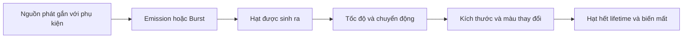

# Bài 05 — Thêm hiệu ứng hạt cho bộ lọc (Add particle effects to your filter)

> **Lộ trình:** Mobile AR Development · **Chủ đề:** Create a basic face filter · **Môi trường tham chiếu:** Unity 2022.3  
> **Hình thức:** Bài học VFX và thực hành Particle System.

## 1. Bối cảnh và mục tiêu

Một bộ lọc khuôn mặt có thể có pháo giấy, ánh lấp lánh, làn khói hoặc những hạt nhỏ bay quanh mũ. Trong Unity, `Particle System` hỗ trợ tạo nhiều phần tử có vòng đời, chuyển động và hình thức khác nhau. Nhưng trên điện thoại, **càng nhiều hạt không đồng nghĩa hiệu ứng càng đẹp**, vì số lượng hạt và cách render ảnh hưởng hiệu năng.

Kết thúc bài, bạn có thể phân biệt phát hạt liên tục và burst; thử `Start Lifetime`, `Start Speed`, `Emission`, `Size over Lifetime`, `Color over Lifetime`; đánh giá số hạt/FPS; và gắn vị trí phát hiệu ứng theo khuôn mặt.

## 2. Các thành phần quan trọng

| Tham số | Ảnh hưởng trực quan |
| --- | --- |
| `Start Lifetime` | Thời gian một hạt tồn tại |
| `Start Speed` | Vận tốc khởi đầu của hạt |
| `Emission` | Cách và lượng hạt được tạo |
| `Burst` | Phát một cụm hạt trong khoảng ngắn |
| `Shape` | Vùng và hình dạng nguồn phát |
| `Size over Lifetime` | Kích thước biến đổi theo tuổi hạt |
| `Color over Lifetime` | Màu/độ trong suốt biến đổi theo tuổi hạt |
| `Renderer/Material` | Cách hạt được hiển thị |

Quy trình trên là vòng đời mô hình hóa của một hiệu ứng, không có nghĩa mọi module bắt buộc phải bật.

## 3. Thực hành từng bước

### 3.1. Tạo hiệu ứng cơ bản

Tạo một `Particle System` gần phụ kiện muốn trang trí. Chọn hình dạng phát dễ quan sát và thử thay đổi lần lượt `Start Lifetime`, `Start Speed`, `Emission`. Sau mỗi lần, chạy lại cùng điều kiện để so sánh. Quan sát cả mật độ hạt lẫn hướng chuyển động.

### 3.2. So sánh hai chế độ phát

- **Emission liên tục:** phù hợp một luồng lấp lánh, mưa, sương hoặc hiệu ứng kéo dài.
- **Burst:** phù hợp một chớp pháo giấy, khoảnh khắc xuất hiện phụ kiện hoặc sự kiện ngắn.

Thử chuyển từ phát liên tục sang một burst. Ghi hình để so sánh: độ dày của hạt, nhịp xuất hiện và thời gian hạt biến mất.

### 3.3. Làm hiệu ứng tự nhiên hơn

Bật `Size over Lifetime` để hạt có thể lớn dần hoặc nhỏ đi; bật `Color over Lifetime` để thay đổi màu hoặc mờ dần. Điều chỉnh từ ít đến nhiều, tránh kết hợp quá nhiều biến khi chưa hiểu tác dụng từng biến.

### 3.4. Gắn với khuôn mặt

Đặt điểm phát hạt trong nhóm nội dung của face filter nếu bạn muốn nguồn phát đi theo khuôn mặt. Sau đó quan sát hành vi những hạt **đã phát ra** khi đầu xoay: chúng có thể biểu hiện khác nhau tùy cấu hình không gian mô phỏng của hệ hạt. Cần chọn cách ứng xử theo mục tiêu thị giác, không cho rằng mọi hạt đều phải dính chặt vào đầu.

### 3.5. Đánh giá hiệu năng

Build lên điện thoại, thử với ít và nhiều hạt, theo dõi frame time/FPS và mức độ giật. Nếu hiệu ứng quá nặng, giảm mật độ, thời gian tồn tại hoặc độ phức tạp material trước khi thêm tính năng mới. `VFX Graph` có thể phù hợp một số dạng hiệu ứng mật độ cao, nhưng khả năng sử dụng tùy render pipeline và nền tảng.

## 4. Bài tập so sánh

| Phiên bản | Thiết lập chính | Kết quả cần ghi nhận |
| --- | --- | --- |
| A | Phát liên tục, hiệu ứng đơn giản | Mật độ, nhịp hạt, FPS |
| B | Burst, thời gian tồn tại ngắn | Cảm giác bùng nổ và biến mất |
| C | Thêm biến thiên size và color | Độ mượt và diễn biến thị giác |
| D | Gắn nguồn phát theo mặt | Khả năng bám khuôn mặt và hiệu năng |

Không cần dùng một con số emission cố định cho mọi máy; hãy chọn thông số dựa trên quan sát thực tế.

## 5. Lỗi thường gặp

**Không nhìn thấy hạt:** xem active state, vị trí nguồn phát, camera, renderer và material. **Hạt quá dày:** giảm emission và lifetime. **Hạt lệch khi quay mặt:** kiểm tra parent của nguồn phát và chế độ không gian mô phỏng. **Hiệu ứng tụt FPS:** ghi nhận số hạt hiển thị và thời gian frame trên thiết bị, thử đơn giản hóa renderer/material.

## 6. Checklist hoàn thành

- [ ] Tạo một Particle System nhìn thấy được.
- [ ] Thử hai cách emission: liên tục và burst.
- [ ] Quan sát size/color theo lifetime.
- [ ] Gắn nguồn phát với phụ kiện/khuôn mặt khi phù hợp.
- [ ] Ghi lại ảnh/video và ít nhất một quan sát hiệu năng.

## 7. Câu hỏi ôn tập

**Câu 1.** Hiệu ứng bắn pháo giấy đúng thời điểm thường thích hợp với cấu hình nào?  
A. Normal Map.  
B. Burst.  
C. Rig Avatar.  
D. UV offset.  
**Đáp án: B.** Burst phát một cụm hạt trong một thời điểm ngắn.

**Câu 2.** Thuộc tính nào quyết định hạt tồn tại trong bao lâu?  
A. Start Lifetime.  
B. XR Origin.  
C. Animator Controller.  
D. Tiling.  
**Đáp án: A.** Lifetime là khoảng sống của mỗi hạt.

**Câu 3.** Vì sao hạt đã phát có thể không đi theo đầu dù nguồn phát bám mặt?  
A. Vì mọi texture đều sai.  
B. Vì camera đang tắt.  
C. Vì keyframe bị thiếu.  
D. Vì cách mô phỏng hạt có thể dùng một không gian tọa độ khác.  
**Đáp án: D.** Cần phân biệt transform của nguồn phát và không gian mô phỏng hạt.

**Câu 4.** Đâu là bước hợp lý khi Particle System gây tụt FPS?  
A. Thêm nhiều hiệu ứng mới.  
B. Bỏ qua thiết bị thật.  
C. Giảm mật độ hạt, lifetime hoặc chi phí render và đo lại.  
D. Đổi tên material.  
**Đáp án: C.** Những thay đổi này trực tiếp giảm tải mô phỏng/hiển thị.

**Câu 5.** `Color over Lifetime` được dùng để làm gì?  
A. Đặt quyền truy cập camera.  
B. Thay đổi màu hoặc alpha theo tuổi hạt.  
C. Tạo hệ xương.  
D. Thay scene khi build.  
**Đáp án: B.** Thuộc tính này định nghĩa diễn biến màu trong vòng đời hạt.

## 8. Tổng kết

Hiệu ứng hạt đẹp cần có **nhịp phát phù hợp, vòng đời có chủ đích, vị trí gắn đúng và chi phí render hợp lý**. Việc test FPS trên điện thoại nên tiến hành song song với tinh chỉnh thị giác.

---

*Bài học độc lập được biên soạn lại bằng tiếng Việt từ đề cương thực hành. Để đối chiếu lộ trình và tài nguyên chính thức, xem [Unity Learn — Create a basic face filter](https://learn.unity.com/pathway/mobile-ar-development/unit/create-a-basic-face-filter-tutorials?version=2022.3). Nội dung này không phải bản chép hay bản dịch chính thức của Unity.*
